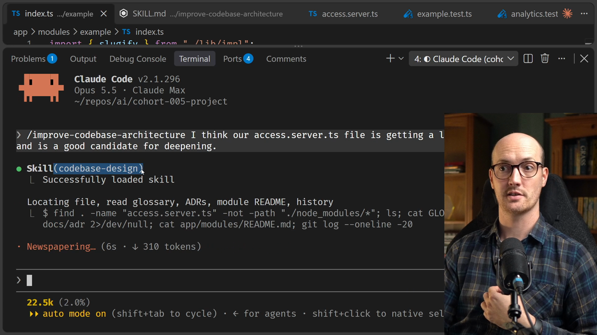
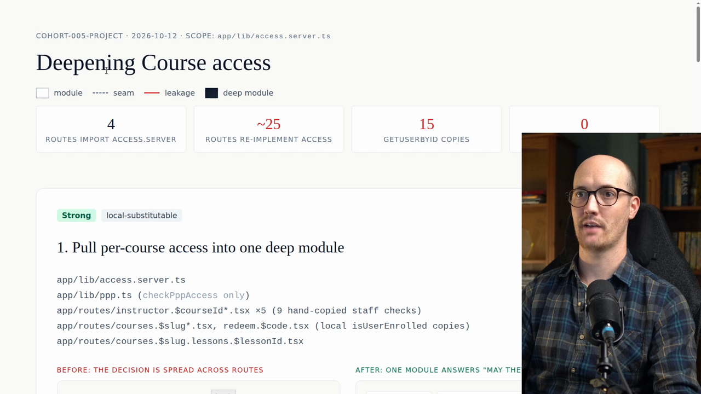
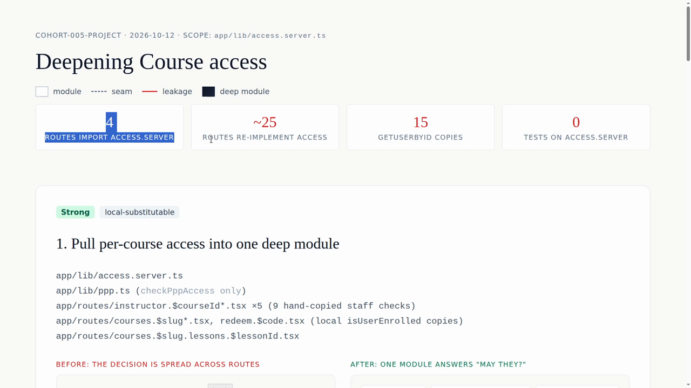
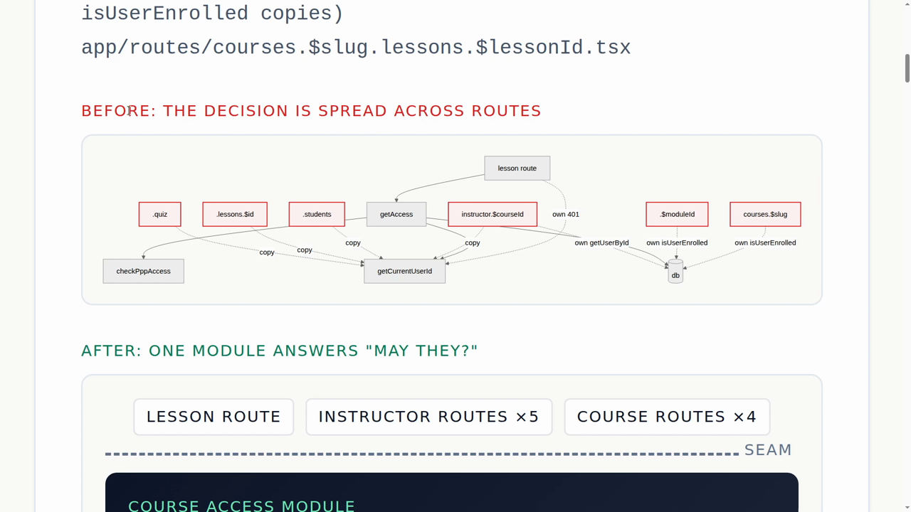
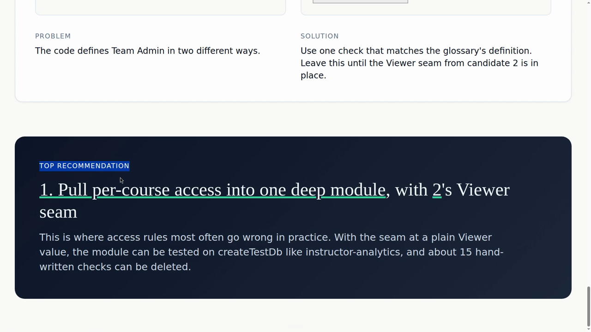
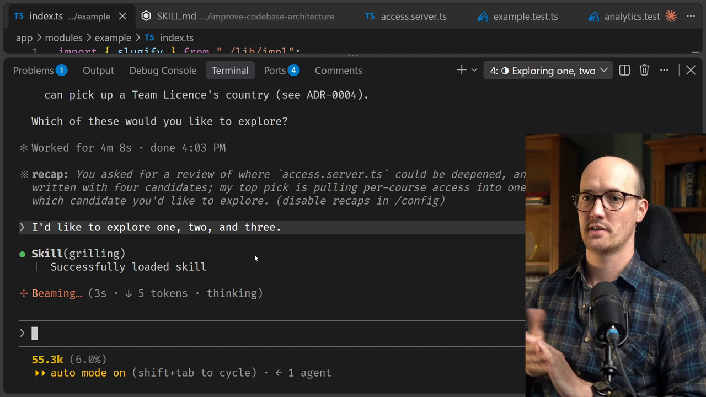

# The /improve-codebase-architecture Skill Solution

<CommitMap packageManager="npm">
  <Commit id="wire-deep-module-boundary">Start the lesson: the repo state before running `/improve-codebase-architecture`. The run makes no code changes, so you stay here for the whole video</Commit>
</CommitMap>

## Running the skill with a prompt

Let's run the [skill](https://www.aihero.dev/ai-coding-dictionary/skill) and pick a prompt.

```txt
/improve-codebase-architecture I think our access.server.ts file is getting a little bit out of control and is a good candidate for deepening.
```

Honestly, that might be enough here. We can see the [agent](https://www.aihero.dev/ai-coding-dictionary/agent) has invoked `/codebase-design`, so it has the entire glossary. That's great.



### Do you need a prompt?

Usually with `/improve-codebase-architecture`, you don't have a specific file that you want to go for. It's designed so that you can run it on any codebase, even without a prompt. Just say `/improve-codebase-architecture` and it will go and do its thing.

In this case, because this is a linear course that needs to follow a specific path, I've seeded it with the exact thing that I want.

Sometimes you will notice an egregious example, maybe in [human review](https://www.aihero.dev/ai-coding-dictionary/human-review), and you'll decide you need to improve the codebase architecture at that specific spot.

## The report

The [subagent](https://www.aihero.dev/ai-coding-dictionary/subagent) it dispatched has finished, and the report is ready. I will warn you, these show up in light mode, so be prepared.

Here it is: Deepening Course Access.



### The stats at the top

We have some nice stats at the top:

| Stat | What it says |
| --- | --- |
| 4 | routes import `access.server` |
| ~25 | routes re-implement access |
| 15 | copies of a `getUserById` function |
| 0 | tests on `access.server` |

So yes, that seems real bad.



## Candidate 1: pull per-course access into one deep module

There's a before and after here. In the before, a decision is spread across lots of routes. Many of them talk directly to the database, and many copy the `getUserById` function. There's a bunch of duplication.

In the after, there's a single module that answers the question "may they?". That's quite a charming way to say authorization, I suppose.



It's proposing a small interface on a course access module, which the lesson route, the five instructor routes and the course routes can all call. It has its database injected, and it uses the `createTestDb` function in tests.

### Problem and solution

The problem and solution are pretty clear and easy to read.

- **Problem:** the module is shallow and only four routes use it. Each caller works out access in its own way, so the rules disagree. The lesson route still sends the lesson body to visitors who can't view the content.
- **Solution:** move "what may this person do on this course" into a module in `app/modules/`, with the database injected the same way as `instructor-analytics`.

### Locality and leverage

We can also see the locality win and the leverage win.

- **Locality:** there is one place for all of the access rules. That is very important. We're going to delete nine copied access checks.
- **Leverage:** we're going to have a single interface and 15 call sites.

So this deep module is going to become incredibly important in our codebase.

## Candidate 2: split "who is asking" from "what may they do"

This is not the only proposal. We have others.

In the before, every route passes the request itself. It grabs the cookie `userId`, and every route throws its own 401. There are 18 throws with four different wordings. Jeez.

Afterwards, we have a single function that turns a request into a viewer.

In plain text, the problem is that `getCurrentUserId` is the real way into access, and it's a shallow pass-through over the cookie session. Every route adds its own 401, a user lookup and a role check on top.

The solution is one small module that turns a request into a viewer. This means that every time we worry about course access, we don't have to pass the request inside it. We just take the viewer instead.

It also handles error handling. Any 401s, any denial of access, we put in this function too.

Again, I would say this is a very, very good idea.

## Candidate 3: name and unify the purchase country rule

Down here, we've got one that's worth exploring: name and unify the purchase country rule.

The problem is that the glossary has no name for the PPP block. Three call sites compare countries with different rules for an unknown country.

To be honest, this does seem pretty bad. The three sites have different logic for how to recalculate PPP, purchasing power parity.

The wins here:

- Locality: the country rule now lives in one place.
- Accidental differences disappear.
- We get to fill out our glossary a little bit, which is nice.

## Candidate 4: skipped

Yes, we could have one definition for team admin, but I'm going to skip over this because it's marked itself as only speculative.

## The top recommendation

It finishes with its top recommendation, which is to pull per-course access into one deep module. But it also says we should do number 2, the viewer seam.

I agree. I think that is very, very smart.



## Exploring candidates 1, 2 and 3

I'm going back into my agent, and I'm going to go with one, two and three. I'll just say that to it.

```txt
I'd like to explore one, two, and three.
```

Let's see what it does. We've entered a [grilling](https://www.aihero.dev/ai-coding-dictionary/grilling) session. It is doing a touch more exploring, and yes, we're grilling again.



### Where this fits in the workflow

At this point in the course, we know what grilling looks like, and we know what domain modeling looks like. We would then grill, turn this into a [spec](https://www.aihero.dev/ai-coding-dictionary/spec) with `/to-spec`, break it into [tickets](https://www.aihero.dev/ai-coding-dictionary/ticket) with `/to-tickets`, and implement it with `/implement-spec`.

Refactors tend to be pretty [token](https://www.aihero.dev/ai-coding-dictionary/token) hungry, so I pretty much always default to spec and tickets for them.

## Why the shared language matters

Hopefully you can see how the language we've been using really benefits us when we look at these diagrams.

They can be pretty hard to read if you don't understand what a good codebase looks like, what we're trying to aim for, and what deep modules even are.

I encourage you to run this on your own codebase. Don't even prompt it. Just let it do its thing and see if you like the things that come back.

Every time you look at one of these, you are in the process of making your application better for your agents to work with. With that, you're going to end up with better tests, better features and better performance from your agents.

Nice work, and I'll see you in the next one.

