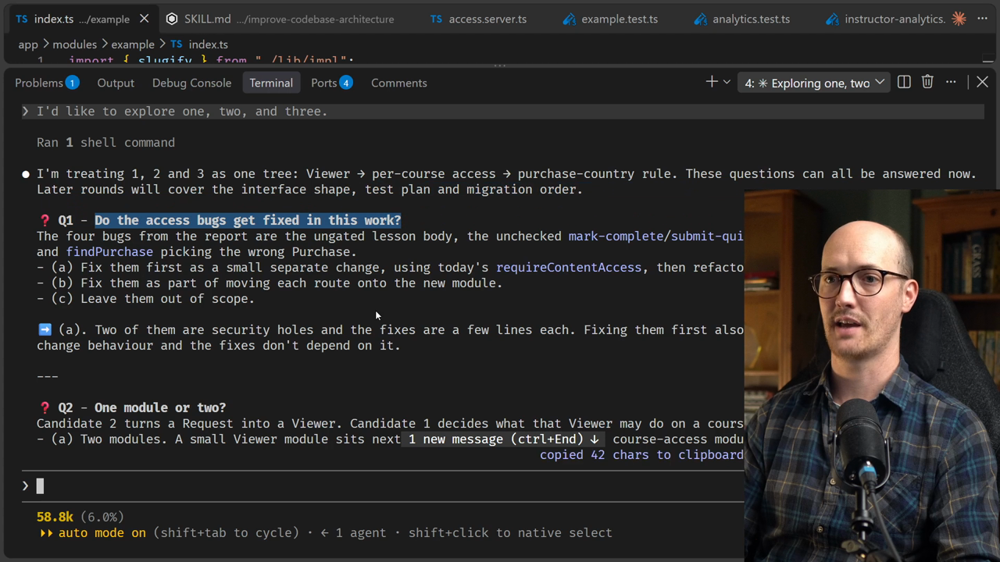
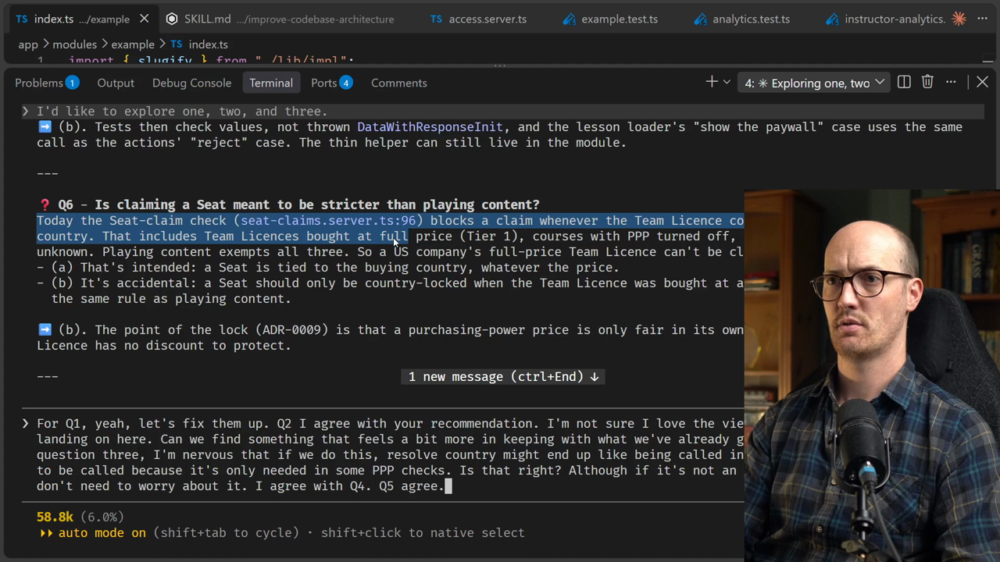
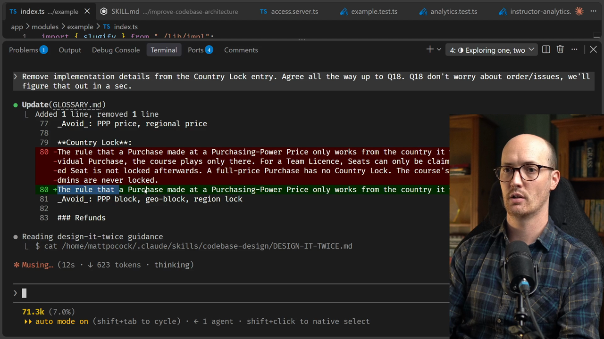
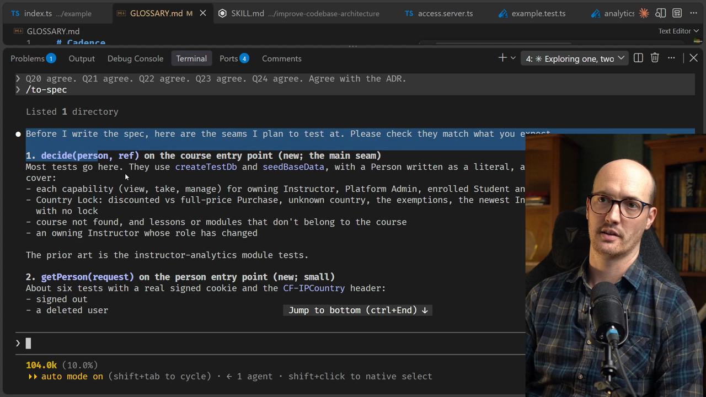
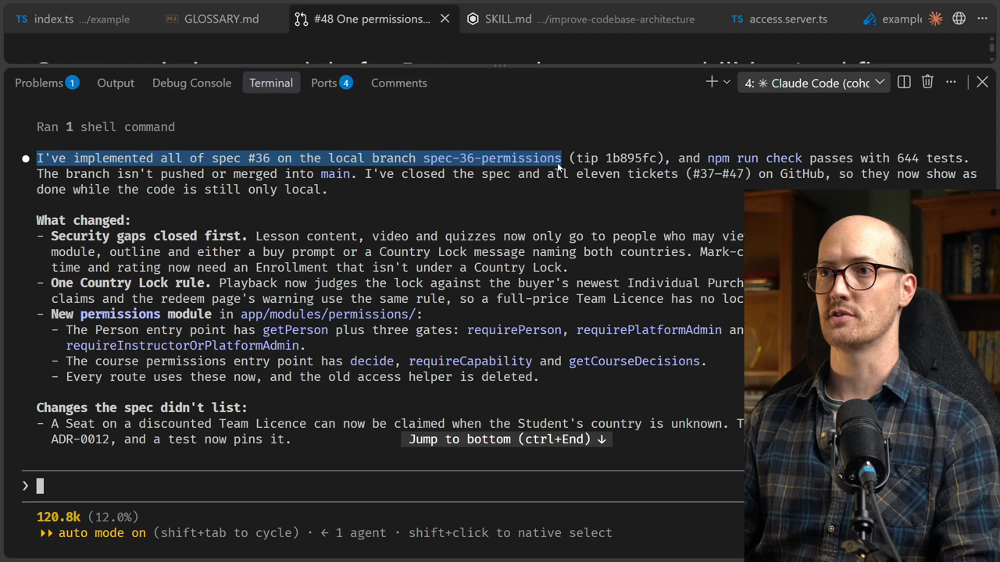
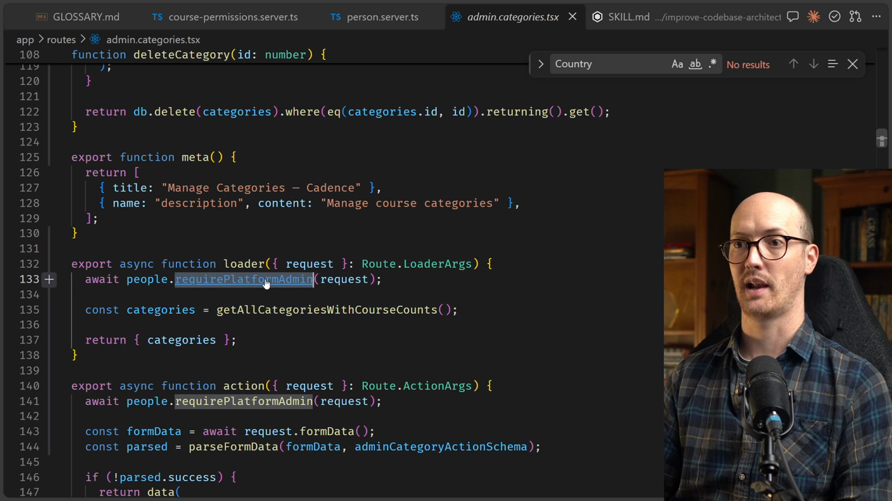
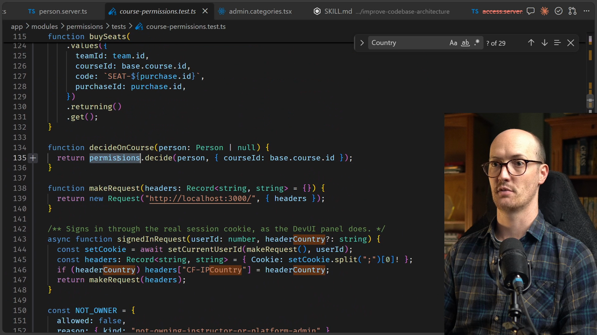

# /implement-spec For Refactors

<CommitMap packageManager="npm">
  <Commit id="wire-deep-module-boundary">Start the lesson: with the deep module boundary in place and no permissions spec yet</Commit>
  <Commit id="add-country-lock-terms">See the grilling's output: Person, Purchasing-Power Price and Country Lock in the glossary, plus ADR-0013</Commit>
  <Commit id="spec-to-shipped-fix">See my solution: the `permissions` module with every route moved onto it</Commit>
</CommitMap>

<Prerequisites title="Crash Course Prerequisites">
  <Prerequisite href="https://www.aihero.dev/workshops/ai-coding-crash-course/the-grill-execute-clear-loop-fac85414">
    How grilling works: the agent interviews you until you both share the same design.
  </Prerequisite>
  <Prerequisite href="https://www.aihero.dev/workshops/ai-coding-crash-course/how-to-tackle-massive-tasks-6199ee6b">
    Why big work splits into a spec (the destination) and tickets (the journey).
  </Prerequisite>
  <Prerequisite href="https://www.aihero.dev/workshops/ai-coding-crash-course/write-great-specs-with-this-skill-362ad013">
    What a spec contains and how `/to-spec` writes one.
  </Prerequisite>
  <Prerequisite href="https://www.aihero.dev/workshops/ai-coding-crash-course/split-features-across-context-windows-with-tickets-d9aa8395">
    How `/to-tickets` splits a spec into vertical-slice tickets.
  </Prerequisite>
  <Prerequisite href="https://www.aihero.dev/workshops/ai-coding-crash-course/the-implement-spec-skill-47372df2">
    What `/implement-spec` does: runs every ticket with subagents and code review.
  </Prerequisite>
</Prerequisites>

## Picking up where the last lesson left off

This lesson finishes exactly where the previous one stopped. We finish the [grilling](https://www.aihero.dev/ai-coding-dictionary/grilling) session, turn it into a [spec](https://www.aihero.dev/ai-coding-dictionary/spec) and [tickets](https://www.aihero.dev/ai-coding-dictionary/ticket), and then implement the spec.

This one is here for the completionists. Some people want to see lots of code being made and watch the whole process end to end.

If you're not one of those people, feel free to skip it. But if you fancy watching along while I code this up, let's do it.



## Finishing the grilling: Q1 to Q8

Q1 asks whether the access bugs get fixed in this work. Yes, let's fix them up.

Q2 asks whether we want one module or two. If you remember from the previous video, candidate two turns a request into a viewer, and candidate one decides what the viewer may do on a course.

Its recommendation is B: one module with two entry points. I think that's right, because this code belongs together. It's all the same stuff.

### Q3: does the viewer carry the current country?

Here we can really tell that we're landing on this "viewer" language, and that we need to do a bit of domain modeling.

I'm not sure I love the viewer language. Can we find something that feels more in keeping with what we already have in our glossary?

I also had a worry about Q3. If we do this, `resolveCountry` might end up being called in places where it doesn't need to be, because it's only needed in some PPP checks. Is that right?

Although if it's not an expensive call, maybe we just don't need to worry about it.

### Q4: naming "owning instructor or platform admin"

This is more domain modeling. Should we call this something like a **course steward**, or have no term at all and just name the capabilities instead? Can manage the course, can moderate discussions.

It recommends B, and I agree. There's no reason to go nuts adding terms when you don't need them.

### Q5: throw or return a decision?

Does course access throw, or does it return a decision? Returning a plain decision is probably fine.

### Q6: claiming a seat

The next one asks whether claiming a seat is meant to be stricter than playing content.

Today the seat claim check blocks a claim whenever the team license country differs from the student's country. That is bad. It's accidental, so it's right to question it.



### Q7 and Q8: more bugs turning up

Zooming down to question seven, it looks like we're turning up a ton of bugs.

Students on a claimed seat have no purchase of their own, so `getAccess` never blocks them. They're checked once when they claim the seat and never again.

I guess it's saying to leave it, so I'm going to agree with its recommendation.

Question 8 is another inconsistency. Platform admins are currently shut out of some things. That seems really weird, because a platform admin should be able to access everything.

## Q9 to Q14: Person, capabilities and terminology

Q9 asks what we call the signed-in person instead of "viewer".

The glossary already has four roles: student, instructor, platform admin and team admin. But it has no word for whoever the request is from. It already uses "person" informally, so I agree with its recommendation of **Person**.

Q10 asks which per-course capabilities the module answers. I agree with the recommendation, it looks sensible.

Q11 is about where to put some code. I don't really mind, so I'm going with the recommendation.

### Q12: naming the rule in the glossary

What is the rule called in the glossary? Its recommendation is two terms:

- **Purchasing-Power Price**: the discounted price set by the buyer's country.
- **Country Lock**: a purchase bought at a purchasing-power price can only be used from the country it was bought in.

Those are superb. I really like the terms it came up with.

[Agents](https://www.aihero.dev/ai-coding-dictionary/agent) are really good at brainstorming domain modeling terminology. Those would have taken me a bit longer to come up with.

Q13 is about the empty state, so I'm going to agree. Q14 looks like a sensible recommendation, so I'm agreeing there too.

## Updating the glossary

The agent now pulls in the `/domain-modeling` [skill](https://www.aihero.dev/ai-coding-dictionary/skill) and updates `GLOSSARY.md`. We've got our Purchasing-Power Price and our Country Lock.

As always, we do a quick scan to make sure there are no implementation details in there. The Country Lock entry felt a bit fat, so I told the agent to reduce it.

Here is the cleaner version:

```md
**Country Lock**:
The rule that a Purchase made at a Purchasing-Power Price only works from the country it was bought in.
_Avoid_: PPP block, geo-block, region lock
```

That's much cleaner. It isn't going to change over time when the implementation updates.



## Design it twice

Now we're getting somewhere. The agent is asking about the module and entry point names, and I really like what it proposes.

There's a neat trick hidden in the `/codebase-design` skill, or maybe the `/improve-codebase-architecture` skill: should it design the interface twice?

There's a chapter on "design it twice" in *A Philosophy of Software Design*. You design the same interface twice, play around with both, and maybe take the best ideas from each.

That was pretty costly in the pre-AI age. In the AI age, it's just [tokens](https://www.aihero.dev/ai-coding-dictionary/token). You dispatch two [subagents](https://www.aihero.dev/ai-coding-dictionary/subagent), they create different interfaces, and you pick the best ones.

I'd forgotten that was in the skill because it doesn't come up very often, so let's definitely try it.

### How do we test it?

Yes, this all looks sensible. We're in the "yes, yes, yes" phase of the grilling.

Q18 and Q19 are essentially about how we track the work. We already know how we're going to do that: turn it into a spec and tickets.

### Three interfaces

It's designing a couple of interfaces. In fact it went for three, which is very fun:

- One with the smallest possible interface.
- One built for flexibility.
- One that makes the most common caller trivial.

This is a very important function. It's going to be called in nearly every route going forwards, so it's best to burn some tokens to get the right one.

Design A is flexibility, where callers ask about actions:

```ts
const person = await persons.require(request);
await coursePermissions.require(person, { slug }, "lesson.complete");
```

Design B, minimal, has a `demand` function and `courseCapabilities.of`:

```ts
const { course } = demand(
  courseCapabilities.of(await people.get(request), { courseId, moduleId }),
  "manage"
);
```

Design C is the common caller, with `requireCapability` and `requirePlatformAdmin`:

```ts
const { course } = await requireCapability(request, "manage", {
  courseId: params.courseId,
});
```

I mostly don't review these much, unless I want to learn about API design. The agent recommends a hybrid of B and C, with a nice comparison of depth and locality.

I'm going to go with its recommendations.

## More decisions, and an ADR

There's a bit more grilling at the bottom, and the designs have turned up decisions that are mine.

It's funny: once you turn this into code, even pseudocode, it turns up things you hadn't considered before, and you might need to do more grilling.

I'm going to agree with most of those. All of them look okay.

In Q24 we're benefiting from our new glossary: a **country locked student**.

I keep wanting to point out these improved little lines. Creating the domain language is a bit onerous and takes some time. But it pays you back so often in little phrases like this.

It's also asking whether to create an ADR recording that a team license's country lock applies only when a seat is claimed. I'm going to agree, because it does feel non-obvious.

So we have our shared understanding:

- The app permissions module.
- The bug fixes.
- Some tests we're going to add.
- The country lock behavior changes.

## From grilling to a spec

Let's turn this into a specification with `/to-spec`.

The cool thing about `/to-spec` is that it asks you which seams it wants to test at. We've been focused on seams for this entire [session](https://www.aihero.dev/ai-coding-dictionary/session), so I'm happy accepting all of them.

I'll say "looks good", and it goes ahead and publishes a GitHub issue.

I'm also going to queue up the next two tickets and let it roll.



The spec is published. It flags one thing as needing action: the glossary changes and the new ADR need to go to `main`.

I'm usually happy to commit those to `main`, unless my team wants a PR. In that case I'd put it on the PR, talk about it, and then merge it.

## From spec to tickets

While `/to-tickets` is running, I'm going to tell the agent to commit the glossary now.

Look at this: a really nice little directed acyclic graph describing how all the tickets interrelate.

```txt
1 ─┐
2 ─┼─► 7 ─┬─► 8 ─┐
3 ─┤      └─► 9 ─┤
4 ─┴─► 5 ───────┤
   └─► 6 ───────┴─► 11
10 (independent)
```

We have 11 tickets here. I like to be quite generous when I'm doing refactors, because refactors can be really token expensive.

I'm not going to review this hard. I'll say "tickets look good" and go from there.

## Implementing the spec

Once that's done, I [clear the context](https://www.aihero.dev/ai-coding-dictionary/clearing) and implement based on the spec number. In this case, spec 36.

```
/clear
```

```
/implement-spec #<issue-number>
```

This will implement everything. We've seen these run a little before, so I'm just going to let it roll.

When it's done, we have our work on the local branch `spec-36-permissions`. `npm run check` passes with 644 tests.



## Walking through the result

We have a new module inside `permissions`, with `person.server.ts` as one entry point and `course-permissions.server.ts` as the other.

What's nice is that it explicitly describes what it needs, its dependencies: this database. So there's a built-in seam here.

```ts
export function createPeople(database: Db) {
  return {
    getPerson(request: Request) {
      return getPerson(database, request);
    },
    requirePerson(request: Request) {
      return requirePerson(database, request);
    },
    requirePlatformAdmin(request: Request) {
      return requirePlatformAdmin(database, request);
    },
    requireInstructorOrPlatformAdmin(request: Request) {
      return requireInstructorOrPlatformAdmin(database, request);
    },
  };
}

export const people = /* @__PURE__ */ createPeople(db);
```

These are all the things the course permissions interface exposes: `decide`, `getCourseDecisions` and `requireCapability`.

```ts
export function createCoursePermissions(database: Db) {
  return {
    decide(person: Person | null, courseRef: CourseRef) {
      return decide(database, person, courseRef);
    },
    getCourseDecisions(request: Request, courseRef: CourseRef) {
      return getCourseDecisions(database, request, courseRef);
    },
    requireCapability(
      request: Request,
      capability: Capability,
      courseRef: CourseRef
    ) {
      return requireCapability(database, request, capability, courseRef);
    },
  };
}

export const coursePermissions = /* @__PURE__ */ createCoursePermissions(db);
```

### How it's used in the wild

Let's see how it's used out in the wild. It's used in a bunch of different places, so let's go to one at random.

Inside the course lessons quiz route, which I think is the ability to manage a quiz, we require the capability of someone based on the request to manage this course.

```ts
export async function loader({ params, request }: Route.LoaderArgs) {
  const { course } = await coursePermissions.requireCapability(
    request,
    "manage",
    { courseId: params.courseId, lessonId: params.lessonId }
  );
  // requireCapability has checked this is a lesson in the course.
  const lesson = getLessonById(Number(params.lessonId));
  // ...
}
```

That has killed a bunch of code from a bunch of different routes.

Going back to the permissions module, we now have `people` as well. Let's see where that's called. And wow, we have a lot.

In the loader here, we have `await people.requirePlatformAdmin(request)`.

```ts
export async function loader({ request }: Route.LoaderArgs) {
  await people.requirePlatformAdmin(request);

  const users = getAllUsers();

  return { users };
}
```



### The tests

If we take a look at the tests for the module, we should see some very detailed ones too.

There are fixtures, like the owning instructor:

```ts
function owningInstructor(country: string | null = null): Person {
  return { id: base.instructor.id, role: "instructor", country };
}
```

The `decide` function is doing quite a lot. Its doc comment sums it up: may this person, or nobody, view, take or manage the course?

```ts
const decisions = permissions.decide(owningInstructor(), {
  courseId: base.course.id,
});

expect(decisions).toMatchObject({
  found: true,
  view: { allowed: true },
  take: { allowed: false, reason: { kind: "not-enrolled" } },
  manage: { allowed: true },
});
```



## Why this matters

So there we go. I consider this project of making the permission structure a lot better inside our codebase done.

We now have a deep module where the boundaries are enforced, which gives callers really high leverage when they call it.

This means every agent building any feature will be more token efficient, because it has higher leverage. It also means the tests will better reflect what this code is actually doing.

We're going to get fewer tautological tests, and it's going to stay that way.

If you keep walking up this hill, continuing to build and improve your codebase side by side with feature work, your agents are going to get better results.

Nice work, and I'll see you in the next one.

<Quiz>
  <QuizQuestion data={{
    id: "design-it-twice-with-subagents",
    question: "You're designing an interface that nearly every route will call. Is it worth having subagents design it more than once?",
    type: "multiple-choice",
    choices: [
      { answer: "a", label: "Yes: it only costs tokens, and this one matters" },
      { answer: "b", label: "No: the agent's first design is good enough" },
      { answer: "c", label: "No: designing it twice is far too expensive" },
      { answer: "d", label: "Only if a human writes one of the designs" }
    ],
    correct: "a",
    answer: "Designing an interface twice was costly before AI, but now it's just tokens: dispatch subagents, compare the designs and take the best ideas from each. For a function called in nearly every route, it's best to burn some tokens to get it right. The point is comparing several designs, not trusting the first one, and the subagents write them, not you."
  }} />
  <QuizQuestion data={{
    id: "glossary-entry-no-implementation-details",
    question: "The agent's new glossary entry for a business rule describes how the code enforces it. What do you do?",
    type: "multiple-choice",
    choices: [
      { answer: "a", label: "Trim it to the rule, so it survives code changes" },
      { answer: "b", label: "Keep it, so agents can find the code faster" },
      { answer: "c", label: "Leave it, and update it when the code changes" },
      { answer: "d", label: "Delete the term, since the code is the truth" }
    ],
    correct: "a",
    answer: "A glossary entry names the rule in the domain's language, with no implementation details, so it doesn't change when the implementation updates. Keeping the detail means it goes stale every time the code moves, and deleting the term throws away the shared language that pays you back in later sessions."
  }} />
  <QuizQuestion data={{
    id: "non-obvious-rule-gets-an-adr",
    question: "Grilling settles that a team license's Country Lock only applies when a seat is claimed. Where should that decision be recorded?",
    type: "multiple-choice",
    choices: [
      { answer: "a", label: "In an ADR, because the rule feels non-obvious" },
      { answer: "b", label: "Nowhere, since the tests already show the rule" },
      { answer: "c", label: "In a comment above the seat claim check" },
      { answer: "d", label: "Only in the spec, which closes when shipped" }
    ],
    correct: "a",
    answer: "A decision that would surprise someone reading the code later earns an ADR. Tests show what the code does but not why it was decided, a comment sits in one file and is easy to miss, and a spec records one piece of work rather than a lasting decision."
  }} />
</Quiz>

