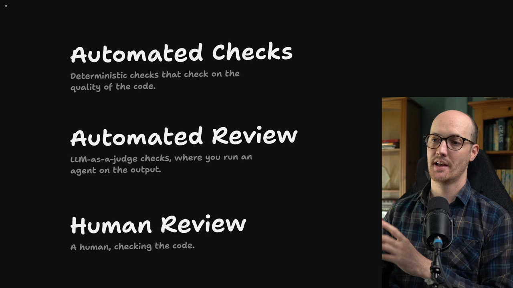
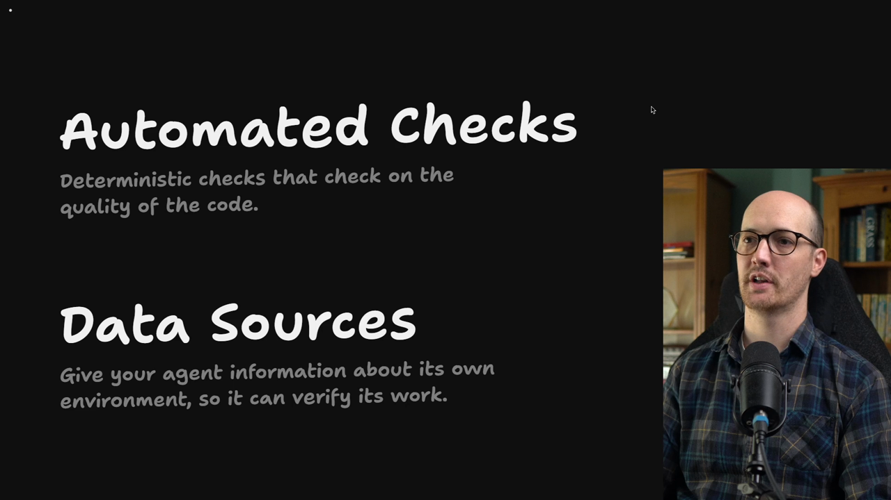

# Making Bad Code (Nearly) Impossible

<Prerequisites title="Crash Course Prerequisites">
  <Prerequisite href="https://www.aihero.dev/workshops/ai-coding-crash-course/models-harnesses-agents-environments-2b9a99a1">
    What an agent's environment is, which is where its feedback comes from.
  </Prerequisite>
  <Prerequisite href="https://www.aihero.dev/workshops/ai-coding-crash-course/non-determinism-c31d9cdd">
    Why the same prompt gives different answers, and so why a deterministic check beats an agent's judgement.
  </Prerequisite>
  <Prerequisite href="https://www.aihero.dev/workshops/ai-coding-crash-course/executing-your-tickets-8389d87c">
    What a feedback loop is, the thing this whole section makes better.
  </Prerequisite>
  <Prerequisite href="https://www.aihero.dev/workshops/ai-coding-crash-course/enforcing-your-coding-standards-f1656d67">
    The layers of review: automated checks, automated review and human review, and what belongs in each.
  </Prerequisite>
</Prerequisites>

So far, we've looked at two of the three layers that I think of as brakes in the [software factory](https://www.aihero.dev/ai-coding-dictionary/software-factory).

We've taken a look at [automated review](https://www.aihero.dev/ai-coding-dictionary/automated-review) and [human review](https://www.aihero.dev/ai-coding-dictionary/human-review). We've been dancing around [automated checks](https://www.aihero.dev/ai-coding-dictionary/automated-check) for a while, but it's time to dive in.

## A grab bag of automated checks

This section is a grab bag of different automated checks. They're techniques you can use to improve the quality of your [agent](https://www.aihero.dev/ai-coding-dictionary/agent)'s output before it even gets to automated review.

## Two parts: automated checks and data sources

This section has two parts. We're going to start with automated checks, and then we're going to look at another concept called data sources.

The idea with data sources is that most people don't give their agent enough information to verify its own work.

The more information, and the higher quality of information, you give the agent, the better results you're going to get.

## Better feedback loops

This is where the name of the section comes from. Both parts increase the quality of the agent's feedback loop, giving it better feedback in one of two ways:

- From automated checks failing in certain ways.
- From data sources giving it higher quality information.

## What you'll get

By the end of the section, you will have a more trustworthy agent. It will be checking its own work, and it will have guardrails to make sure it stays on track.

Nice work, and I will see you in the next one.

<Quiz>
  <QuizQuestion data={{
    id: "feedback-loop-checks-and-data-sources",
    question: "What do automated checks and data sources have in common?",
    type: "multiple-choice",
    choices: [
      { answer: "a", label: "Both improve the agent's feedback loop" },
      { answer: "b", label: "Both are run by a human after the agent" },
      { answer: "c", label: "Both cost tokens every time that they run" },
      { answer: "d", label: "Both replace the need for human review" }
    ],
    correct: "a",
    answer: "Both give the agent better feedback: automated checks by failing in certain ways, data sources by giving it higher quality information. They're used by the agent, not run by a human afterwards, automated checks cost CPU rather than tokens, and they sit underneath review rather than replacing it."
  }} />
  <QuizQuestion data={{
    id: "data-sources-self-verification",
    question: "Your agent's work keeps passing its checks but turning out wrong in ways it could have spotted. What is it most likely missing?",
    type: "multiple-choice",
    choices: [
      { answer: "a", label: "Enough information to verify its own work" },
      { answer: "b", label: "A larger context window to hold the code" },
      { answer: "c", label: "A stricter human reviewer on every PR" },
      { answer: "d", label: "A slower model with more reasoning effort" }
    ],
    correct: "a",
    answer: "Most people don't give their agent enough information to verify its own work, and the more and higher quality information you give it, the better the results. A bigger context window, a stricter reviewer or more reasoning effort don't give it anything new to check its work against."
  }} />
</Quiz>
