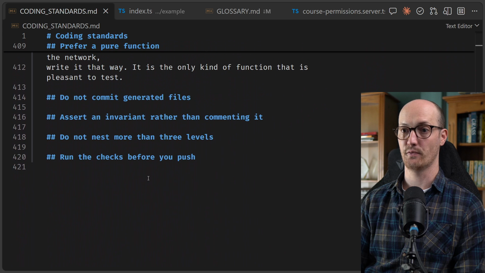

# Pruning CODING_STANDARDS.md

<CommitMap packageManager="npm">
  <Commit id="seed-bloated-coding-standards">Start the lesson: `CODING_STANDARDS.md` has grown to about 420 lines</Commit>
  <Commit id="split-and-prune-coding-standards">See my solution: `CODING_STANDARDS.md` pruned to 111 lines</Commit>
</CommitMap>

<Prerequisites title="Crash Course Prerequisites">
  <Prerequisite href="https://www.aihero.dev/workshops/ai-coding-crash-course/non-determinism-c31d9cdd">
    Why the same prompt gives different answers, and so why a deterministic check beats an agent's judgement.
  </Prerequisite>
  <Prerequisite href="https://www.aihero.dev/workshops/ai-coding-crash-course/what-are-agent-skills-20f91a4e">
    What a skill is and how you invoke one, so running /retro makes sense.
  </Prerequisite>
  <Prerequisite href="https://www.aihero.dev/workshops/ai-coding-crash-course/pruning-db28fc2c">
    The sediment and no-op tests you'll use to decide which rules to cut.
  </Prerequisite>
  <Prerequisite href="https://www.aihero.dev/workshops/ai-coding-crash-course/enforcing-your-coding-standards-f1656d67">
    The difference between automated checks and automated review, and where coding standards fit.
  </Prerequisite>
</Prerequisites>

When you have a choice between deterministic and [non-deterministic](https://www.aihero.dev/ai-coding-dictionary/non-determinism), pick determinism. [Automated review](https://www.aihero.dev/ai-coding-dictionary/automated-review) is an [agent](https://www.aihero.dev/ai-coding-dictionary/agent), so it is slightly probabilistic. [Automated checks](https://www.aihero.dev/ai-coding-dictionary/automated-check) behave the same way every time.

That means coding standards should become automated checks wherever possible. A big `CODING_STANDARDS.md` also collects sediment. Code review is underloaded compared with implementation, but even so, we want to take pressure off it where we can.

In this exercise, you'll run `/retro` against the file and decide, rule by rule, whether to delete it or turn it into a check.

## Steps To Complete

### Reset to the bloated file

- [ ] Reset your branch to the bloated starting point

```bash
npm run reset seed-bloated-coding-standards
```

This resets the current branch and fills `CODING_STANDARDS.md` with a big chunk of extra rules.



- [ ] Open `CODING_STANDARDS.md` and scroll through it

It starts with the existing rule "Fail with a thrown response, not a return value", then runs on for roughly 420 lines. Get a feel for its size and shape before you ask the agent to touch it.

### Run `/retro` on the standards

- [ ] Run your agent and invoke `/retro`

`/retro` is normally used for a retrospective on previous [sessions](https://www.aihero.dev/ai-coding-dictionary/session). You don't need it to scan any, so say so in your prompt. You only want it to use its internal rules to sniff out weirdness in the file.

- [ ] Tell it what you want for each rule

For every coding standard, it should either delete the rule or turn it into an automated check. You are not using any new [skills](https://www.aihero.dev/ai-coding-dictionary/skill) for this.

```txt
Use /retro, but do not scan any previous sessions. Look only at CODING_STANDARDS.md. For each rule, either delete it or turn it into an automated check. Don't implement any checks yet. Give me a list of ideas for the checks instead.
```

### Review what comes back

- [ ] Read the list of ideas for automated checks

Don't implement them yet. Just look at the ideas that come back and judge whether they are sensible.

- [ ] Take a hatchet to `CODING_STANDARDS.md`

Cut anything that isn't needed. Check that the file is now noticeably smaller than 420 lines.

- [ ] Check what the agent deleted

If it cut a rule you think still matters, put it back.