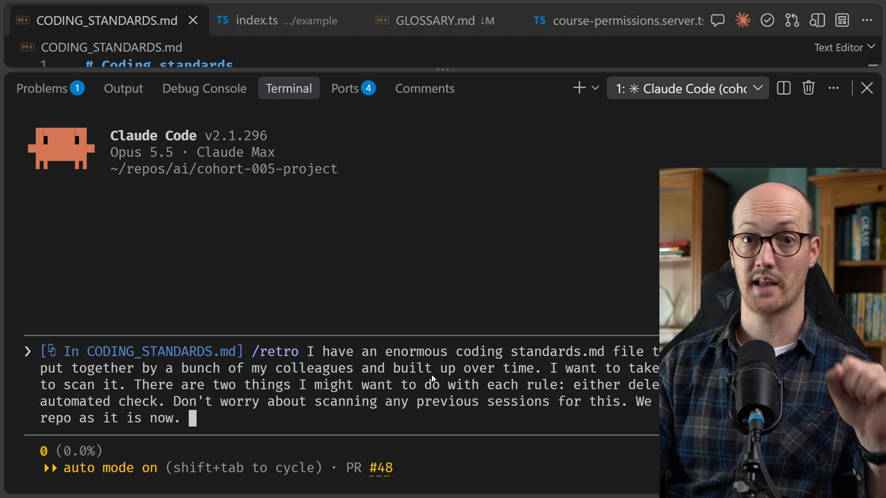
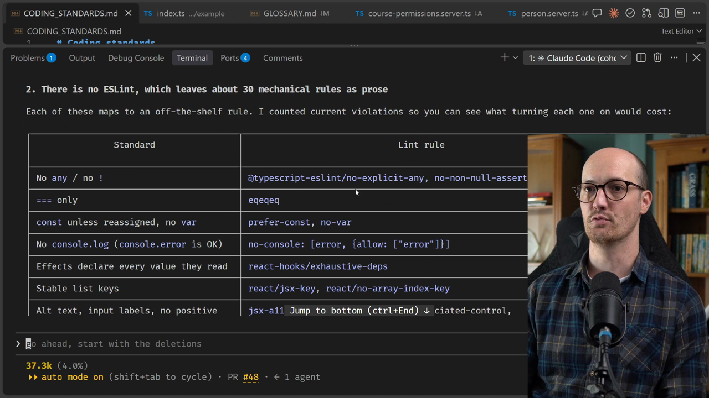
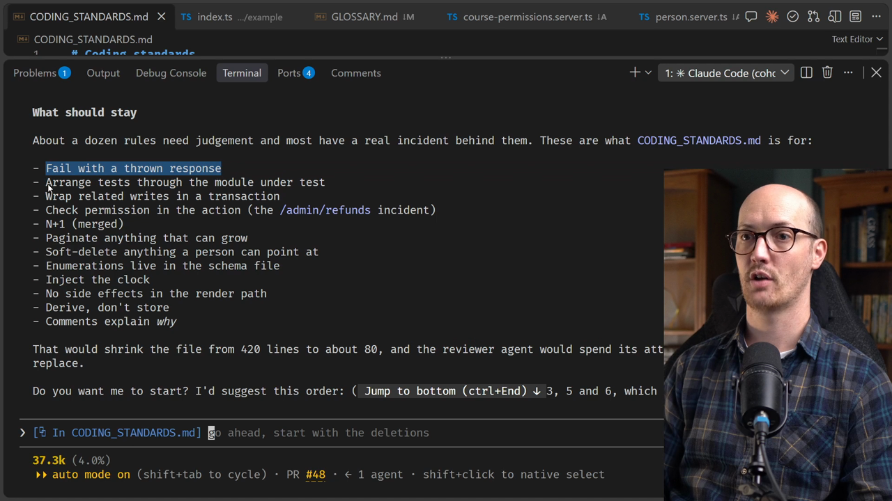
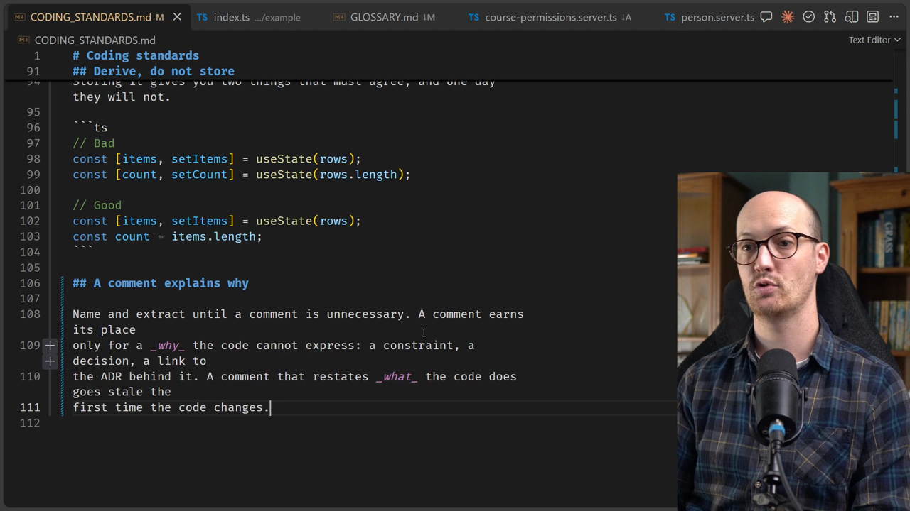
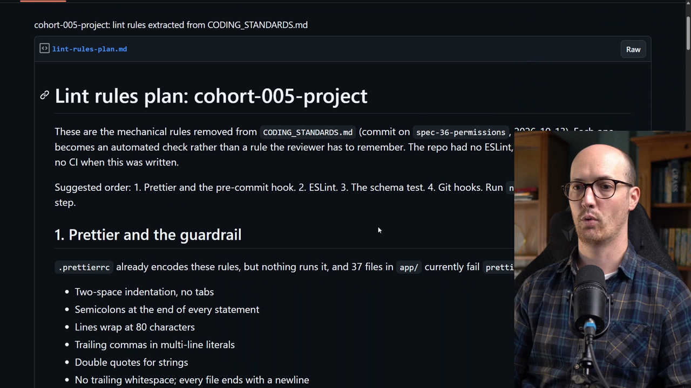

# Pruning CODING_STANDARDS.md Solution

<CommitMap packageManager="npm">
  <Commit id="seed-bloated-coding-standards">Start the lesson: with `CODING_STANDARDS.md` grown to 420 lines of mixed, duplicated, stale and contradictory rules</Commit>
  <Commit id="split-and-prune-coding-standards">See my solution: with `CODING_STANDARDS.md` pruned to 111 lines</Commit>
</CommitMap>

The repo has an enormous `CODING_STANDARDS.md` file, put together by a bunch of colleagues and built up over time. The goal is to scan it and decide, for each rule, one of two things: delete it, or turn it into an [automated check](https://www.aihero.dev/ai-coding-dictionary/automated-check).

The `/retro` [skill](https://www.aihero.dev/ai-coding-dictionary/skill) normally reviews past [sessions](https://www.aihero.dev/ai-coding-dictionary/session). The last two sentences of the prompt steer it away from that and toward the repo as it is now.

```txt
/retro I have an enormous CODING_STANDARDS.md file that has been put together by a bunch of my colleagues and built up over time. I want to take a look at it and I want to scan it. There are two things I might want to do with each rule: either delete it or turn it into an automated check. Don't worry about scanning any previous sessions for this. We just want to look at the repo as it is now.
```



## What the agent investigates

Once it runs, the [agent](https://www.aihero.dev/ai-coding-dictionary/agent) goes and investigates the guardrails already in the repo, meaning the automated checks that are already there.

It also looks at which rules could be made into mechanical rules, and it counts existing violations. That's interesting, because it shows what turning each rule on would cost.

```txt
: any\b                        3
as any                         0
console\.log                   3
interface Props                0
type Props                     0
\bvar                          1
[^=!]==[^=]                    1
```

Then we get a huge chunk of output to review.



## 1. There are no guardrails in place

The first finding is that there are no automated checks in place:

- There is no pre-commit hook.
- There is no CI.
- Prettier is configured, but never run.

Prettier is a formatter. It makes the code always look the same, so diffs stay clean because they contain no formatting changes.

A pre-commit hook runs scripts before we make a commit. That makes it really useful for enforcing automated checks.

The agent's suggestion is to run `npm run check` from a pre-commit hook, and to add a `format:check` script to it.

`format:check` checks whether the formatting in the repo is correct. If it isn't, it errors and forces us to run Prettier.

```txt
[warn] Code style issues found in 37 files. Run Prettier with --write to fix.
```

## 2. About 30 rules could be lint rules

The second finding is that there is no linter. About 30 mechanical rules in the standards file could be turned into automated checks.

For instance, one coding standard says do not write `any` and do not write `!`. That is a really easy thing for a linter to check, and there are built-in rules for it:

| Standard                         | Rule                                       |
| -------------------------------- | ------------------------------------------ |
| No `any`                         | `@typescript-eslint/no-explicit-any`       |
| No `!`                           | `@typescript-eslint/no-non-null-assertion` |
| No exports used by only one file | knip                                       |

The agent actually went and looked: all of the mechanical rules have lint rules that could enforce them. That's a lot of prose that can go.

The knip one is a nice little CLI for finding exports that only one file uses.

## 3. Stale, contradictory and duplicated rules

Third, some rules are stale, contradictory or duplicated. Those we should just delete now.

The first is "read lesson progress through `progressCache`", but `progressCache` doesn't exist anywhere in `app`. That's a classic one: the code gets edited and the rule doesn't get updated.

Then there's a contradiction:

- Line 187 says prefer `interface` for object shapes.
- Line 326 says component props should be a `type`.

And there are duplicates. "Avoid the N+1" and "Do not read from the database in a loop" are the same rule.

## 4. Schema rules can be one Vitest test

Next, several rules are deterministic facts about the schema and Drizzle.

So some of these rules don't need to become lint rules. They can become unit tests instead, and one Vitest test can cover several of them.

## 5. Process rules don't belong in a code review file

Then there are process rules that don't belong in a code review file. They are about process, not about the diff that the reviewer is going to review.

## 6. No-ops

The agent then looks at no-ops. I'm not sure whether I cover the term in the crash course, but a no-op is a line inside any steering file that you can delete without anything changing.

In other words, it doesn't do anything to the output. It doesn't change it in any meaningful way, so it can just go.

These either describe what the [model](https://www.aihero.dev/ai-coding-dictionary/model) already does, or are too vague to apply:

- Measure before you optimize
- Mobile first
- Lazy-load below the fold
- Debounce keystrokes
- And so on

## What should stay

Finally, there's a list of what should stay:

- Fail with a thrown response
- Arrange tests through the module under test
- Wrap related writes in a transaction



## Cutting the file down and saving the lint rules

We said in the prompt that we want to end with ideas for lint rules, which we absolutely have, and that we want to cut down the coding standards. So let's cut the file down and stop there.

I'm also going to show you a trick I like when working, especially with GitHub. If I want to save something from an agent session, I will often just save it to a secret gist. That way I can pass it into an agent session later.

```txt
Okay, can you cut down the coding standards down to your recommended size? I really like what you've done there. And then can you take all of the recommended lint rules and can you save those to a secret gist? That way I can apply them later in a separate session.
```

Let's fire this off, and we will end up with a much smaller `CODING_STANDARDS.md`.

## Using a skill for its reference material

You can think of the `/retro` skill as having two halves. Most skills have this:

- A list of steps that you complete.
- Reference material: an understanding of what the skill is trying to accomplish, and guidance on how to perform it.

Here we're using `/retro` for its reference material and not for its steps. That's a perfectly legitimate way of using a skill. Agents are good enough to figure out what you actually want from the skill you're calling.

## The result

Our `CODING_STANDARDS.md` has been updated, and we are now at about 111 lines. Let's see what's left.



The rules that remain include:

- Fail with a thrown response.
- Parse untrusted input with a schema, at the edge.
- Check permission in the action.

All of this feels too fuzzy and too tricky to write an automated check for. Overall, I'm really happy with the coding standards that have been created.

## The gist of lint rules

The agent has also created the gist, which has a list of all of the lint rules that came out of `/retro`. I'll copy the link below so you can take a look yourself: [lint-rules-plan.md](https://gist.github.com/mattpocock/9ccd6319bb565428e01ceeaa9fbd0514).



We're going to use this as inspiration for the next few lessons, where we tighten up our automated checks.

