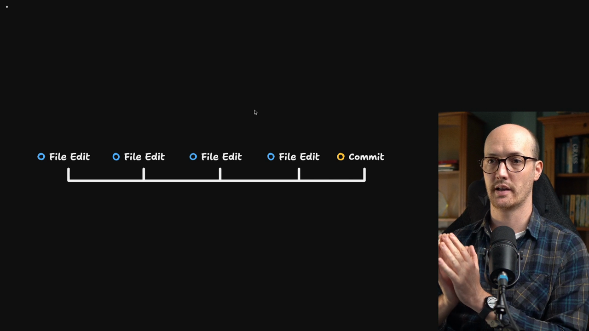

# Our First Automated Checks

<CommitMap packageManager="npm">
  <Commit id="coding-standards-feedback-loops">Start the lesson: the coding standards with a file-length rule written as prose and no hook yet</Commit>
  <Commit id="husky-and-file-size-hook">See my solution: the pre-commit hook with a format check and a file size check</Commit>
  <Commit id="format-codebase-with-prettier">See the one-time `npm run format` across the codebase, committed with the hook skipped</Commit>
</CommitMap>

<Prerequisites title="Crash Course Prerequisites">
  <Prerequisite href="https://www.aihero.dev/workshops/ai-coding-crash-course/models-harnesses-agents-environments-2b9a99a1">
    What a harness is, which is the thing that runs hooks around the agent.
  </Prerequisite>
  <Prerequisite href="https://www.aihero.dev/workshops/ai-coding-crash-course/sessions-and-the-context-241f60ee">
    What tokens, sessions and the context window are, so the 5,000-token file cap makes sense.
  </Prerequisite>
  <Prerequisite href="https://www.aihero.dev/workshops/ai-coding-crash-course/codebase-exploration-205910ac">
    How an agent explores files it can't see, and why huge files make that hard.
  </Prerequisite>
  <Prerequisite href="https://www.aihero.dev/workshops/ai-coding-crash-course/enforcing-your-coding-standards-f1656d67">
    What an automated check is, and why it's the cheapest way to enforce a standard.
  </Prerequisite>
</Prerequisites>

Our gist from the previous exercise has a couple of good ideas in it. One is a pre-commit hook, which we definitely want in the system.

Many people recommend running checks in a hook on every file edit. That is slow, noisy and [token](https://www.aihero.dev/ai-coding-dictionary/token) inefficient, because an [agent](https://www.aihero.dev/ai-coding-dictionary/agent) makes tons of edits per [session](https://www.aihero.dev/ai-coding-dictionary/session). Running checks at commit time batches the feedback instead.



We will also go beyond linters. One of my favorite checks is not a linter at all. It is custom, and devilishly simple: agents tend to build enormous files, and a 10,000 token file is hard for an agent to navigate. So we will cap file size.

## Steps To Complete

### Set up the pre-commit hook

- [ ] Open the gist from the previous exercise and review its Prettier section

You want the hook to run the format check described there. Oxlint comes in later lessons, so leave it for now.

- [ ] Send this prompt to your agent, or write your own version

```txt
https://gist.github.com/mattpocock/9ccd6319bb565428e01ceeaa9fbd0514 I want you to create a precommit hook that checks for prettier like we have described in the gist. Also, in this precommit hook, I want you to write a custom script that checks whether the file is over five thousand tokens. If it's over five thousand tokens, we should error and we should provide some guidance to the agent on how it should split up that file. You can use a cheap calculation to determine the tokens, such as bytes divided by four.
```

The prompt asks for three things:

- A pre-commit hook that runs the Prettier format check
- A custom script that checks staged files for a maximum of 5,000 tokens
- Error output that tells the agent how to split up an oversized file

The script does not need a real tokenizer. Bytes divided by four is a cheap enough estimate.

### Keep it fast

- [ ] Make sure the hook runs in under three seconds

If your agent has put anything slower than that into the hook, tell it to take it out. A slow hook gets in the way of every commit.

### Verify it works

- [ ] Commit a file that is badly formatted and check that the hook blocks the commit

- [ ] Stage a file over 5,000 tokens (roughly 20,000 bytes) and check that the commit fails

The error should give the agent useful guidance on how to split the file up.

- [ ] Commit a small, well-formatted file and check that it goes straight through

By the end of this lesson, you should have a pre-commit hook that checks the formatting of your files and checks their size.
