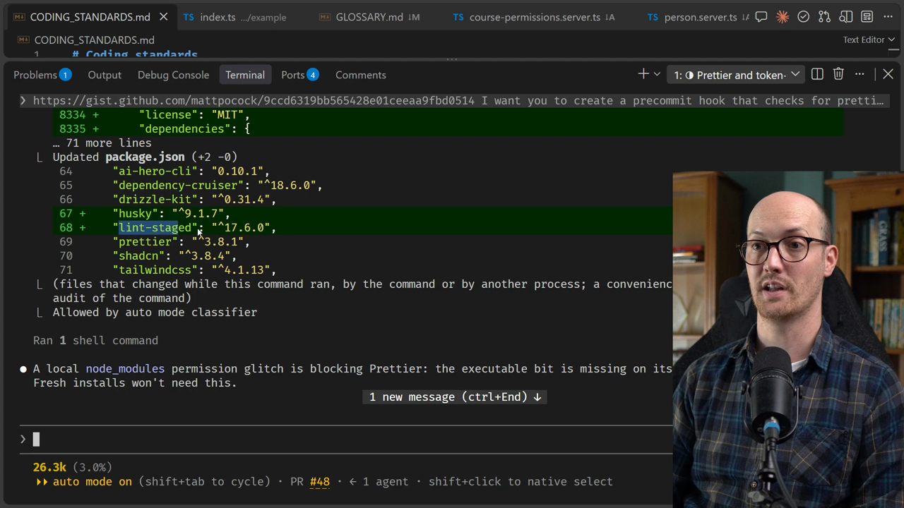
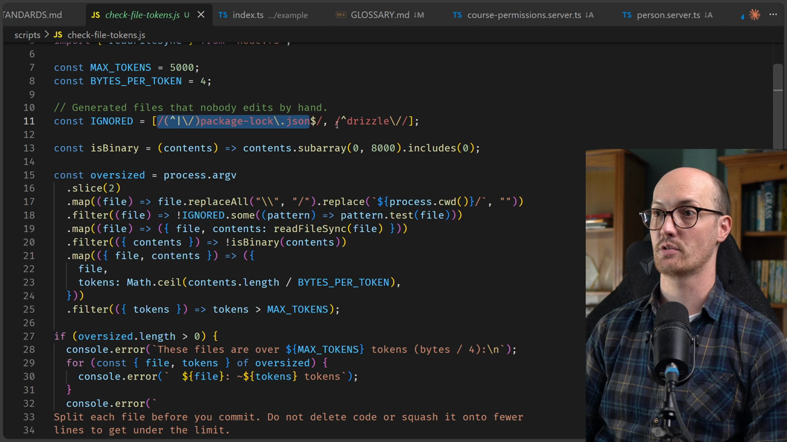
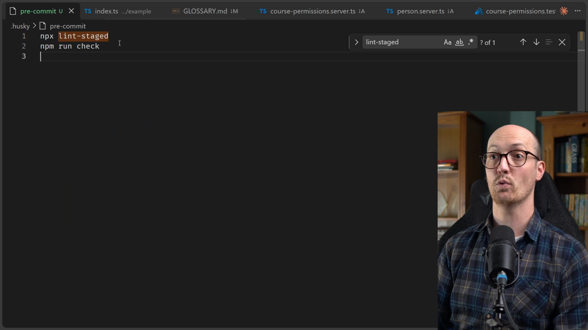
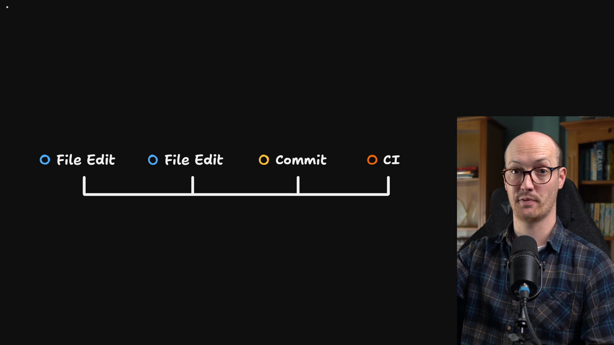
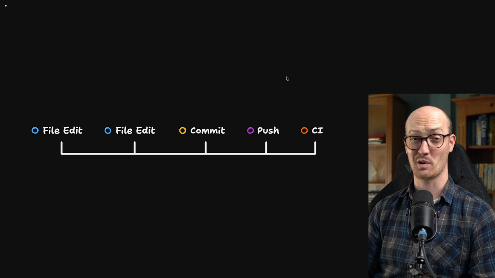
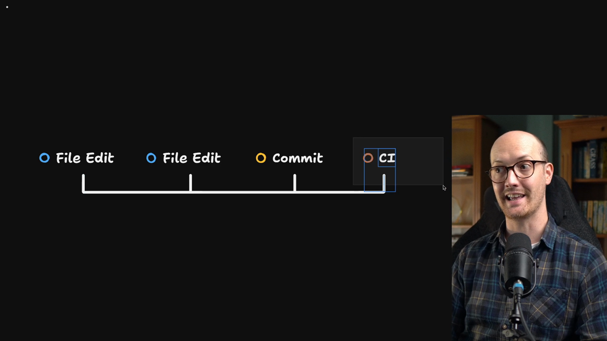
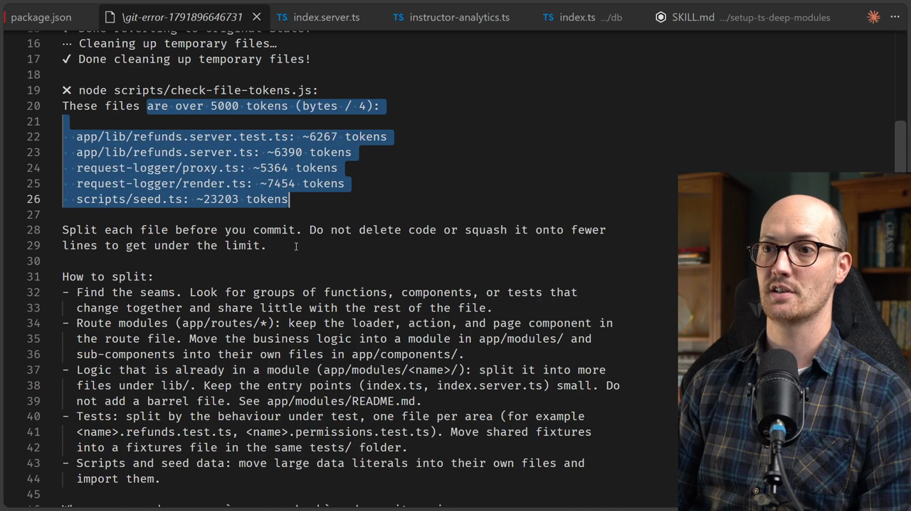

# Our First Automated Checks Solution

<CommitMap packageManager="npm">
  <Commit id="coding-standards-feedback-loops">Start the lesson: the coding standards with a file-length rule written as prose and no hook yet</Commit>
  <Commit id="husky-and-file-size-hook">See my solution: the Husky pre-commit hook running `lint-staged` (`prettier --check` plus `scripts/check-file-tokens.js`)</Commit>
  <Commit id="format-codebase-with-prettier">See the one-time `npm run format` across the codebase, committed with the hook skipped</Commit>
</CommitMap>

## Running the prompt

Let's run this.

I find [automated checks](https://www.aihero.dev/ai-coding-dictionary/automated-check) so much fun to work with alongside [agents](https://www.aihero.dev/ai-coding-dictionary/agent). Whenever I add one, I'm trading [tokens](https://www.aihero.dev/ai-coding-dictionary/token) for CPU cycles. I'm giving away probabilism and getting determinism. It's a wonderful feeling.

## What the agent installed

The first thing it has done is install a couple of packages: `husky` and `lint-staged`.

- **Husky** is a simple way to set up and manage pre-commit hooks. It's a JavaScript-specific tool. You might just want to use raw pre-commit hooks if you like, but Husky makes them a little easier.
- **lint-staged** is a very popular JavaScript CLI that lets you run commands on the files that have been staged before the commit.



## The `lint-staged` config

Inside `package.json` there is a new piece of `lint-staged` configuration.

The `*` wildcard means it runs on every file, so every file that has been staged. We run a script called `node scripts/check-file-tokens.js`, and then we have `prettier --check --ignore-unknown`.

```json
"lint-staged": {
  "*": [
    "prettier --check --ignore-unknown",
    "node scripts/check-file-tokens.js"
  ]
}
```

It also looks like it has done a dry run and figured everything out. It has formatted the repo for us as well, so every single file that had a formatting issue has now been fixed with Prettier.

## The token check script

We can also take a look at the `check-file-tokens.js` script.

It ignores some files. It ignores large generated files like `package-lock.json`, and it ignores any Drizzle migrations too.

```js
const MAX_TOKENS = 5000;
const BYTES_PER_TOKEN = 4;

// Generated files that nobody edits by hand.
const IGNORED = [/(^|\/)package-lock\.json$/, /^drizzle\//];
```



### Errors that guide the agent

There's a really cool feature here. When the script errors, it errors with a very detailed message on how the agent should behave.

So this is almost like `AGENTS.md`, but only loaded when it needs to be.

For instance, for route modules:

```txt
Route modules (app/routes/*): keep the loader, action, and page component in
the route file. Move the business logic into a module in app/modules/ and
sub-components into their own files in app/components/.
```

That means moving the logic into our deep modules, and sub-components into their own files.

This is true for tests as well:

```txt
Tests: split by the behaviour under test, one file per area (for example
<name>.refunds.test.ts, <name>.permissions.test.ts).
```

And at the end:

```txt
When you are done, run `npm run check` and commit again.
```

## Files that are already too big

The agent has also done a bit of research, and it sees that about 15 files are already over the limit. That includes `app/routes/instructor.$courseId.tsx`, at already about 18K tokens.

It makes a good point here: the check only looks at staged files, so these files block a commit only when someone edits them.

That's another reason to do this in a pre-commit hook. We see the staged files, in other words the things that are about to be changed.

So we can adopt this now, and any time a large file is touched, it will be split up by the agent that's touching it.

## Something has gone a little wrong

Something has gone a little wrong inside the actual pre-commit hook. We can see it by looking at `.husky/pre-commit`.

This is the script that's going to be run when we commit. In other words, it's the pre-commit hook we've been talking about all this time.

It runs `lint-staged`. If we look at `package.json`, `lint-staged` simply runs Prettier and the node checker.

However, the agent has gone a little bit nuts and put the whole check suite in there too:

```text
npx lint-staged
npm run check
```

That means the hook is going to run quite a few things:

- `npm run format:check` again
- the typecheck
- the boundaries lint
- the entire test suite



## Why the hook needs a time budget

I want the pre-commit hook to have a very strict time budget.



The pre-commit hook is not the last chance to catch things before they go into production. Running checks on commit is very useful for quick feedback to the agent or the human committing. But we also have a CI platform.

Most projects have a continuous integration platform: a remote server that runs checks on any PR going into the main branch.

So we don't have to run everything on pre-commit. If we do, it slows us down, especially if the test suite is in there.

I recommend keeping pre-commit to under around three seconds if you can, maybe even faster. Put the slow stuff that takes minutes onto CI.

### Telling the agent

So I'm going to tell that to my agent.

```txt
We're doing too much work in the pre-commit hook. The pre-commit hook should be maximum three seconds long. I want you to take out anything that doesn't fit into that budget.
```

Let's give the agent this prompt and see how it goes.

## The agent's timings

It has come back with a table of how long everything takes.

| Step | Time |
| --- | --- |
| `lint-staged`, 1-file commit | 1.4s |
| `lint-staged`, 44-file diff | 2.1s |
| `typecheck` | 7.8s |
| `format:check` (whole repo) | 2.7s |
| `test` | 2.0s |
| `lint:boundaries` | 1.4s |

Running the tests turns out to be incredibly fast, only two seconds, whereas type checking was taking 7.8 seconds.

So it has decided to cull certain things from the budget. Typecheck, boundaries and tests no longer run before a commit. The hook is now a single line:

```text
npx lint-staged
```

The agent also says that if you want those checks enforced automatically, they could go in a pre-push hook or a CI workflow.

### Pre-push hooks

A pre-push hook does what it says on the tin. It runs a script before you push your code to the repo.



I actually really recommend not using any push hooks. I find them extremely annoying. Even if you do use them, you probably only want a three second time budget in there too.

CI is the only place where you can really stretch out and allow your scripts to run for minutes. Even then, you want them as short as possible so that you can keep the merge train running.

Overall, this looks fine for now. These numbers could be improved. There are definitely tooling changes we could make to the typecheck and the format check to speed this up. The faster we get them, the more we can squeeze into our pre-commit hook. But I think I'll put that in a separate lesson.

## Committing

For now, I want to commit this so that we can see the pre-commit hook in action.

Let's commit this to the repo.

I'm interested in what it's going to do here. It has touched a bunch of files when it formatted the code with Prettier. That means the pre-commit hook might fail, because we end up with a bunch of changes that will need to be split into different files.

### The agent's solution

It has found quite a neat solution. It has already committed the hook setup. It says the one-time Prettier reformat still needs to go in, but the new hook will block it.

The seed script is already 23K tokens. Blimey.

So for this change, it recommends that we skip the hook for this one commit and commit with `HUSKY=0`, because the commit only changes formatting.

```bash
HUSKY=0 git commit
```

I really dig this. You can also see that agents can cheat on pre-commit hooks.



The pre-commit hook is not a hard gate, as agents would say. It's not a hard stop. CI is the only real hard stop.

## Seeing it fail

I'm going to recommend that it carries on with this, but I also want to show the hook failing, so I'll demo that now.

To try it out, go into source control and try to commit yourself. I'll type a message like `foo bar` and commit.

Something happens. If we go to "Show Command Output", we can see it says it failed to run tasks for staged files.

We can then see the exact output that gets sent to the agent:

```txt
These files are over 5000 tokens (bytes / 4):

  scripts/seed.ts: ~23203 tokens
  ...

Split each file before you commit. ...
```

It says these files are over 5000 tokens, to split each file before committing, and then explains how to split.



## Skipping the hook

With that, I'm going to tell my agent to skip the hook and go ahead.

```txt
skip the hook and go ahead
```

It commits the formatted code. There we go: we have now fully formatted our repo.

We have also set up a system where, on every new change, files get split up into reasonable sizes.

## Wrapping up

I hope this gives you a sense of the kind of automated checks you can start adding for your agent. You can be really, really creative.

This system is especially good because it only runs on staged files, using `lint-staged`, in this case in TypeScript. That means you can be quite aggressive with the checks, and they only operate on files that are actually being modified.

Welcome to the wonderful world of automated checks. Nice work, and I will see you in the next one.

