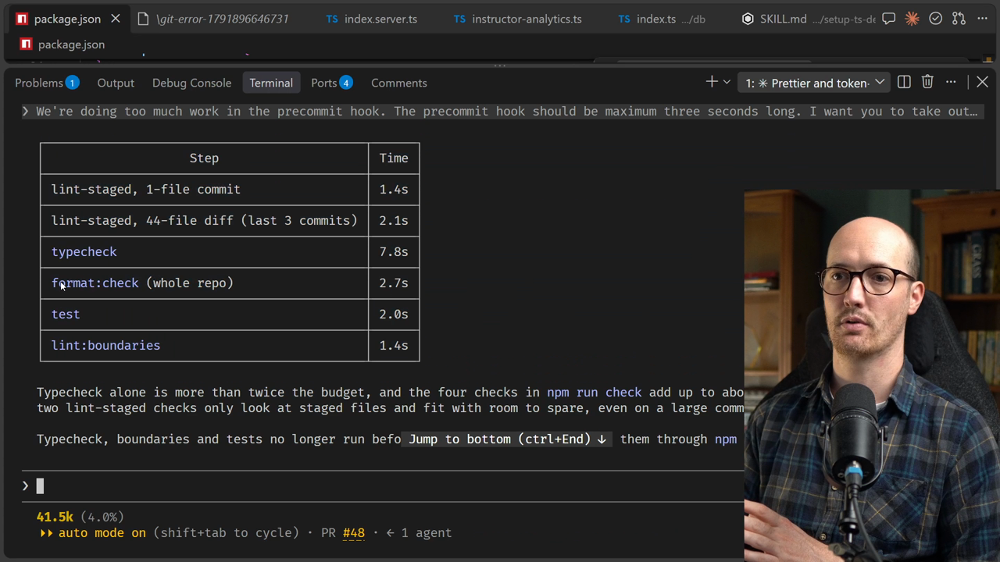
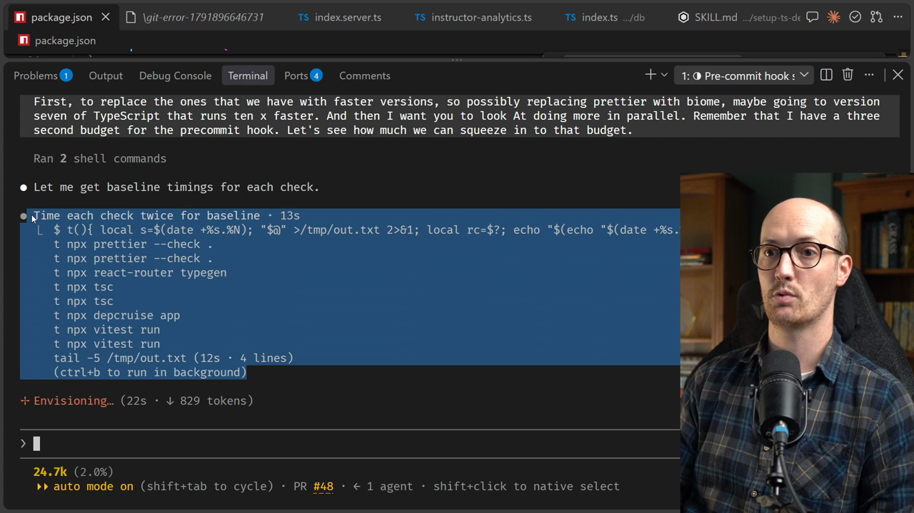
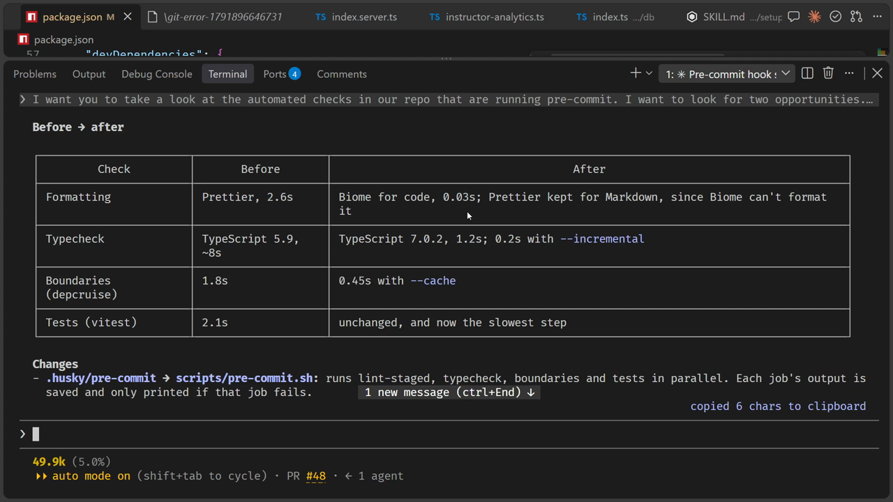
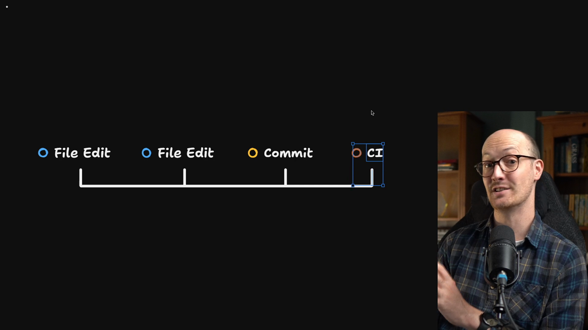
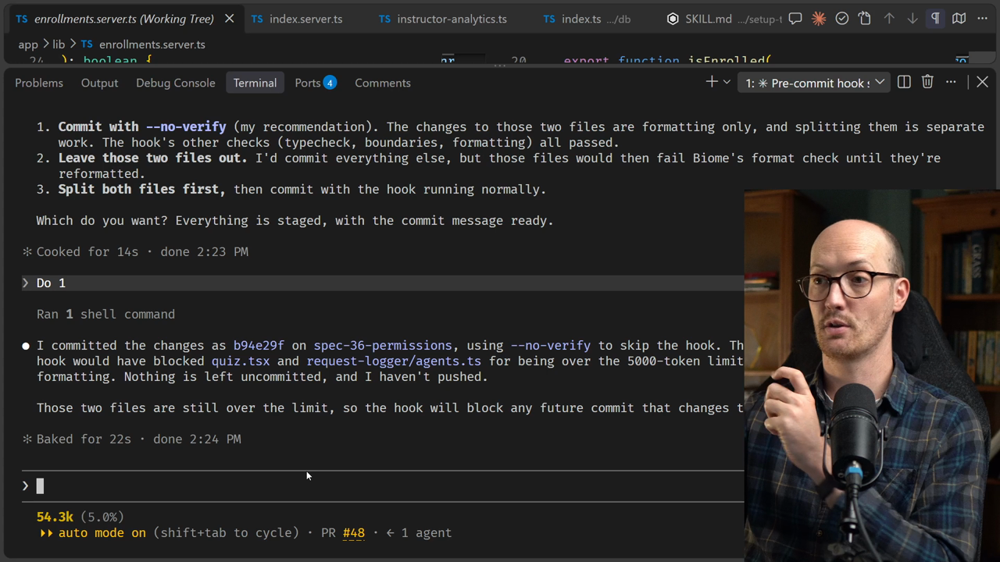

# Speeding Up Our Automated Checks

<CommitMap packageManager="npm">
  <Commit id="format-codebase-with-prettier">Start the lesson: Prettier formats the codebase, and the husky hook runs `prettier --check` and the file-size check through lint-staged</Commit>
  <Commit id="speed-up-pre-commit-hook">See my solution: Biome, TypeScript 7, caches and a parallel `scripts/pre-commit.sh` without the tests</Commit>
  <Commit id="add-oxlint-to-hook">See oxlint added: the coding standards' lint rules run on staged files in the pre-commit hook and in `npm run check`</Commit>
</CommitMap>

<Prerequisites title="Crash Course Prerequisites">
  <Prerequisite href="https://www.aihero.dev/workshops/ai-coding-crash-course/how-to-run-the-exercises-a0eb0474">
    How `npm run reset` moves your repo between the lesson's commits.
  </Prerequisite>
  <Prerequisite href="https://www.aihero.dev/workshops/ai-coding-crash-course/managing-your-claude-code-session-78bcc6c8">
    The hands-on basics of driving the agent, including `/clear`.
  </Prerequisite>
  <Prerequisite href="https://www.aihero.dev/workshops/ai-coding-crash-course/executing-your-tickets-8389d87c">
    How automated checks give an agent a feedback loop, which is why a slow one slows the agent down.
  </Prerequisite>
  <Prerequisite href="https://www.aihero.dev/workshops/ai-coding-crash-course/enforcing-your-coding-standards-f1656d67">
    What an automated check is, and why it's the cheapest way to enforce a standard.
  </Prerequisite>
</Prerequisites>

## Why speed matters



In the previous exercise, we saw a table with the duration of all the checks running inside our pre-commit hook and inside our repo.

I mentioned then that a couple of them seem particularly long. The type checking is slow, and the format check feels pretty long to me too.

A lot of people would see these check times and say, "they're under 10 seconds, it's fine. We can live with those."

But in my opinion, people massively underestimate how much [automated checks](https://www.aihero.dev/ai-coding-dictionary/automated-check) slow down the [agent](https://www.aihero.dev/ai-coding-dictionary/agent) as it runs. I've seen huge benefits when I've invested time in making my automated checks run faster.

## Sequential versus parallel

So that is what we're going to do now. We'll take this table and ask the agent to do better. Can we squeeze more inside our time budget, and crucially do more work in parallel?

Currently, all of our checks run sequentially: one command executes, then another, then another.

If we run all of them at the same time, we finish in probably a third of the time, assuming they take the same amount.

## Prompting the agent

I'm going to [clear my context](https://www.aihero.dev/ai-coding-dictionary/clearing) and prompt the agent. Feel free to just watch this one. You can get a feel for it just by seeing me do it.

```md
I want you to take a look at the automated checks in our repo that are running pre-commit. I want to look for two opportunities. First, to replace the ones that we have with faster versions, so possibly replacing Prettier with Biome, maybe going to version seven of TypeScript that runs 10x faster. And then I want you to look at doing more in parallel. Remember that I have a three second budget for the pre-commit hook. Let's see how much we can squeeze into that budget.
```

I don't think this needs a [skill](https://www.aihero.dev/ai-coding-dictionary/skill) or a [grilling](https://www.aihero.dev/ai-coding-dictionary/grilling) session. What I'm asking is relatively simple, and the agent's changes aren't going to be that large at the end.

## Baseline timings

Agents are really good at making things faster when they have access to all the information. It starts by timing each check twice to get a baseline.

```txt
2.63s  npx prettier --check .
3.22s  npx prettier --check .
7.82s  npx tsc
7.96s  npx tsc
1.78s  npx depcruise app
2.55s  npx vitest run
2.10s  npx vitest run
```



TypeScript, at about eight seconds, is the blocker. The agent checks whether there's a newer version, and I happen to know there is.

## TypeScript 7 and Biome

This new version of TypeScript has been rewritten in native code, so it's often 10 times faster. Biome is a similar story. It's a faster alternative to Prettier, because it's written in native code instead of JavaScript.

## `dependency-cruiser` silently passes

Things are not quite that simple. TypeScript's check jumped from eight seconds to 1.4, which is very encouraging. But `dependency-cruiser` can't load TypeScript 7's API, and it silently passed.

```txt
✔ no dependency violations found (0 modules, 0 dependencies cruised)
```

It was green while checking nothing.

The agent found a way around this. It pins TypeScript 5.9 as `typescript`, and installs TypeScript 7 alongside it under an alias just for type checking.

```txt
Version 5.9.3
Version 7.0.2

✔ no dependency violations found (147 modules, 734 dependencies cruised)
```

Now the same check reports 147 modules.

## Prettier versus Biome

The agent then compared Prettier with Biome. Biome checked 144 files in 28 milliseconds, compared to 2.6 seconds for Prettier.

That might not sound like a lot. But these checks run a lot, so the numbers add up over time. With such a tight budget for the pre-commit hook, it's a big difference.

## Running everything in parallel

Next, the agent tries running everything at the same time. It comes down to about three seconds, just a little over budget.

```txt
  vitest rc=0 2.86s
  depcruise rc=0 2.87s
  types rc=0 3.13s
total 3.13s
```

It then looks for more creative performance optimizations:

- `dependency-cruiser` has a cache.
- TypeScript 7 has an `--incremental` flag.
- Vitest has a threads pool.

Some of these appear to help a lot, which is nice. The threads pool didn't help Vitest, though.

## The summary



The agent comes back with a final summary:

| Check | Before | After |
|---|---|---|
| Formatting | Prettier, 2.6s | Biome, 0.03s |
| Typecheck | TypeScript 5.9, ~8s | TypeScript 7.0.2, 0.2s with `--incremental` |
| Boundaries (`dependency-cruiser`) | 1.8s | 0.45s |
| Tests (Vitest) | 2.1s | Unchanged, and now the slowest step |

## Tests don't belong in the hook

All of these checks get slower the more files we add to the repo, so we need to monitor them carefully to make sure we don't go over our limit.

The one I know will go over is Vitest. This repo is relatively untested, so there's not much to run yet. As we add more tests, it will quickly go over the limit, and it's already stretching it.

So in my opinion, the tests are not the right thing to put in the pre-commit hook. I told the agent that, and it went away to remove them.

```md
Remove the test from the precommit hook. They're under two seconds now, but they'll quickly grow to more.
```



We need to push those tests into CI. We keep our pre-commit hook nice and quick, and our CI can afford to be a little slower.

The tests are out of the pre-commit hook, but they still run in `npm run check`, so I'm happy with that.

The hook now runs `lint-staged`, the typecheck and the boundaries check in parallel. It takes under a second on a small commit.

## Committing the formatting changes

Looking at the files, we can see that Biome formats things slightly differently to Prettier, so some formatting changes are going in. The agent will probably do a similar thing to before and commit without worrying about the pre-commit hook.

Let's send this off and see what happens.

```md
Let's commit this.
```

The same thing happens as before. The hook blocks the commit, as expected, because `app/routes/instructor.$courseId.lessons.$lessonId.quiz.tsx` and `request-logger/agents.ts` are too large.

```txt
These files are over 5000 tokens (bytes / 4):
  app/routes/instructor.$courseId.lessons.$lessonId.quiz.tsx: ~8890 tokens
  request-logger/agents.ts: ~13690 tokens
```

It gives us the same three options again, and option 1 is fine by me.

```md
Do 1
```



With that, we've committed. Our formatting changes are in, and we've sped up our automated checks, so the pre-commit hook is nice and snappy.

## Why this matters

This is essential work. The downside of pre-commit hooks, and of automated checks in general, is that they take a long time to run, or they certainly can.

The speedier the agent receives feedback, the faster you can get work done.

Nice work, and I'll see you in the next one.

<Quiz>
  <QuizQuestion data={{
    id: "fast-checks-faster-feedback",
    question: "Your pre-commit checks take about eight seconds. A teammate says that's fine. Why spend time making them faster?",
    type: "multiple-choice",
    choices: [
      { answer: "a", label: "Faster checks give the agent quicker feedback" },
      { answer: "b", label: "Slow checks make the agent skip the hook" },
      { answer: "c", label: "Slow checks give less accurate results" },
      { answer: "d", label: "They don't need it: under ten seconds is fine" }
    ],
    correct: "a",
    answer: "People massively underestimate how much automated checks slow the agent down as it runs, and the speedier the agent gets feedback, the faster you get work done. A slow check isn't less accurate, and the agent doesn't skip it, which is exactly why its run time adds up."
  }} />
  <QuizQuestion data={{
    id: "tests-in-ci-not-pre-commit",
    question: "Your test suite runs in under two seconds today, but it will grow quickly. Where should it run?",
    type: "multiple-choice",
    choices: [
      { answer: "a", label: "In CI and the full check, not the pre-commit hook" },
      { answer: "b", label: "In the pre-commit hook, so every commit is tested" },
      { answer: "c", label: "In the pre-commit hook, run in parallel there" },
      { answer: "d", label: "Only when you run it by hand before merging" }
    ],
    correct: "a",
    answer: "The pre-commit hook has a tight time budget, and a growing test suite will soon blow it, even in parallel. Keep the hook quick and push the tests into CI, which can afford to be slower, while they still run in the full check. Running them only by hand loses the automated feedback altogether."
  }} />
  <QuizQuestion data={{
    id: "green-check-checking-nothing",
    question: "After upgrading a tool, your boundaries check goes green but reports 0 modules cruised. What has happened?",
    type: "multiple-choice",
    choices: [
      { answer: "a", label: "It checked nothing, so the green is meaningless" },
      { answer: "b", label: "The codebase has no boundary violations left" },
      { answer: "c", label: "The upgrade made the check fast enough to pass" }
    ],
    correct: "a",
    answer: "When dependency-cruiser couldn't load the new TypeScript's API, it silently passed while checking nothing. A pass over 0 modules proves nothing about violations, and a faster check is only worth having if it still checks the code. Read what a check actually did, not just its colour."
  }} />
</Quiz>
