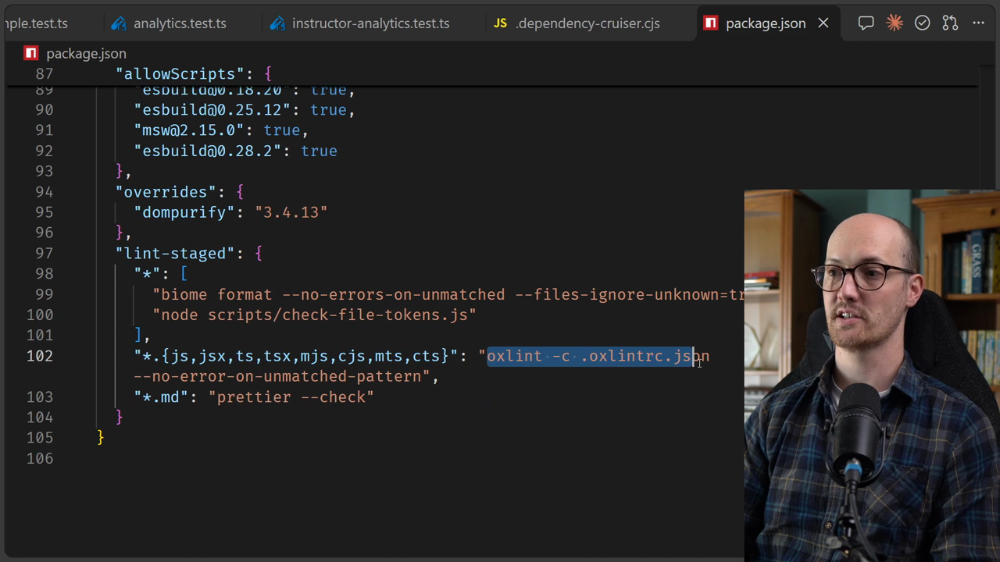
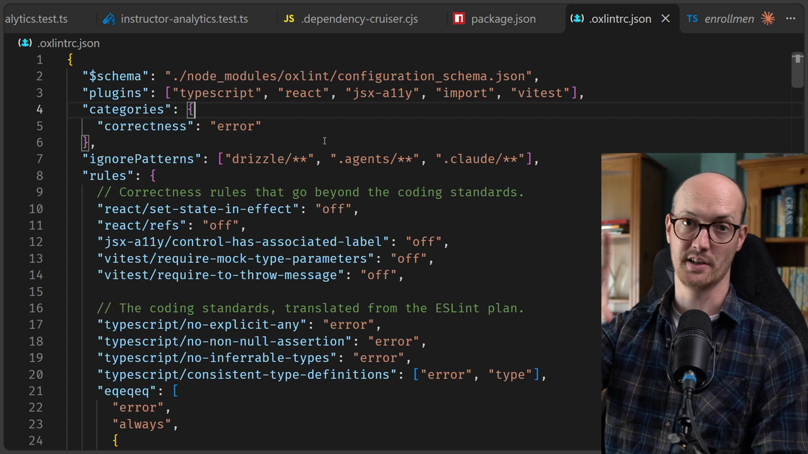
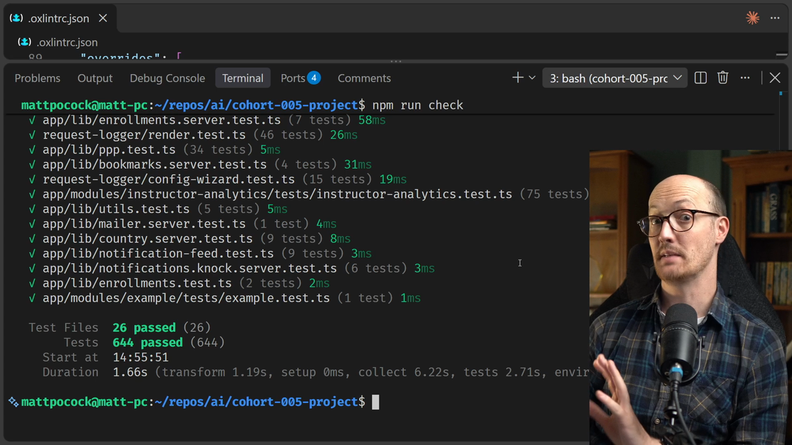
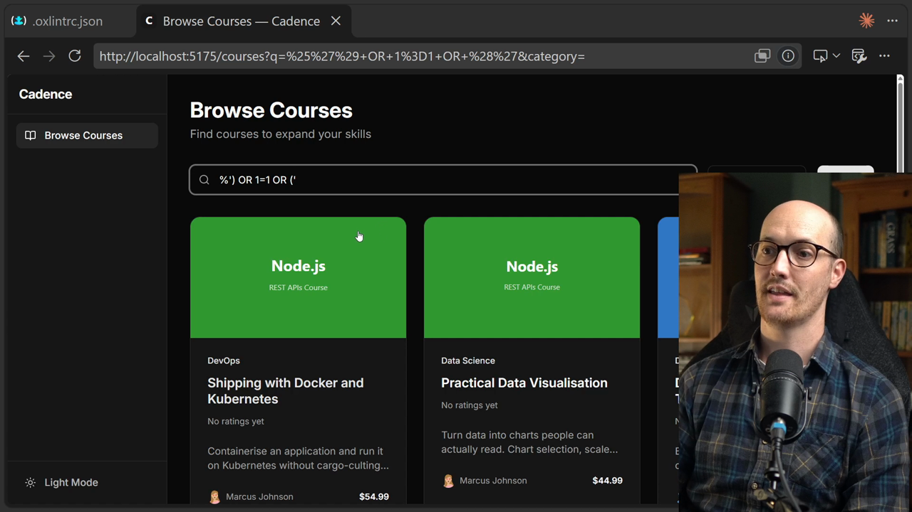

# Writing A Custom Lint Rule

<CommitMap packageManager="npm">
<Commit id="search-built-with-sql-raw">Start the lesson: the courses search builds its `WHERE` clause with an interpolated `sql.raw`</Commit>
<Commit id="custom-lint-rule">See my solution: a custom Oxlint rule that bans dynamic strings in `sql.raw`</Commit>
</CommitMap>

<Prerequisites title="Crash Course Prerequisites">
  <Prerequisite href="https://www.aihero.dev/workshops/ai-coding-crash-course/non-determinism-c31d9cdd">
    Why a check that behaves the same every time beats asking an agent to spot the bug.
  </Prerequisite>
  <Prerequisite href="https://www.aihero.dev/workshops/ai-coding-crash-course/hallucination-77d5b4c6">
    Why you tell the agent to look up the Oxlint docs instead of trusting what it remembers.
  </Prerequisite>
  <Prerequisite href="https://www.aihero.dev/workshops/ai-coding-crash-course/what-are-agent-skills-20f91a4e">
    What a skill is and how you invoke one, so running /retro makes sense.
  </Prerequisite>
  <Prerequisite href="https://www.aihero.dev/workshops/ai-coding-crash-course/enforcing-your-coding-standards-f1656d67">
    What automated checks are for, and how they take pressure off code review.
  </Prerequisite>
</Prerequisites>

The lint rules plan is now real. Oxlint is much faster than ESLint, so it fits our time budget, and `.oxlintrc.json` holds the rules that used to live in `CODING_STANDARDS.md`.

But this lesson is about what [automated checks](https://www.aihero.dev/ai-coding-dictionary/automated-check) can accomplish. There's a critical security failure in this app, and `npm run check` passes anyway. Your job is to get an [agent](https://www.aihero.dev/ai-coding-dictionary/agent) to write a custom lint rule that catches it.

## Steps To Complete

### Get set up

- [ ] Reset to the starting commit and install dependencies

```bash
npm run reset search-built-with-sql-raw
npm install
```

You need `npm install` because Oxlint is a new package.

- [ ] Look at how Oxlint is wired in

Open `package.json` and find the `lint-staged` block. Oxlint runs on any JavaScript or TypeScript file, using `.oxlintrc.json`.

```json
"*.{js,jsx,ts,tsx,mjs,cjs,mts,cts}": "oxlint -c .oxlintrc.json --no-error-on-unmatched-pattern",
```

The `--no-error-on-unmatched-pattern` flag stops Oxlint failing when lint-staged hands it no matching files.



- [ ] Skim `.oxlintrc.json`

The coding standards from the gist have been translated into rules here. This closes the loop on `CODING_STANDARDS.md`, which has been pruned down to automated checks.



### Prove the existing checks miss it

- [ ] Run the full check

```bash
npm run check
```

Formatting, Oxlint, typecheck, dependency boundaries and tests all pass. Nothing flags the problem.



- [ ] Seed the database and open the courses search in the app

```bash
npm run db:seed
```

The seed creates four public courses and one that isn't public: "Shipping with Docker and Kubernetes".

- [ ] Search for `Kubernetes`

The unpublished course doesn't show up, as expected.

- [ ] Exploit the search box

Paste input that closes the `LIKE` group and adds an always-true condition. This is an example of the kind of input that works:

```txt
%') OR 1=1 OR ('
```

"Shipping with Docker and Kubernetes" now appears. This is SQL injection: you've written SQL that returns courses you shouldn't see.



### Find the leak

- [ ] Open `courses.tsx` and find the `sql.raw` call

When there's a search term, the code builds a condition with `sql.raw`:

```tsx
if (search) {
  conditions.push(
    sql.raw(`(title LIKE '%${search}%' OR description LIKE '%${search}%')`)
  );
}
```

An ORM like Drizzle makes this kind of mistake hard, except that `sql.raw` skips the usual escaping. Here `search` comes straight from the query string.

- [ ] Work out the rule you want

`sql.raw` has legitimate uses. A raw piece of SQL with nothing dynamic in it is fine. Interpolation or concatenation is where it goes wrong.

Oxlint is very configurable, but its built-in rules can't express this. You can ban `sql.raw` outright, but you can't inspect its argument. That's why you need a custom rule.

### Get the agent to write the rule

- [ ] Open your agent and run the `/retro` [skill](https://www.aihero.dev/ai-coding-dictionary/skill) with the three requirements

Tell it that:

1. There is a security leak that needs fixing.
2. `sql.raw` must not be banned from the codebase outright.
3. `sql.raw` must not be used with dynamic strings.

Something like this:

```txt
/retro There is a security leak in courses.tsx. Find it and fix it. I want to prevent this from happening again, but I don't want to ban sql.raw from the repo. Instead, I want a highly targeted lint rule that prevents dynamic strings being passed to sql.raw. Look up how to write a custom Oxlint rule and create it.
```

Agents are very good at writing lint rules, so this should come together quickly.

### Verify the result

- [ ] Run Oxlint and check the new rule fires

```bash
npm run lint:oxlint
```

If you want to see the rule go red on the real leak, check it against the original `courses.tsx` before the fix lands.

- [ ] Check the rule is targeted

A `sql.raw` call with a plain static string should pass. A template literal with interpolation, or string concatenation, should fail.

- [ ] Confirm the injection no longer works

Search again with your injected input. The unpublished course should stay hidden.

- [ ] Run the full check again

```bash
npm run check
```

Everything should pass, and from now on an automated check protects this repo from this class of security mistake.
