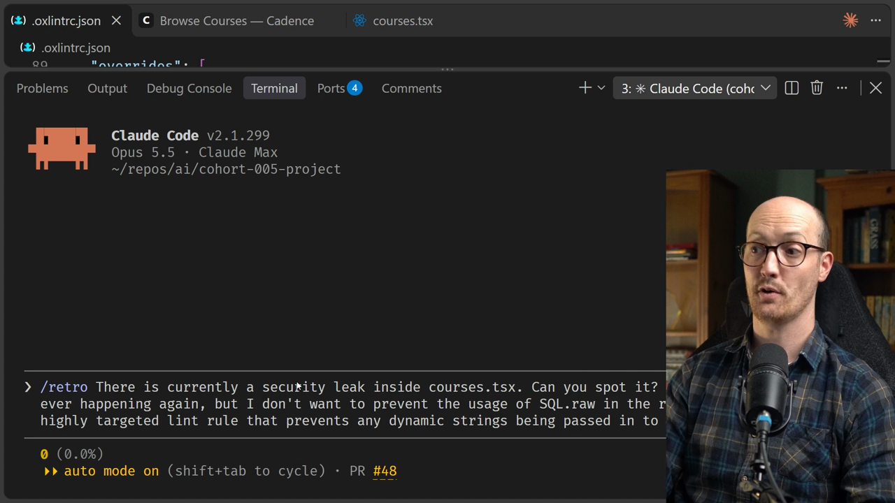
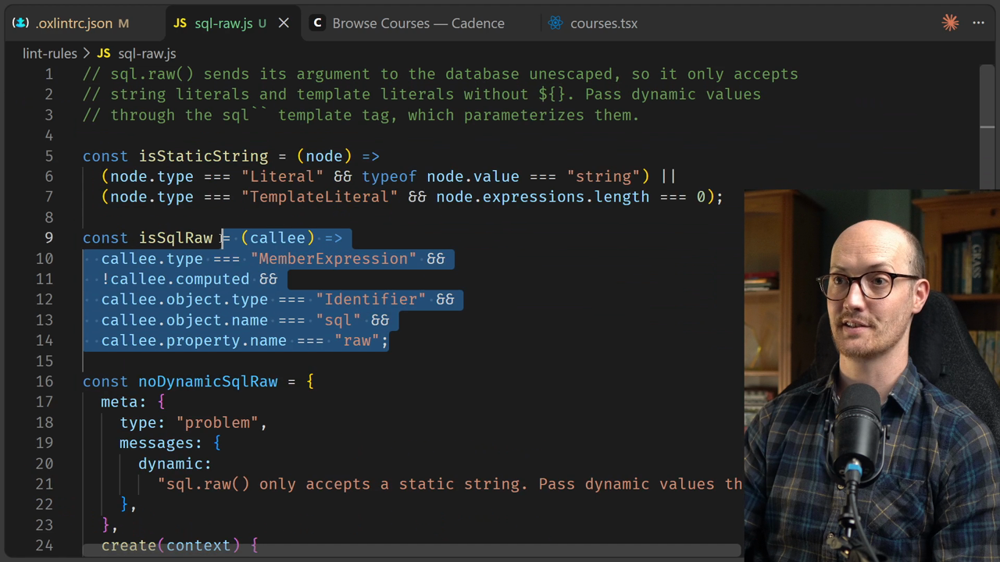
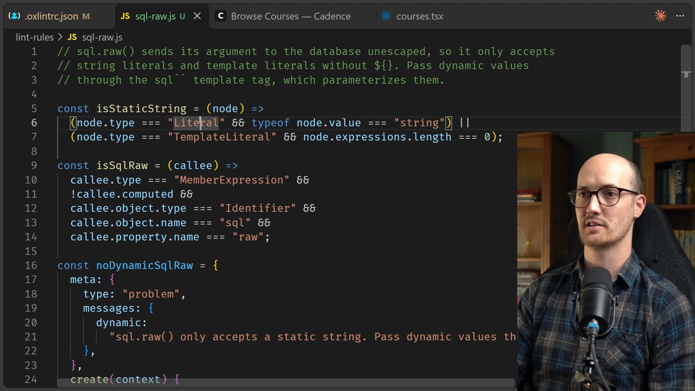
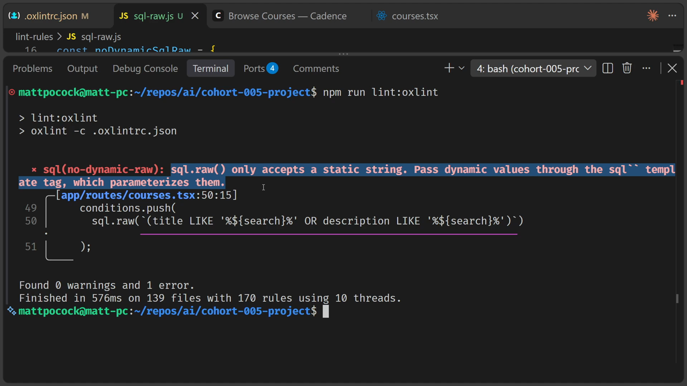
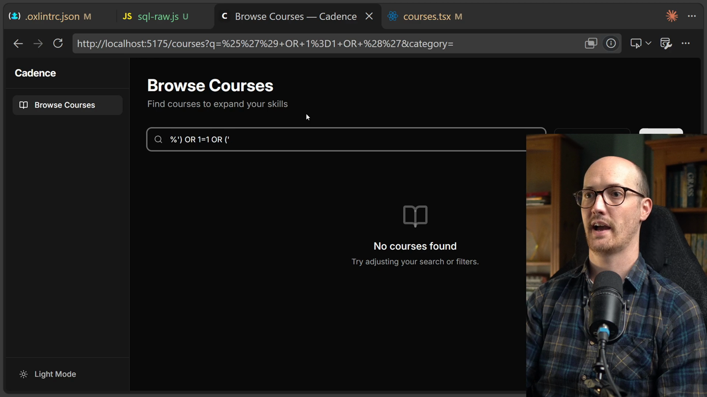

# Writing A Custom Lint Rule Solution

<CommitMap packageManager="npm">
  <Commit id="search-built-with-sql-raw">Start the lesson: the `/courses` search builds its `WHERE` clause with an interpolated `sql.raw`, so it can be injected</Commit>
  <Commit id="custom-lint-rule">See my solution: the `sql/no-dynamic-raw` lint rule added in `lint-rules/sql-raw.js`, and the search rewritten with `like()`</Commit>
</CommitMap>

## Writing the prompt

Let's put a prompt together. There is currently a security leak inside `courses.tsx`, and the prompt asks the [agent](https://www.aihero.dev/ai-coding-dictionary/agent) to spot it.

I want to prevent this from ever happening again. But I don't want to ban `sql.raw` from the repo altogether. Instead, I want a highly targeted lint rule that stops any dynamic string being passed into `sql.raw`.

I run this with the `/retro` [skill](https://www.aihero.dev/ai-coding-dictionary/skill):

```
There is currently a security leak inside courses.tsx. Can you spot it? I want to prevent this ever happening again, but I don't want to prevent the usage of sql.raw in the repo. Instead, I want a highly targeted lint rule that prevents any dynamic strings being passed in to SQL.raw.
```



## The agent finds the leak and writes a rule

Let's fire this off and see what happens.

Predictably, it has found the leak: a SQL injection, where the user's `search` value is interpolated into `sql.raw`.

```ts
sql.raw(`(title LIKE '%${search}%' OR description LIKE '%${search}%')`)
```

And just like that, it has created its own little lint rule inside the `lint-rules` folder.



## Reading the rule

If we take a look, we can see how complicated this code looks, and how hard it would be to write by hand.

But to be honest, these lint rules are incredibly small. They are quite complex in the sense that they have to know the difference between a literal, a template literal, a member expression, an identifier and so on. But they really are terse to write, and [token](https://www.aihero.dev/ai-coding-dictionary/token) efficient.

Here is the rule:

```js
const isStaticString = (node) =>
  (node.type === "Literal" && typeof node.value === "string") ||
  (node.type === "TemplateLiteral" && node.expressions.length === 0);

const isSqlRaw = (callee) =>
  callee.type === "MemberExpression" &&
  !callee.computed &&
  callee.object.type === "Identifier" &&
  callee.object.name === "sql" &&
  callee.property.name === "raw";

const noDynamicSqlRaw = {
  meta: {
    type: "problem",
    messages: {
      dynamic:
        "sql.raw() only accepts a static string. Pass dynamic values through the sql`` template tag, which parameterizes them.",
    },
  },
  create(context) {
    return {
      CallExpression(node) {
        if (!isSqlRaw(node.callee)) return;
        const [arg] = node.arguments;
        if (arg && isStaticString(arg)) return;
        context.report({ node: arg ?? node, messageId: "dynamic" });
      },
    };
  },
};
```

The rule only allows a plain string, or a template literal with no `${}` in it. Anything else passed to `sql.raw` gets reported.



## Running the lint rule

The agent comes back already. It spent 38K tokens, and it says it has added the lint rule.

We can run `npm run lint:oxlint`, and now we should see the leak being flagged:

```txt
app/routes/courses.tsx:50:15: error sql(no-dynamic-raw): sql.raw() only accepts a static string. Pass dynamic values through the sql`` template tag, which parameterizes them.
```

We even get a really helpful message. `sql.raw` only accepts a static string, and dynamic values should be passed through the `` sql`` `` template tag, which parameterizes them.



## Fixing the bug

Now I'll get the agent to fix the bug, and see whether it actually fixes the issue:

```
Fix the bug!
```

It says it has fixed the leak. The search now uses parameterized `like()` calls instead of an interpolated string:

```ts
if (search) {
  const term = `%${search}%`;
  conditions.push(
    or(like(coursesTable.title, term), like(coursesTable.description, term))
  );
}
```

Let's go into the courses page. If I search for Kubernetes, the draft course doesn't appear. And if I add my SQL injection, it no longer works either. So we have fixed the leak.



## When custom lint rules fit

These kinds of custom lint rules are superb when you have something you can detect just by looking at the code itself.

The `/retro` skill is really good at spotting whether something needs to belong to [automated review](https://www.aihero.dev/ai-coding-dictionary/automated-review), or whether it can use creative solutions like this to turn it into an [automated check](https://www.aihero.dev/ai-coding-dictionary/automated-check).

Hopefully this lesson has inspired you to think about the kinds of things you can build with custom lint rules.

