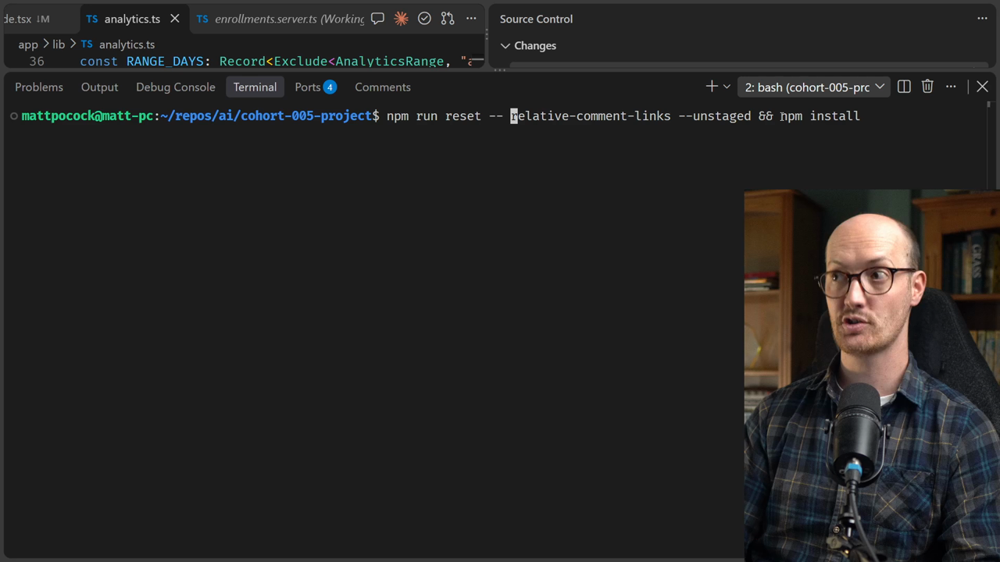

# Mutation Testing

<CommitMap packageManager="npm">
  <Commit id="relative-comment-links">Start the lesson: the relative-link change sits in your working tree as an unstaged diff (reset with `npm run reset -- relative-comment-links --unstaged`)</Commit>
  <Commit id="kill-one-survivor">See my solution: the strengthened `app/lib/comment-markdown.test.ts`</Commit>
</CommitMap>

<Prerequisites title="Crash Course Prerequisites">
  <Prerequisite href="https://www.aihero.dev/workshops/ai-coding-crash-course/how-to-run-the-exercises-a0eb0474">
    How npm run reset works, so you can start the lesson with its changes left unstaged.
  </Prerequisite>
  <Prerequisite href="https://www.aihero.dev/workshops/ai-coding-crash-course/what-are-agent-skills-20f91a4e">
    What a skill is and how the agent decides to load one, like /mutation-testing.
  </Prerequisite>
  <Prerequisite href="https://www.aihero.dev/workshops/ai-coding-crash-course/executing-your-tickets-8389d87c">
    How tests act as a red-green feedback loop for the agent, which mutation testing then grades.
  </Prerequisite>
</Prerequisites>

Passing tests tell you the suite is green. They don't tell you whether it would notice if your code were wrong. Mutation testing grades the test suite itself.

It changes your code on purpose, for example flipping `===` or turning a `-` into a `+`, then reruns your tests. If they stay green, that mutant survived, and you have a hole in your tests.

In this exercise, you'll let an [agent](https://www.aihero.dev/ai-coding-dictionary/agent) run mutation testing on a small change and fix whatever survives.

## Steps To Complete

### Set Up The Exercise

- [ ] Reset the repo to the start of the lesson, leaving the change unstaged

```bash
npm run reset -- relative-comment-links --unstaged
```

The `--` hands everything after it to the reset script. `--unstaged` leaves the commit's changes in your working tree, so the mutation run has changes to mutate.

- [ ] Install the new packages

```bash
npm install
```

This pulls in [StrykerJS](https://stryker-mutator.io/), which runs the mutation testing for you.



### Look Around

- [ ] Find the new `test:mutation` script in `package.json`

```json
"test:mutation": "tsx scripts/mutate-diff.ts",
```

Mutation testing is very slow, because it reruns your suite for every mutant. This script only mutates the code you're actually changing, and only the hunks you changed, which keeps it relatively fast.

- [ ] Read the `/mutation-testing` [skill](https://www.aihero.dev/ai-coding-dictionary/skill)

It lives in `.agents/skills/mutation-testing/SKILL.md`. It teaches an agent how to read the mutation report and scan for surviving mutants.

- [ ] Skim the unstaged changes with `git diff`

You should see a new relative-link branch in `safeHref` in `app/lib/comment-markdown.server.ts`, plus a new `keeps relative links` test.

### Run Mutation Testing

- [ ] Give your agent this prompt

```txt
Run the test mutation script and fix any surviving mutants.
```

- [ ] Watch how the agent reads the report

Does it load the `/mutation-testing` skill? Does it list the survivors and find each one in the source?

- [ ] Review what it does to each surviving mutant

A survivor is a comment on your tests, not on your implementation. The fix is to make a test fail against the mutated code.

### Verify

- [ ] Check that the test improvements ended up in your unstaged changes

The new tests should sit alongside the relative-link change.

- [ ] Rerun the mutation script and confirm no mutants survive

```bash
npm run test:mutation
```

Once you've seen how it goes, compare your result with the `kill-one-survivor` commit in the solution video.
