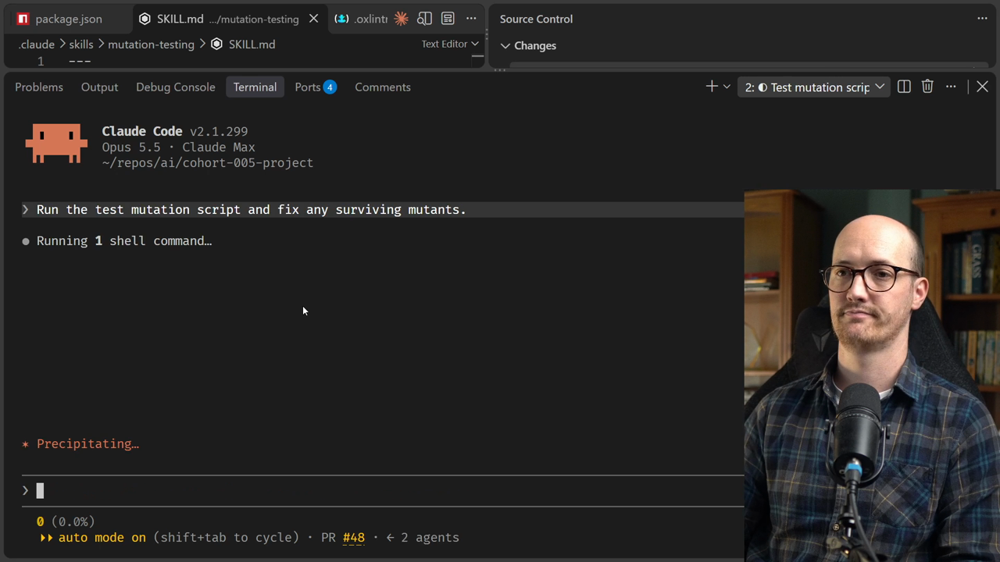
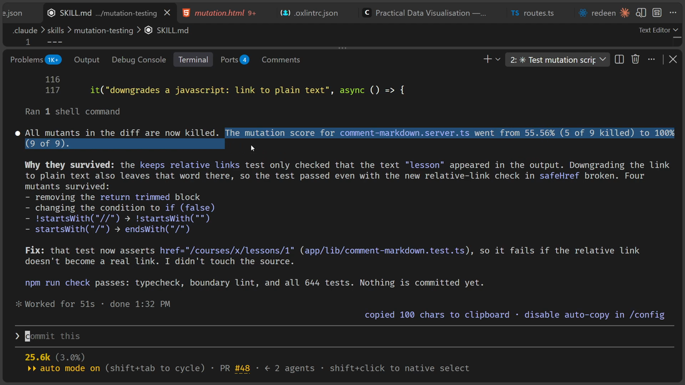
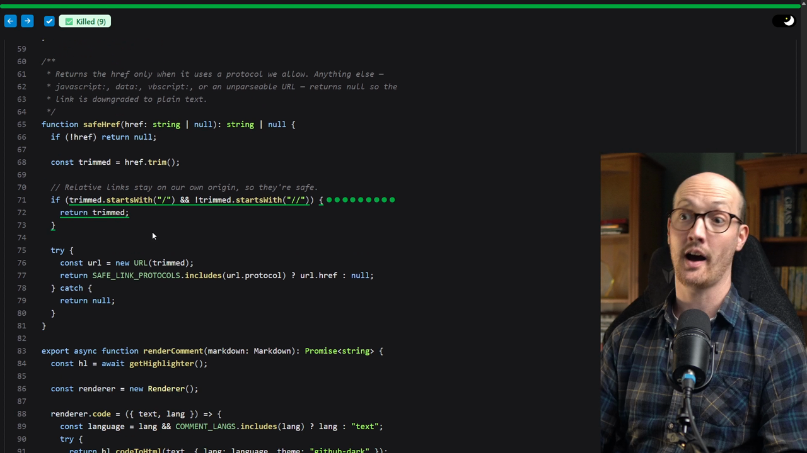
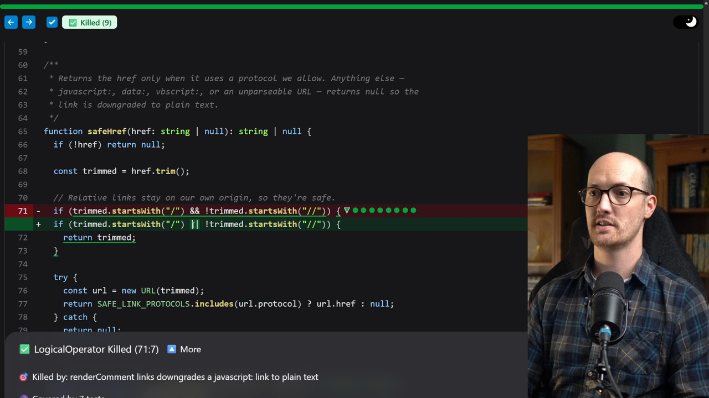
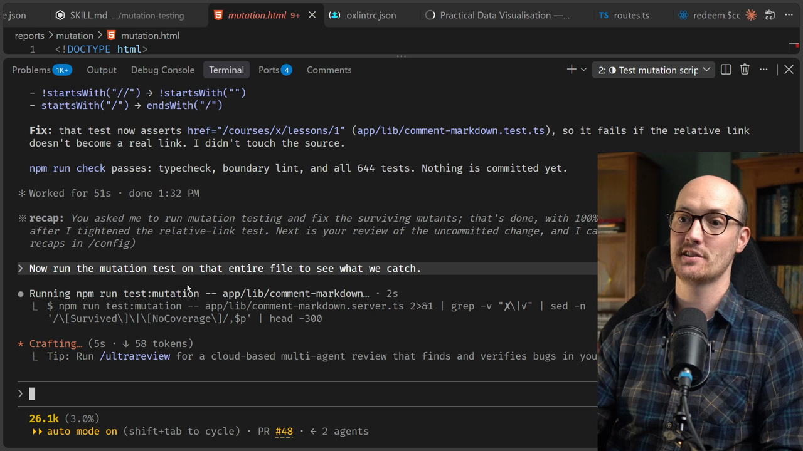
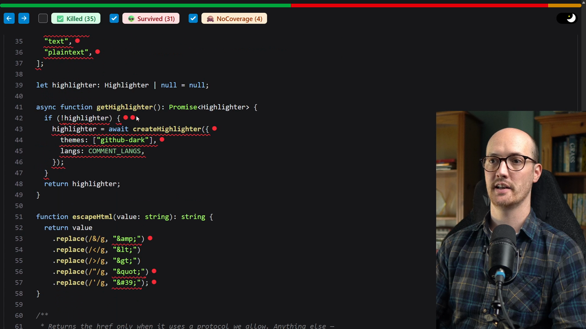
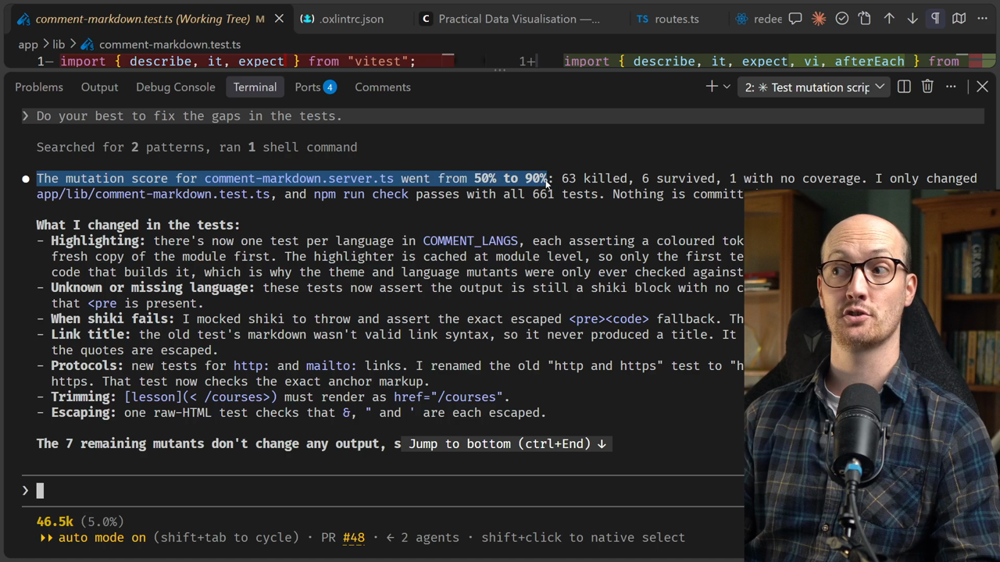
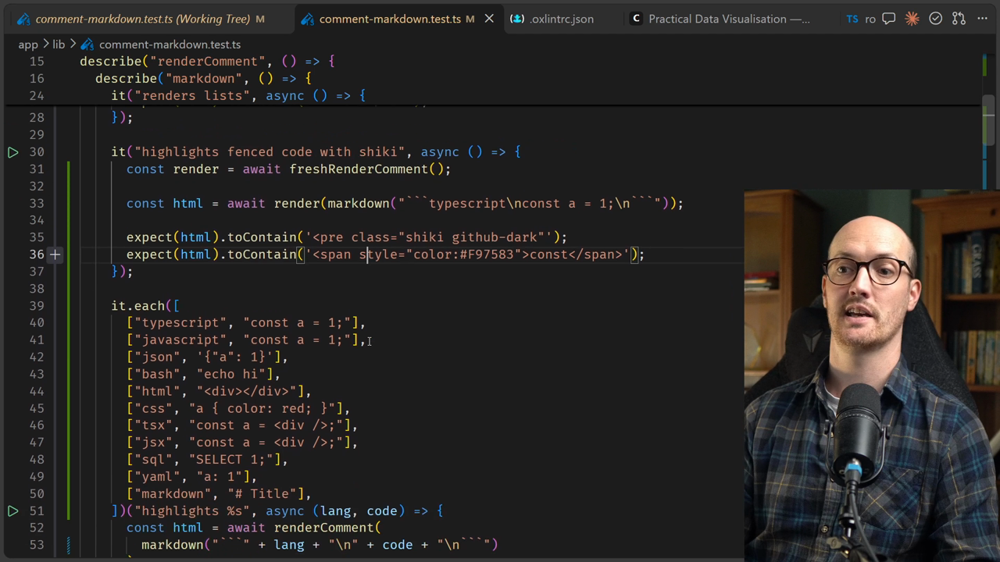

# Mutation Testing Solution

<CommitMap packageManager="npm">
  <Commit id="relative-comment-links">Start the lesson: the relative-link change sits in your working tree as an unstaged diff (reset with `npm run reset -- relative-comment-links --unstaged`)</Commit>
  <Commit id="kill-one-survivor">See my solution: the strengthened `app/lib/comment-markdown.test.ts`</Commit>
</CommitMap>

## Running mutation testing on the diff

Let's give this a go and see what it finds.



The [agent](https://www.aihero.dev/ai-coding-dictionary/agent) is running the `npm run test:mutation` script. The mutation testing [skill](https://www.aihero.dev/ai-coding-dictionary/skill)'s description only causes it to be invoked when the agent is reading the report. It specifically says to use it after running `npm run test:mutation`.

Incredibly, it is already complete. It reports that all mutants in the diff are now killed.

The mutation score for `comment-markdown.server.ts` went from 55.56% to 100%. It did its work in only 51 seconds, including all the agent calls, which is pretty impressive.

| File | Before | After |
|---|---|---|
| `comment-markdown.server.ts` | 55.56% | 100% |



## Reading the HTML report

If we open `reports/mutation/mutation.html`, we can read a full report of what was mutated and what changed.

We can see all of the files that were mutated, and zoom down to the exact lines.



If we filter to the killed mutants, we can see that they are all within the hunk that was changed.

Zooming in and clicking through them, we can see the kinds of change Stryker makes:

- `&&` changed into `||`
- The condition changed to `true`
- The condition changed to `false`
- `startsWith` changed to `endsWith`
- A string changed to an empty string

You can see how many mutations it is making here. And it turns out all of these mutations were killed.



## Mutating the entire file

To get a slightly larger demo, and to see what a full mutation test looks like on a larger diff, I'm going to get the agent to run it on a particular file.

```
Now run the mutation test on that entire file to see what we catch.
```

This means we get to see how long a proper mutation test takes. The agent runs `npm run test:mutation`, passing in the file name.

Before, we were only working with the specific hunk. Now we're working with the entire file.



## The surviving mutants

It's still running here, and we can see there are 31 surviving mutants in this file.

It mutated all of these, for example:

- It took out all of `COMMENT_LANGS`.
- It took out `SAFE_LINK_PROTOCOLS`.
- Inside `getHighlighter`, all of the red dots are things that our system failed on.

We can also look at the 35 that were killed. That's good, because we still have some coverage, but there are plenty of surviving mutants.

| Result | Count |
|---|---|
| Killed | 35 |
| Survived | 31 |



The agent then gives us a little readout of what the real gaps in the tests are.

## Fixing the gaps

```
Do your best to fix the gaps in the tests.
```

Let's run this, and hopefully we'll have a better tested file at the end of it.

It comes back with a summary saying the mutation score went from 50% to 90%.

| Run | Score before | Score after |
|---|---|---|
| Diff only | 55.56% | 100% |
| Entire file | 50% | 90% |



## The tests it added

We can see that a bunch of tests got added.

- It now tests syntax highlighting in various languages.
- It has logic for what happens when the syntax highlighter fails. That's a bug we weren't even countenancing before, and it is really working.
- It checks that it escapes ampersands.
- It keeps `http:` links, `mailto:` links and relative links.

For example, the shiki failure test mocks the highlighter to throw, then asserts the exact fallback output:

```ts
vi.doMock("shiki", () => ({
  createHighlighter: async () => ({
    codeToHtml: () => {
      throw new Error("boom");
    },
  }),
}));
const render = await freshRenderComment();

const html = await render(markdown("```typescript\n<b>&</b>\n```"));

expect(html).toBe("<pre><code>&lt;b&gt;&amp;&lt;/b&gt;</code></pre>");
```

These are really solid tests. We know all of them actually test something in the application. These are not garbage tests that have been added.



## Mutation score as information, not a gate

It's important to say that we haven't tried to get to 100% of mutants killed. We could probably push it further, but I prefer mutation testing as an informational input to the agent.

In other words, this isn't a deterministic check that we're going to fail the agent's output over. It's more like something we use to inform the agent.

We could set a threshold, maybe saying that 90% is as low as we're willing to go, or maybe 85%.

## Where to run it

Your question is probably how, and at what point, we run the mutation testing.

What I like to do is put it in the verification checks that the agent runs itself.

This means it's not going to be a blocker. It's not going to block on the pre-commit hook or slow us down. It's just something the agent is encouraged to do at the end, to give it more information.

Your mileage may vary. You may want to jack it up to 100% and put it on CI, for example.

## Wrapping up

This is how I would approach mutation testing. It is extremely useful for improving the quality of your test suite.

It's also an amazing feedback loop for the agent, because it gives it so much high quality information.

Nice work, and I will see you in the next one.
