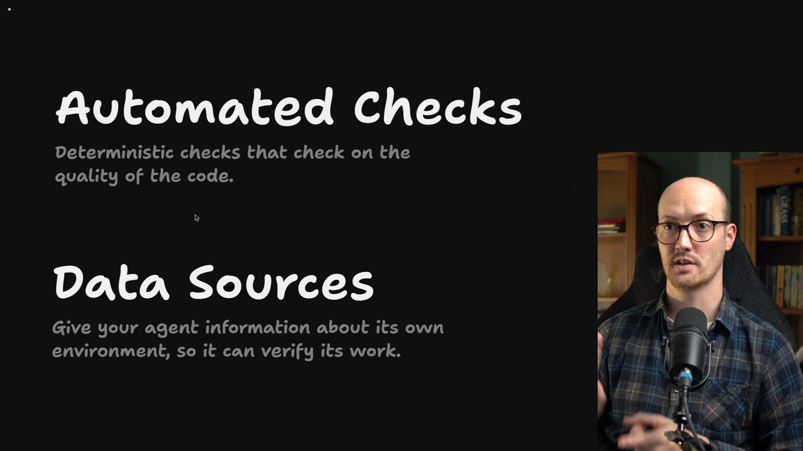
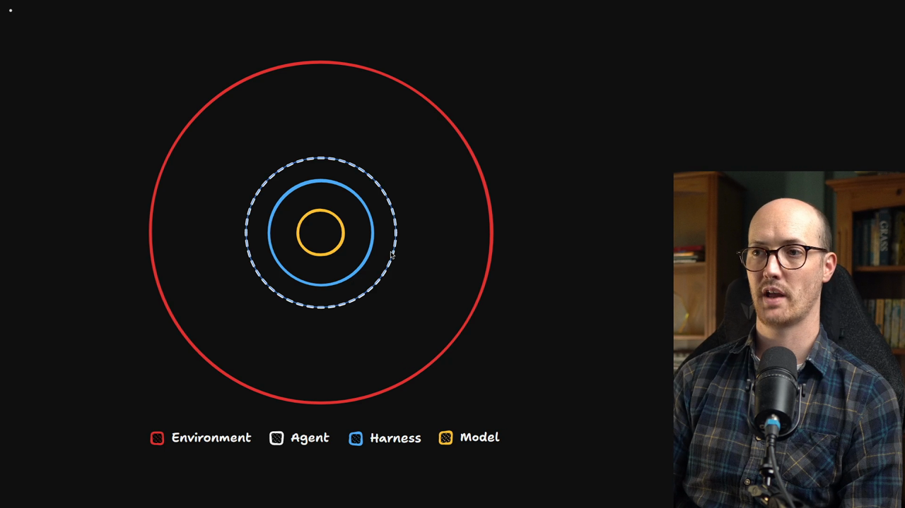
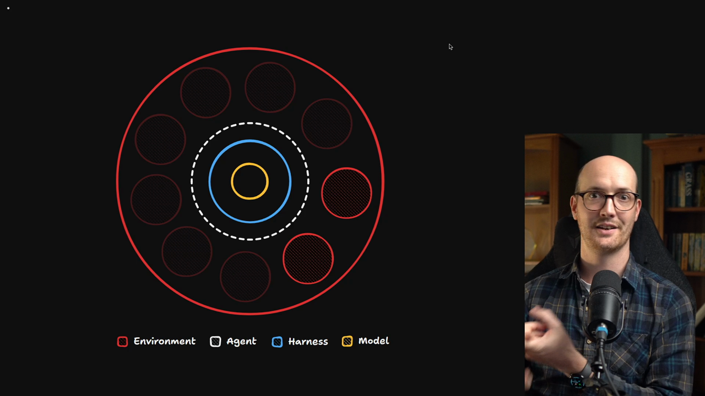
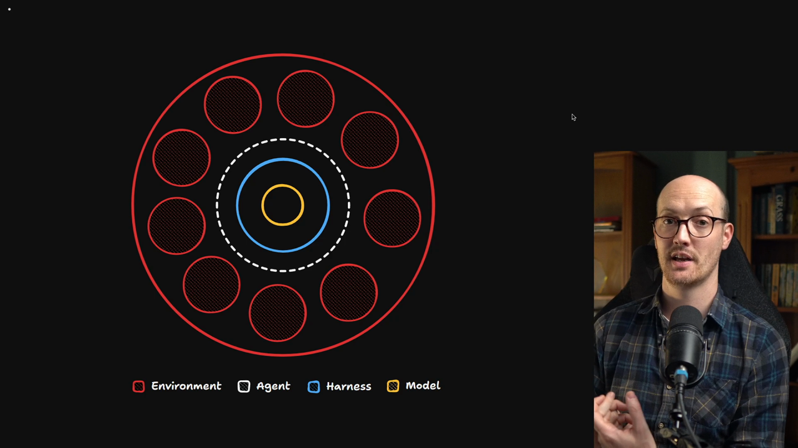

# Data Sources

<Prerequisites title="Crash Course Prerequisites">
  <Prerequisite href="https://www.aihero.dev/workshops/ai-coding-crash-course/models-harnesses-agents-environments-2b9a99a1">
    What the agent's environment is, so you can see what plugging in a data source adds.
  </Prerequisite>
  <Prerequisite href="https://www.aihero.dev/workshops/ai-coding-crash-course/hallucination-77d5b4c6">
    Why an agent guesses when information isn't in its context, and why giving it the facts fixes that.
  </Prerequisite>
  <Prerequisite href="https://www.aihero.dev/workshops/ai-coding-crash-course/executing-your-tickets-8389d87c">
    What a feedback loop is, which data sources feed alongside automated checks.
  </Prerequisite>
</Prerequisites>

So far in this section, we have looked at a bunch of [automated checks](https://www.aihero.dev/ai-coding-dictionary/automated-check). We've looked at lint rules, mutation testing, and other things too.

Throughout the course, I've emphasized the importance of tests. Automated checks have run through this whole course like a stick of rock.

Data sources are something we haven't touched on yet. They give your [agent](https://www.aihero.dev/ai-coding-dictionary/agent) information about its own [environment](https://www.aihero.dev/ai-coding-dictionary/environment), so that it can verify its work.

## The Environment Is More Than the Codebase

Let's go back to this old diagram for a second. The agent sits in the center, operating in its environment.

So far I've talked about the environment as if it's just the codebase. Really, it's so much more than that.

The environment an agent operates in is full of data sources, things it can tap for information.

Some of these data sources are always available to the agent. Others you need to work a little to get functioning. A lot of the time there will be information in the environment that the agent simply can't access.

## What the Agent Might Be Missing

For example:

- You might not have given the agent credentials to access a read-only version of a production database.
- It might not have access to logs from production, or from the place where you deploy production.
- It might not have access to the logs from your dev server or your browser console.

Even if the agent can reach your test suite and your local file system, that is often not enough for it to make informed decisions.

The more of your data sources you can open up to the agent, the better it will be able to verify its work.

## Blind vs Data-Rich

An agent that only has access to the file system and your tests is essentially blind.

An environment rich in data, on the other hand, is an incredibly productive place for an agent to work.

## Data Sources to Plug In

There are many different sources you might want to plug your agent into:

- Dev server logs
- Production logs
- Clicking around your app's front end
- A local database
- A read-only production database
- Your issue tracker
- Your bug reporter, such as Sentry or Bugsnag

One incredibly valuable data source would be a wiki of all the transcripts you've had with clients. That gives the agent direct access to what people have said in meetings about the application you're building for them.

## Feedback Loops

All of this comes back to the idea of feedback loops: agents gather feedback from the environment and then act on it.

That feedback might come from automated checks, or from these data sources.

In this section, I'm going to give you a grab bag of different data sources that we can use to give the agent richer information.

Nice work, and I will see you in the next one.

<Quiz>
  <QuizQuestion data={{
    id: "agent-blind-without-data-sources",
    question: "Your agent can reach the file system and run your tests, and nothing else. How well can it verify its work?",
    type: "multiple-choice",
    choices: [
      { answer: "a", label: "Poorly: it's essentially working blind" },
      { answer: "b", label: "Fully: the tests cover what matters" },
      { answer: "c", label: "Fully: the code is the whole environment" },
      { answer: "d", label: "Poorly, until you give it a larger model" }
    ],
    correct: "a",
    answer: "An agent with only the file system and your tests is essentially blind. Its environment is much more than the codebase: logs, databases, the running front end, your issue tracker and more. A bigger model doesn't give it access to any of that."
  }} />
  <QuizQuestion data={{
    id: "data-source-vs-automated-check",
    question: "You want to give your agent a data source to verify its work against. Which one of these is a data source rather than an automated check?",
    type: "multiple-choice",
    choices: [
      { answer: "a", label: "A read-only copy of the production database" },
      { answer: "b", label: "A lint rule that bans a risky code pattern" },
      { answer: "c", label: "A mutation testing run over the test suite" },
      { answer: "d", label: "A typecheck run inside the pre-commit hook" }
    ],
    correct: "a",
    answer: "A data source gives the agent information about its environment, like a read-only production database, production or dev server logs, or your bug reporter. Lint rules, mutation testing and type checking are automated checks: they give feedback by failing, not by supplying information."
  }} />
</Quiz>
