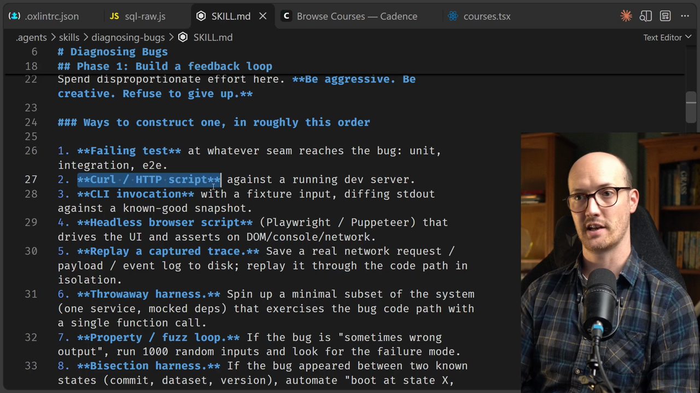
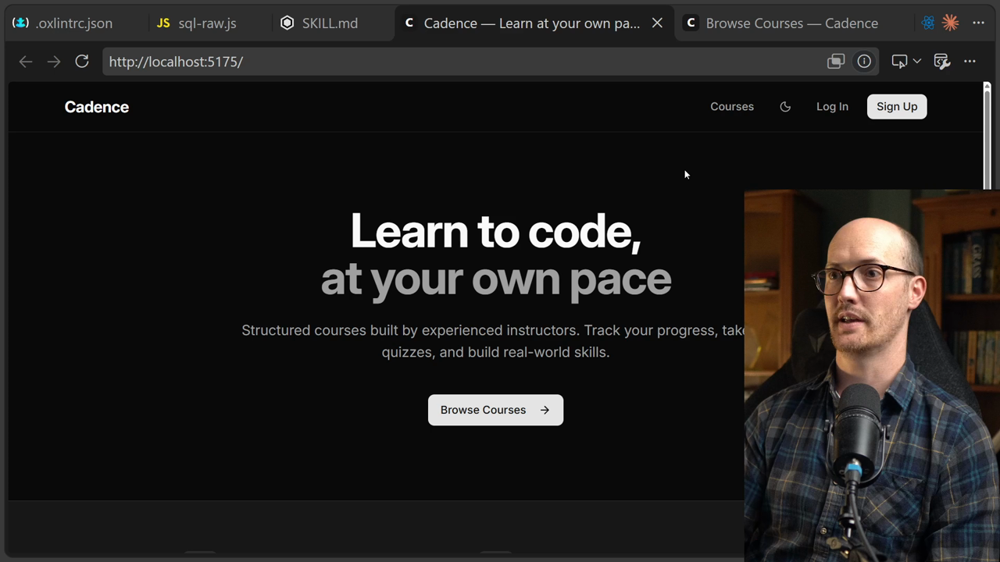
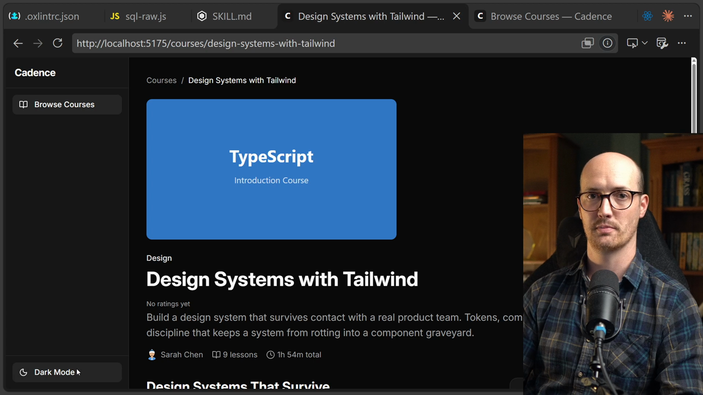

# Diagnosing Bugs

<CommitMap packageManager="npm">
  <Commit id="diagnosing-bugs">Start the lesson: the `diagnosing-bugs` skill added, with the bug already planted</Commit>
  <Commit id="move-the-helper">See my solution: `DevUI` uses `users.length`, the client-side DB helper is deleted, and a dependency-cruiser rule stops it coming back</Commit>
</CommitMap>

<Prerequisites title="Crash Course Prerequisites">
  <Prerequisite href="https://www.aihero.dev/workshops/ai-coding-crash-course/models-harnesses-agents-environments-2b9a99a1">
    What the agent's environment and tools are, so you can see why it can't read the browser console by default.
  </Prerequisite>
  <Prerequisite href="https://www.aihero.dev/workshops/ai-coding-crash-course/what-are-agent-skills-20f91a4e">
    What a skill is and how the agent picks one up on its own, like /diagnosing-bugs.
  </Prerequisite>
  <Prerequisite href="https://www.aihero.dev/workshops/ai-coding-crash-course/executing-your-tickets-8389d87c">
    What a feedback loop is, the thing /diagnosing-bugs builds before it touches the code.
  </Prerequisite>
</Prerequisites>

Some bugs are invisible to everything the [agent](https://www.aihero.dev/ai-coding-dictionary/agent) can normally see. The data it needs to diagnose them lives somewhere it has no access to.

In this exercise, the Cadence app has a bug you can only see from the browser. You'll describe the symptoms to the agent, point it at the right data source, and watch the `/diagnosing-bugs` [skill](https://www.aihero.dev/ai-coding-dictionary/skill) build a feedback loop around it.

## Steps To Complete

### Reset And Explore The Skill

- [ ] Reset the repo to the `diagnosing-bugs` lesson

```bash
npm run reset diagnosing-bugs
```

A new skill appears at `.agents/skills/diagnosing-bugs/SKILL.md`.

- [ ] Read through the `/diagnosing-bugs` skill

It describes itself as a discipline for hard bugs. Its theory is that you build a feedback loop first. The skill lists many ways to construct one, such as a failing test, a curl / HTTP script, or a CLI invocation.

The success of that loop depends on one thing: does the agent have access to the right data?



### See The Bug Yourself

- [ ] Start the dev server and open the app

```bash
npm run dev
```

At first, Cadence looks fine. You can see everything and click through to various systems.



- [ ] Try the broken controls

- In the DevUI panel, click the top control ("Switch user"). It doesn't open. The bottom select (PPP Country) does.
- Click the Dark Mode toggle at the bottom of the left sidebar. It does nothing.



- [ ] Check what data sources the agent could already reach

Look at the terminal running the dev server. An agent could run `npm run dev` itself and read those logs, but there's nothing useful there. It could also read the code, but that means hunting for the bug manually.

You now know what the agent can't see. Your job is to give it access.

### Diagnose With The Agent

- [ ] Describe the symptoms to the agent, without revealing the cause

Pretend you don't know what the bug is. Describe what's broken, and tell the agent to look at the browser console as a data source. Your dev server will usually be on `localhost:5173`, so adjust the port if yours differs.

```txt
There is a strange bug happening in the front end of the application. The top selector in the DevUI panel doesn't work, but the bottom one does. Also, the dark mode toggle doesn't work. My suspicion is that you don't have access to the data that would help you solve this. See if you can connect to the browser console first. Dev server is running on localhost:5173 /diagnosing-bugs
```

The agent should invoke the `/diagnosing-bugs` skill automatically. If you tell it where to look, it will try to be creative in hunting for the data.

- [ ] Watch how the agent gets at the browser console

Note which [tools](https://www.aihero.dev/ai-coding-dictionary/tool) or approaches it reaches for to read the console. This is the data source doing its job.

- [ ] Confirm the agent finds and fixes the bug

Reload the app and check that the top DevUI control opens and the Dark Mode toggle works.

- [ ] Reflect on how much the data access mattered

Notice how important having access to the right data was. You also now have a new discipline for finding bugs.

Good luck, and I'll see you in the solution.
