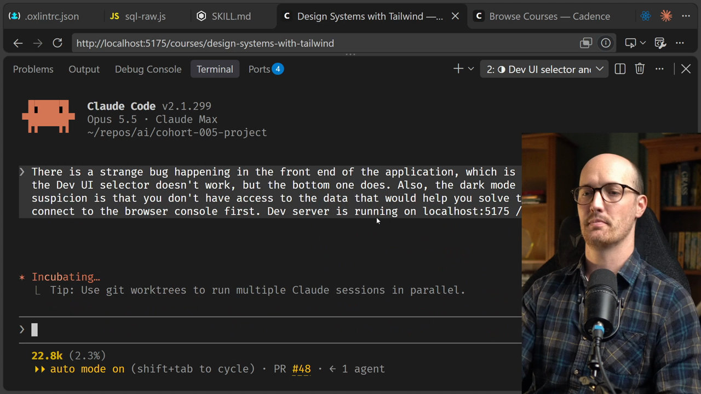
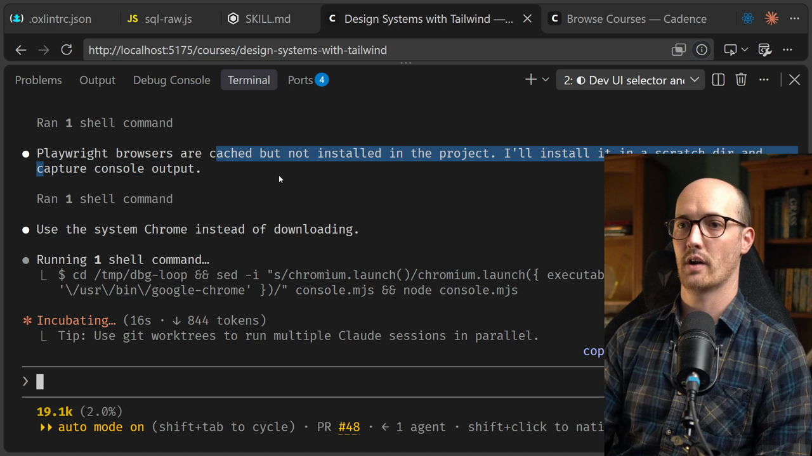
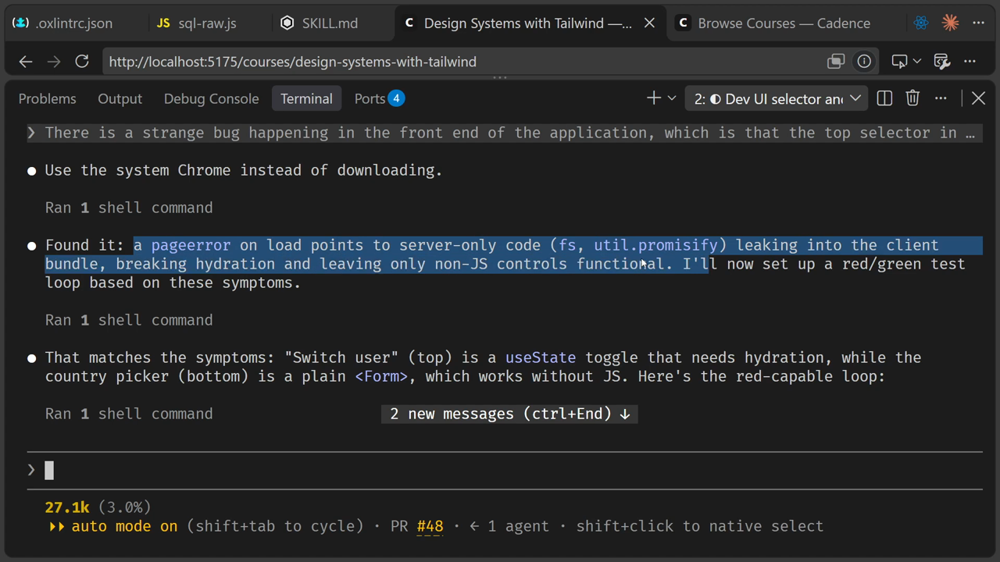
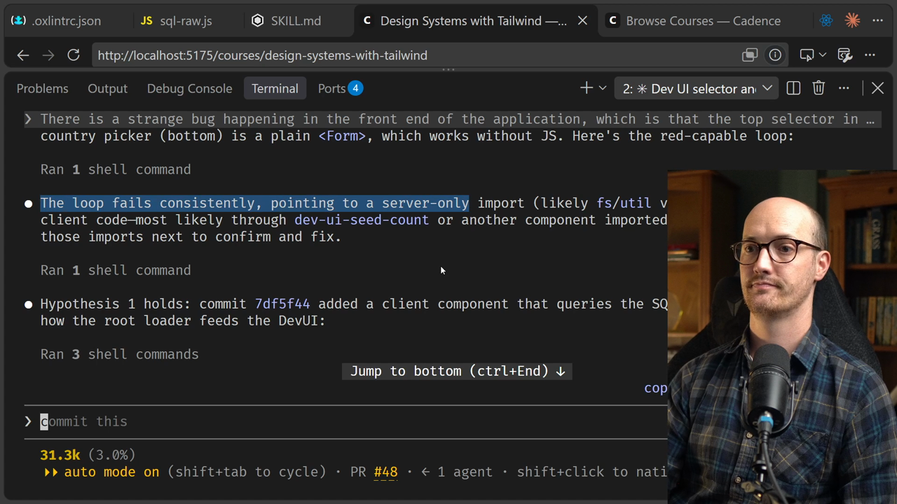
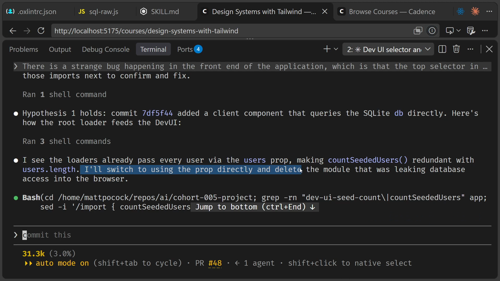
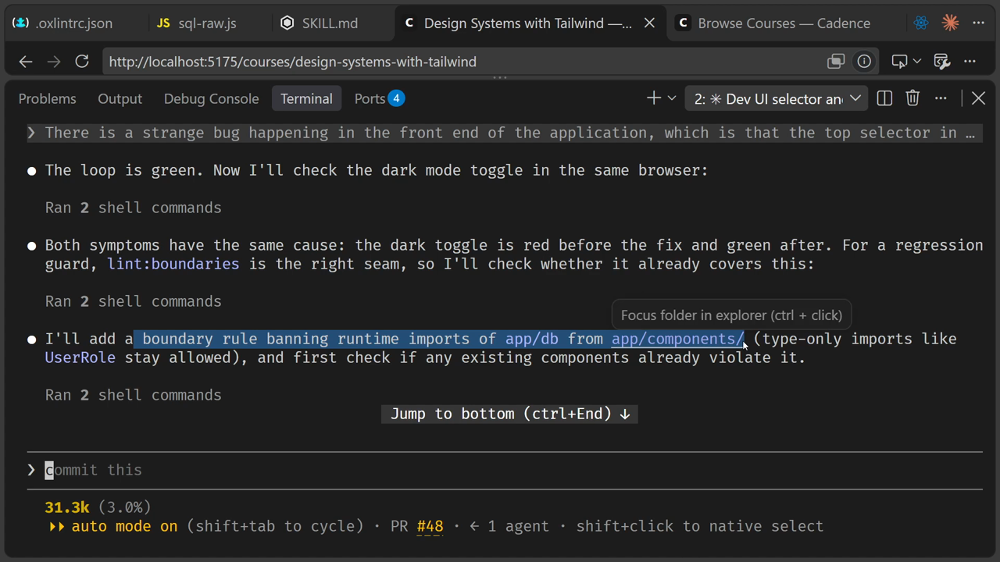
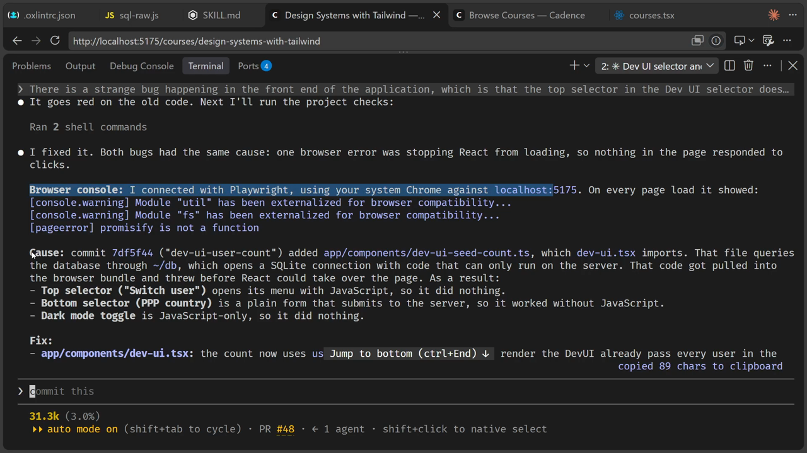

# Diagnosing Bugs Solution

<CommitMap packageManager="npm">
  <Commit id="diagnosing-bugs">Start the lesson: the repo has the planted bug and the `diagnosing-bugs` skill installed</Commit>
  <Commit id="move-the-helper">See my solution: `DevUI` uses `users.length`, the helper is deleted and the dependency-cruiser rule is added</Commit>
</CommitMap>

Let's pull together a prompt. It describes the bug and tells the [agent](https://www.aihero.dev/ai-coding-dictionary/agent) where to look.

```
There is a strange bug happening in the front end of the application, which is that the top selector in the Dev UI selector doesn't work, but the bottom one does. Also, the dark mode toggle doesn't work. My suspicion is that you don't have access to the data that would help you solve this. So see if you can connect to the browser console first. Dev server is running on localhost:5175 /diagnosing-bugs
```



Two things to note about this prompt:

- My suspicion is that the agent doesn't have access to the data that would help it solve this. So I ask it to connect to the browser console first.
- My dev server is running on `localhost:5175`. Yours doesn't need the port, because it's probably running on the default, `5173`.

The first time I ran this, the `/diagnosing-bugs` [skill](https://www.aihero.dev/ai-coding-dictionary/skill) didn't actually trigger. So I've added `/diagnosing-bugs` at the end, just to make sure we get the right demo in the lesson.

## The agent reaches for Playwright

Immediately, it starts experimenting with a tool called Playwright.



It looks like I've already got a version of Chrome in here. Playwright uses Chrome to debug the application. It opens it in a real browser and clicks around to see if it can modify things.

Crucially, it then has access to the browser console.

## Reading the browser console

The console shows a page error on load. The agent says it points to server-only code leaking into the client bundle. That breaks hydration and leaves only the non-JS controls functional.

```txt
[pageerror] promisify is not a function
```



That explains the symptoms in our little DevUI:

| Control                       | Needs JavaScript? | Result |
| ----------------------------- | ----------------- | ------ |
| Top selector ("Switch user")  | Yes               | Broken |
| Bottom selector (PPP country) | No                | Works  |
| Dark mode toggle              | Yes               | Broken |

The bottom select is a plain form, so it doesn't need JavaScript. The top one does. And it looks like the agent has already gone and fixed it.

## The feedback loop

The `/diagnosing-bugs` skill tries to build a loop first. We can see that the loop fails consistently.



If the first hypothesis had failed, it would have tried lots of hypotheses until it found one that fit.

## The fix

It then attempted the fix. It noticed that the loader already passes every user to `DevUI`, so it switched to using an alternate method: counting `users.length` instead of querying the database from a client component.

```diff
-import { countSeededUsers } from "~/components/dev-ui-seed-count";
```

```diff
-          DevUI · {countSeededUsers()} users
+          DevUI · {users.length} users
```



## The regression guard

It then adds a regression guard, and it actually uses our `lint:boundaries` script.

This adds a boundary rule banning runtime imports of `app/db` from `app/components`. It's using our existing [automated checks](https://www.aihero.dev/ai-coding-dictionary/automated-check) to stop this happening again. You can see it adds the rule to dependency-cruiser.

```js
{
  name: "components-no-db-connection",
  severity: "error",
  from: { path: "^app/components/" },
  to: {
    path: ["^app/db/index\\.ts$", "^node_modules/better-sqlite3/"],
  },
},
```



Then, one more time, it confirms that the rule goes red on the buggy code and green on the fix.

## The readout

Finally, it gives this nice little readout.



In summary, the agent:

- Went through the browser console.
- Connected to the right data.
- Found the exact cause.
- Found the fix.
- Made sure it's not going to happen again, with lint boundaries.

## Why access to data matters

Honestly, once an agent has access to the right data sources, solving these bugs is absolutely trivial. It can ingest, sort and understand logs and information far better than you or I could.

So often when people say that agents are bad at fixing bugs, it's just that they don't have access to the right data.

Hopefully you also saw the extra rigour that the `/diagnosing-bugs` skill provides. It has a kind of built-in retro, where it stops the bug ever happening again.

Nice work, and I'll see you in the next one.
