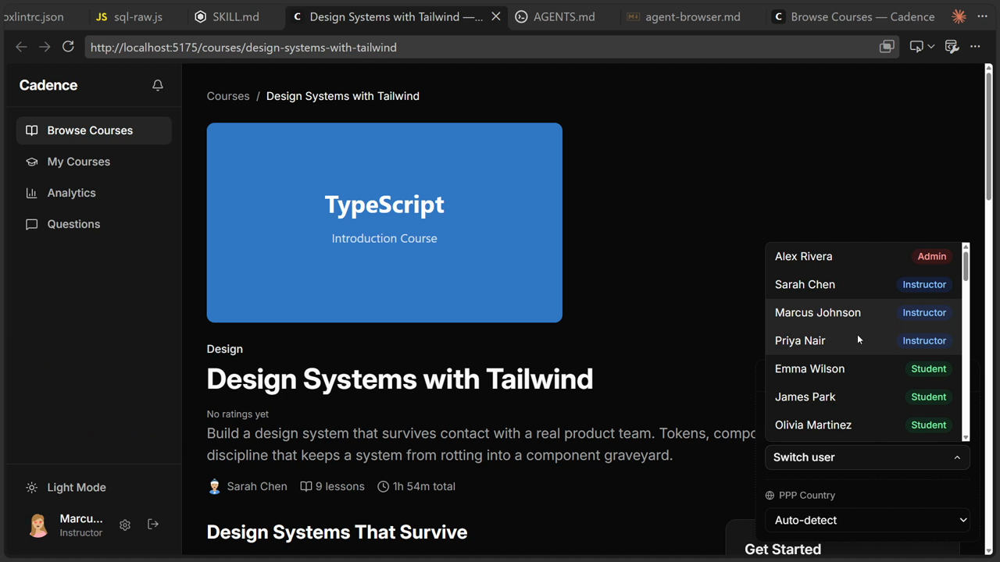
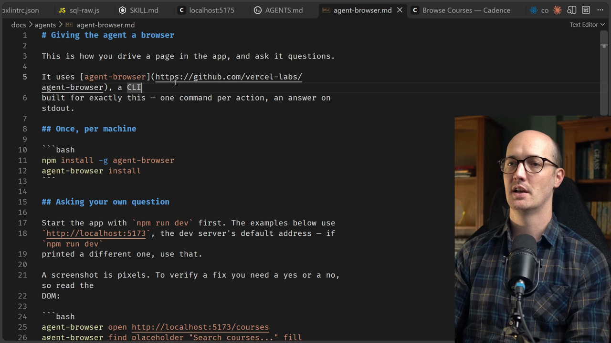

# Verifying Frontend Apps

<CommitMap packageManager="npm">
  <Commit id="agent-browser">Start the lesson: `agent-browser` docs and the `AGENTS.md` section added, switcher bug still present</Commit>
  <Commit id="fix-dev-ui-switcher">See my solution: the fix in `app/components/dev-ui.tsx`</Commit>
</CommitMap>

<Prerequisites title="Crash Course Prerequisites">
  <Prerequisite href="https://www.aihero.dev/workshops/ai-coding-crash-course/models-harnesses-agents-environments-2b9a99a1">
    What the agent's environment and tools are, so you can see what giving it a browser adds.
  </Prerequisite>
  <Prerequisite href="https://www.aihero.dev/workshops/ai-coding-crash-course/the-steering-map-c061e049">
    What AGENTS.md is and why it points to docs instead of holding everything.
  </Prerequisite>
  <Prerequisite href="https://www.aihero.dev/workshops/ai-coding-crash-course/steering-with-a-pointer-0074b76f">
    The doc-plus-pointer pattern this lesson uses for docs/agents/agent-browser.md.
  </Prerequisite>
  <Prerequisite href="https://www.aihero.dev/workshops/ai-coding-crash-course/what-are-agent-skills-20f91a4e">
    What a skill is, so asking the PR skill for evidence makes sense.
  </Prerequisite>
</Prerequisites>

In the last lesson, we saw how powerful it is to attach a new data source to the [agent](https://www.aihero.dev/ai-coding-dictionary/agent). Let's attach another one: [`agent-browser`](https://github.com/vercel-labs/agent-browser), which gives the agent eyes.

It lets the agent drive a real browser, click through the app and see what's on the page. Subtle visual interactions are almost impossible to judge from code alone, so we're going to use it to fix a bug that has probably been bothering you too.



## The bug

In the running app, open the DevUI panel and click **Switch user**. Pick a user, and the list stays open.

Clicking outside the panel doesn't close it either. The only way to close it is to click **Switch user** again.

## How the agent learns about `agent-browser`

`agent-browser` is a thin wrapper over Playwright. It lets the agent run commands like `agent-browser open`, `agent-browser snapshot`, click, fill, get text and screenshot.

`AGENTS.md` has an `agent-browser` section that works as a [context pointer](https://www.aihero.dev/ai-coding-dictionary/context-pointer). It sends the agent to `docs/agents/agent-browser.md` before it touches the browser.



That doc is a better home than generic docs. It can hold details specific to this app, and it gives the agent somewhere to store what it learns if a browser session goes wrong and needs a retro.

## Steps To Complete

### Set up the workspace

- [ ] Reset your branch to the start of the lesson

```bash
npm run reset agent-browser
```

- [ ] Install dependencies, migrate and seed the database

```bash
npm install
npm run db:migrate
npm run db:seed
```

- [ ] Make sure `agent-browser` is installed on your machine

```bash
npm install -g agent-browser
agent-browser install
```

### Review what the agent will read

- [ ] Find the `agent-browser` section in `AGENTS.md`

- [ ] Skim `docs/agents/agent-browser.md`, including the parts that are specific to this app

### Reproduce the bug yourself

- [ ] Start the dev server, open the app, click **Switch user**, pick a user and confirm the list stays open

```bash
npm run dev
```

### Give the agent the task

- [ ] Describe the bug to your agent and ask it to open a PR

Because the PR [skill](https://www.aihero.dev/ai-coding-dictionary/skill) requires evidence, ask for before and after screenshots of the interaction. That forces the agent to verify its own work and makes your review easier. Adapt this prompt:

```txt
In the DevUI, when I switch user and pick someone from the list, it switches me over but the user list stays open. Clicking outside doesn't close it either. I have to click Switch user again to close it.

Use agent-browser to see it for yourself. docs/agents/agent-browser.md says how.

Then fix it and create a PR. Include before and after screenshots of the interaction as evidence.
```
