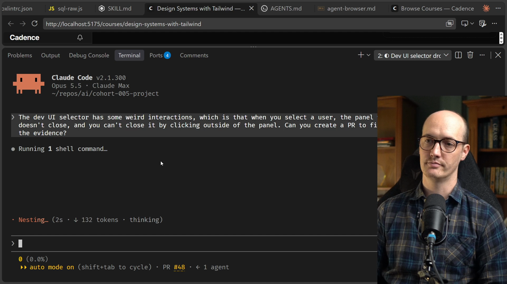
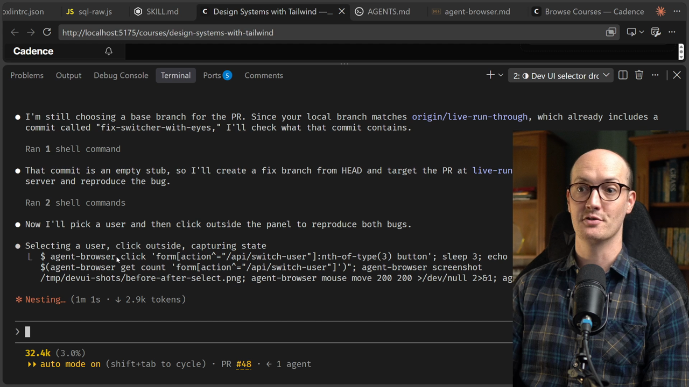
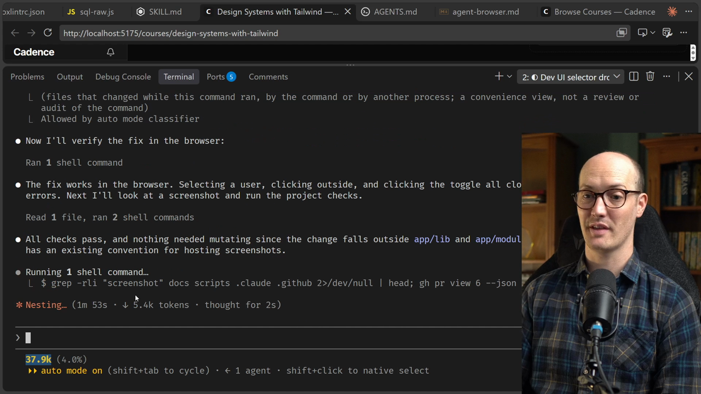
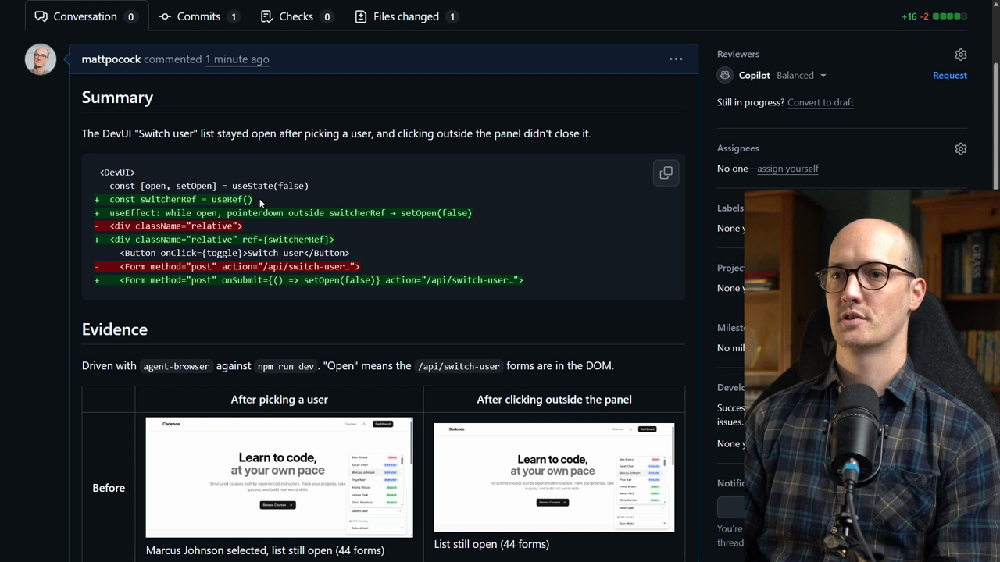
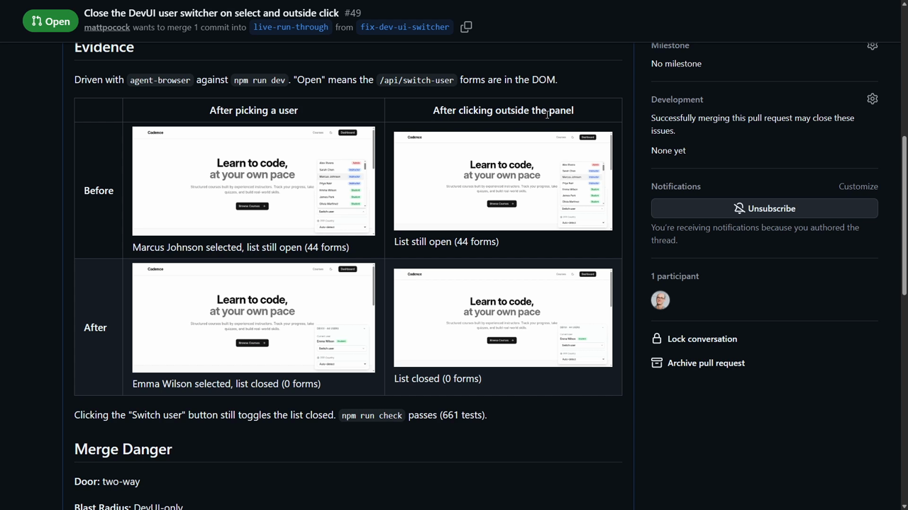
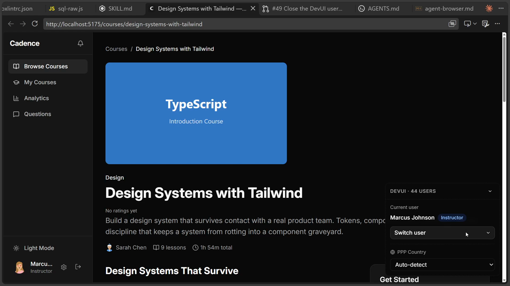

# Verifying Frontend Apps Solution

<CommitMap packageManager="npm">
<Commit id="agent-browser">Start the lesson: the `agent-browser` guide is in place and the switcher bug is still present</Commit>
<Commit id="fix-dev-ui-switcher">See my solution: the DevUI switcher closes on select and on outside click</Commit>
</CommitMap>

Let's put together a prompt. The DevUI selector has some weird interactions. When you select a user, the panel where you select the users doesn't close, and you can't close it by clicking outside of the panel.

```txt
The dev UI selector has some weird interactions, which is that when you select a user, the panel where you select the users doesn't close, and you can't close it by clicking outside of the panel. Can you create a PR to fix this and use screenshots as the evidence?
```



Let's run this and see how it gets on.

## Watching the agent reproduce the bug

Because we've got a slightly funky commit history, the [agent](https://www.aihero.dev/ai-coding-dictionary/agent) has to choose a base branch for the PR. It may do something a bit weird there, but it should be okay.

What matters is that it clicks with `agent-browser`. It has picked up the guidance in `AGENTS.md`, and it has managed to reproduce the first bug.



Now it has made the fix, and it is going to verify the fix in the browser.

## Is browser verification too expensive?

This kind of verification has a reputation for being really [token](https://www.aihero.dev/ai-coding-dictionary/token) expensive. In this run, it's not that bad. We're up to 38.1k tokens.



## Verification benefits from higher effort

Verification is something that really benefits from higher [effort](https://www.aihero.dev/ai-coding-dictionary/effort) levels. Think of effort as how much work you're putting into the asset you're creating.

With verification, the asset we're creating is evidence that our check works. The more effort the [model](https://www.aihero.dev/ai-coding-dictionary/model) puts in, the better the verification you get out.

## The PR

The agent has now created the PR with the fix.

We have our little show me diff at the top of the PR body. It shows a new `useRef` and a `useEffect`, which seems fine.

A `pointerdown` listener is attached to `document` only while the list is open. It closes the list when the click lands outside the switcher.

```tsx
const switcherRef = useRef<HTMLDivElement>(null);

useEffect(() => {
  if (!open) return;
  function handlePointerDown(event: PointerEvent) {
    if (!switcherRef.current?.contains(event.target as Node)) {
      setOpen(false);
    }
  }
  document.addEventListener("pointerdown", handlePointerDown);
  return () => document.removeEventListener("pointerdown", handlePointerDown);
}, [open]);
```

Each user's form also closes the list when it's submitted, and the wrapping `div` gets the ref:

```tsx
<div className="relative" ref={switcherRef}>
  {/* ... */}
  <Form
    key={user.id}
    method="post"
    onSubmit={() => setOpen(false)}
    action={`/api/switch-user?redirectTo=${encodeURIComponent(location.pathname + location.search)}`}
  >
```



## Before and after evidence

Crucially, we can see a before and after.

|            | After picking a user   | After clicking outside the panel |
| ---------- | ---------------------- | -------------------------------- |
| **Before** | The list is still open | The list is still open           |
| **After**  | The list is closed     | The list is closed               |



How about that for evidence? That is some level of evidence. How beautiful.

We can also see this is a two-way door, with a blast radius of the DevUI only. Phenomenal.

## Checking it ourselves

Let's check it ourselves on the branch. We open the switcher and click outside it, and it closes. If we choose a different instructor, it closes too.



## Why the richer evidence matters

By connecting the agent to the front end, we've done two things:

- The agent verifies its own work more effectively.
- It gives us much richer evidence in the PR body, to convince us that the fix actually works.

A lot of folks just say, "I just need to see it working". But I find the before really comforting as well. With the before, you can see that the agent has identified the bug correctly, and that's really important.

I've even heard of folks creating videos out of this. They take the screenshots and have a text-to-speech API narrate over them. You can just watch a video of the bug happening and then the bug being fixed.

That makes the evidence so much richer, and so much easier and faster to review.

This is going to be essential as we start cranking up the speed of our [software factory](https://www.aihero.dev/ai-coding-dictionary/software-factory) and accelerating the number of PRs we push through our system.

Nice work, and I'll see you in the next one.
