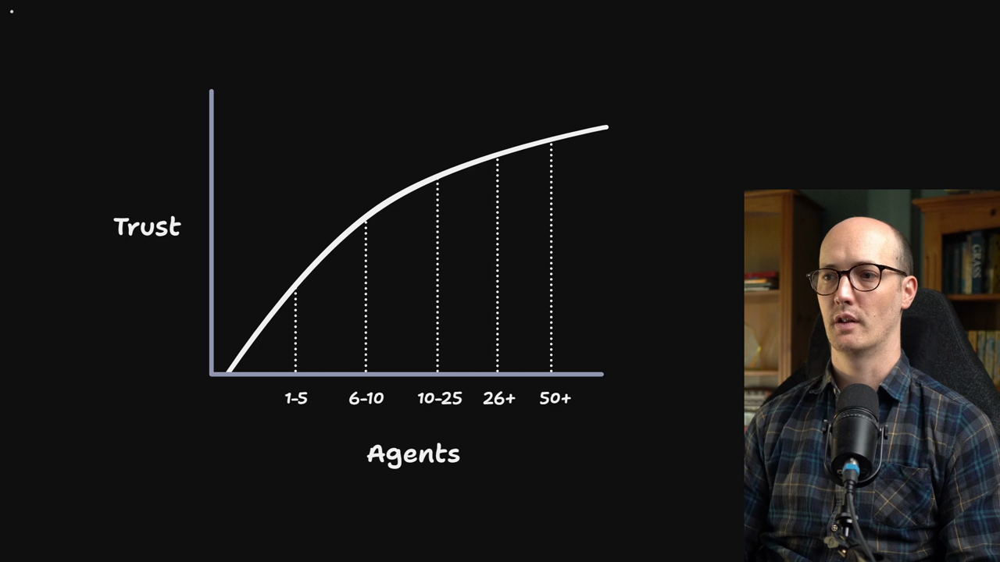
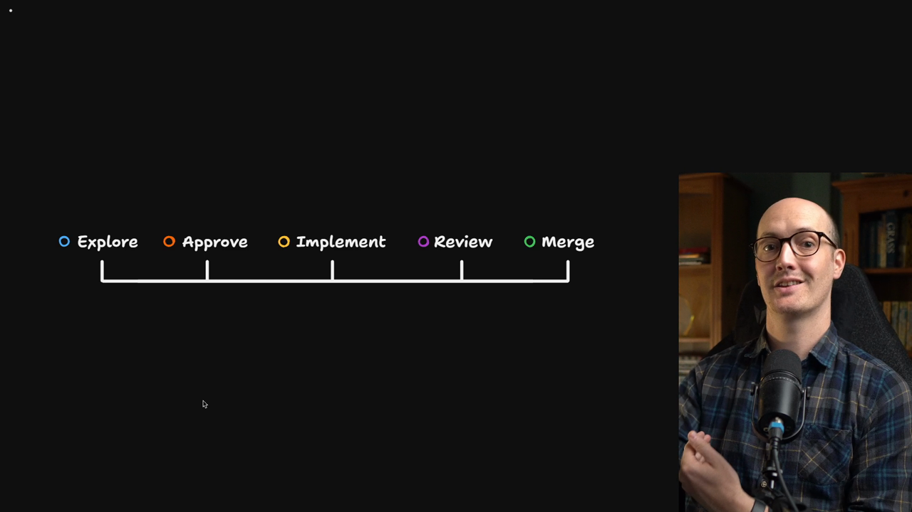
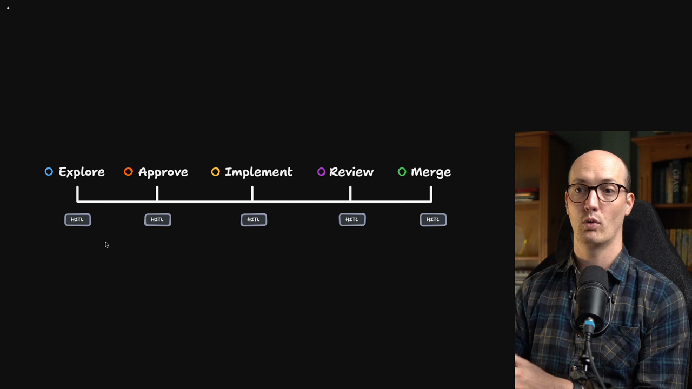
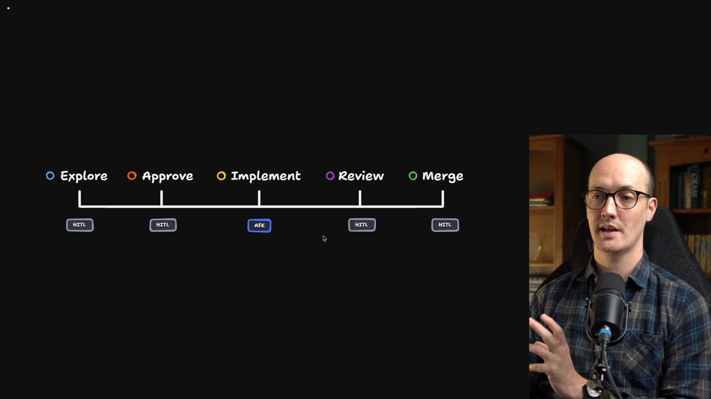
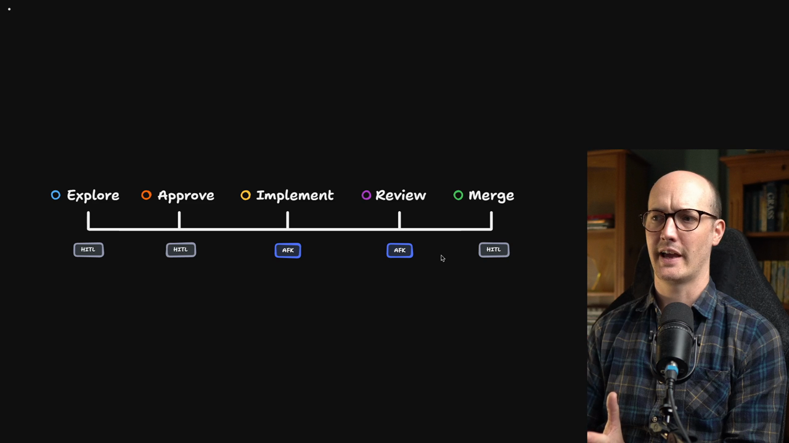
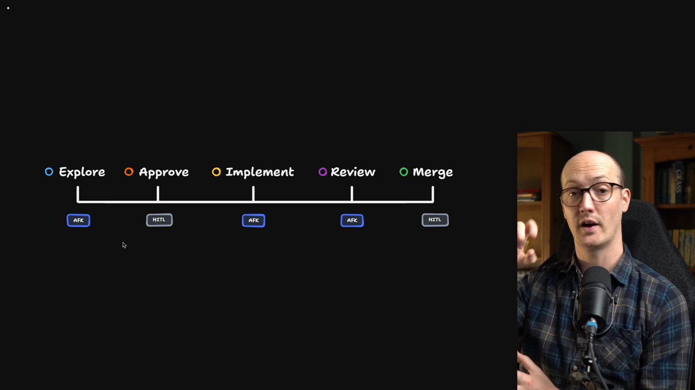
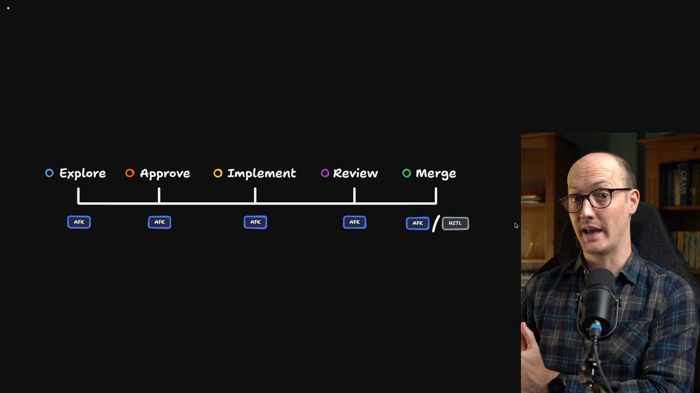
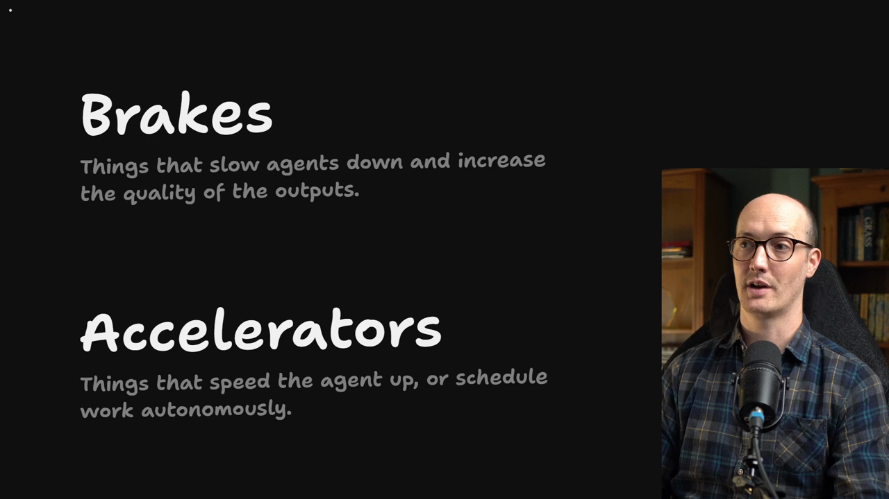

# Our Factory's Goal

<Prerequisites title="Crash Course Prerequisites">
  <Prerequisite href="https://www.aihero.dev/workshops/ai-coding-crash-course/how-much-did-it-cost-abb3ab6e">
    How tokens turn into cost, which decides how many agents you can afford to run at once.
  </Prerequisite>
  <Prerequisite href="https://www.aihero.dev/workshops/ai-coding-crash-course/the-grill-execute-clear-loop-fac85414">
    How grilling works, since it's how the explore step starts.
  </Prerequisite>
  <Prerequisite href="https://www.aihero.dev/workshops/ai-coding-crash-course/enforcing-your-coding-standards-f1656d67">
    The layers of review, and why the chain still ends with a human deciding whether to merge.
  </Prerequisite>
  <Prerequisite href="https://www.aihero.dev/workshops/ai-coding-crash-course/where-you-go-from-here-4c6bb9b1">
    What AFK agents are, the step beyond the five-step system that the factory is built on.
  </Prerequisite>
</Prerequisites>

We have now gone through all of the possible ways to slow down our [agents](https://www.aihero.dev/ai-coding-dictionary/agent). They increase quality, make [human review](https://www.aihero.dev/ai-coding-dictionary/human-review) work, and add [automated checks](https://www.aihero.dev/ai-coding-dictionary/automated-check) and [automated review](https://www.aihero.dev/ai-coding-dictionary/automated-review).

In other words, we have learned every way to put **brakes** on an agent: things that slow them down and increase the quality of their outputs.

| | What it does |
|---|---|
| **Brakes** | Things that slow agents down and increase the quality of the outputs. |
| **Accelerators** | Things that speed the agent up, or schedule work autonomously. |

That's the right sequence, because now we are going to jam on the accelerator. We are going to find ways to speed up our [factory](https://www.aihero.dev/ai-coding-dictionary/software-factory), to push more work through it, and especially to schedule work autonomously.

## The Trust Ladder

I'm going to borrow a visual from a friend. It's about climbing the trust ladder. The more you can trust your agents, the more you can run simultaneously.

Throughout this journey, you might only have been comfortable running one to five agents at the same time.

As you begin to trust the work that agents are producing, you can stack more agents up at once. You can end up with 50 or 100 agents running at the same time.

This can lead to absolutely outrageous numbers of PRs pushed through every month.

Where you end up on this ladder depends on your company's appetite for spending [tokens](https://www.aihero.dev/ai-coding-dictionary/token), and how far you want to push this. Somewhere on this graph will be your happy place.

That's the point at which you'll say: I am shipping fast enough, my tokens to value ratio is correct, and we are doing better work than we've ever done before.

But you're probably also thinking: if I've got 50 agents running at the same time, how am I going to prompt all of them? That sounds like a nightmare to handle.

Let me show you a couple of mechanics for running 50 agents at the same time without pulling our hair out.

## The Steps to Merge

Let's start by looking at all the steps we currently take to get work merged into the main branch.

1. **Explore.** We think about the thing we're going to build, either with a [grilling](https://www.aihero.dev/ai-coding-dictionary/grilling) [session](https://www.aihero.dev/ai-coding-dictionary/session) or by getting the agent to explore the bug.
2. **Approve.** At some point we say, yes, this is what we're going to build. This might be mixed in with the explore step, or we might go in already knowing we're going to do it.
3. **Implement.** We get the agent to go away and do its thing.
4. **Review.** Part of this is done by the agent, and another part is done by the human.
5. **Merge.** The human presses the button and sends it to production.

## Human in the Loop

All of these phases so far are what I'm going to call **[HITL](https://www.aihero.dev/ai-coding-dictionary/human-in-the-loop)**, or Human in the Loop.

In our current process, even if an agent is involved, there is still a human in the loop at every single step.

## Flipping Steps to AFK

What if we change some of these to be **[AFK](https://www.aihero.dev/ai-coding-dictionary/afk)** instead? Away from keyboard, with no human involved at all.

The implement phase is basically AFK already. We explore as a human, then we approve, the agent goes away and implements, and then we come back for review.

Review is also basically AFK, because we're only using it as a way to improve the process and to spot anything really dangerous on one-way doors.

What about exploration? What if agents could autonomously find problems or bugs inside our repo, check whether they're valid, and create reproductions of them?

What if an agent could respond to incoming feature requests, explore their validity, and figure out what we'd need to modify?

What if, for bug reports, the agent could approve the reproduction automatically if it was satisfactory?

Then the implementer agent goes through and the review happens. Only then does the human come back, at merge, once all the information is there.

## Merging Some PRs Automatically

And what if we take the merge phase and merge some PRs automatically? These would be:

- PRs that are two-way doors
- PRs that have a small blast radius
- PRs that don't contain data migrations

You can start to see how parts of the software lifecycle can be automated.

## The Software Factory

This is what I think of as a software factory. We take the checkpoints where we've previously worked as humans, manually approving, exploring and even implementing, and we take the human out of them.

Once you take the human out and things speed up, you've jammed on the accelerator. To me, that only feels safe, and only feels possible, when you can also apply the brakes.

For this kind of software factory to work, you have to have humans keeping the output quality high. It is incredibly easy for this kind of setup to turn into a slop cannon.

But once you do have it working, it is the fastest way to create high quality code on the planet.

In the next couple of sections, we are going to demo what that factory might look like. I'm going to give you the tools you can use to build your own.

Nice work, and I will see you in the next one.

<Quiz>
  <QuizQuestion data={{
    id: "auto-merge-eligible-prs",
    question: "Your factory has agents exploring, approving, implementing and reviewing AFK. You want to let some PRs merge without a human pressing the button. Which PR is the safest candidate?",
    type: "multiple-choice",
    choices: [
      { answer: "a", label: "A two-way door change with a small blast radius and no data migration" },
      { answer: "b", label: "A one-way door change that the review agent signed off" },
      { answer: "c", label: "A small change that includes a data migration, since it is tiny" },
      { answer: "d", label: "Any PR where the implementing agent reports that it is confident" }
    ],
    correct: "a",
    answer: "Two-way doors are easy to reverse, and a small blast radius limits the damage if something slips through. A one-way door should keep a human at merge, even after agent review. A data migration is hard to undo however small the diff looks. Agent confidence is not a check, so it does not decide who merges."
  }} />
  <QuizQuestion data={{
    id: "scaling-agents-needs-brakes",
    question: "You have been running three agents at once and want to move towards 50. Output quality is acceptable today. What is the right way to get there?",
    type: "multiple-choice",
    choices: [
      { answer: "a", label: "Remove the review and automated checks, since they slow every agent down" },
      { answer: "b", label: "Raise the token budget first, then add checks if quality drops" },
      { answer: "c", label: "Keep the brakes in place and build trust in the output as you add agents" },
      { answer: "d", label: "Stay at a handful of agents, because humans must prompt each one" }
    ],
    correct: "c",
    answer: "Climbing the trust ladder means trusting the work agents produce, and that trust comes from the brakes: human review, automated checks and automated review. Removing them is how the factory turns into a slop cannon. Spending more tokens does not improve quality. And the lesson's point is that you do not have to prompt 50 agents by hand, because work can be scheduled autonomously."
  }} />
  <QuizQuestion data={{
    id: "hitl-afk-step-flip",
    question: "Today a human explores a bug, approves the fix, and merges. An agent implements and reviews. You want agents to find bugs and reproduce them without anyone at a keyboard. Which step do you flip to AFK?",
    type: "multiple-choice",
    choices: [
      { answer: "a", label: "Implement, because that is where the agent does its work" },
      { answer: "b", label: "Review, because agents can spot one-way doors for us" },
      { answer: "c", label: "Merge, because it is the last step before production" },
      { answer: "d", label: "Explore, because finding and reproducing is exploration" }
    ],
    correct: "d",
    answer: "Finding problems in the repo and creating reproductions is the explore step. Implement is already basically AFK. Review is only used to improve the process and spot dangerous one-way doors. Merge is the last step to flip, and only for PRs that are two-way doors with a small blast radius."
  }} />
</Quiz>
