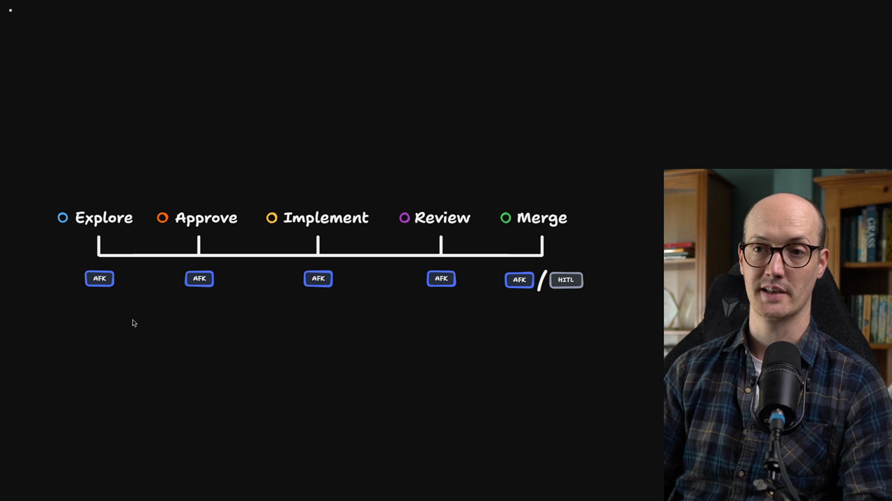
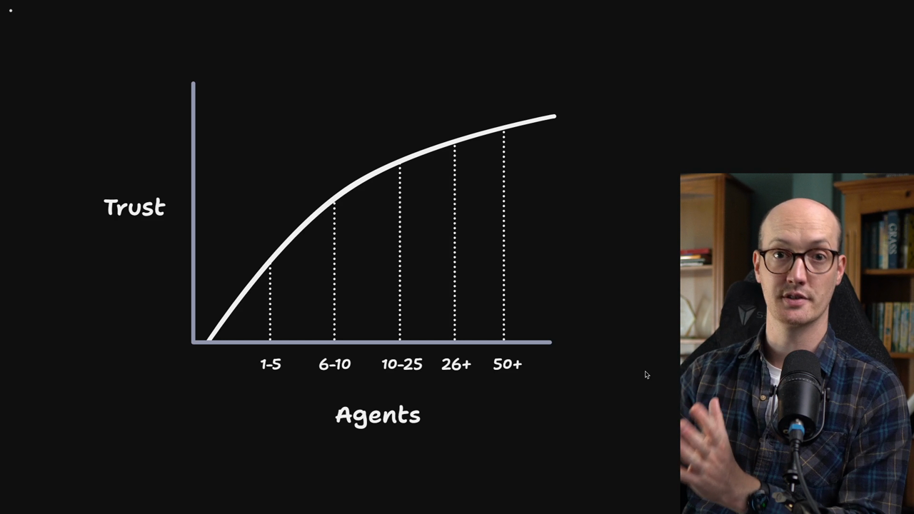
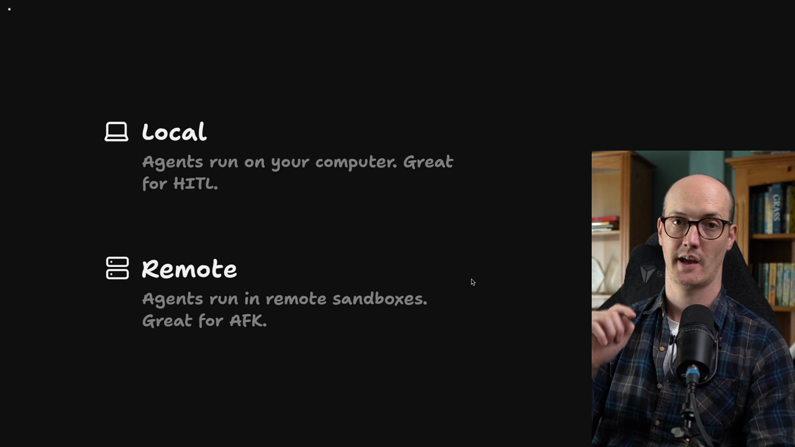
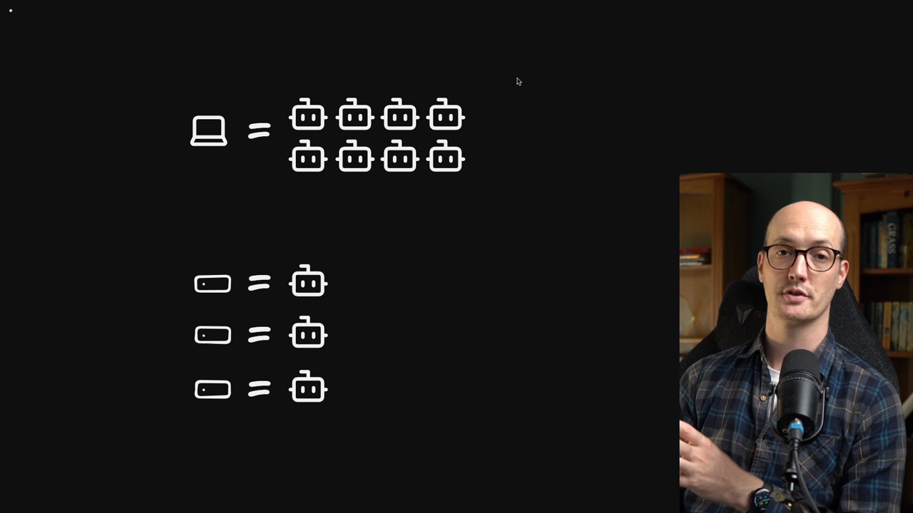
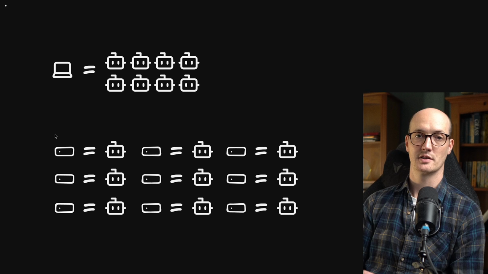
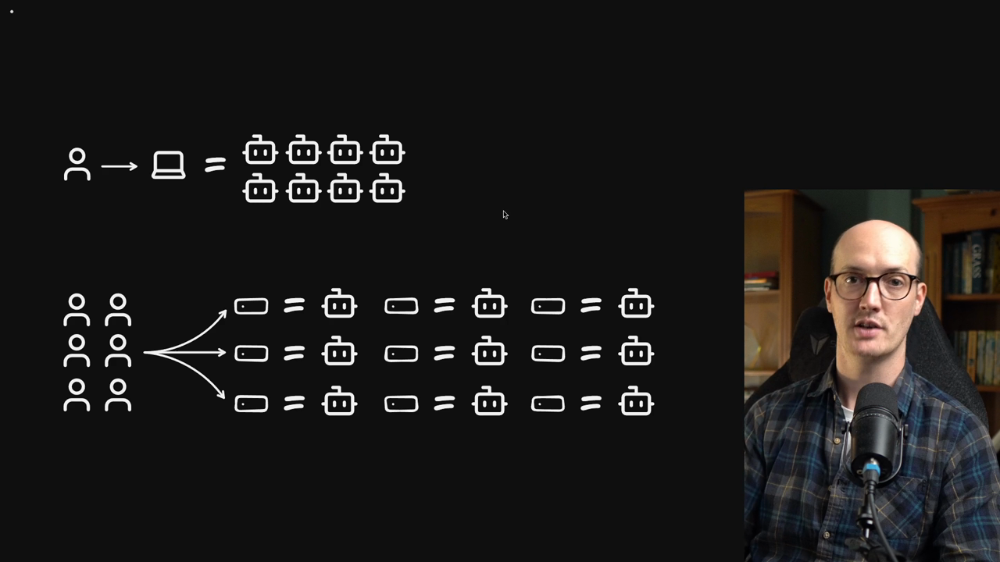
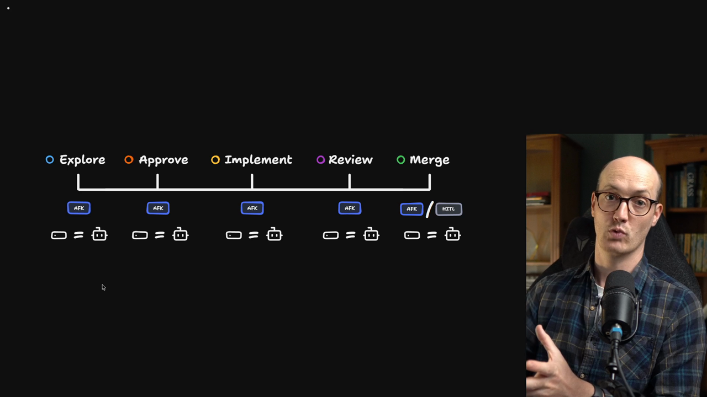
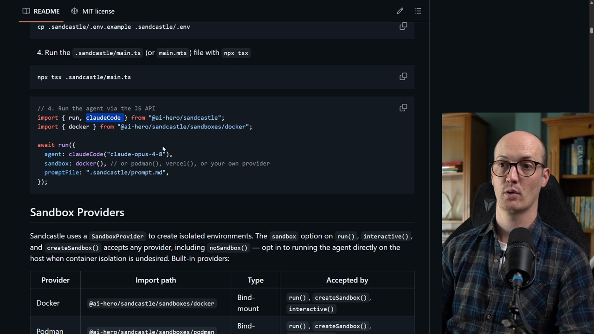
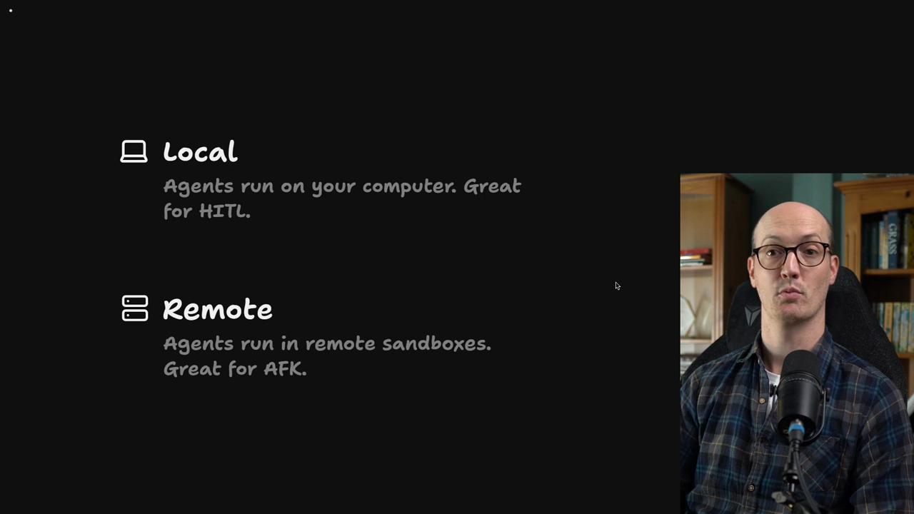

# Sandboxing The Factory

<Prerequisites title="Crash Course Prerequisites">
  <Prerequisite href="https://www.aihero.dev/workshops/ai-coding-crash-course/models-harnesses-agents-environments-2b9a99a1">
    What an agent's environment is, and why one running loose on your machine can damage it.
  </Prerequisite>
  <Prerequisite href="https://www.aihero.dev/workshops/ai-coding-crash-course/permissions-f7b3c00b">
    What the agent may run without asking, and why autonomy needs a safe place to run.
  </Prerequisite>
  <Prerequisite href="https://www.aihero.dev/workshops/ai-coding-crash-course/how-to-tackle-massive-tasks-6199ee6b">
    Why big work splits into a spec and tickets, the units the factory passes along.
  </Prerequisite>
  <Prerequisite href="https://www.aihero.dev/workshops/ai-coding-crash-course/where-you-go-from-here-4c6bb9b1">
    Where AFK agents and sandboxes fit beyond the five-step system.
  </Prerequisite>
</Prerequisites>

We've started to understand some of the goals of our [software factory](https://www.aihero.dev/ai-coding-dictionary/software-factory), which are to take the human out of more places in the loop. But how are we going to do this?



Physically, what infrastructure do we need to get this working?

Specifically, how do we scale up to tons of different [agents](https://www.aihero.dev/ai-coding-dictionary/agent)? If they're all working on my machine, they're going to eat my resources and become a danger to my system.

And am I going to need to deal with worktrees and all the complicated setup that comes with running tons of agents?



## Two Places Agents Can Run

We need to consider the two different places that agents can run.



| | Local | Remote |
| --- | --- | --- |
| Where it runs | On your computer | On remote servers, usually [sandboxed](https://www.aihero.dev/ai-coding-dictionary/sandbox) |
| Best for | [Human in the loop](https://www.aihero.dev/ai-coding-dictionary/human-in-the-loop) (HITL) | Running [AFK](https://www.aihero.dev/ai-coding-dictionary/afk) |
| Why | The agent is right there if you need to interrupt it or ask questions | No one needs to be watching |

## Why Local Is Hard to Scale

A local setup is pretty hard to scale and quite complicated to run. If you want to run multiple agents on it, they compete for your CPU resources. You also have to manage all their worktrees.



## Why Remote Scales Better

It's much simpler to scale up with remote servers, because you have one remote server per agent.



This simply scales better:

- You can spin up more servers or sandboxes as you need them.
- You can close them once the agent has finished its work.

It's also safer. If an agent does anything weird or dangerous, it usually only affects the state of one server.

If an agent does something weird on your local setup, that setup might get screwed up. You might lose the progress of all the other agents, and a ton of work with it.

## Collaboration

Setting up your agents this way also makes collaboration easier.



With a local setup, usually only one dev has access to it. There are ways to share it and send it to your teammates, but it's not as collaborative as a group of people spinning up remote servers as needed.

So these sandboxes become crucial infrastructure for your team. Everyone can observe them, contribute to them, and make the whole system work better.

## Choosing a Remote Provider

How you design this infrastructure is really up to you. An agent can run on any remote server you choose.

- You could use AWS directly and create EC2 instances, or Kubernetes.
- You could use a more managed service like Daytona, E2B or Vercel.

## Why GitHub Actions

In designing this course, I had a problem: how do I demonstrate this without needing users to sign up for a third party service?

What I landed on was GitHub Actions. They're free for public repositories, so we can use as much as we want as long as your repo is public. That makes them a perfect fit for our purposes.

If you forked with `npx ai-hero-cli fork --private`, the factory still runs, but it uses your account's Actions minutes, and draft pull requests on a private repo need a paid GitHub plan.



For each step we've been thinking about, we can spin up a GitHub Action that runs an agent inside it. It outputs some information that we can then use for the next step.

That GitHub Action also has access to all of our [specs](https://www.aihero.dev/ai-coding-dictionary/spec) and [tickets](https://www.aihero.dev/ai-coding-dictionary/ticket), because those are in GitHub too.

## Running the Agent with Sandcastle

I've been using this setup with great success in my open source repos, especially Sandcastle. It's relevant here because it's what we'll use to run the agent in the sandbox.

Sandcastle lets us run coding agents from TypeScript. It essentially wraps all of the CLIs we might use, like Claude Code, OpenCode or Codex. So no matter which agent you're using, Sandcastle should be able to run it on the GitHub Action for you.

Here's how it looks in practice:

- We have the `run` function.
- We have the `claudeCode` function, passed as the `agent`.
- We run the agent inside the `sandbox`.
- We pass it a `promptFile`, and the contents of that file become the prompt passed to the agent.



```typescript
import { run, claudeCode } from "@ai-hero/sandcastle";
import { docker } from "@ai-hero/sandcastle/sandboxes/docker";

await run({
  agent: claudeCode("claude-opus-4-8"),
  sandbox: docker(),
  promptFile: ".sandcastle/prompt.md",
});
```

## Local and Remote Together

This is the setup we're going to use to demonstrate the benefits of moving to remote.



We're not going to abandon local development. Local is really good for building [prototypes](https://www.aihero.dev/ai-coding-dictionary/prototyping), and for close, tight human in the loop interactions with the agent. But remote is indispensable if we want a fast software factory.

Finally, GitHub Actions was the best tool I found for demonstrating this. I recommend you explore all of the tools out there that can help you build it, because all you really need is a remote server to run an agent on.

With that, let's get GitHub Actions set up so that we can start seeing this in action.

<Quiz>
  <QuizQuestion data={{
    id: "local-vs-remote-agent-placement",
    question: "You want to prototype a feature and keep interrupting the agent to answer its questions and steer it. Where should it run?",
    type: "multiple-choice",
    choices: [
      { answer: "local", label: "Locally on your own computer, where you can interrupt it" },
      { answer: "remote", label: "In a remote sandbox, so it can't affect your machine" },
      { answer: "either", label: "In a remote sandbox, since remote is always the better default" }
    ],
    correct: "local",
    answer: "Local is great for human in the loop work because the agent is right there when you need to interrupt it or ask questions. Remote sandboxes shine when you want agents to run AFK, but they aren't the best fit for tight, interactive back and forth, and remote isn't always the better default."
  }} />
  <QuizQuestion data={{
    id: "remote-sandbox-per-agent-blast-radius",
    question: "You're about to run 20 agents in parallel on a few tickets, and one of them might do something destructive. Which setup limits the damage best?",
    type: "multiple-choice",
    choices: [
      { answer: "local-worktrees", label: "Run all 20 on your laptop, each in its own worktree" },
      { answer: "one-sandbox-each", label: "Run each agent in its own remote sandbox" },
      { answer: "one-shared-server", label: "Run all 20 on a single shared remote server" }
    ],
    correct: "one-sandbox-each",
    answer: "With one sandbox per agent, a misbehaving agent usually only affects one server, and you can close it when the work is done. On your laptop, all 20 compete for your CPU and a bad agent can wreck the shared setup and everyone's progress. A single shared server recreates the same problem remotely."
  }} />
</Quiz>
