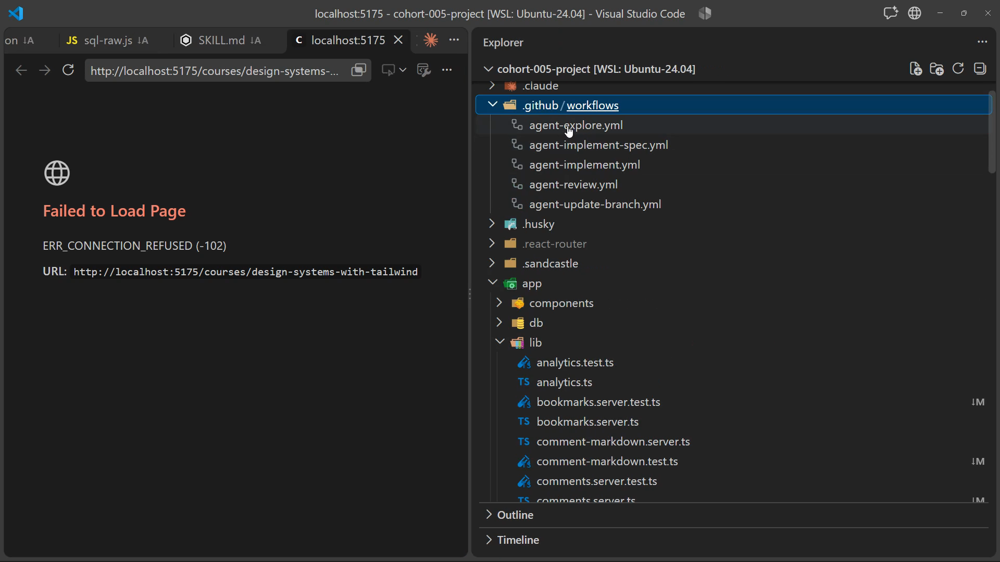
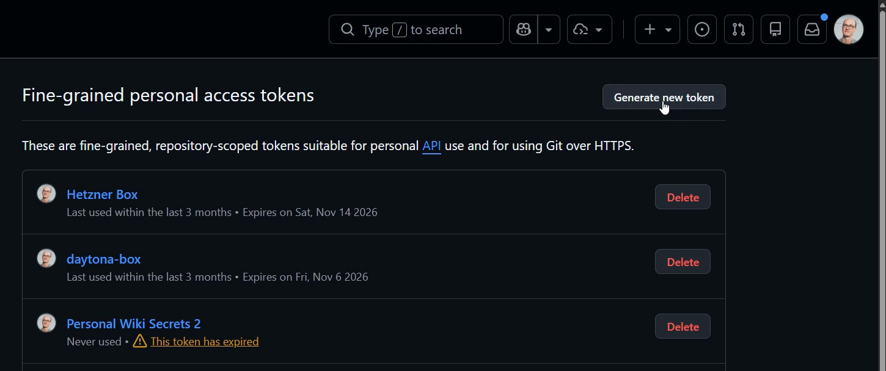
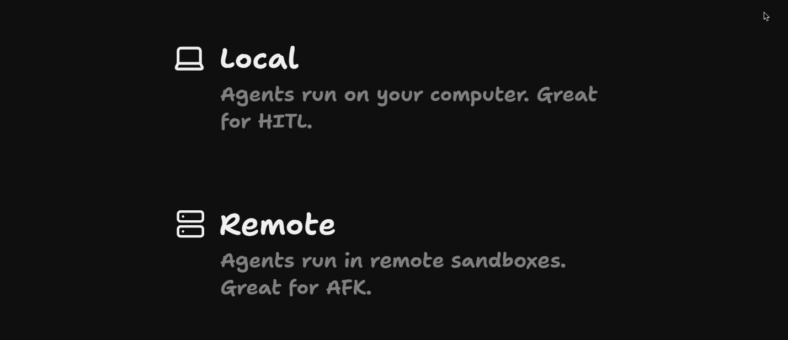
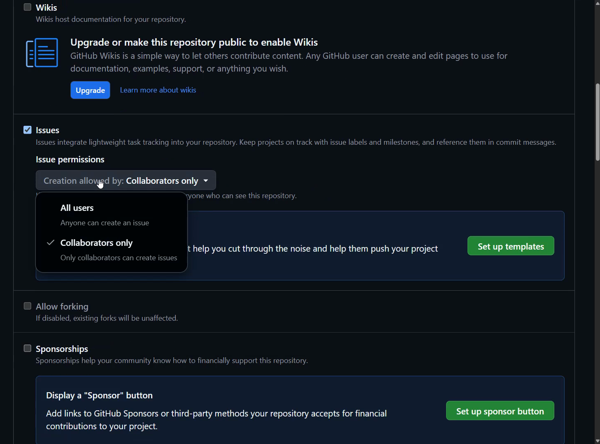

# Setting Up Secrets And Permissions

<CommitMap packageManager="npm">
  <Commit id="add-dev-feedback-button">Start the lesson: a dev-only feedback button that files a GitHub issue</Commit>
  <Commit id="add-factory-workflows">See the result: the factory workflows added under `.github/workflows/`</Commit>
</CommitMap>

<Prerequisites title="Crash Course Prerequisites">
  <Prerequisite href="https://www.aihero.dev/workshops/ai-coding-crash-course/choosing-your-plan-and-model-24420278">
    Subscription versus pay-per-token API pricing, which decides which token the factory uses.
  </Prerequisite>
  <Prerequisite href="https://www.aihero.dev/workshops/ai-coding-crash-course/models-harnesses-agents-environments-2b9a99a1">
    What a harness is, the thing your token lets the factory run.
  </Prerequisite>
  <Prerequisite href="https://www.aihero.dev/workshops/ai-coding-crash-course/permissions-f7b3c00b">
    What the agent may do without asking, so the factory's own permissions make sense.
  </Prerequisite>
  <Prerequisite href="https://www.aihero.dev/workshops/ai-coding-crash-course/set-up-your-issue-tracker-30629075">
    How your agent reads GitHub through the `gh` CLI, which is how it sees issues and PRs.
  </Prerequisite>
</Prerequisites>

## Adding the factory workflows

Now that we know what we're using, let's get into the weeds a little more and start setting it up.

As usual, we have a command to reset:

```bash
npm run reset add-factory-workflows
```

That brings in every workflow the [factory](https://www.aihero.dev/ai-coding-dictionary/software-factory) is going to use. They sit inside `.github/workflows`.



There are four workflows, from explore to implement to review:

- `agent-explore.yml`
- `agent-implement.yml`
- `agent-implement-spec.yml`
- `agent-review.yml`

Each one has a huge comment at the top explaining what it does, written in the YAML language.

## Why a factory PAT is needed

One of the first things we need to do is set up the secrets. A few of the workflows require secrets, like `CLAUDE_CODE_OAUTH_TOKEN` and, specifically, `FACTORY_PAT`.

The `WHAT IT NEEDS` section of each workflow header lists them. This is the one from `agent-implement.yml`:

```yaml
# WHAT IT NEEDS
#   secrets.CLAUDE_CODE_OAUTH_TOKEN - the agent's auth token, from a Claude
#     subscription. To bill the API instead, see
#     .sandcastle/agent-workflows/shared/common.ts.
#   secrets.FACTORY_PAT - a fine-grained PAT on this repository with Issues,
#     Pull requests, Contents, Workflows and Actions, all read/write. Every
#     step that talks to GitHub uses it: reading the ticket, pushing, opening
#     the pull request, commenting. One token for the whole factory, because some
#     hops need it anyway, by default the built-in GITHUB_TOKEN cannot open a
#     pull request at all, and a label it applies starts no workflow.
#   secrets.GITHUB_TOKEN - supplied by Actions, and now used for one thing:
#     the checkout. The `permissions:` block below shrinks it to match.
```

`FACTORY_PAT` stands for Factory Personal Access Token, and we need to create it inside GitHub.

GitHub Actions do come with their own `GITHUB_TOKEN`, but we need a `FACTORY_PAT` so that we can do some very specific things.

For instance, in `agent-implement.yml`, the workflow is triggered when someone puts a label on an issue:

```yaml
on:
  issues:
    types: [labeled]
```

```yaml
jobs:
  implement:
    # Every other label on every other issue stops here, for free.
    if: github.event.label.name == 'agent:implement'
```


That's how a lot of this is going to work. We add a label to explore, a label to implement, a label to review. Ideally, once implement is complete, it automatically triggers a review.

The thing a normal GitHub token absolutely cannot do is trigger another action. GitHub does that on purpose, so your actions can't set each other off in an infinite loop.

But setting off other actions is exactly what we want our factory to do.

## Creating the fine-grained token

We fix that by going into our own GitHub settings, all the way down to developer settings, then personal access tokens, then fine-grained tokens.



Click generate new token and choose an appropriate name. I'm going to choose `cohort factory token`. I'll set the expiration to 90 days, and choose only select repositories, then pick the cohort 005 project.

Next, give it a bunch of permissions. All of these are set to read and write:

| Permission | Why |
|---|---|
| Actions | Allows the workflow to start other workflows |
| Issues | Read and write issues |
| Pull requests | Read and write pull requests |
| Contents | Lets the [agent](https://www.aihero.dev/ai-coding-dictionary/agent) push to the repo |
| Workflows | Lets the agent update its own workflows |

Everything else stays at no access.

Once you click generate token, it's ready for use immediately. Copy the token to your clipboard.

## Saving the FACTORY_PAT secret

Next, go back to your project settings, all the way down to secrets and variables, then actions.

Scroll down to repository secrets and create a new repository secret. Name it `FACTORY_PAT`. It has to be this exact casing, with the exact underscore.

Paste the token you just copied into the box and click add secret. You should now see `FACTORY_PAT` in your repository secrets.

The workflows read it by name, like this:

```yaml
      - name: Read the ticket
        env:
          GH_TOKEN: ${{ secrets.FACTORY_PAT }}
```

## Model provider token setup

The other secret is the token we use to communicate with the [model provider](https://www.aihero.dev/ai-coding-dictionary/model-provider).



When our agent runs on our computer, we don't need to worry about handling its token. We log in, and it keeps the state on our local machine.

But when the agent runs on a remote server, it needs to contact the model provider. So we need to give it an environment variable containing the right token.

This differs depending on the [harness](https://www.aihero.dev/ai-coding-dictionary/harness) and the model provider you use with it. In the next lesson, I'll show you how to set this up with other providers.

For now, we'll work with Claude Code on a subscription. If you use an API key, it is slightly different.

## Generating the Claude Code token

In your terminal, run:

```bash
claude setup-token
```

This sets up a long-lived authentication token that lasts for one year. You visit the URL, do any sign in you need to, and paste a code in if asked.

You'll be given back an enormous token, so make sure you copy it. It can be so large that it overflows the terminal, so make sure it doesn't have any accidental new lines in it. I've made that mistake before.

Once you have the token, go back into your secrets and add a new secret named `CLAUDE_CODE_OAUTH_TOKEN`. Paste the token into the box.

You'll end up with `CLAUDE_CODE_OAUTH_TOKEN` and `FACTORY_PAT` in your repository secrets.

In `agent-implement.yml`, this token goes only to the agent's step:

```yaml
      - name: Build the ticket
        env:
          CLAUDE_CODE_OAUTH_TOKEN: ${{ secrets.CLAUDE_CODE_OAUTH_TOKEN }}
        run: npx tsx .sandcastle/agent-workflows/implement/implement.ts
```

## Workflows run from default branch

The main thing to understand is that your GitHub workflows all run from your default branch. In this case, that's `main`.

So when you're testing things out, reset to the branch, then push to `main`, and then you can play with it.

## Repository security and permissions

It's worth talking a little about security.

As mentioned, the main way our actions get triggered is that someone puts a label on an issue or a PR. So it's important to know who can label an issue or a PR.

By default in GitHub, only people with certain access to the repository can label issues. Any randomer from the internet can't come and label one. People with the triage role or above are allowed to.

The workflow headers make the same argument. From `agent-implement.yml`:

```yaml
#   That keeps the token out of the agent's way. It is not a wall. The agent
#   runs on the same machine as the steps that hold the PAT, with no sandbox,
#   and a determined one could leave something behind for them to run. The
#   real defence is who can reach the agent at all: only a collaborator can
#   open an issue that gets read, only a collaborator's comments get in, and
#   the label is an approval only a collaborator can give.
```



With public repositories that aren't really open source, like this dummy repo, I like to go into issues and make sure issue creation is allowed only for collaborators. The same goes for pull requests: allow them only for collaborators.

If you forked with `npx ai-hero-cli fork --private`, strangers can't see the repo at all, so this matters less, but it doesn't hurt.

It's very easy for stray agents to make your repo a little bit crappy by making loads of issues or loads of bad pull requests.

## Setup wrap-up

I think the repo setup is complete. If you're not using Claude Code on a subscription, or you're using some other type of agent, go on to the next lesson. For folks happy with this setup, we're ready to go.

Nice work, and I'll see you in the next one.

<Quiz>
  <QuizQuestion data={{
    id: "factory-pat-triggers-workflows",
    question: "GitHub Actions already supplies a GITHUB_TOKEN. Why does the factory need its own FACTORY_PAT?",
    type: "multiple-choice",
    choices: [
      { answer: "a", label: "The built-in token can't trigger other workflows" },
      { answer: "b", label: "The built-in token can't read the repo's issues" },
      { answer: "c", label: "The built-in token only works on the main branch" },
      { answer: "d", label: "The built-in token is billed by the model provider" }
    ],
    correct: "a",
    answer: "GitHub deliberately stops the built-in token from triggering another action, so workflows can't set each other off in an infinite loop. The factory wants exactly that, such as implement finishing and kicking off a review, so it needs a fine-grained PAT. The model provider token is a separate secret, CLAUDE_CODE_OAUTH_TOKEN."
  }} />
  <QuizQuestion data={{
    id: "workflows-run-from-default-branch",
    question: "You edit a factory workflow on a feature branch, label an issue, and the old behaviour runs. Why?",
    type: "multiple-choice",
    choices: [
      { answer: "a", label: "Workflows run from the default branch" },
      { answer: "b", label: "The PAT is missing Workflows access" },
      { answer: "c", label: "Labels only trigger workflows on PRs" },
      { answer: "d", label: "The OAuth token is still the old one" }
    ],
    correct: "a",
    answer: "GitHub workflows all run from your default branch, main here, so to test a change you push it to main and then play with it. The PAT's Workflows permission is about pushing changes to workflow files, labels on issues do trigger the factory, and the OAuth token only authenticates the agent with the model provider."
  }} />
  <QuizQuestion data={{
    id: "who-can-trigger-the-factory",
    question: "Your factory starts when someone labels an issue. What stops a stranger on the internet setting your agents off?",
    type: "multiple-choice",
    choices: [
      { answer: "a", label: "Only people with triage access or above can label" },
      { answer: "b", label: "The agent runs in a sandbox with no access to the PAT" },
      { answer: "c", label: "The FACTORY_PAT expires after its 90 days are up" },
      { answer: "d", label: "GitHub won't run agents on a public repository" }
    ],
    correct: "a",
    answer: "Only people with the triage role or above can label issues, so a random visitor can't approve work for the factory, and limiting issue and pull request creation to collaborators tightens it further. The agent isn't sandboxed away from the PAT, an expiry date doesn't stop anyone before it arrives, and a public repo like this one runs the factory just fine."
  }} />
</Quiz>
