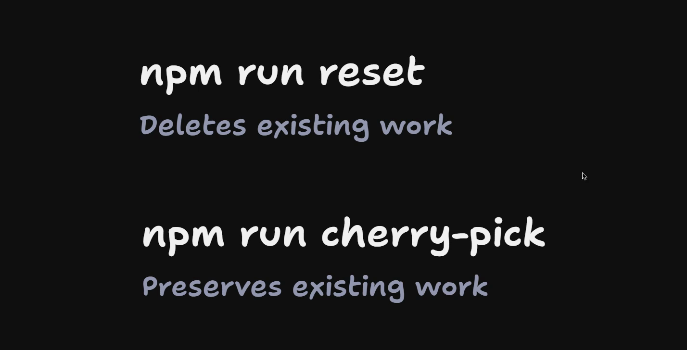

# Running Your Own Coding Agent

<CommitMap packageManager="npm">
  <Commit id="add-factory-workflows">Start the lesson: every factory workflow added under `.github/workflows/`</Commit>
</CommitMap>

<Prerequisites title="Crash Course Prerequisites">
  <Prerequisite href="https://www.aihero.dev/workshops/ai-coding-crash-course/choosing-your-plan-and-model-24420278">
    Subscription versus pay-per-token API pricing, which decides how you pay for the agent you plug in.
  </Prerequisite>
  <Prerequisite href="https://www.aihero.dev/workshops/ai-coding-crash-course/models-harnesses-agents-environments-2b9a99a1">
    What a harness is, so swapping Claude Code for Codex or another harness makes sense.
  </Prerequisite>
  <Prerequisite href="https://www.aihero.dev/workshops/ai-coding-crash-course/choosing-a-model-c28af0b7">
    Why the harness and environment matter as much as the model you pick.
  </Prerequisite>
  <Prerequisite href="https://www.aihero.dev/workshops/ai-coding-crash-course/permissions-f7b3c00b">
    What the agent may run without asking, which each harness sets up differently.
  </Prerequisite>
</Prerequisites>

This lesson is optional. In the last video we pulled in every workflow the [factory](https://www.aihero.dev/ai-coding-dictionary/software-factory) uses and set up the secrets for Claude Code on your subscription.

If that's you, and you've set up your `CLAUDE_CODE_OAUTH_TOKEN`, feel free to skip straight to the next lesson.

But maybe you don't use Claude Code, or you pay for it through the API rather than a subscription. This video is for you. We're going to look at where the factory picks its [agent](https://www.aihero.dev/ai-coding-dictionary/agent), how to modify it, and how to pass in different keys for it.

## Where the factory picks its agent

The secret sauce lives in the `.sandcastle` folder, inside `common.ts`.

Here we specify an agent with `sandcastle.claudeCode`. We pass in the [model](https://www.aihero.dev/ai-coding-dictionary/model) we're using, and then the [environment](https://www.aihero.dev/ai-coding-dictionary/environment) we're using.

```ts
// .sandcastle/agent-workflows/shared/common.ts
export const claudeAgent = () =>
  sandcastle.claudeCode("claude-opus-5-5", {
    env: {
      CLAUDE_CODE_OAUTH_TOKEN: required("CLAUDE_CODE_OAUTH_TOKEN"),
    },
  });
```

If we look at where `claudeAgent` is used, we can see it's inside build, explore, implement, and a bunch of other places. Every one of them has the same line:

```ts
  agent: claudeAgent(),
```

So this is the one place where we modify the model and the [harness](https://www.aihero.dev/ai-coding-dictionary/harness) for every single workflow.

## Supported harnesses

Sandcastle supports a few different harnesses:

- Copilot
- Claude Code
- Codex
- OpenCode
- Pi

I'll show you a few ways to set up the agent differently.

## Claude Code paid for by an API key

Let's start with the Claude Code version that's paid for by an API key. You change `CLAUDE_CODE_OAUTH_TOKEN` to `ANTHROPIC_API_KEY`, and you need to change it everywhere.

In `common.ts`, that looks like this:

```ts
export const claudeAgent = () =>
  sandcastle.claudeCode("claude-opus-5-5", {
    env: {
      ANTHROPIC_API_KEY: required("ANTHROPIC_API_KEY"),
    },
  });
```

In every workflow where we use `CLAUDE_CODE_OAUTH_TOKEN`, we swap it out for `ANTHROPIC_API_KEY`:

```yaml
        env:
          ANTHROPIC_API_KEY: ${{ secrets.ANTHROPIC_API_KEY }}
```

Then, in your cohort 005 project repo, go to repository secrets. Instead of `CLAUDE_CODE_OAUTH_TOKEN`, put in `ANTHROPIC_API_KEY`.

That really is all you need.

## Swapping to Codex

What if you want to use Codex instead? We swap the agent to `sandcastle.codex`, and swap the model to whichever you use with Codex.

```ts
export const claudeAgent = () =>
  sandcastle.codex("gpt-5.4", {
    env: {
      CODEX_API_KEY: required("OPENAI_API_KEY"),
    },
  });
```

One correction to what's said on camera: the video says to swap the token for an OpenAI API key everywhere. In `common.ts`, the name handed to Codex needs to be `CODEX_API_KEY`, because that's the variable `codex exec` reads. The repo secret and the workflow `env:` are still `OPENAI_API_KEY`, as above.

The name `claudeAgent` stays the same even though it's now running Codex. Renaming it means editing every file that imports it.

Next, you need to modify the workflows. Currently they install Claude Code, in an "Install Claude Code" step:

```yaml
      - name: Install Claude Code
        run: npm install -g @anthropic-ai/claude-code
```

This is pretty simple. Find and replace every place we install Claude Code, and install OpenAI Codex instead:

```yaml
      - name: Install Codex
        run: npm install -g @openai/codex
```

Then, everywhere we have `CLAUDE_CODE_OAUTH_TOKEN`, swap it out for an OpenAI API key:

```yaml
        env:
          OPENAI_API_KEY: ${{ secrets.OPENAI_API_KEY }}
```

Then head back to the repo secrets and add your `OPENAI_API_KEY` there.

## The same flow for every harness

That's basically the same flow for every harness:

1. Figure out which environment variables you need.
2. Switch the harness in `common.ts`.
3. Fix the workflows to install the right harness.
4. Fix the workflows to use the right environment keys.

## If your agent isn't supported

If for some reason Sandcastle doesn't support the agent you want to use, make a PR. Sandcastle lets you implement your own agent provider, if that's helpful.

If it's robust, and it works with how Sandcastle works, I'll happily bring it into main.

Below this video I'm going to include instructions for all of the major harnesses and all the major [model providers](https://www.aihero.dev/ai-coding-dictionary/model-provider). If you don't see your setup below, head to the [Discord](https://www.aihero.dev/discord) and I'll be able to add it for you.

## Setup for every agent

Here's the setup for each of the harnesses listed above. Each one is the same four steps from above, done by one command, plus the secret to add.

Run these from the root of your project repo, with a clean working tree. They work in a bash or zsh terminal on macOS, Linux, WSL and Git Bash. They won't run in PowerShell.

### Save the swap script

First, save the swap script. You only do this once:

```bash
cat > .git/swap-agent.mjs <<'EOF'
import fs from "node:fs";
import { parseArgs } from "node:util";

const fail = (msg) => {
  console.error(`swap-agent: ${msg}`);
  process.exit(1);
};

const { values: o } = parseArgs({
  options: {
    agent: { type: "string" },
    model: { type: "string" },
    env: { type: "string" },
    install: { type: "string" },
    name: { type: "string" },
  },
});
for (const flag of ["agent", "model", "env", "install", "name"]) {
  if (!o[flag]) fail(`missing --${flag}`);
}

// --env AGENT_VAR=SECRET: the variable the agent reads, and the repo secret
// it comes from. --env SECRET alone means both have the same name.
const [agentVar, secret = agentVar] = o.env.split("=");
for (const v of [agentVar, secret]) {
  if (!/^[A-Z_][A-Z0-9_]*$/.test(v)) fail(`bad variable name: ${v}`);
}
if (secret.startsWith("GITHUB_")) {
  fail(`GitHub refuses secret names starting with GITHUB_: ${secret}`);
}

const commonPath = ".sandcastle/agent-workflows/shared/common.ts";
const workflowDir = ".github/workflows";
if (!fs.existsSync(commonPath)) fail(`no ${commonPath}: run this from the repo root`);

// The agent block: the comment above `claudeAgent`, then the export itself.
const common = fs.readFileSync(commonPath, "utf8");
const block = common.match(
  /(?:\/\/.*\n)*export const claudeAgent = \(\) =>\n[\s\S]*?\n {2}\}\);\n/
);
if (!block) fail(`could not find the claudeAgent export in ${commonPath}`);

// What's there now, plus the Claude Code defaults: a repo nobody has swapped
// yet runs Claude Code, and a cherry-picked lesson can bring those lines back.
const current = {
  name: block[0].match(/^\/\/ Agent: (.+)$/m)?.[1],
  install: block[0].match(/^\/\/ Install: npm install -g (\S+)$/m)?.[1],
  secret: block[0].match(/required\("([A-Z0-9_]+)"\)/)?.[1],
};
const escape = (s) => s.replace(/[.*+?^${}()|[\]\\]/g, "\\$&");
const anyOf = (...xs) => [...new Set(xs.filter(Boolean))].map(escape).join("|");
const oldNames = anyOf(current.name, "Claude Code");
const oldInstalls = anyOf(current.install, "@anthropic-ai/claude-code");
const oldSecrets = anyOf(current.secret, "CLAUDE_CODE_OAUTH_TOKEN");

const newBlock = `// The one agent every factory workflow runs. Each workflow installs it and
// passes it the repository secret below.
// Agent: ${o.name}
// Install: npm install -g ${o.install}
// Secret: ${secret}
//
// Sandcastle runs every agent with its permission checks skipped, so it can
// use any tool.
export const claudeAgent = () =>
  sandcastle.${o.agent}(${JSON.stringify(o.model)}, {
    env: {
      ${agentVar}: required(${JSON.stringify(secret)}),
    },
  });
`;

// Work out every change before writing any, so a mismatch leaves no half-swap.
const newCommon = common.replace(block[0], () => newBlock);
const writes = newCommon === common ? [] : [[commonPath, newCommon]];
let installs = 0;
let secrets = 0;
for (const file of fs.readdirSync(workflowDir)) {
  if (!/\.ya?ml$/.test(file)) continue;
  const p = `${workflowDir}/${file}`;
  const before = fs.readFileSync(p, "utf8");
  const after = before
    .replace(
      new RegExp(`^([ \\t]*- name: Install )(?:${oldNames})$`, "gm"),
      (_, step) => step + o.name
    )
    .replace(
      new RegExp(`^([ \\t]*run: npm install -g )(?:${oldInstalls})$`, "gm"),
      (_, run) => {
        installs++;
        return run + o.install;
      }
    )
    .replace(new RegExp(`\\b(?:${oldSecrets})\\b`, "g"), () => {
      secrets++;
      return secret;
    });
  if (after !== before) writes.push([p, after]);
}
if (installs === 0) fail(`no agent install step in ${workflowDir}: nothing swapped`);
if (secrets === 0) fail(`no agent secret in ${workflowDir}: nothing swapped`);

for (const [p, text] of writes) fs.writeFileSync(p, text);
console.log(
  `swap-agent: now ${o.name} (sandcastle.${o.agent}, ${o.model}), ` +
    `secret ${secret}. ${installs} install step(s), ${writes.length} file(s) changed.`
);
EOF
```

It lives inside `.git`, so git never commits it and the formatter never sees it. It makes three edits:

- It rewrites the `claudeAgent` export in `common.ts` for the agent, model and secret you pick.
- It renames the "Install ..." step in every workflow and swaps the package it installs.
- It renames the agent's secret everywhere in the workflows, so there's no stray `CLAUDE_CODE_OAUTH_TOKEN` left.

It checks every file before it writes any. If something doesn't match, it stops and changes nothing. You can run it again to switch to a different agent, and running it after a cherry-pick catches any Claude Code lines the cherry-pick brought back.

### Check the swap

After any swap below, look at what changed and typecheck the agent scripts:

```bash
git diff
npx tsc --noEmit -p .sandcastle/agent-workflows
```

`npm run typecheck` doesn't cover the `.sandcastle` folder, so run this one directly. Then commit and push, because the workflows run from your repo on GitHub:

```bash
git commit -am "Swap the factory's agent"
git push
```

Last, set the agent's secret. Each section below names it. `gh secret set` asks for the value and hides it as you paste:

```bash
gh secret set <SECRET_NAME>
```

If you're no longer using the subscription token, delete it:

```bash
gh secret delete CLAUDE_CODE_OAUTH_TOKEN
```

You can also do both in the repo's Settings, under Secrets and variables, then Actions.

### Claude Code on your subscription

This is the default, so there's nothing to do unless you've swapped away and want to come back. You need a Claude subscription, and a token from:

```bash
claude setup-token
```

The secret is `CLAUDE_CODE_OAUTH_TOKEN`. To swap back:

```bash
node .git/swap-agent.mjs --agent claudeCode --model claude-opus-5-5 \
  --env CLAUDE_CODE_OAUTH_TOKEN --install @anthropic-ai/claude-code --name "Claude Code"
```

### Claude Code on an API key

You pay Anthropic per token instead of using your subscription. Create a key in the Anthropic Console. The secret is `ANTHROPIC_API_KEY`.

```bash
node .git/swap-agent.mjs --agent claudeCode --model claude-opus-5-5 \
  --env ANTHROPIC_API_KEY --install @anthropic-ai/claude-code --name "Claude Code"
```

Delete `CLAUDE_CODE_OAUTH_TOKEN` from your secrets afterwards. If Claude Code sees both, the API key wins.

### Codex

You need an OpenAI API key from platform.openai.com. The secret is `OPENAI_API_KEY`. `common.ts` hands it to Codex as `CODEX_API_KEY`, which is the name `codex exec` reads.

```bash
node .git/swap-agent.mjs --agent codex --model gpt-5.4 \
  --env CODEX_API_KEY=OPENAI_API_KEY --install @openai/codex --name Codex
```

### OpenCode

OpenCode runs models from many providers, so you pick the provider by the model id, written `provider/model`. This one runs Claude Opus on an Anthropic API key, so the secret is `ANTHROPIC_API_KEY`:

```bash
node .git/swap-agent.mjs --agent opencode --model anthropic/claude-opus-5-5 \
  --env ANTHROPIC_API_KEY --install opencode-ai --name OpenCode
```

For another provider, change `--model` and `--env` together:

| Provider | `--model` | `--env` (and secret) |
|---|---|---|
| Anthropic | `anthropic/claude-opus-5-5` | `ANTHROPIC_API_KEY` |
| OpenAI | `openai/gpt-5.5` | `OPENAI_API_KEY` |
| OpenCode Zen | `opencode/big-pickle` | `OPENCODE_API_KEY` |

Run `opencode models` to list every model id it knows. OpenCode can't resume a session, so the factory asks it for its structured output at the end of the work, in the same run.

### Pi

Pi also runs models from many providers. Give it the model id with the provider in front: Pi won't find `claude-opus-5-5` on its own, but it will find `anthropic/claude-opus-5-5`. This one runs on an Anthropic API key, so the secret is `ANTHROPIC_API_KEY`:

```bash
node .git/swap-agent.mjs --agent pi --model anthropic/claude-opus-5-5 \
  --env ANTHROPIC_API_KEY --install @mariozechner/pi-coding-agent --name Pi
```

For another provider, change `--model` and `--env` together:

| Provider | `--model` | `--env` (and secret) |
|---|---|---|
| Anthropic | `anthropic/claude-opus-5-5` | `ANTHROPIC_API_KEY` |
| OpenAI | `openai/gpt-5.5` | `OPENAI_API_KEY` |
| Google | `google/gemini-3.1-pro-preview` | `GEMINI_API_KEY` |

Run `pi --list-models` to see every model id Pi knows. It lists a provider's models once that provider's key is set.

### GitHub Copilot

You need a Copilot plan, and a fine-grained personal access token with the "Copilot Requests" permission. The secret is `COPILOT_GITHUB_TOKEN`. Copilot reads that name ahead of `GH_TOKEN`, so it won't pick up your `FACTORY_PAT` by mistake.

```bash
node .git/swap-agent.mjs --agent copilot --model claude-opus-5.5 \
  --env COPILOT_GITHUB_TOKEN --install @github/copilot --name "GitHub Copilot"
```

Copilot names its models with dots, like `claude-opus-5.5`. Opus 5.5 needs Copilot Pro+, Max, Business or Enterprise. On another plan, pick a model your plan includes, such as `claude-sonnet-4.5`. Copilot takes the prompt on its command line, so a very large prompt fails, and like OpenCode it can't resume a session.

### Adding another agent

Every setup above is the same line with five values:

```bash
node .git/swap-agent.mjs --agent <sandcastle-export> --model <model-id> \
  --env <VAR_THE_AGENT_READS>=<SECRET_NAME> --install <npm-package> --name "<Agent Name>"
```

- `--agent` is the function Sandcastle exports for the agent: `claudeCode`, `codex`, `opencode`, `pi` or `copilot`.
- `--model` is the model id, in the form that agent's command line takes.
- `--env` is the variable the agent reads its key from, then `=` and the repo secret it comes from. Leave off `=` when they're the same name. GitHub won't let a secret name start with `GITHUB_`.
- `--install` is the npm package that puts the agent's command on the path.
- `--name` is the name for the install step.

The script only handles agents you install with `npm install -g`. For one that installs another way, run the script, then edit the install step's `run:` line in each workflow by hand. When you've got a new setup working, share it in the [Discord](https://www.aihero.dev/discord) and I'll add it here.

## Use cherry-pick from here on

One last thing worth saying. We're making changes to the repo that we want to persist between lessons. So from here on out, instead of running `npm run reset`, you'll want to run `npm run cherry-pick`.



| Command | What it does |
|---|---|
| `npm run reset` | Resets your entire repo and deletes any existing changes |
| `npm run cherry-pick` | Cherry-picks the latest changes onto your branch and preserves any existing work |

In other words, if you run `npm run reset`, you'll reset your agent swap back to Claude, which is not good.

If you run into any issues with `cherry-pick`, ask your agent to resolve any merge conflicts it finds, and it should work out fine.

## What you should have by the end

By the end of this session:

- `common.ts` is set up with the exact agent you want to use.
- All of your workflows use the correct environment variables.
- There's no mention of `CLAUDE_CODE_OAUTH_TOKEN` unless you're actually using it in the repo.
- Your repository secrets contain `FACTORY_PAT` and whatever token you're using for your agent.

Nice work, and I'll see you in the next one.

<Quiz>
  <QuizQuestion data={{
    id: "cherry-pick-preserves-agent-swap",
    question: "You've swapped your factory to a different agent in `common.ts` and the workflows. The next lesson has a commit to bring in. Which command do you run?",
    type: "multiple-choice",
    choices: [
      { answer: "reset", label: "`npm run reset <slug>`, so you start from a clean known state" },
      { answer: "cherry-pick", label: "`npm run cherry-pick <slug>`, so your existing changes are kept" }
    ],
    correct: "cherry-pick",
    answer: "`npm run cherry-pick` applies the latest changes on top of your branch and preserves your work. `npm run reset` wipes your changes and puts you back on the default agent."
  }} />
  <QuizQuestion data={{
    id: "agent-swap-places-to-change",
    question: "You're moving the factory from a subscription token to a different provider's API key. Which set of changes is needed?",
    type: "multiple-choice",
    choices: [
      { answer: "common-only", label: "Only the agent export in `common.ts`, since every workflow imports it" },
      { answer: "common-and-secrets", label: "The agent export in `common.ts` and the repository secret, leaving the workflow files alone" },
      { answer: "all-three", label: "The agent export in `common.ts`, the install step and `env:` keys in each workflow, and the repository secret" }
    ],
    correct: "all-three",
    answer: "The harness is chosen in `common.ts`, but each workflow also installs the agent's CLI and passes its secret to the step that runs the script. Skipping the workflow edits leaves the wrong CLI installed or the key never reaching the agent, and the new secret must exist in the repo too."
  }} />
</Quiz>

