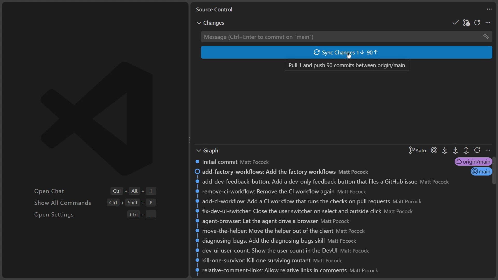
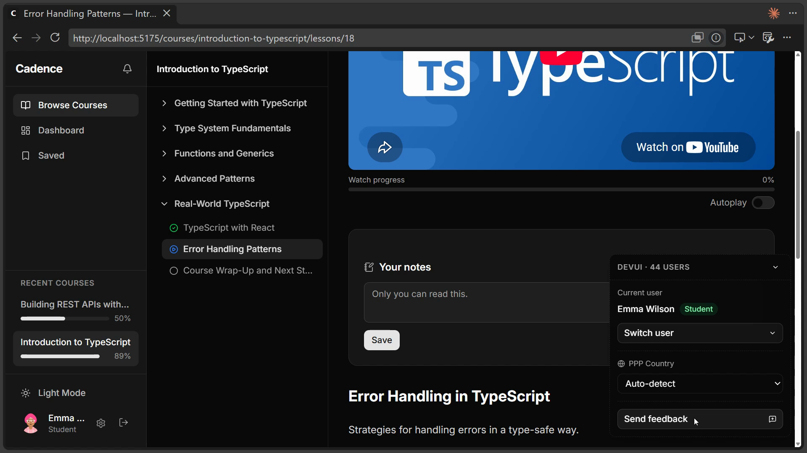
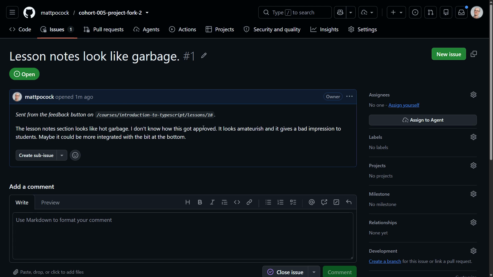

# Your First Implementer

<CommitMap packageManager="npm">
  <Commit id="add-factory-workflows">Start the lesson: the factory workflows added to `.github/workflows/`</Commit>
</CommitMap>

<Prerequisites title="Crash Course Prerequisites">
  <Prerequisite href="https://www.aihero.dev/workshops/ai-coding-crash-course/models-harnesses-agents-environments-2b9a99a1">
    What's actually running when the implementer picks up your issue: a model in a harness, working in an environment.
  </Prerequisite>
  <Prerequisite href="https://www.aihero.dev/workshops/ai-coding-crash-course/turns-and-model-provider-requests-8bf689b0">
    How to read an agent's trace: the prompts, tool calls and tool results you'll see scroll past in the run.
  </Prerequisite>
  <Prerequisite href="https://www.aihero.dev/workshops/ai-coding-crash-course/what-are-agent-skills-20f91a4e">
    What a skill is, since the implementer works by loading skills.
  </Prerequisite>
  <Prerequisite href="https://www.aihero.dev/workshops/ai-coding-crash-course/set-up-your-issue-tracker-30629075">
    Why GitHub issues are where tickets live, and how agents read and write them.
  </Prerequisite>
  <Prerequisite href="https://www.aihero.dev/workshops/ai-coding-crash-course/executing-your-tickets-8389d87c">
    What an implementer does with a ticket: build it, check it, and hand it on for review.
  </Prerequisite>
</Prerequisites>

The setup is done, so it's time to run your first workflow. Your job is to file a vague piece of user feedback as a GitHub issue, then hand it to the implementer [agent](https://www.aihero.dev/ai-coding-dictionary/agent) by adding a label.

The workflows run from GitHub, not from your machine. So first you need to make sure what's on GitHub matches what's local.

After that, watch the run closely. Don't just wait for it to finish. Work out what's happening while it happens.

## Steps To Complete

### Sync Your Fork

- [ ] Open the Source Control panel in VS Code with Ctrl+Shift+G / Cmd+Shift+G



Check how far your local `main` is ahead of `origin/main`. Every lesson you've reset to since you forked adds commits your fork doesn't have yet. In the video it was 90 commits ahead.

- [ ] Push your local `main` to your fork

```bash
git push
```

If the push is rejected because the histories have diverged (for example, you reset back to an earlier lesson), force-push instead. This overwrites the remote with your local history:

```bash
git push --force-with-lease
```

- [ ] Check your repo on GitHub

The latest commit should now be `add-factory-workflows`. Inside `.github/workflows/` you should see files like `agent-explore.yml` and `agent-implement.yml`.

### File Some Feedback

- [ ] Start the dev server and open the dev UI

Log in as Emma Wilson. At the bottom of the dev UI is a **Send feedback** button. It opens a form that files a GitHub issue on your repo.



Imagine this form is an external one, filled in by your users. The problem to report is the **Your notes** card on the lesson page:

- There's odd padding at the top.
- There's no display of how many characters you can type.
- It's in the wrong place. It should sit at the bottom, near **Questions & Discussion**.

- [ ] Write the feedback as an instructor, not as a developer

Don't use dev-team language. Keep it vague, the way a real user would. For example:

```txt
Title: Lesson notes look like garbage.

The lesson notes section looks like hot garbage. I don't know how this got approved. It looks amateurish and it gives a bad impression to students. Maybe it could be more integrated with the bit at the bottom.
```

- [ ] Press **File issue**



Open the issue on GitHub. It should include a line saying it was sent from the feedback button, plus your notes.

### Create The Labels

- [ ] Run this script in your terminal to create every label the next two sections need

```bash
gh label create "agent:implement" --color 1D76DB --description "Hand this issue to the implementer agent" --force
gh label create "agent:review" --color 0052CC --description "Ask the review workflow to read this pull request" --force
gh label create "agent:explore" --color 7057FF --description "The factory explores this ticket" --force
gh label create "agent:implement-spec" --color 3E4B9E --description "Work this spec through the implement-spec queue" --force
gh label create "agent:in-progress" --color FBCA04 --description "An agent is working on this right now" --force
gh label create "agent:queued" --color FEF2C0 --description "Waiting for the implement-spec chain" --force
gh label create "agent:blocked" --color B60205 --description "An agent run failed here. Its comment says how to retry" --force
gh label create "needs-a-human" --color FF69B4 --description "The factory stopped here" --force
```

The colours group the labels:

| Colour | Meaning | Labels |
| --- | --- | --- |
| Blue and purple | Triggers you add to start a workflow | `agent:implement`, `agent:review`, `agent:explore`, `agent:implement-spec` |
| Amber | Status | `agent:in-progress`, `agent:queued` |
| Red | A run failed | `agent:blocked` |
| Pink | The [factory](https://www.aihero.dev/ai-coding-dictionary/software-factory) stopped for a decision | `needs-a-human` |

- [ ] Open your issue and check its **Labels** picker

You should see `agent:implement` in the list.

### Run The Implementer

- [ ] Add the `agent:implement` label to your issue

Then see what happens.

- [ ] Open the **Actions** tab and watch the run

While it runs, trace what's happening:

- Find what's running the workflow.
- Read some of the prompts.
- Try to work out how the pieces fit together.

You're mostly watching passively, but the goal is to understand the run as it happens.

- [ ] If the run fails, check your setup

This is the first place your setup gets tested. For example, you may be missing the API key for your [harness](https://www.aihero.dev/ai-coding-dictionary/harness). If you get stuck, ask in the [AI Hero Discord](https://www.aihero.dev/discord).
