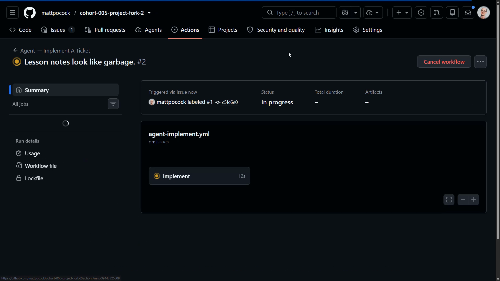
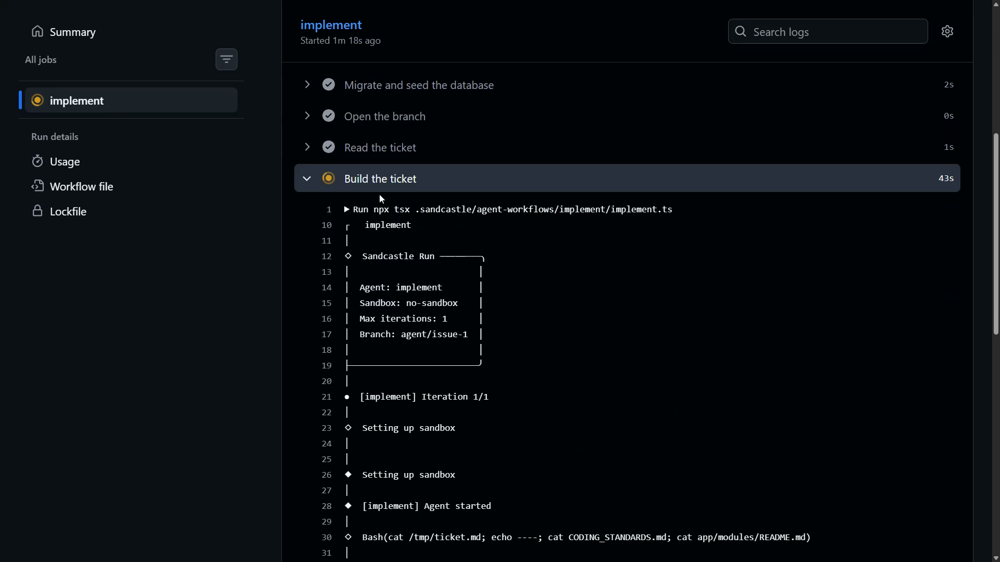
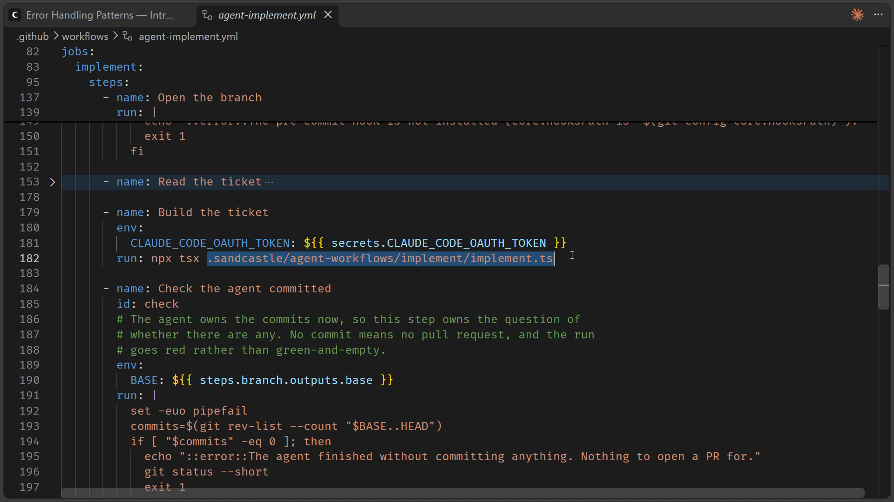
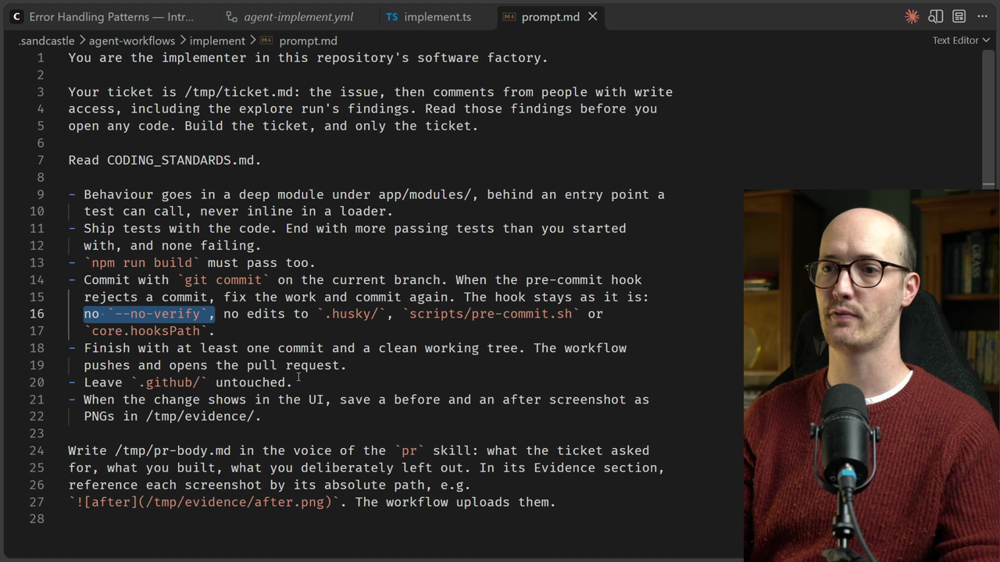
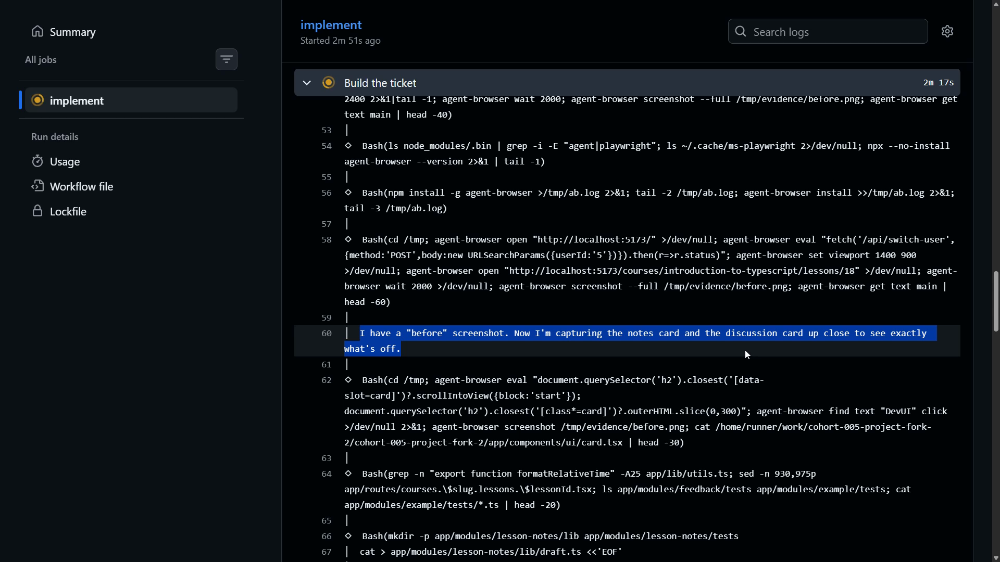
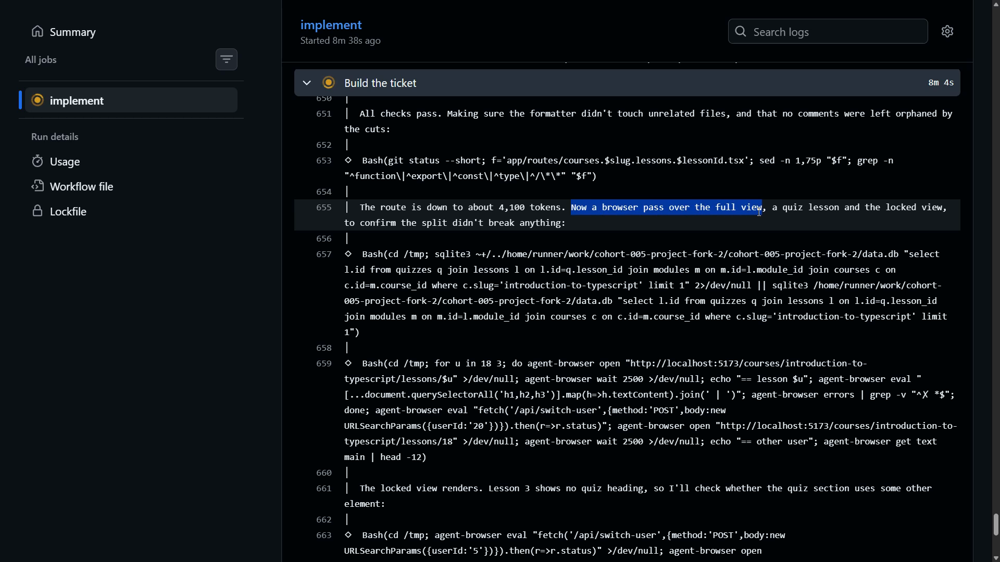
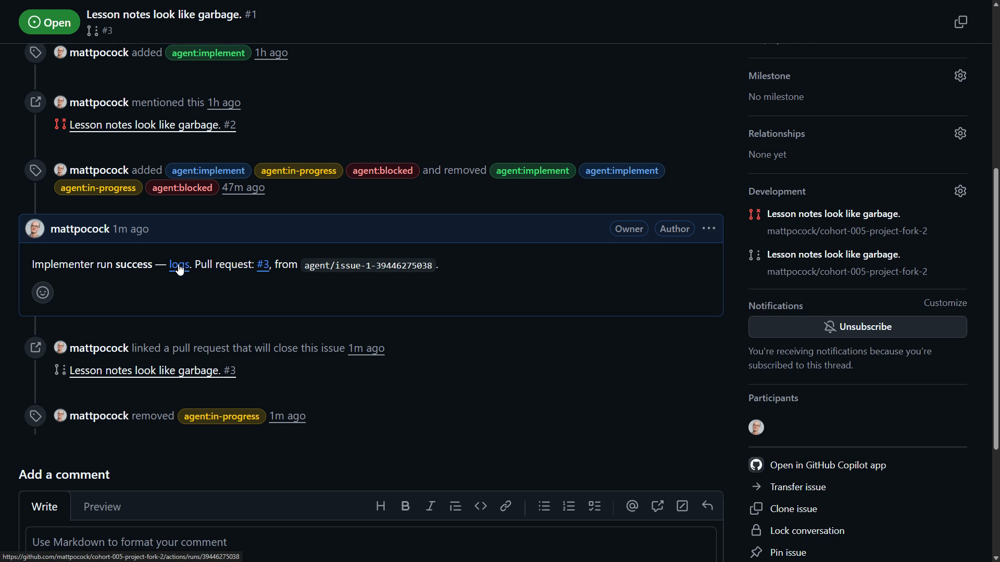
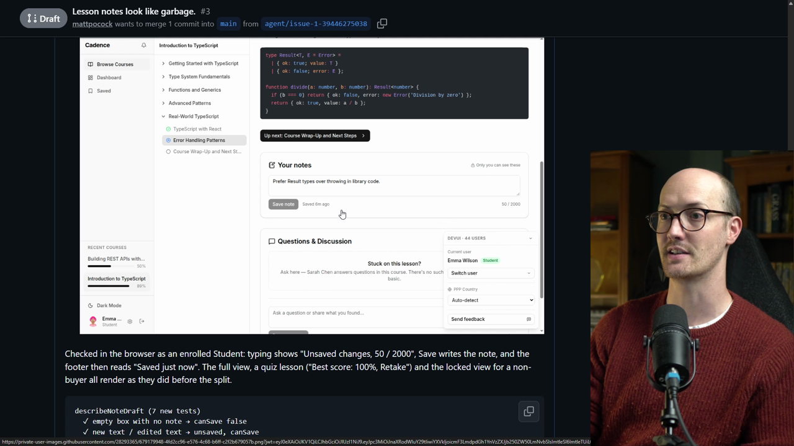
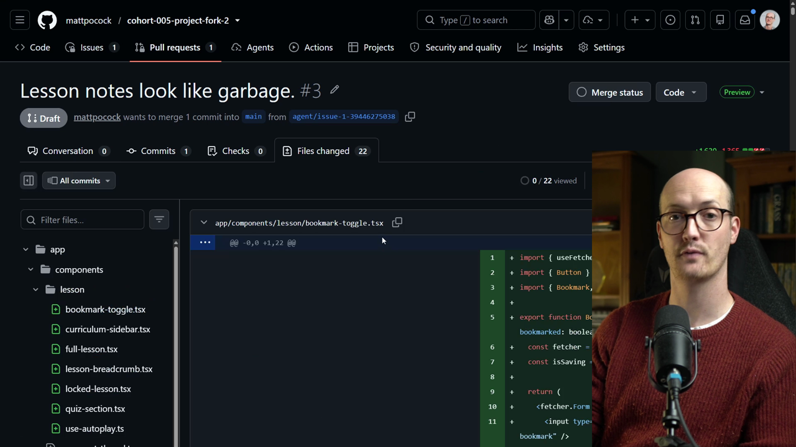

# Your First Implementer Solution

<CommitMap packageManager="npm">
  <Commit id="add-factory-workflows">Start the lesson: the factory workflows are added</Commit>
</CommitMap>

## Pressing the button

Are we ready to push the button? I am. Let's do it.

Adding the `agent:implement` label to the issue kicks things off. If we head up to Actions, we should see a run being started.



One quality-of-life addition: if you go back to the original issue, you can see it has added an `agent:in-progress` label.

That means if you have lots of issues running at the same time, you can see what is happening and what their status is.

## Watching the run

Back in the action, we can click into the `implement` job and see things happening. We can see all of the steps it has walked through so far, and that it is now building the [ticket](https://www.aihero.dev/ai-coding-dictionary/ticket).



In the "Build the ticket" step, the setup is very similar to what we usually see from a local [agent](https://www.aihero.dev/ai-coding-dictionary/agent) [session](https://www.aihero.dev/ai-coding-dictionary/session). We can see all of the [tool calls](https://www.aihero.dev/ai-coding-dictionary/tool-call), including the agent reading the notes section of the lesson page.

If you are seeing this, congratulations, it is working.

## The workflow file

Now let's look in the codebase at where this is defined.

The workflow lives in `.github/workflows/agent-implement.yml`. This is typically how you define a GitHub Action.

We have seen a little of this already, especially if you did some custom setup. There is the `CLAUDE_CODE_OAUTH_TOKEN` secret, and then all of the steps that go into this workflow:

1. Transition the labels, which is what we just saw happen.
2. Set up Node.js 22.
3. Install dependencies.
4. Install Claude Code.
5. Migrate and seed the database.
6. Read the ticket.
7. Build the ticket.

```yaml
      - name: Build the ticket
        env:
          CLAUDE_CODE_OAUTH_TOKEN: ${{ secrets.CLAUDE_CODE_OAUTH_TOKEN }}
        run: npx tsx .sandcastle/agent-workflows/implement/implement.ts
```

The last one is the most important. It runs `npx tsx` on a `.ts` file.



## The Sandcastle script

`implement.ts` is probably pretty important, so let's look at it.

This is where Sandcastle comes into the picture. We call `sandcastle.run`, pass in our `claudeAgent()`, and the prompt file sits right next to it.

```ts
await sandcastle.run({
  name: "implement",
  agent: claudeAgent(),
  sandbox: noSandbox(),
  logging: { type: "stdout" },
  promptFile: path.join(import.meta.dirname, "prompt.md"),
});
```

## The prompt

It is a relatively short prompt. The key rules:

```markdown
- Commit with `git commit` on the current branch. When the pre-commit hook
  rejects a commit, fix the work and commit again. The hook stays as it is:
  no `--no-verify`, no edits to `.husky/`, `scripts/pre-commit.sh` or
  `core.hooksPath`.
- Finish with at least one commit and a clean working tree. The workflow
  pushes and opens the pull request.
- Leave `.github/` untouched.
```

The prompt tells the agent its place in the workflow: it finishes with at least one commit, and the workflow then pushes and opens the pull request.

This prompt is something we will need to look at very carefully. We will take another look at it later with the retro [skill](https://www.aihero.dev/ai-coding-dictionary/skill).



One really important line is this one:

```markdown
- When the change shows in the UI, save a before and an after screenshot as
  PNGs in /tmp/evidence/.
```

The workflow that follows looks at everything inside `/tmp/evidence/` and uploads it, so the GitHub issue can reference it.

That means when we get the pull request, we should have screenshots we can review without pulling the branch down and running it ourselves.

## Following the agent's trace

We can see that working. The agent says it has a before screenshot, and that it is now capturing the notes card and the discussion card up close to see exactly what is off.



This is great. Even though it is running on a remote server, our agent has access to all the data sources it needs to get its feedback loops working and its quality higher.

Further down, because the agent is committing, it runs into our [automated checks](https://www.aihero.dev/ai-coding-dictionary/automated-check):

- It says the file is still over the limit, so it will also move the header out.
- It then runs `npm run test:mutation`.
- Everything passes and every mutant was killed.
- When it tries to commit again, it still hits the [token](https://www.aihero.dev/ai-coding-dictionary/token) hook, so it keeps breaking things into smaller parts.

Eventually it succeeds. The route is down to around 4,100 tokens, and it does a final browser pass now that all the refactors are done.



### Comparing the agent to yourself

When I look at traces like this, I compare how I would have behaved if there were a really hard pre-commit rule, like 5,000 tokens. Would I have gone back and reviewed the browser to make sure my changes had not broken anything? I am not sure I would.

Sometimes I catch the agent being far more thorough than I would have been building that feature myself.

When I feel that, I know I am gaining confidence in my agent. It is verifying things hard, and I have things tuned pretty well.

## The results

Now a bunch of things happened in quick succession.

On the issue itself, the agent commented with a link back to the action run logs. The pull request it created was also added.



The PR is titled with the original issue's title. That could maybe be improved. But we have the summary, and we have the evidence.

In the before screenshot, we have "Your notes, only you can read this". Now it looks a lot nicer: the notes are integrated with the Questions & Discussion card, with a character counter, "Only you can see these" and "Saved six minutes ago".



There is more evidence too: the new tests, the passing check, and the merge danger section. It is a two-way door, with a small blast radius of just the lesson page.

```markdown
**Door:** two-way
**Blast Radius:** lesson-page
```

### Files changed

In Files changed, 22 files have been touched.



It pulled a bunch of the lesson components out into individual files, probably because they were too large and were breaking the pre-commit hook.

It also created a new module, `app/modules/lesson-viewer/`. This looks like a deep module, albeit one without any tests.

## Wrapping up

What we have done is take a very small issue report and turn it into a huge set of code changes, which we can decide whether or not to merge.

Our [factory](https://www.aihero.dev/ai-coding-dictionary/software-factory) just got a little bit faster. This is the first of the accelerators.

Nice work, and I will see you in the next one.
