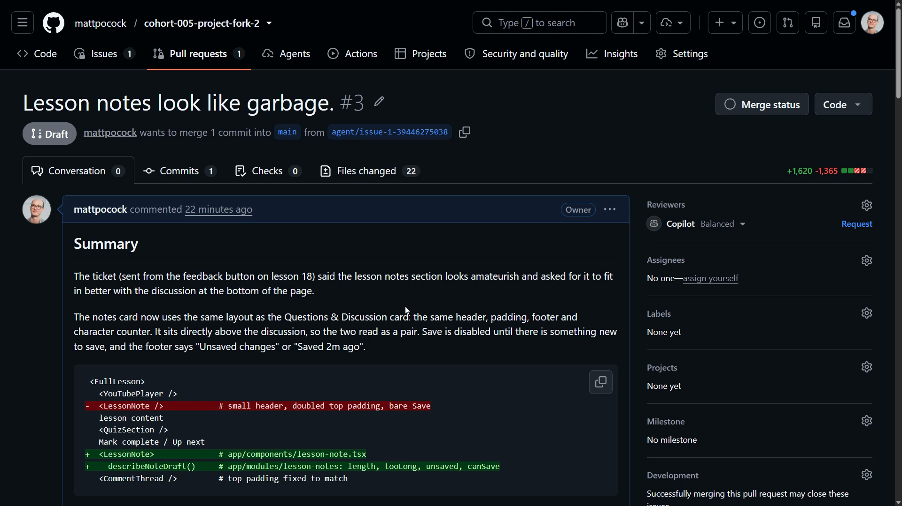
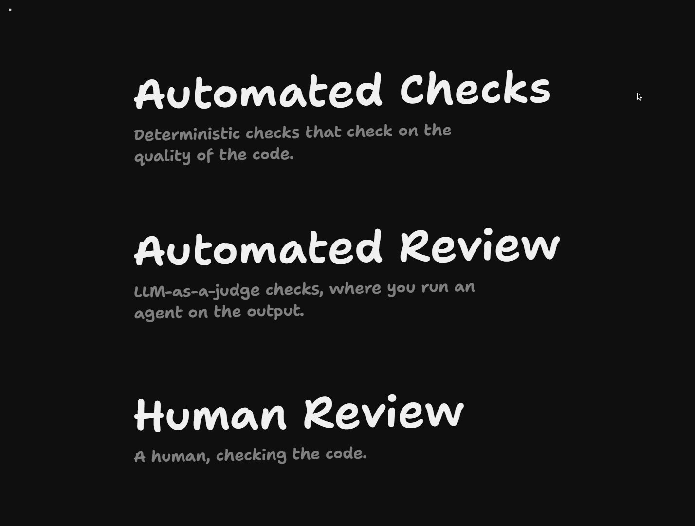

# Splitting Build From Review

<CommitMap packageManager="npm">
  <Commit id="add-factory-workflows">Start the lesson: with the factory workflows added, including the review workflow</Commit>
</CommitMap>

<Prerequisites title="Crash Course Prerequisites">
  <Prerequisite href="https://www.aihero.dev/workshops/ai-coding-crash-course/non-determinism-c31d9cdd">
    Why the same agent can get it right one run and wrong the next, which is why we review its work.
  </Prerequisite>
  <Prerequisite href="https://www.aihero.dev/workshops/ai-coding-crash-course/what-are-agent-skills-20f91a4e">
    What a skill is, so you know what the review label actually runs.
  </Prerequisite>
  <Prerequisite href="https://www.aihero.dev/workshops/ai-coding-crash-course/executing-your-tickets-8389d87c">
    The `/code-review` skill and automated checks in a local loop, before the factory runs them for you.
  </Prerequisite>
  <Prerequisite href="https://www.aihero.dev/workshops/ai-coding-crash-course/enforcing-your-coding-standards-f1656d67">
    The layers of review: automated checks, automated review and human review, and what belongs in each.
  </Prerequisite>
</Prerequisites>

Our implementer opened a pull request, but it's sitting in draft. That's deliberate. Our [automated checks](https://www.aihero.dev/ai-coding-dictionary/automated-check) have passed, but nobody has reviewed the code yet, so it isn't ready for a human to look at.



There are three layers of review: deterministic checks on code quality, [automated review](https://www.aihero.dev/ai-coding-dictionary/automated-review) (an LLM-as-a-judge [agent](https://www.aihero.dev/ai-coding-dictionary/agent) run on the output), and finally [human review](https://www.aihero.dev/ai-coding-dictionary/human-review). We've done the first. We haven't done the second.



The repo already has an `agent:review` label. Adding it runs the `/code-review` [skill](https://www.aihero.dev/ai-coding-dictionary/skill) on the PR, tries to fix what it finds, and then makes the PR ready for review.

## Steps To Complete

### Get set up

- [ ] Reset to the starting commit

```bash
npm run reset add-factory-workflows
```

This adds the [factory](https://www.aihero.dev/ai-coding-dictionary/software-factory) workflows, including the review workflow. You also need the implementer's draft PR from the previous lesson still open on your own GitHub repo.

- [ ] Confirm your PR is still a draft

Open the PR on GitHub and check that automated checks have passed but that it is still marked as draft.

### Run the review

- [ ] Add the `agent:review` label to your PR

Use the Labels control in the PR sidebar. The label already exists on the repo.

- [ ] Read the action that the label triggers

Open the Actions tab and find the review run for your PR. Read through what it does as it runs.

- [ ] Watch what happens to the PR

Follow the process end to end and see how the pieces come together.

### Check the outcome

- [ ] Confirm the PR is now ready for review

By the end, your PR should no longer be a draft, and be ready for you to review.
