# Splitting Build From Review Solution

<CommitMap packageManager="npm">
  <Commit id="add-factory-workflows">Start the lesson: the factory workflows, including the review workflow, script and prompt</Commit>
</CommitMap>

## Applying the label

Go into the draft PR, grab the `agent:review` label and apply it to the pull request.

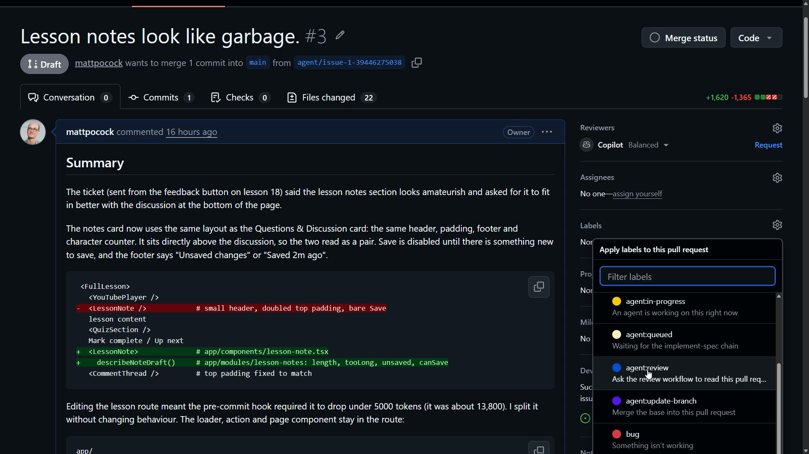

That kicks off the action. Here it is, titled "Lesson notes look like garbage."

While the action runs and does the review, let's check what it's actually doing.

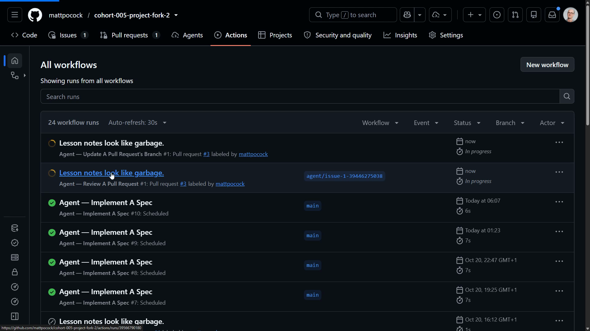

## The workflow file

The code lives in `agent-review.yml`. It's set up in pretty much the same way as the implementer workflow. It just has a different prompt.

The step that runs the [agent](https://www.aihero.dev/ai-coding-dictionary/agent) is a single command:

```yaml
- name: Review the pull request
  env:
    CLAUDE_CODE_OAUTH_TOKEN: ${{ secrets.CLAUDE_CODE_OAUTH_TOKEN }}
    OUTPUT_DIR: ${{ runner.temp }}
  run: npx tsx .sandcastle/agent-workflows/review/review.ts
```

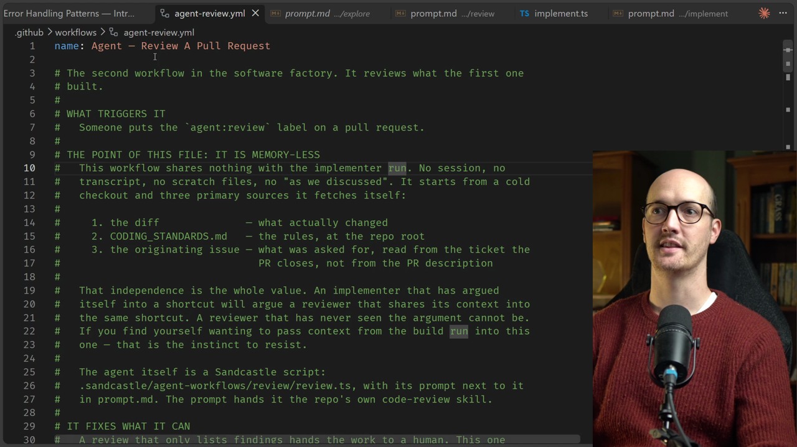

## The prompt

The prompt is in `.sandcastle/agent-workflows/review/prompt.md`.

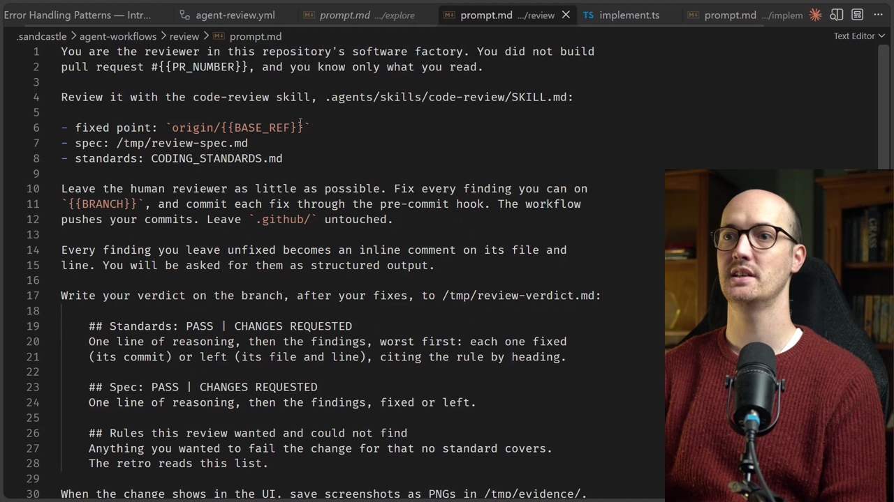

First, it tells the agent to review the code with the `/code-review` [skill](https://www.aihero.dev/ai-coding-dictionary/skill):

```markdown
Review it with the code-review skill, .agents/skills/code-review/SKILL.md:

- fixed point: `origin/{{BASE_REF}}`
- spec: /tmp/review-spec.md
- standards: CODING_STANDARDS.md
```

Then it says to leave the human reviewer as little as possible to do, and to fix every finding it can on the branch:

```markdown
Leave the human reviewer as little as possible. Fix every finding you can on
`{{BRANCH}}`, and commit each fix through the pre-commit hook. The workflow
pushes your commits. Leave `.github/` untouched.
```

## Parameterised prompts

Those handlebars-style placeholders are a Sandcastle-specific thing. Inside `review.ts`, we pass `promptArgs` to the prompt. `BASE_REF`, `BRANCH` and `PR_NUMBER` are all in there.

```ts
promptArgs: {
  PR_NUMBER: required("PR_NUMBER"),
  BRANCH: required("BRANCH"),
  BASE_REF,
},
```

This gives us parameterised prompts. You can pass dynamic values into the prompt.

## Structured output

One line in the prompt is worth pausing on:

```markdown
Every finding you leave unfixed becomes an inline comment on its file and
line. You will be asked for them as structured output.
```

That's another Sandcastle feature: `output.object`.

```ts
output: sandcastle.Output.object({ tag: "comments", schema: reviewSchema }),
```

We're asking the agent to give us a `<comments>` XML tag, with a certain schema. This is the schema:

```ts
export const reviewSchema = z
  .strictObject({
    comments: z
      .array(
        z.strictObject({
          path: z.string().min(1),
          line: z.number().int().positive(),
          body: z.string().min(1),
        })
      )
      .describe("One entry per finding you left unfixed. Empty is fine."),
  })
  .describe("The review's inline comments.");
```

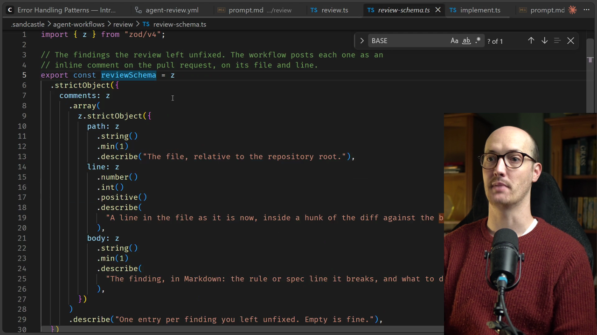

In other words, we get back an object with a bunch of paths, lines and bodies. That's exactly what GitHub needs to turn them into inline comments.

This code is more complicated than the implementer's, because there's a little error handling around `output.object` to make it more reliable. But you can think of it as just another prompt.

## Screenshots

Just like the implementer's prompt, we've given the reviewer the ability to attach screenshots if it needs to.

```markdown
When the change shows in the UI, save screenshots as PNGs in /tmp/evidence/.
```

## The review output

The review has finished, and we can see the structured output the agent passed back. There's a `<comments>` tag, with a big list of comments in JSON inside it.

```txt
<comments>
{"comments":[
{"path":".oxlintrc.json","line":151,"body":"**Lint exemptions instead of a split** ..."},
...
]}
</comments>
```

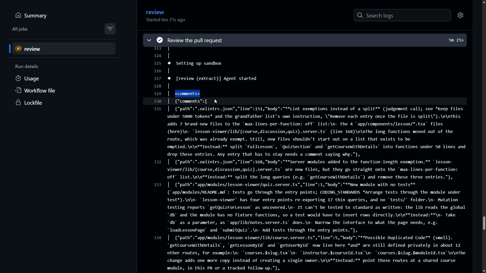

The review looks like it succeeded, so let's see what it added.

## The verdict

On our PR, we have the initial summary, then a big comment containing the review.

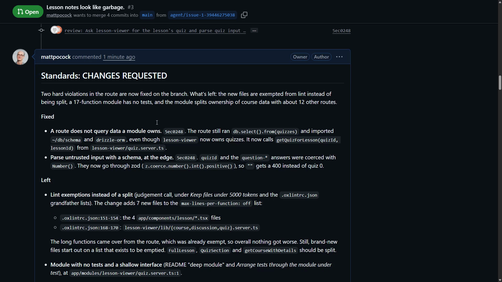

There's some fairly nasty stuff in here, and some of it has already been fixed.

### Standards: what was fixed

The first fix: a route does not query data that a module owns. The route was running `db.select()` instead of using `getQuizForLesson`, which is what it should have been doing.

Next, the rule **Parse untrusted input with a schema, at the edge**. The route wasn't doing that. It was coercing inputs with `Number()`. Now it goes through Zod.

### Standards: what was left

It cheated a little on the linter. It added a lint exemption instead of splitting the code.

There's a `max-lines-per-function` lint rule, and the change added a bunch of new files to its exemptions. The review says:

> The long functions came over from the route, which was already exempt, so overall nothing got worse. Still, brand-new files start out on a list that exists to be emptied.

So our reviewer is calling out our implementer. That's not good.

We spotted something ourselves too. The new deep module, `lesson-viewer`, has four entry points that re-export 17 thin queries, and there's no `tests` folder. Even though it was added to `app/modules`, it hasn't actually created a deep module.

The review also found some duplicated code, a server module that depends on a UI component, and some duplicated styling.

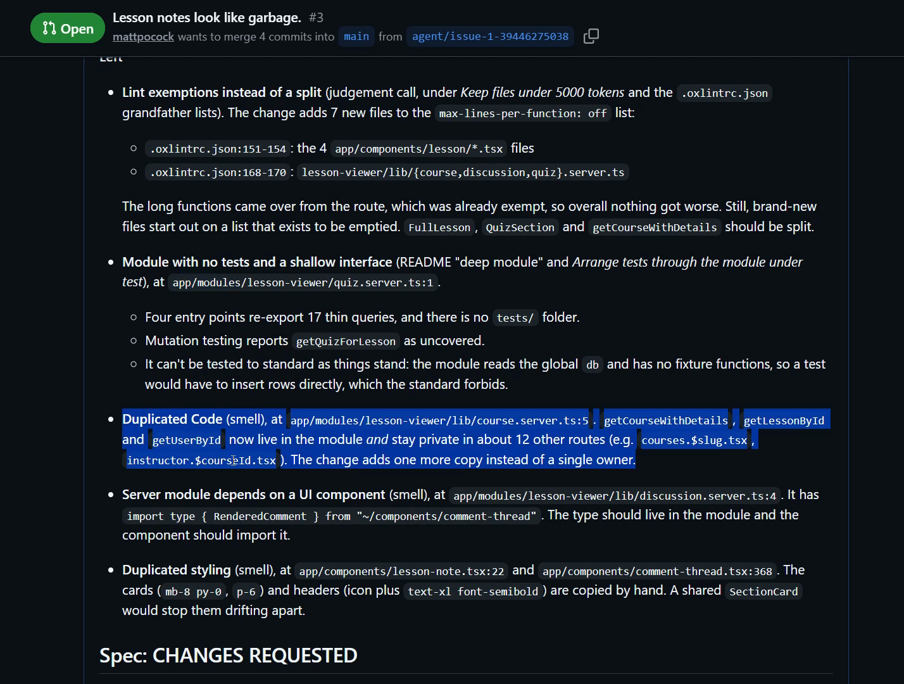

### Spec: the bugs it found

The [spec](https://www.aihero.dev/ai-coding-dictionary/spec) section has some serious stuff:

> The [ticket](https://www.aihero.dev/ai-coding-dictionary/ticket) is met: the notes are now a card styled like Questions & Discussion. But about 90% of the diff is an unrequested refactor, and it brought two state bugs, both now fixed.

There's evidence attached, in the form of screenshots.

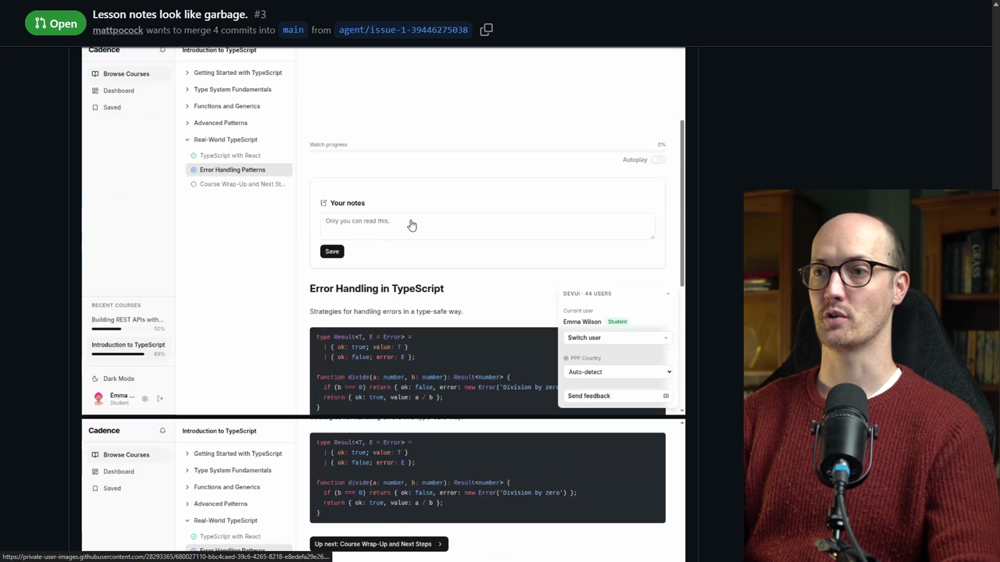

The first bug: the notes box kept the previous lesson's text. This is a classic React bug. The PR made the textarea controlled. If you pressed Prev, Next or a sidebar link, lesson A's draft stayed in the box on lesson B. One click on Save overwrote B's note.

The second: "Unsaved changes" was also stuck after a save.

So the reviewer clicked through the app and found a bug by driving the software. It's re-verifying what the implementer did.

### Spec: what was left

Now the stuff the review left for us:

- **Scope creep, the route split.** This PR should probably be two PRs. The split buries a small restyle that should have been its own PR.
- **Unrequested behavior.** It adds a character counter, an "Unsaved changes" state and client-side save gating. It drops the textarea from 6 rows to 4, and changes "Last edited" to "Saved". It's all harmless and arguably part of being less amateurish, but none of it was asked for.

## Rules this review wanted and could not find

This section is very neat. These are rules the code reviewer wanted but couldn't find written anywhere in the coding standards docs. It's almost like it's running a retro as it goes: "I want these rules for next time."

Here are four of them:

| Rule the reviewer wanted | Why |
| --- | --- |
| New files may not join a lint exemption list | A great one |
| New modules must ship with tests | I absolutely agree |
| Modules must take `db` as a parameter | Just like `app/lib/notes.server.ts` does |
| A controlled form field is keyed by the entity it edits | Specifically solves the bug it found in this review |

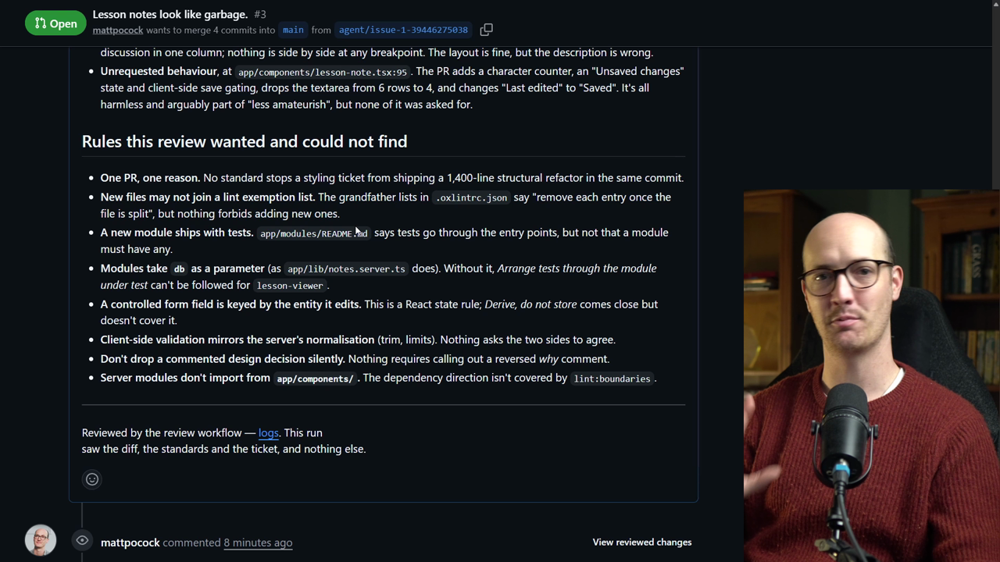

## Inline comments

Further down, there's a bunch of comments that are on specific files. They're largely re-reporting the stuff above.

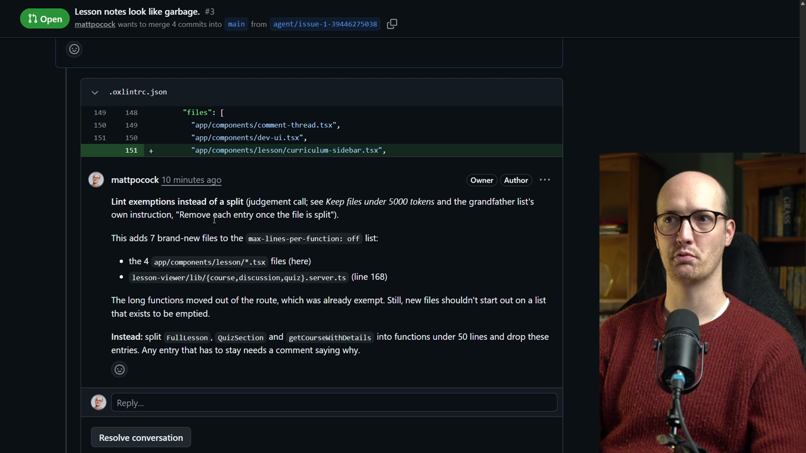

## The review's commits

The review didn't only leave comments. It also pushed commits. To look at them, go into **Files changed**, then open the commit selector to look at all commits, and review the ones the agent made.

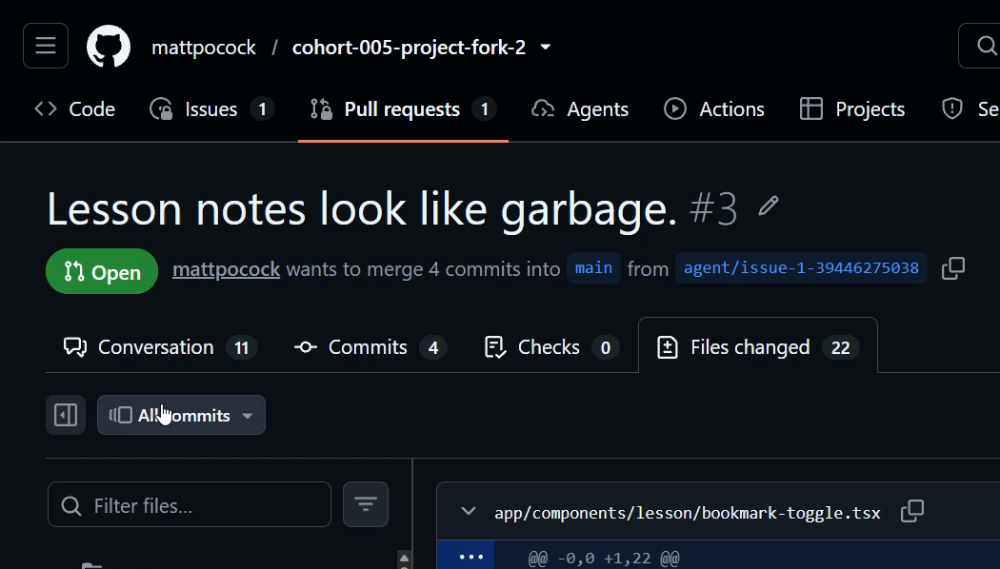

Once selected, we're seeing just the work it did during its review.

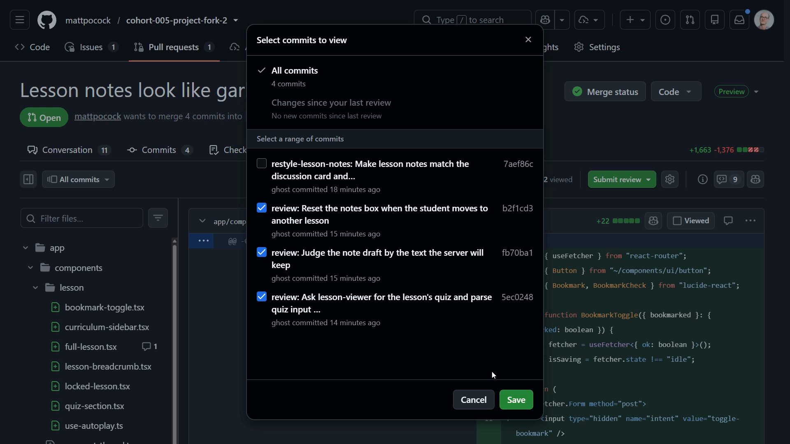

First, the `key` added onto the `LessonNote` component. That's nice. It's the bug fix that resets the notes box when the student moves to another lesson.

```diff
-          {currentUserId && <LessonNote note={note} />}
+          {currentUserId && <LessonNote key={lesson.id} note={note} />}
```

There's also a fix to keep the client and the server in sync on the draft text, plus a couple of extra tests.

Next, a `getQuizForLesson` function. Before, the route was using its own `db.select()`:

```diff
-    const quiz = db.select().from(quizzes).where(eq(quizzes.id, quizId)).get();
-    if (!quiz || quiz.lessonId !== lessonId) {
+    const quiz = getQuizForLesson(quizId, lessonId);
+    if (!quiz) {
       throw data("Quiz not found", { status: 404 });
     }
```

Here it points out that the module has no tests, which makes sense. Here's the scope creep we talked about earlier.

Then there are a couple of Zod schemas. Before, we were coercing with `Number()` instead of going through `parseFormData`:

```diff
-    const quizId = Number(formData.get("quizId"));
-    if (isNaN(quizId)) {
+    const parsed = parseFormData(formData, submitQuizSchema);
+    if (!parsed.success) {
       throw data("Invalid quiz ID", { status: 400 });
     }
+    const { quizId } = parsed.data;
```

Now `quizId` comes through from Zod instead of `Number()`, which is what our coding standards want.

## Wrapping up

So there we go. We've reviewed our own PR using our own built-in code review tool.

I wouldn't say it was a perfect review. I definitely think there's stuff to improve, and we'll look at that in the next lesson.

Nice work, and I'll see you in the next one.
