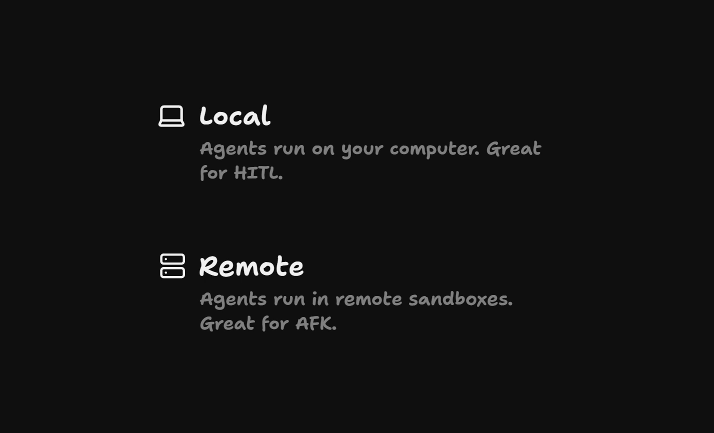
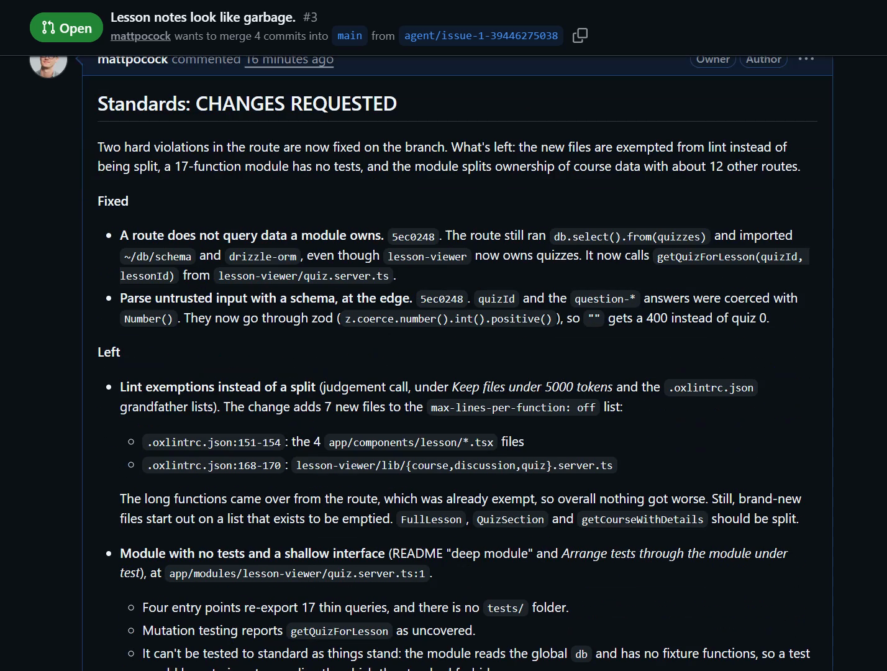
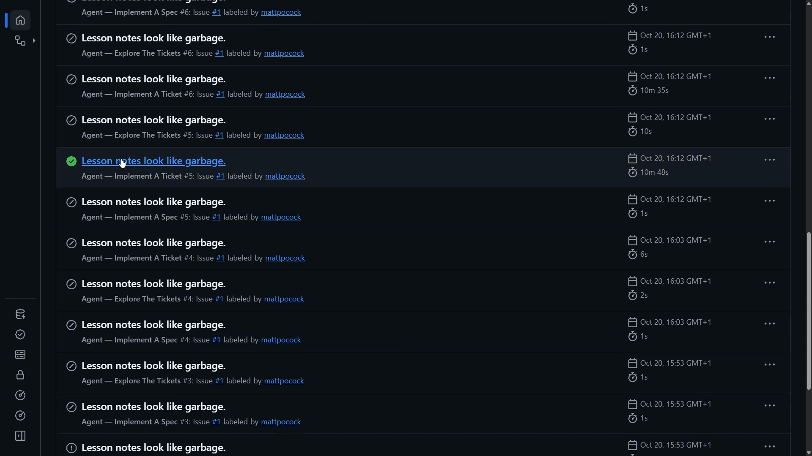

# Retro A Run

<CommitMap packageManager="npm">
  <Commit id="add-factory-workflows">Start the lesson: the factory workflows, with the PR and its review already on your GitHub repo</Commit>
  <Commit id="retro-review-and-checks">See my solution: the reviewer fixes more, lists each finding once, and gains new checks</Commit>
</CommitMap>

<Prerequisites title="Crash Course Prerequisites">
  <Prerequisite href="https://www.aihero.dev/workshops/ai-coding-crash-course/turns-and-model-provider-requests-8bf689b0">
    How to read a run's logs: turns, tool calls and tool results, so you can spot where the agent struggled.
  </Prerequisite>
  <Prerequisite href="https://www.aihero.dev/workshops/ai-coding-crash-course/statelessness-1fdb45c1">
    Why the agent remembers nothing between runs, so every fix has to land in the repo.
  </Prerequisite>
  <Prerequisite href="https://www.aihero.dev/workshops/ai-coding-crash-course/the-steering-map-c061e049">
    Where steering lives, so you know where the retro's improvements should go.
  </Prerequisite>
  <Prerequisite href="https://www.aihero.dev/workshops/ai-coding-crash-course/what-are-agent-skills-20f91a4e">
    What a skill is and how you invoke one, since the retro is a skill.
  </Prerequisite>
  <Prerequisite href="https://www.aihero.dev/workshops/ai-coding-crash-course/enforcing-your-coding-standards-f1656d67">
    How coding standards feed an automated review, which is what the retro tunes.
  </Prerequisite>
</Prerequisites>

Our [software factory](https://www.aihero.dev/ai-coding-dictionary/software-factory) has produced a PR, and the review [agent](https://www.aihero.dev/ai-coding-dictionary/agent) has reviewed it. The result works, but the review isn't as good as it could be.

The verdict comment is a massive wall of text. It duplicates the inline comments on the code. And the action logs are full of detail that could show where the agent struggled.

Time to run a retrospective on the factory itself. The `/retro` [skill](https://www.aihero.dev/ai-coding-dictionary/skill) isn't just for local runs. It works on remote runs too.



## Steps To Complete

### Find the problems in the review

- [ ] Open the PR your factory created and read the review agent's verdict comment



Look for things you'd improve. Two problems stand out:

- The verdict is a huge wall of text. The `show-me` skill might help make it simpler.
- Findings are duplicated. The `## Spec` section repeats what the inline comments on the code already say.

- [ ] Scroll to the **Rules this review wanted and could not find** section at the end of the verdict

These are rules the reviewer wanted to apply but couldn't find in your standards. There are some good ideas here, and you want the agent to read them.

### Gather the runs

- [ ] Open the **Actions** tab on your repo and find the runs that led to this PR



You need two:

- The **Agent - Review A Pull Request** run, which found and pushed the fixes.
- The **Agent - Implement A Ticket** run, which opened the PR.

Ignore the skipped runs. They are sibling workflows that fire on any label change.

- [ ] Copy the URL of each run

They have this form, using your own repo and run ids:

```txt
https://github.com/<owner>/<repo>/actions/runs/<run-id>
```

### Run the retro

- [ ] Head back to your agent and invoke the `/retro` skill, passing in both run URLs

- [ ] Add a prompt saying how you feel about the review so far

Tell the agent which parts you care about. Point it at the **Rules this review wanted and could not find** section and ask it to read those comments.

- [ ] Ask for a list of concrete ways to improve the factory to your preferences

The retro should look for places where the agent struggled in the run logs, as well as the problems you spotted in the review.

- [ ] Apply the improvements

Have the agent make the changes, so future runs and experiments benefit from this process.

If you want to compare your result with mine, see the solution commit in the commit map above.
