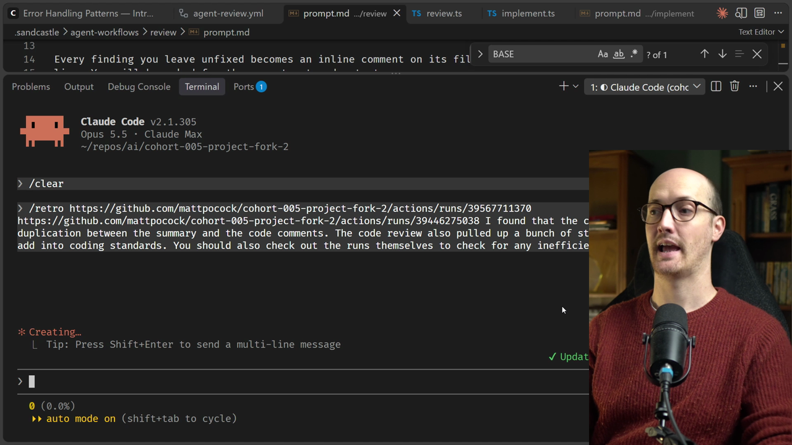
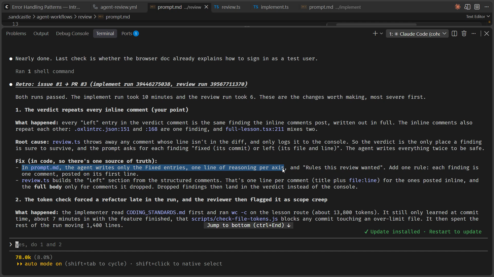
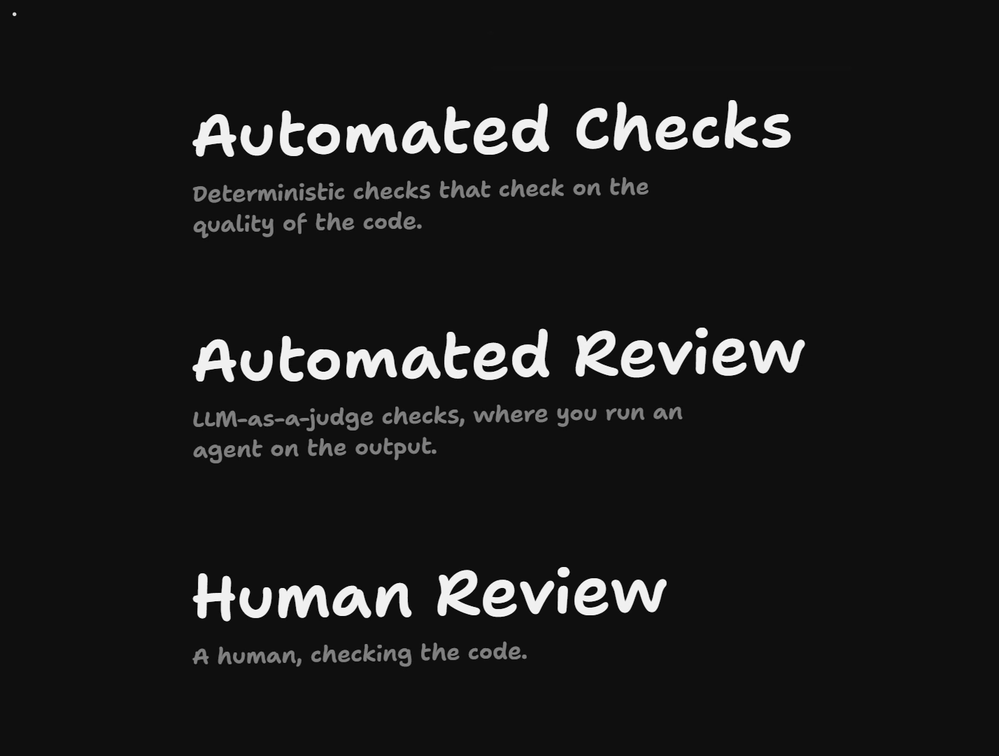
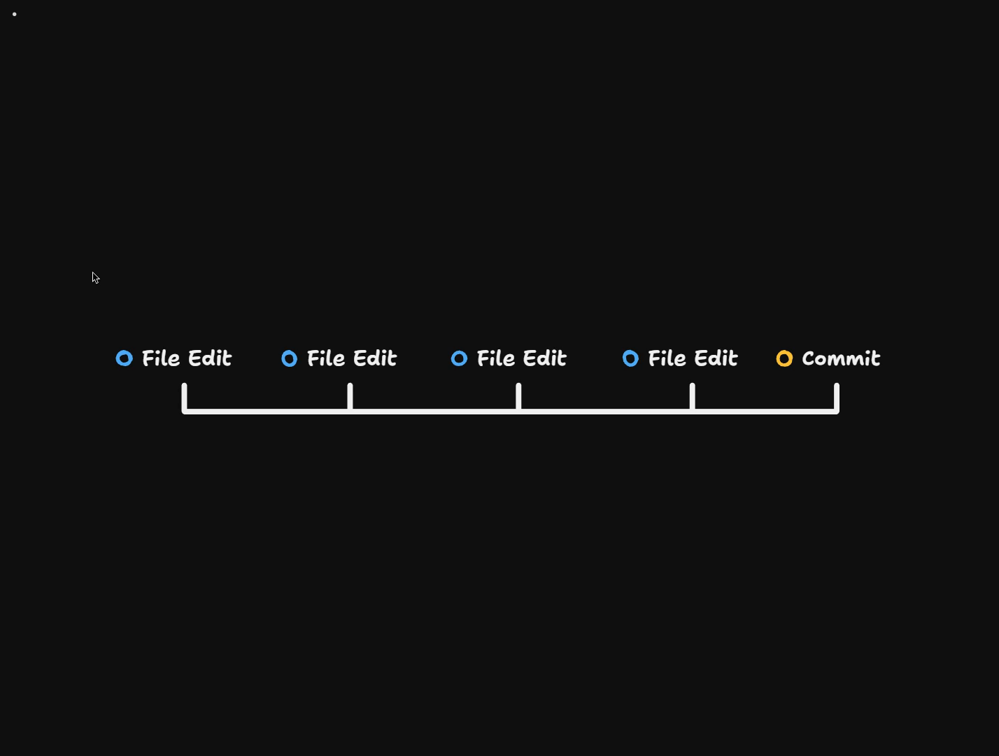
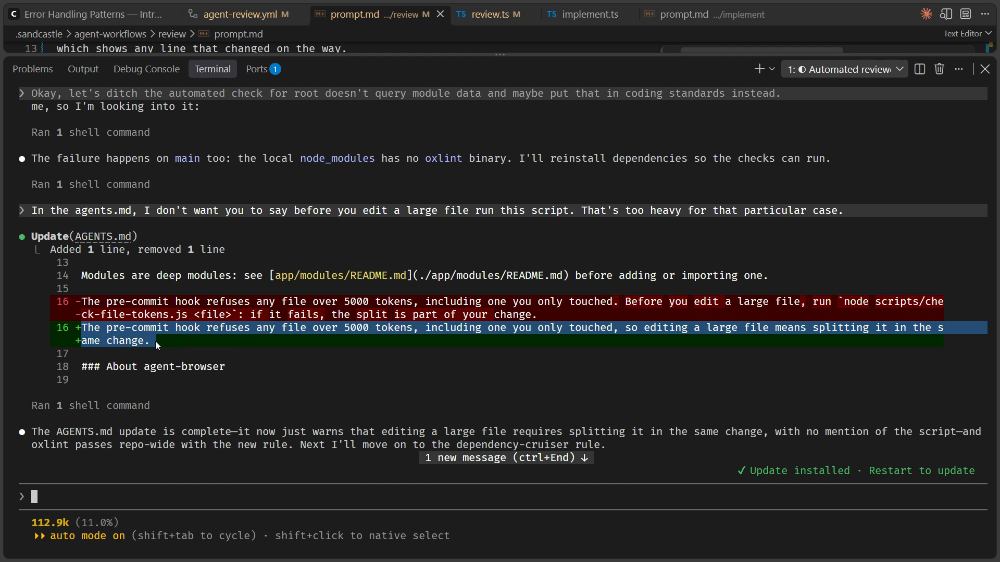
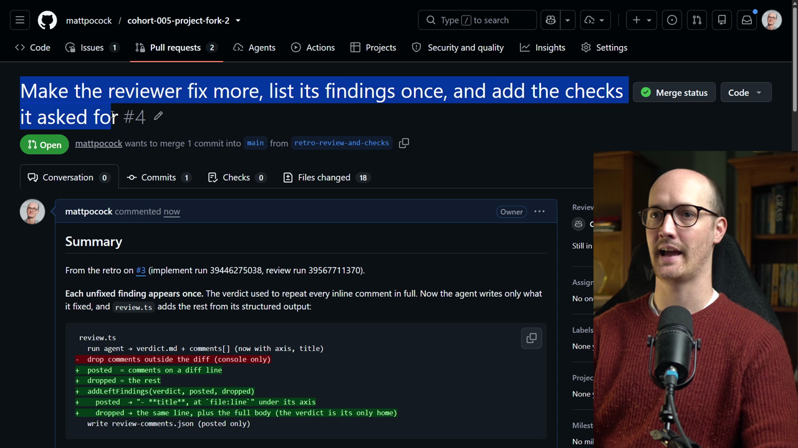

# Retro A Run Solution

<CommitMap packageManager="npm">
  <Commit id="add-factory-workflows">Start the lesson: the factory workflows are in place, ready for a retro</Commit>
  <Commit id="retro-review-and-checks">See my solution: the reviewer fixes more, lists each finding once, and three new checks are added</Commit>
</CommitMap>

## Writing the retro prompt

The retro [skill](https://www.aihero.dev/ai-coding-dictionary/skill) takes the runs to look at, plus a prompt describing how I feel about the code review. Here is the prompt, with the review run and implement run URLs passed in first.

```txt
/retro <review-run-url> <implement-run-url> I found that the code review contains a lot of duplication between the summary and the code comments. The code review also pulled up a bunch of stuff that we could potentially add into coding standards. You should also check out the runs themselves to check for any inefficiencies.
```

Three things are in there:

- The review has duplication between the summary and the code comments.
- The review surfaced rules we could add to the coding standards.
- The runs themselves might contain inefficiencies.



## Item 1: the verdict repeats every inline comment

The retro has come back with a bunch of findings. The first one is the one we pointed out: the verdict repeats every inline comment.

The fix goes in `prompt.md`. The [agent](https://www.aihero.dev/ai-coding-dictionary/agent) writes only the fixed entries, with one line of reasoning per axis.

In other words, the summary becomes just a summary of what was fixed. That makes sense.



## The reviewer isn't aggressive enough

One thing I didn't like from the run is that I think it didn't fix enough.

Take the finding about a module with no tests and a shallow interface. I would have expected the reviewer to fix that with a commit. I wanted it to be pretty aggressive, pretty radical in its approach.

The same goes for the duplicated code, and even for the server module depending on a UI component.

I'm going to give that feedback too, but not submit it quite yet. I also noticed the reviewer isn't particularly aggressive in going to find fixes. I would have expected the app modules deep module fix to have been done, instead of being passed back to the human reviewer.

We're not being aggressive enough in [automated review](https://www.aihero.dev/ai-coding-dictionary/automated-review), and that means [human review](https://www.aihero.dev/ai-coding-dictionary/human-review) is being slowed down.

## Item 2: automated checks disagree with automated review

The next thing it noticed is that the [token](https://www.aihero.dev/ai-coding-dictionary/token) check forced a refactor late in the run, and then the reviewer flagged that refactor as scope creep.



Our [automated checks](https://www.aihero.dev/ai-coding-dictionary/automated-check) are disagreeing with our automated review. The checks force the agent to split up code when it can. Then the review says no, this is scope creep, because the issue didn't specifically mention it.

This is quite tricky. How do we sort it out?

The retro recommends adding this line to the coding standards:

> A split the token check forced is in scope for any [ticket](https://www.aihero.dev/ai-coding-dictionary/ticket). Confirm that no behavior changed and do not flag it as scope creep.

### The implement prompt line is too noisy

It also suggests something I don't recommend, which is a one-line addition to the implement prompt. It says that before editing a file, you run a script on the file. If it fails, you do the split first as its own commit.



When we talked about pre-commit hooks, you might remember I asked why we don't use [harness](https://www.aihero.dev/ai-coding-dictionary/harness) hooks here. The answer is that they're too frequent. If we fire the check on every file edit, it's going to be really noisy for the agent.

So I tend to prefer batching these automated checks until right at the end. I'm worried that the implement prompt line would be a bit too noisy, so keeping the check in the commit is fine.

But maybe we should add a little note inside `AGENTS.md`, so the implementer agent is pre-warned.

## Item 3: rules sorted into checks and standards

Next is a list of rules the reviewer wanted, sorted into checks and standards.

Here is how the mechanical ones map to checks:

| Rule | Check |
|---|---|
| Server modules shouldn't import from app components | A rule in dependency-cruiser |
| Parse input with Zod, not `Number()` | A custom oxlint rule in `lint-rules/` |
| A route doesn't query data a module owns | Another boundaries check |
| A new module ships with tests | A simple file system check |

The file system check would go through every module and make sure it has a tests folder with some tests in it.

All of those sound incredibly simple and incredibly fast. I'm definitely for all of them.

Notice what happens when you start rolling down the automated check hill. Because the checks live in your repo, the agent knows they're on the table. It knows that's an option for future runs and future retros.

### The judgment calls

Some are judgment calls, so they belong in the coding standards:

- **Key a controlled field by the entity it edits.** This would fix the real bug of the run, where lesson A's draft overwrote lesson B's note.
- **Client and server share one normalization function** for trimming and limits. This would prevent the "Unsaved changes" state that never cleared.
- **A PR that reverses a *why* comment says so.**

This is a great pattern. We found a bug in automated review, and we make that bug less likely next time by adding a coding standard to prevent it.

The last one wasn't clear to me, so I asked the agent for more context. My dictation garbled "A PR that reverses a *why* comment" into "APR that reverses a Y comment", and the message went to the agent that way. I'll come back to it below.

## Items 4 to 6: agent-browser, sign-in and screenshots

Number four in the retro: both runs installed agent-browser mid-[session](https://www.aihero.dev/ai-coding-dictionary/session).

In both runs the agent tried to call `agent-browser`, then installed it and ran `agent-browser install`. That downloads Chromium inside the agent's step.

This is such a classic thing that a retro is really good at finding, and that would be really painful to pick through yourself. The fix is to add a workflow step that installs it with a cache.

Number five: both runs worked out from scratch how to sign in as an enrolled student. They need a little bit of steering, so the fix is a short signing-in section.

Number six: the reviewer posted some useless screenshots. The fix goes in the review prompt: screenshot what your own fixes change, and check the PR's after-state in the browser.

## Sending the feedback

I accept all the recommendations except the minor ones. Let's build all of it, in a separate PR to the main branch.

I'm going to send this off. There were a couple of things that needed feedback before it came back, so in theory it shouldn't go straight ahead to implementation.

It looks like I'm going to need to interrupt it and stop its flow.

## What is a why comment?

Let's ask about the why comments.

```txt
Tell me about the why comments now.
```

The agent explained what happened. On `main`, the lesson route had a comment above the note. The comment said the note sits under the video so the student can write while they watch.

That comment is the only record of a product decision. The implementer moved the lesson note down and deleted the comment along with the old line.

What the rule is saying is this: when a PR changes a decision that a why comment records, name the reversal in the PR description. Replace the comment with the new reason if the code still needs one.

### My take: why comments belong in ADRs

I'd prefer not to put these why things inside comments. I think they belong in ADRs, if they need to exist at all.

If we record product decisions inside comments, those comments can quickly go out of date and become stale. I would rather delete even those why comments as needed, and probably turn them into ADRs.

If we have a lot of why information or product decisions in comments, that's a sign our workflow isn't working correctly. That should be flagged in the PR.

Then we should pretty aggressively remove those comments.

## Dropping the route check

I said I was ready to build, but I interrupted again, sorry. There's a line above saying that something has come up since the retro. A scan found 24 routes that import a module and also import `~/db` and `drizzle-orm`.

In other words, one of our automated checks would have a massive exemption list from day one.

So I sent this:

```txt
Okay, let's ditch the automated check for route doesn't query module data and maybe put that in coding standards instead.
```

## The agent disobeys on AGENTS.md

It's rolling through, and I can see it has disobeyed me in `AGENTS.md`. It wrote this:

```md
Before you edit a large file, run `node scripts/check-file-tokens.js <file>`: if it fails, the split is part of your change.
```

That's exactly what I didn't want it to add. So I queued up a message:

```txt
In the AGENTS.md, I don't want you to say, before you edit a large file, run this script. That's too heavy for that particular case.
```

It went and modified `AGENTS.md`. Now the line says that editing a large file means splitting it in the same change.

```md
The pre-commit hook refuses any file over 5000 tokens, including one you only touched, so editing a large file means splitting it in the same change.
```



## Context size

This is getting to be a pretty large change. I debated turning it into a [spec](https://www.aihero.dev/ai-coding-dictionary/spec) and tickets, but I think we'll creep under the 150 mark.

Even so, this work isn't particularly complicated, so I'm not too worried about it going into the [dumb zone](https://www.aihero.dev/ai-coding-dictionary/smart-zone).

## Caching agent-browser's Chrome

It's now installing agent-browser and caching its version of Chrome. Here is the shape of the steps in the workflow:

```yaml
- name: Cache agent-browser's Chrome
  uses: actions/cache@v4
  with:
    path: ~/.agent-browser/browsers
    key: agent-browser-0.27.0-${{ runner.os }}

- name: Install agent-browser
  run: |
    npm install -g agent-browser@0.27.0
    agent-browser install
```

The caching is important. The agent won't have to re-download Chrome every single time, because it's already in the cache.

## Committing and the PR

It's now going ahead and committing. The hook accepted the commit and still ran pretty fast. Then it opened the PR.

The title reads: make the reviewer fix more, list its findings once, and add the checks it asked for.



We can see the new checks, the standards and docs, and some evidence too. Each new check was tried on a throwaway file.

| Rule | Check |
|---|---|
| Parse request input with Zod, not `Number()` | `input/no-number-coercion` in `lint-rules/input.js` |
| Server code doesn't import components | `server-code-no-components` in dependency-cruiser |
| Every module has tests | `npm run lint:modules` |

The agent didn't actually test the new workflow changes. That makes sense, because workflows only run from the main branch.

It also says this is a two-way door, and the blast radius is only the [factory](https://www.aihero.dev/ai-coding-dictionary/software-factory).

## Merging

For me, I'm going to merge this in.

Back in the code, I'll check out `main` and pull, so the latest changes come in.

```bash
git checkout main
git pull
```

## Closing the loop

That's the process for improving your software factory over time. You make your runs more efficient, and you tune the factory to how you want it.

You can use the retro skill on bigger and bigger chunks, too. You don't have to point it at one particular PR. You can say, look at the last 10 implement runs, or the last 20 review runs.

And all of that human review feeds back into automated review and automated checks. It is the circle of life, folks.

Nice work, and I'll see you in the next one.
