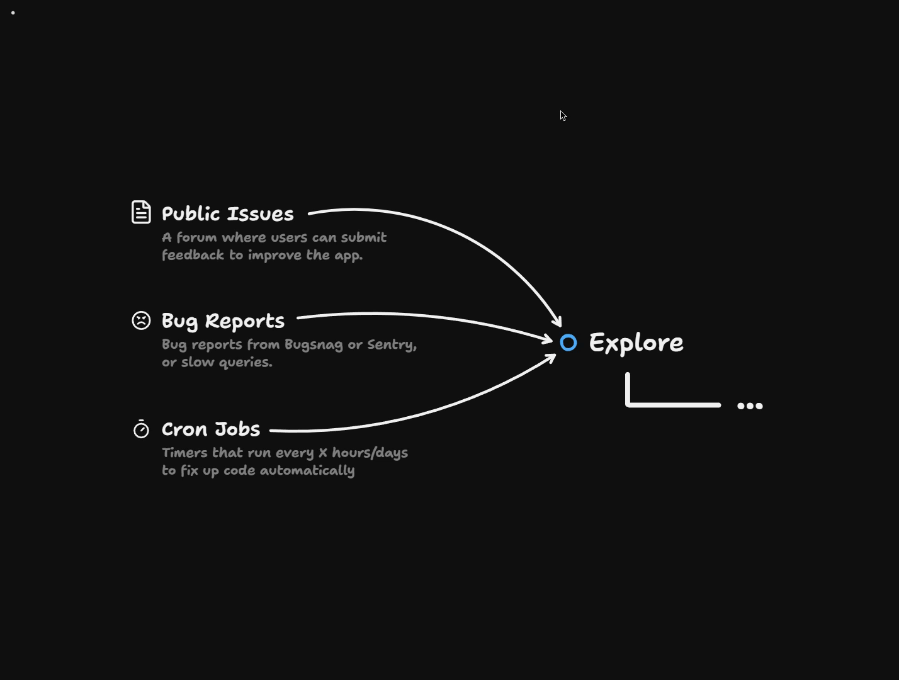
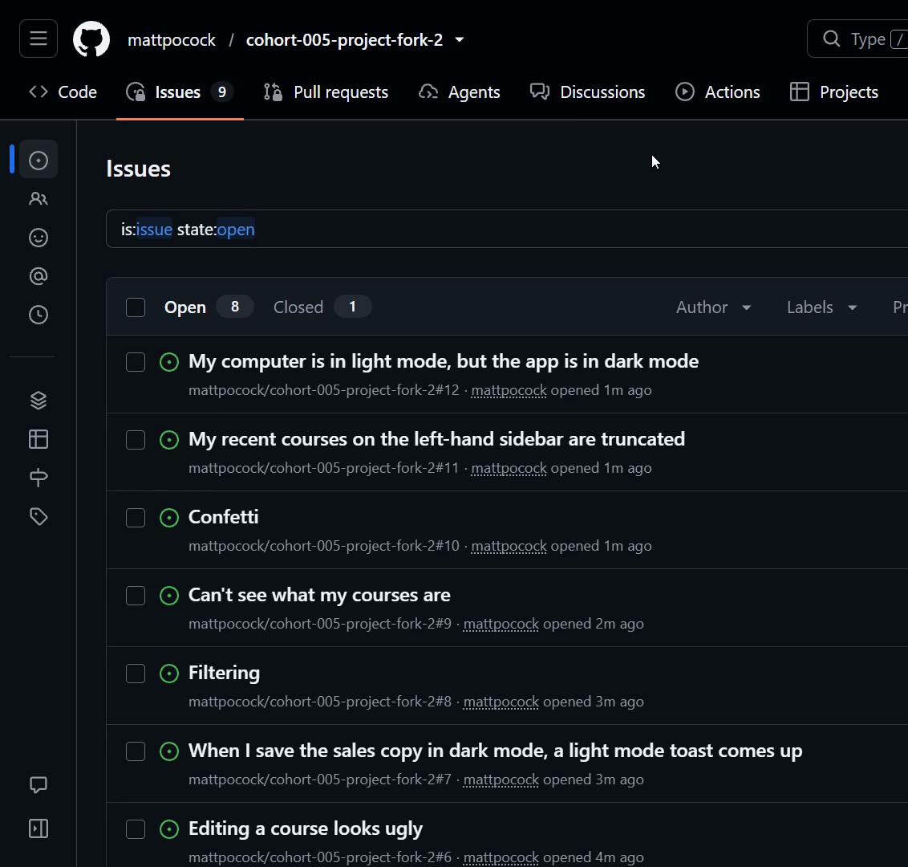

# Explore Before You Commit

<CommitMap packageManager="npm">
  <Commit id="retro-review-and-checks">Start the lesson: the factory workflows plus the retro's changes to the reviewer and checks</Commit>
</CommitMap>

<Prerequisites title="Crash Course Prerequisites">
  <Prerequisite href="https://www.aihero.dev/workshops/ai-coding-crash-course/codebase-exploration-205910ac">
    Why an agent starts knowing nothing about your code, and has to explore before it can act.
  </Prerequisite>
  <Prerequisite href="https://www.aihero.dev/workshops/ai-coding-crash-course/why-plan-mode-sucks-2d6ef1a6">
    Why agents rush to build before checking they're building the right thing, which is the gap explore fills.
  </Prerequisite>
  <Prerequisite href="https://www.aihero.dev/workshops/ai-coding-crash-course/the-grill-execute-clear-loop-fac85414">
    How grilling surfaces the open questions only a human can answer.
  </Prerequisite>
  <Prerequisite href="https://www.aihero.dev/workshops/ai-coding-crash-course/set-up-your-issue-tracker-30629075">
    How GitHub issues work as the ticket tracker the factory reads from.
  </Prerequisite>
</Prerequisites>

So far we've taken an issue and turned it into implemented code, then reviewed and merged it. But not every issue should go straight to implementation.

Feedback from outside your repo is vague, rude, sometimes wrong, and often duplicated. It needs an explore phase first: verify the claims, find the relevant code, and surface open questions.

In this exercise you'll fill your issues list with exactly that kind of feedback, ready for the explore workflow.



## Steps To Complete

### Get Your Repo Ready

- [ ] Reset to the starting point for this lesson

```bash
npm run reset retro-review-and-checks
```

This lesson adds no commit of its own. The work is filing issues and running the explore workflow that's already in the repo.

- [ ] (Optional) Tidy your repo by merging any open implementer PR from the earlier lessons, then pull `main`

I merged my own PR as it stood and ran `git pull` so my repo was in a clean state. Later lessons don't depend on that merged code, so you can skip this.

```bash
git pull
```

### File Your Feedback Issues

- [ ] Start the app and open it in the browser

```bash
npm run dev
```

- [ ] Use the **Send feedback** button to file a batch of issues

Click the button on any page. A dialog opens with a **Title** and a **What happened?** field. Submitting it files a GitHub issue on your repo, with the page it was sent from on the first line.

Cruise through the app and find things you're not happy with. If a bug has been bugging you for ages, now is the moment.

- [ ] Write each issue as if it came from someone outside the dev team

Make them vague, rude, hard to specify, and in some cases dependent on a decision from the dev team. Aim for around nine issues.



- [ ] Include at least one pair of near-duplicate issues

For example, I filed these two from the home page:

```text
Title: My computer is in light mode, but the app is in dark mode
What happened?: Shouldn't it auto adjust?
```

```text
Title: App is in dark mode, my computer is in light mode
What happened?: It's annoying having to ping back and forth as I switch it during the day.
```

- [ ] (Optional) Copy my exact issues if you'd rather follow along

Here are a few of the nine I filed, with the page I sent each from:

| Page | Title | What happened? |
| --- | --- | --- |
| `/courses` | `My name isn't Emma...` | In the bottom left, I can only see my first name. |
| `/instructor/2` | `Editing a course looks ugly` | Especially on dark mode, it's just like a really horrible experience. There's so much information, and it just looks really grim. |
| `/instructor/2` | `When I save the sales copy in dark mode, a light mode toast comes up` | Just what it says |
| `/instructor/2` | `Filtering` | I want the ability to filter these students and sort them |
| `/courses` | `Can't see what my courses are` | From this page, I can't easily see which ones I've already purchased. |
| `/courses/design-systems-with-tailwind/welcome` | `Confetti` | I expected confetti on this page when I purchased. |
| `/courses/design-systems-with-tailwind/lessons/40` | `My recent courses on the left-hand sidebar are truncated` | Design systems with Ta? |

Add the light/dark mode pair above and you have all nine.

### Check Your Work

- [ ] Open your repo's issues list on GitHub and confirm all your issues arrived

The feedback button adds no label at this point, so they'll be unlabelled. Check that the duplicate pair is there.

- [ ] Look at the vague issues and ask yourself how you'd implement them

Notice how poor a prompt each one makes for an [agent](https://www.aihero.dev/ai-coding-dictionary/agent). That's the problem the explore phase solves.

### What Happens Next

In the solution, you'll select all your issues at once and label them `agent:explore`. One run does the work, being passed every issue in the batch so it can spot duplicates. It then comments back on each issue with what it found.

Don't label anything yet. Good luck, and I'll see you in the solution.
