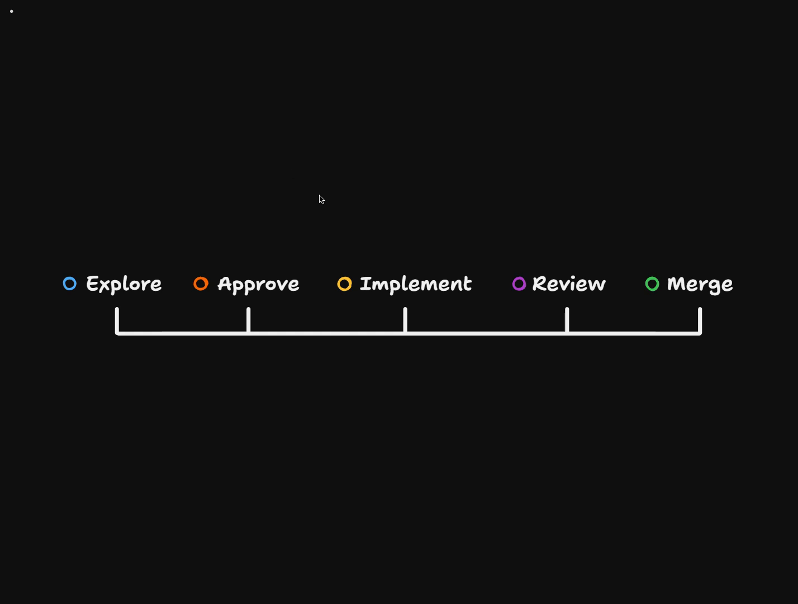

# Chaining The Whole Factory

<CommitMap packageManager="npm">
  <Commit id="retro-review-and-checks">Start the lesson: the retro's reviewer and checks changes</Commit>
  <Commit id="chain-factory-end-to-end">See the solution: the factory chained from a filed issue to a reviewed PR</Commit>
</CommitMap>

<Prerequisites title="Crash Course Prerequisites">
  <Prerequisite href="https://www.aihero.dev/workshops/ai-coding-crash-course/non-determinism-c31d9cdd">
    Why an agent's verdict can differ from run to run, so you can't predict how far a ticket will chain.
  </Prerequisite>
  <Prerequisite href="https://www.aihero.dev/workshops/ai-coding-crash-course/handing-off-ef5d222b">
    What a handoff is: passing work to a fresh agent with what it needs, which is what each link in the chain does.
  </Prerequisite>
  <Prerequisite href="https://www.aihero.dev/workshops/ai-coding-crash-course/how-to-tackle-massive-tasks-6199ee6b">
    Why big work splits into a spec and tickets, the units the factory passes along.
  </Prerequisite>
  <Prerequisite href="https://www.aihero.dev/workshops/ai-coding-crash-course/enforcing-your-coding-standards-f1656d67">
    The layers of review, and why the chain still ends with a human deciding whether to merge.
  </Prerequisite>
</Prerequisites>

Our exploration now kicks in on its own, but the [software factory](https://www.aihero.dev/ai-coding-dictionary/software-factory) still needs us to step in. We pick the [ticket](https://www.aihero.dev/ai-coding-dictionary/ticket) to implement, apply the review label by hand, and decide whether to merge.

That doesn't feel autonomous. In this exercise, you'll automate two of those [hand-offs](https://www.aihero.dev/ai-coding-dictionary/handoff): explore calling implement, and implement calling review. Then you'll kick the whole chain off by sending feedback from the app.



## Steps To Complete

### Take the chaining commit

- [ ] Cherry-pick the `chain-factory-end-to-end` commit onto your local `main` branch

```bash
npm run cherry-pick
```

Choose `chain-factory-end-to-end` from the list.

- [ ] Push the commit to GitHub

The workflows on GitHub only change once the push lands.

```bash
git push
```

### Read how explore decides

- [ ] Open the explore prompt at `.sandcastle/agent-workflows/explore/prompt.md` and find the new **VERDICT** step

Each issue gets exactly one tag, and the workflow branches on it:

| Tag | Meaning |
| --- | --- |
| `easy-call` | The right change is clear, nobody would disagree with any decision in it, and you'd be happy for the PR to land without you. It goes straight to the implementer. |
| `needs-a-human` | Somebody has to decide something first (a migration, a name, a policy, a trade), or the issue's claims did not hold up. |
| `blocked` | Waiting on something outside the repository, or on information only the reporter has. |

This text is the criteria the [agent](https://www.aihero.dev/ai-coding-dictionary/agent) uses to make the call. You may want to tweak it later, or add examples of easy calls and issues that needed a human.

- [ ] Open `.sandcastle/agent-workflows/explore/plan-schema.ts` and find where each issue is tagged

Look at the `tag` field on each issue in the plan.

- [ ] Open `.github/workflows/agent-explore.yml` and find the **Apply the plan** step

Find the `easy-call` branch. It removes the `agent:in-progress` label and adds `agent:implement`. That's the first arrow of the chain: explore now calls implement when it thinks it can.

### Read how implement calls review

- [ ] Open `.github/workflows/agent-implement.yml` and find the new **Hand the pull request to the reviewer** step

It runs after the draft PR is opened and applies the `agent:review` label to it. That's the second arrow, so the chain now runs all the way to review.

### Start the factory from the app

The feedback flow now adds the `agent:explore` label to every issue it creates. Submitting the form is enough to start the factory.

- [ ] Open the app and click the **Send feedback** button

- [ ] Write an issue that is likely to pass the `easy-call` test, such as a simple visual change

You can copy this one or write your own.

Title:

```text
Landing Page
```

Description:

```text
I don't really like the current design of the landing page. I think it could use a little bit more left align. I think the center align is kind of cheesy and overall just doesn't grab attention and looks pretty half finished.
```

- [ ] Click **File issue**

This begins your software factory. Watch the issue on GitHub as explore, and then, if the verdict allows it, implement and review pick it up.

Whether your issue chains all the way through depends on the verdict the agent gives it. If it lands on `needs-a-human` or `blocked`, the factory stops there.
