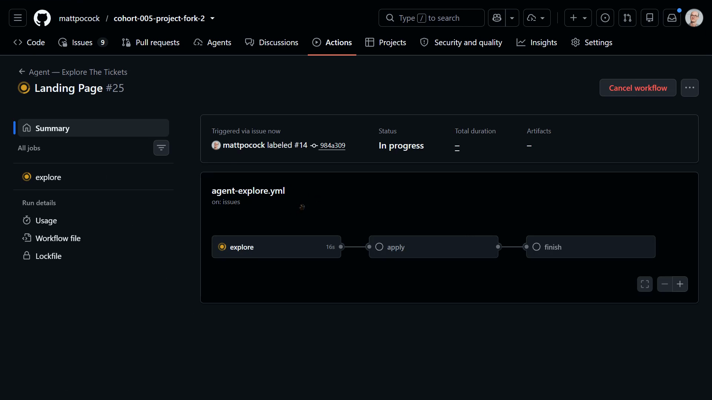
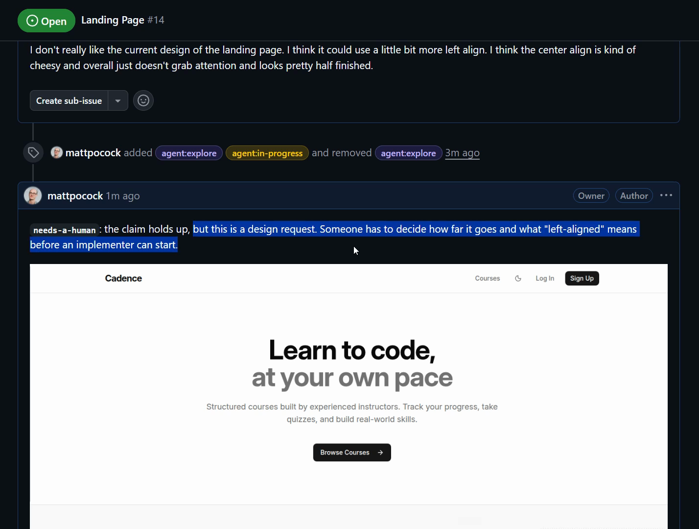
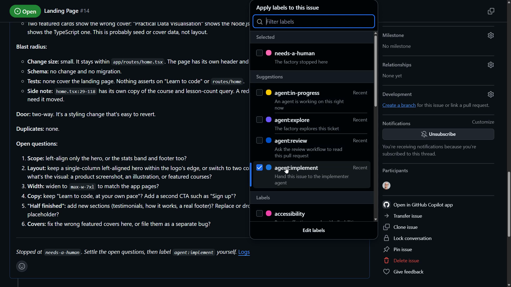
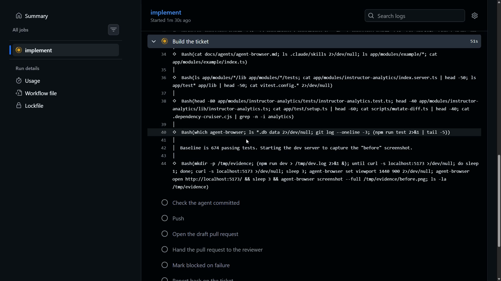
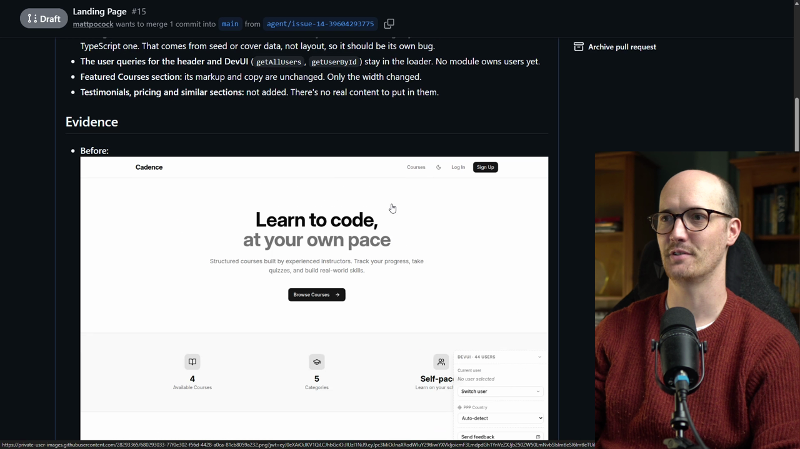
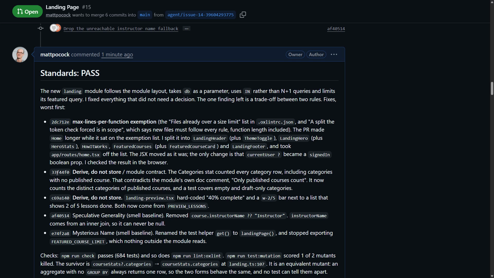
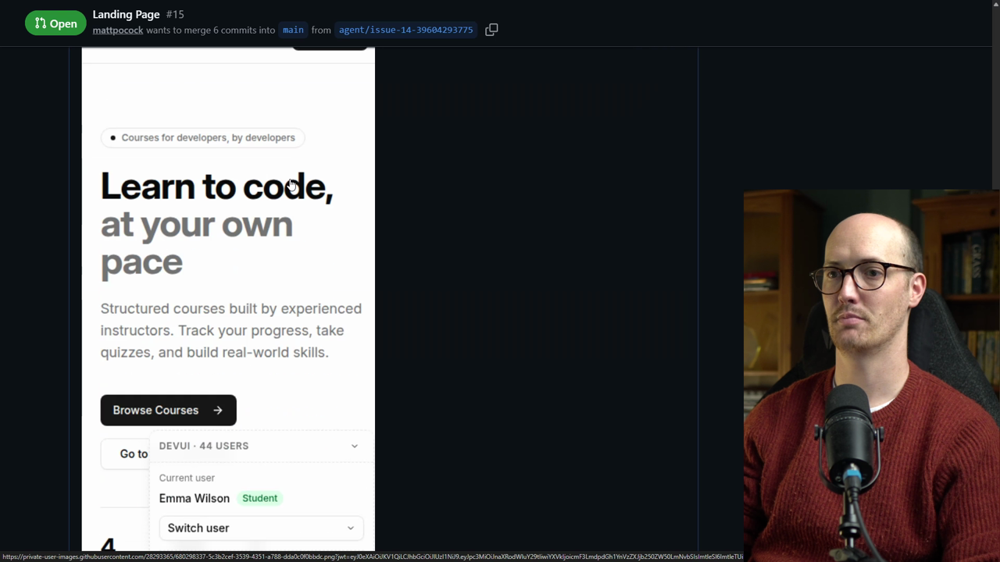
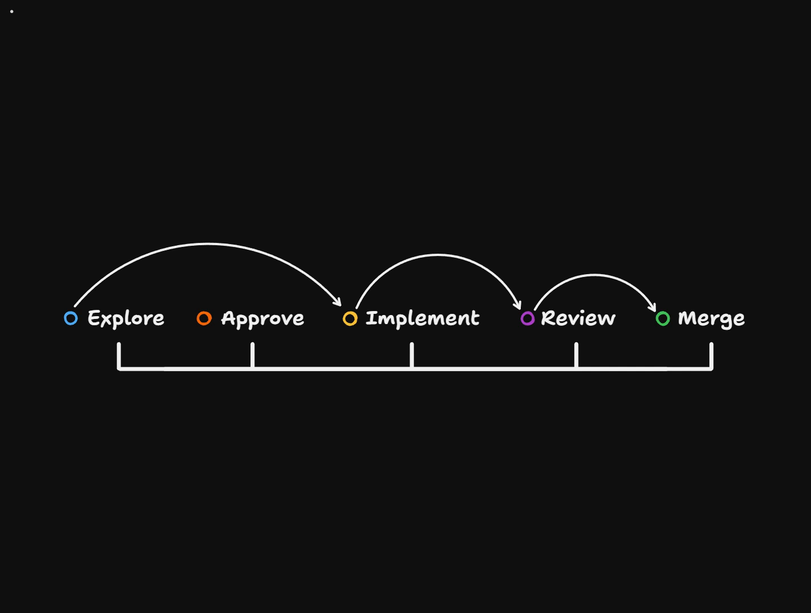

# Chaining The Whole Factory Solution

<CommitMap packageManager="npm">
  <Commit id="retro-review-and-checks">Start the lesson: the retro's reviewer and checks changes</Commit>
  <Commit id="chain-factory-end-to-end">See my solution: the factory chained from a filed issue to a reviewed PR</Commit>
</CommitMap>

## Kicking off the explore phase

The GitHub issue has been created with the `agent:explore` label. In the Actions tab, we can see that it has kicked off the explore phase.

This should be a pretty fast run. It's only one [ticket](https://www.aihero.dev/ai-coding-dictionary/ticket), it only has to do a little validation, and it's quite an easy thing to explore.

## Explore's verdict

It ended up taking three minutes. It labelled the issue `needs-a-human`.

Its comment says the claim holds up, but this is a design request. Someone has to decide how far it goes and what "left-aligned" means before an implementer can start.

We've got our screenshot here too.

Further down the comment are the door, duplicates and open questions:

- **Door:** two-way.
- **Duplicates:** none.
- **Open questions:** a list of questions for a human to settle.

Essentially, this is like a [grilling](https://www.aihero.dev/ai-coding-dictionary/grilling) [session](https://www.aihero.dev/ai-coding-dictionary/session): the [agent](https://www.aihero.dev/ai-coding-dictionary/agent) is asking me questions.

## Chaining it manually

It's annoying for the lesson that it hasn't chained automatically. But it gives me a chance to show how I would chain it manually.

1. Add a comment saying "Give it your best shot."
2. Change the labels: remove `needs-a-human`.
3. Add `agent:implement`.

Anything we add in the comments is pulled in by the agent. So it will see "Give it your best shot" along with `agent:implement`.

This decision making is something we might want to retro later. This one needed a human. We could even have a [prototype](https://www.aihero.dev/ai-coding-dictionary/prototyping) chain, where it calls a different workflow that creates a prototype PR.

You can start to see how this could develop into something really complex, which handles every single case you might want to throw at it.

## The implement run

Our implementer is in progress. Here's the Actions run for implementing a ticket, and it's churning on.

Once it has created its PR, it should label it `agent:review`.

It built the ticket in 4 minutes 37 seconds. Now it pushes the branch, opens the draft pull request and hands it to the reviewer.

And there we go: a PR with the `agent:in-progress` label. If we zoom into Actions, we can see the review running.

## Before and after evidence

This is the first time we see the benefits of the retro. Hopefully we get a better review. We're looking for:

- A more concise summary.
- More feedback done via file comments.

Just look at the PR.

That's the before evidence, and this is the after evidence. I can never quite get over how useful it is to have screenshots in PRs.

## The review lands

Let's wait and see what the review comes back with.

It's done. There aren't many comments, which probably means it went and fixed a bunch of stuff. The PR is now ready for [human review](https://www.aihero.dev/ai-coding-dictionary/human-review), and the reviewer has committed a number of fixes.

Two of them stand out:

- **Max-lines-per-function exemption.** The implementer tried to cheat the [automated checks](https://www.aihero.dev/ai-coding-dictionary/automated-check) again, and the automated reviewer caught it.
- **Derive, do not store.** The landing preview had a hard-coded "40% complete". Now both figures come from `PREVIEW_LESSONS`.

It also passed the [spec](https://www.aihero.dev/ai-coding-dictionary/spec). It gave us a screenshot to prove nothing broke, and it even tested on mobile.

## Decisions left for a human

The review has also left a hint of what's to come in the comments. Zooming down, there's a comment on the hero:

> **Decision needed.** The ticket says the page "looks pretty half finished". The hero now puts four catalogue counts front and centre with no empty state. A fresh deployment would read **0 Courses · 0 Lessons · 0 Instructors · 0 Categories**.

The agent didn't change it, because the fix is a product choice. This is a high quality finding, and it does need a decision.

There are a couple more product ones, more marketing-based. Then there's a trade-off between two of our coding standards. And then we're done.

## Why this is a high quality asset

I consider this a really high quality asset for a human to spool through. They get:

- Images of the latest updates.
- Mobile testing.
- Follow-up questions they can reply to, then rerun implement, or take the branch down locally and implement there.

And all of this was created largely without our input.

We did have to kick it a little at one point, at the `easy-call` decision. I don't think that description is properly worded, so I would go through it in a retro.

## The software factory so far

Overall, our [software factory](https://www.aihero.dev/ai-coding-dictionary/software-factory) is off to a really great start.

- We can explore new work and decide whether to approve it.
- We can implement it, review it, and then decide whether to merge.
- We've set up our infrastructure on GitHub Actions using these workflows.
- We now have a fleet of remote servers that we can spin up and do whatever we want with.

Really nice work. I'll see you in the next one.
