# What Infrastructure Do I Need?

<Prerequisites title="Crash Course Prerequisites">
  <Prerequisite href="https://www.aihero.dev/workshops/ai-coding-crash-course/models-harnesses-agents-environments-2b9a99a1">
    What a runner is actually running: an agent, made of a model, a harness and an environment.
  </Prerequisite>
  <Prerequisite href="https://www.aihero.dev/workshops/ai-coding-crash-course/how-much-did-it-cost-abb3ab6e">
    How agent billing works, so you can weigh what each runner and model will cost you.
  </Prerequisite>
  <Prerequisite href="https://www.aihero.dev/workshops/ai-coding-crash-course/how-to-tackle-massive-tasks-6199ee6b">
    Why big work splits into a spec and tickets, the units the factory passes along.
  </Prerequisite>
  <Prerequisite href="https://www.aihero.dev/workshops/ai-coding-crash-course/set-up-your-issue-tracker-30629075">
    How the ticket tracker and Git host fit together on GitHub.
  </Prerequisite>
</Prerequisites>

At the end of Part One, we had a working [software factory](https://www.aihero.dev/ai-coding-dictionary/software-factory) where you could see concretely what was going on. But we hadn't made any steps yet to make it _your_ software factory.

## Why Move Away From GitHub?

You probably have some questions, especially around the GitHub of it all. We've been using GitHub for everything. It's a really good teaching tool, but it's a paid service at the end of the day.

Most of the projects you're going to work on are not public. They're going to be private, so you're going to end up paying GitHub Actions pricing.

So I want to give you a way to move the concepts we've just learned into your own setup, your own workplace, your own infrastructure.

To do that, we need to look at all the individual parts that GitHub gives us, so that you can rework them onto your own setup.

## The Plan For This Lesson

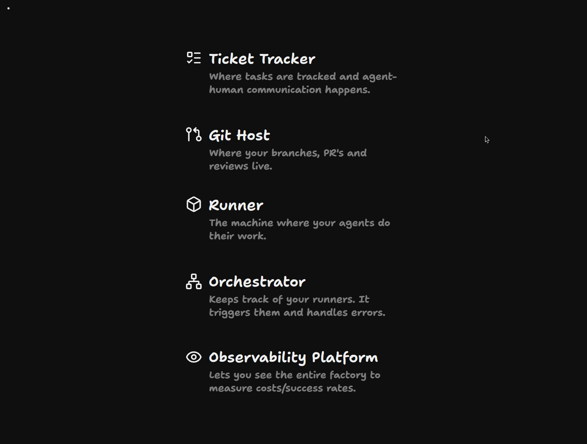

I've broken down the infrastructure you need for a working software factory into five parts. We'll cover them in this lesson.

| Part | What it does |
| --- | --- |
| Ticket Tracker | Where tasks are tracked and [agent](https://www.aihero.dev/ai-coding-dictionary/agent)-human communication happens |
| Git Host | Where your branches, PRs and reviews live |
| Runner | The machine where your agents do their work |
| Orchestrator | Keeps track of your runners, triggers them and handles errors |
| Observability Platform | Lets you see the entire factory to measure costs and success rates |

Once that's done, we'll look at your current infrastructure. You'll have a brainstorming session where you take all of these concepts and apply them to your workplace.

Then, once you've figured out (or nearly figured out) the infrastructure you're going to use, you'll figure out what your software factory is actually going to do.

By the end, you will have a working [specification](https://www.aihero.dev/ai-coding-dictionary/spec) for a software factory that you can plug into an agent and start building and running.

## Ticket Tracker

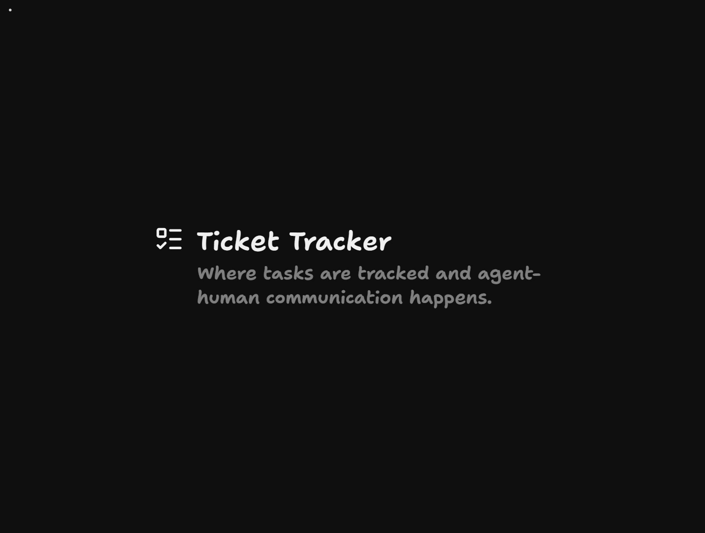

The first part of the software factory is the [ticket](https://www.aihero.dev/ai-coding-dictionary/ticket) tracker. Every software factory needs some kind of human-to-agent interface where tasks are tracked, where users can provide feedback, and where agent-human communication happens.

In our setup, this is GitHub. We are using issues for tracking work.

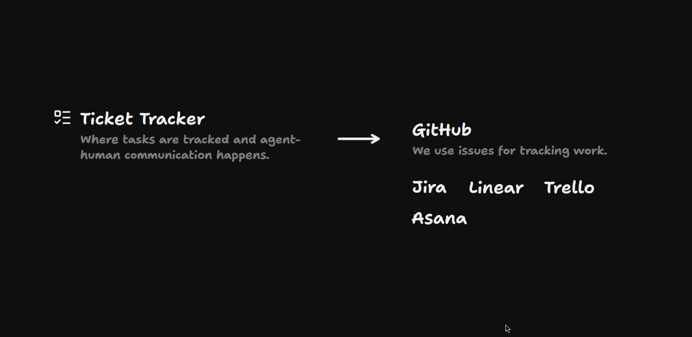

But we don't have to. We could use Jira, Linear, Trello, Asana, or any ticket tracking system where users and agents can both access tickets and both update them.

GitHub is particularly useful because it has a [CLI](https://cli.github.com/) that agents can interact with. Linear has an [MCP](https://www.aihero.dev/ai-coding-dictionary/mcp) server, and so does Jira. Every one of these tools is trying to get to the point where agents can contribute to it very effectively.

Essentially, any tool will be fine here if it has:

- A list of tickets
- The ability to assign tickets to different people
- Labels, or some other organizational setup
- A way for the agent to access it

## Git Host

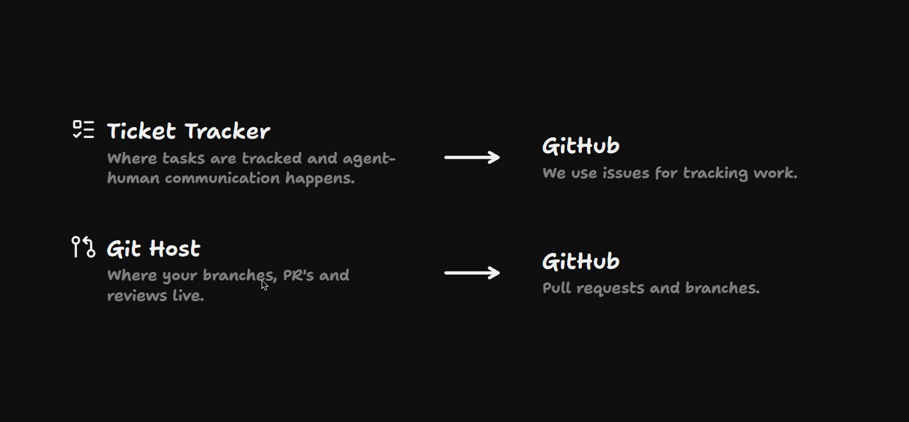

Once your tickets are tracked and you can schedule them as humans and interact with the agent in a ticket tracker, you also need somewhere to put your branches and PRs and do your reviews.

For us, this is GitHub again: pull requests and branches inside GitHub. That is the place where our code is stored. It's where we interact with it and decide whether something needs to be merged.

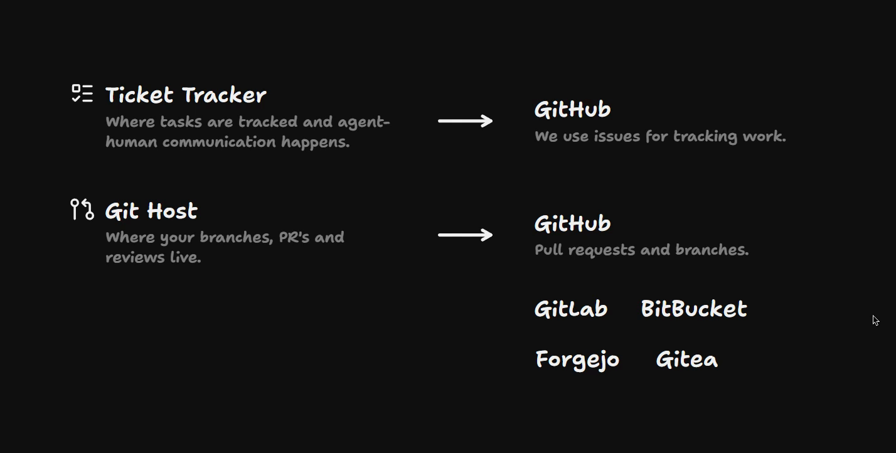

What else could fill this slot?

- **GitLab**.
- **Bitbucket**. If you're on Atlassian already, it usually comes paired with Jira.
- **Forgejo** or **Gitea**. Maybe the code can't leave your network, so you need something self-hosted.

Apologies if I've butchered any of those names. I basically only use GitHub for this purpose.

## Runner

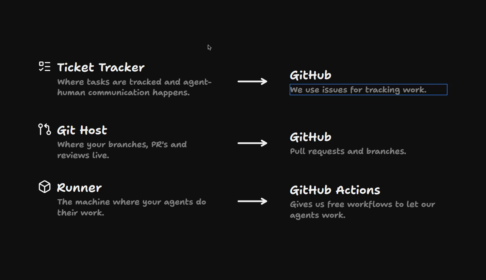

So at this point we've got our ticket tracker and a place where our code lives. We then need somewhere for the agent to do its work.

This is the runner: the [sandboxed](https://www.aihero.dev/ai-coding-dictionary/sandbox) [environment](https://www.aihero.dev/ai-coding-dictionary/environment) where the agent is actually doing its thing.

For us, that is GitHub Actions. This is where we have free space on a disposable machine to let our agents work.

I'm going to call each action a **run**. It's a run of the runner. For instance, one run reviewed a pull request, and it ran on the GitHub Actions runner.

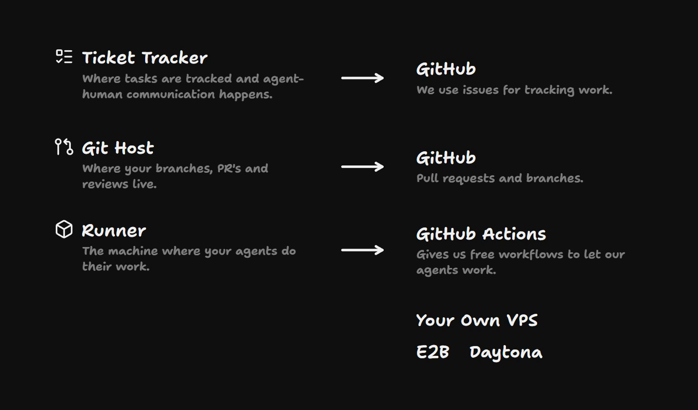

There are tons of different types of runner, and services are springing up all over the place. E2B and Daytona give you actual sandboxes, just like GitHub Actions, but you can do really anything with them. You spawn them programmatically, run your agents in them, and shut them down.

Equally, you could provision your own VPS: a virtual private server somewhere that spawns a fresh container for each run.

The point of these runners is that they are as disposable as possible. Any state a runner creates either:

- gets put back to the git host as commits, branches and PRs, or
- gets stored in the ticket tracker.

## Orchestrator

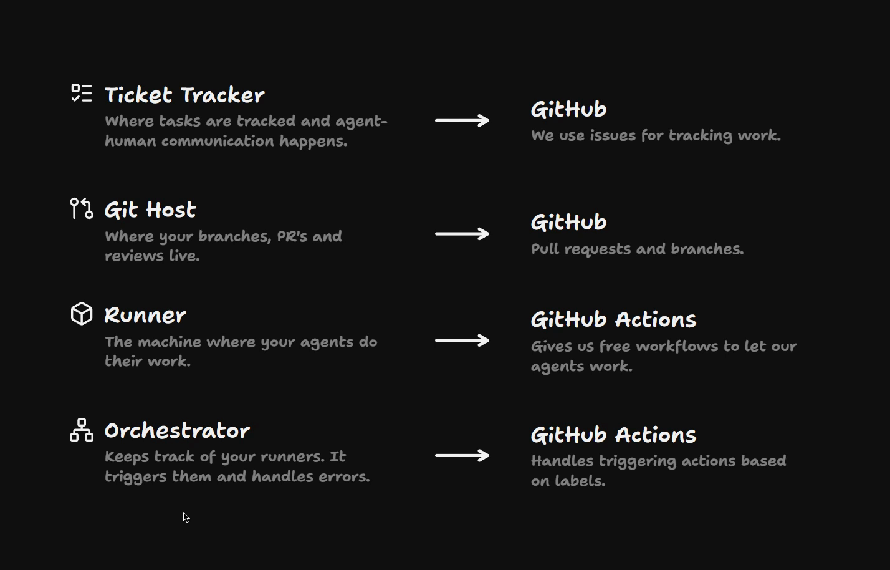

You might be thinking: who keeps track of all of these runners? What is the process that keeps all of these things happening in parallel?

Every software factory needs some kind of orchestrator. It keeps track of your runners, triggers them based on certain events, and handles any errors that come up.

In our factory, that's handled for us by being on GitHub Actions. If I label an issue with the explore or implement agent labels, then GitHub Actions handles setting up that runner.

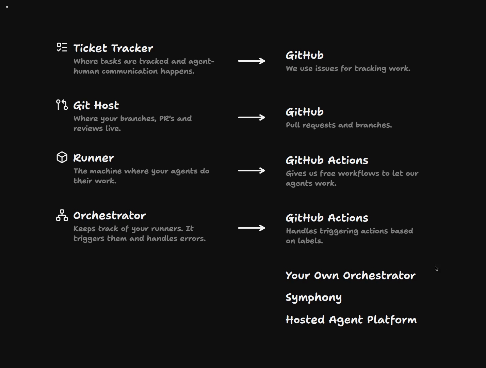

What else could fill the orchestrator slot?

- **A CI platform**, like we have: GitHub Actions, GitLab, or something similar.
- **Your own orchestrator**. You could build your own server with a database. There's a spec for this called Symphony, by OpenAI, which is particularly good.
- **A hosted agent platform**. If your company has invested heavily in a particular agent or [harness](https://www.aihero.dev/ai-coding-dictionary/harness), you could use its hosted platform, like Claude Code on the web.

Essentially, your orchestrator should be able to:

- Trigger runners
- Listen to outside data
- Run loops, such as schedules

## Observability Platform

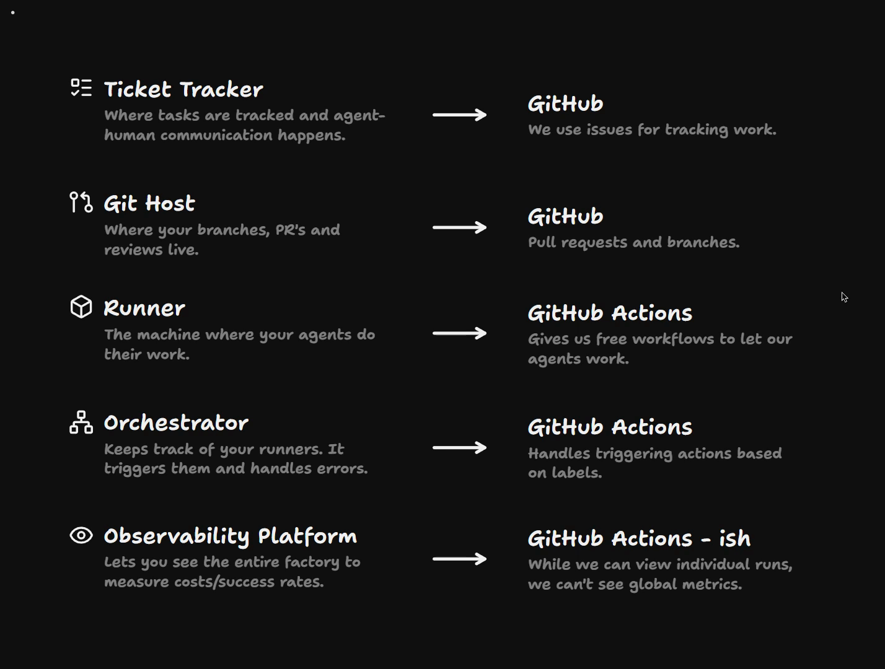

Finally, we need some way to observe the entire factory. We need to be able to measure costs and success rates. This is an observability platform.

Do we have this in GitHub Actions? Sort of. We can dive into what happened in individual runs, but we can't see any global metrics. We can't see that this particular approach is working and this particular approach isn't.

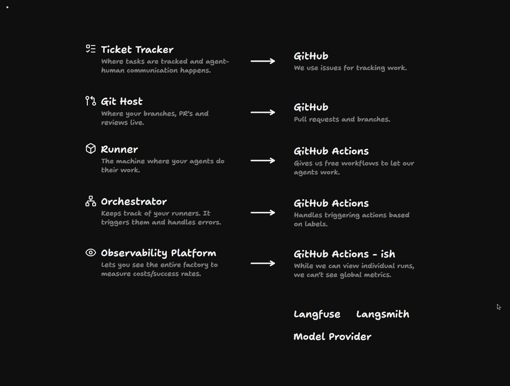

There are tons of tools for this. Langfuse and LangSmith are two, and many more observability startups are coming to the fore.

If you've invested in a single [model provider](https://www.aihero.dev/ai-coding-dictionary/model-provider), you probably want to use their observability tools.

And if you're already building your own orchestrator, you may want to bundle in your own observability platform too, since the orchestrator already keeps track of all of those runners.

## Which Decisions Come First?

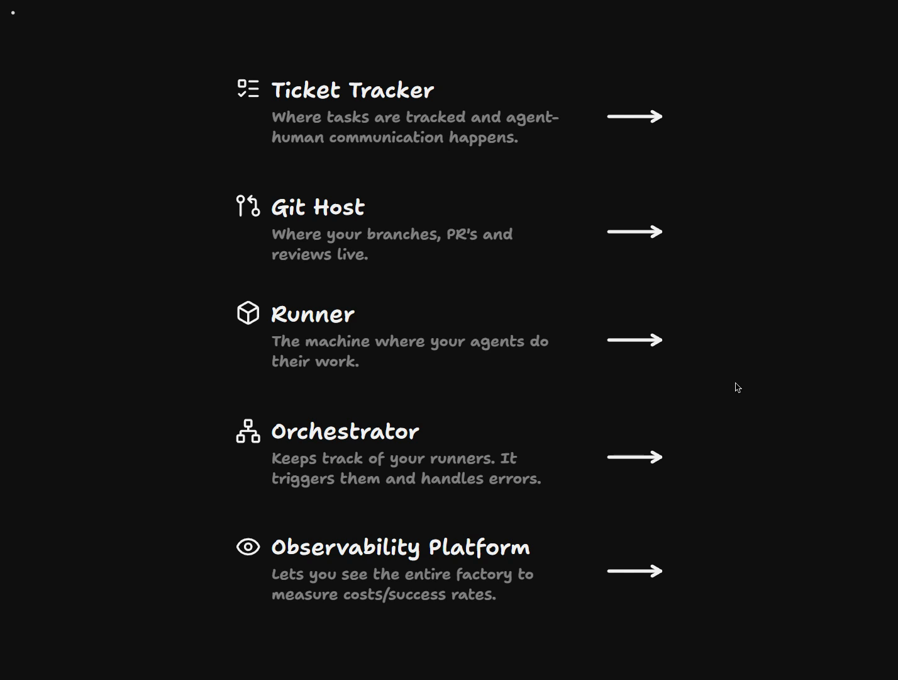

These are the five things I think you need for any working software factory.

I've put them in the best teaching order, but this is also the order of priority for figuring out which one you need first.

- **Ticket tracker.** Your team probably already uses one, so migrating to a new one is probably out of the question. Work with what you've got.
- **Git host.** This is a massive lift to move, so again, work with what you've got.
- **The bottom three.** This is where the main decisions are going to be made, because this is likely new infrastructure. Or you might be reusing existing infrastructure, like virtual machines or cloud containers, in a new way.

I'd even go so far as to say that the observability platform is optional until you've really got some use out of the software factory.

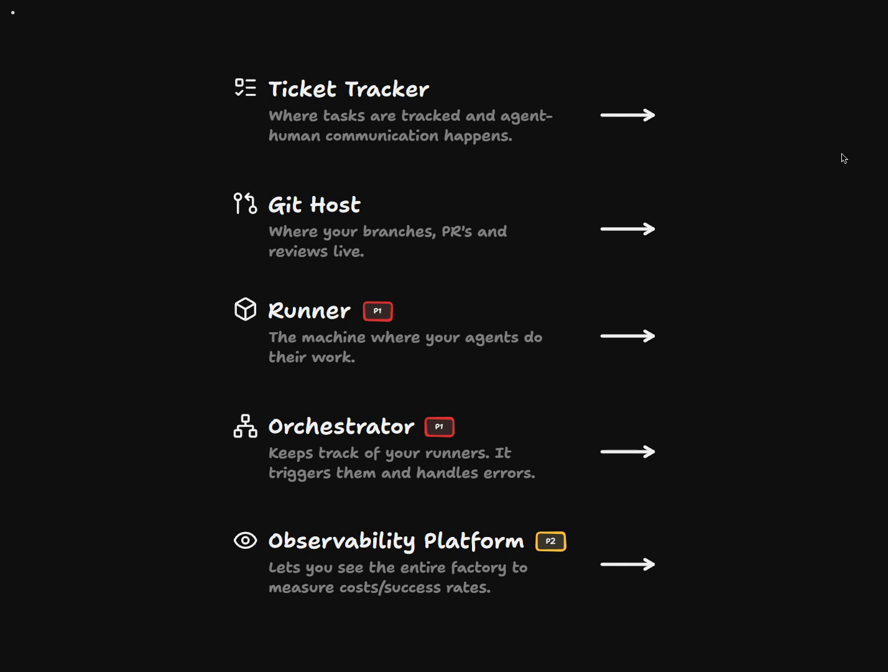

So the ticket tracker and git host are probably already decided. The runner and the orchestrator are **P1**, and the observability platform is **P2**.

## A Worked Example: My Setup

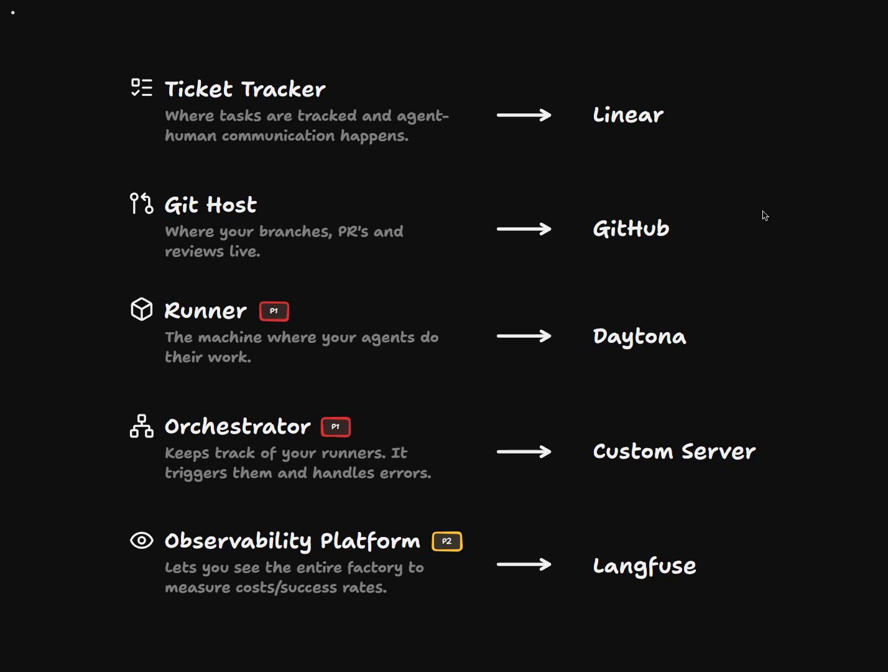

Just as a demonstration, let me show you a system I've been working with for a little while that works really nicely.

| Part | My choice |
| --- | --- |
| Ticket Tracker | Linear |
| Git Host | GitHub |
| Runner (P1) | Daytona |
| Orchestrator (P1) | Custom server |
| Observability Platform (P2) | Langfuse |

My preferred ticket tracker is Linear. It's really excellent, with a nice UI for fiddling around with tasks.

My git host is of course GitHub. There's no way I'm moving off it currently, but you can use your own.

I really like Daytona as a runner. Its pricing structure is a little bit weird, but it starts up extremely fast. You can customize the runners, and they can be sandboxed really effectively, so it's nice and secure.

For my orchestrator I've been using a custom server. It's a relatively simple process that schedules work in Daytona. Then I use Langfuse for observability.

It's a fair amount of work to keep updating this custom server to make it more reliable. It uses [Sandcastle](https://github.com/mattpocock/sandcastle) under the hood. That's the reason I didn't want to show it off: it's a little bit buggy.

There's also a build versus buy decision here when you're thinking about this stuff, and I didn't want to mandate that you use my tool.

## How The Pieces Fit Together

Here's how work flows through my setup:

1. A ticket comes in in Linear, which my orchestrator monitors.
2. The orchestrator pings off to a runner, which goes and completes its task.
3. The runner creates a PR, or maybe just a comment back to the ticket tracker.
4. All of that data goes into my observability platform, so I can see what's happening as it's happening.

Hopefully this gives you a clear sense of the different parts of your software factory and how they might fit together to make something that works.

Nice work, and I'll see you in the next one.

<Quiz>
  <QuizQuestion data={{
    id: "factory-infra-decision-order",
    question: "Your team is moving from a hand-run agent setup to a software factory. You have a week to decide on infrastructure. Where should you spend the time?",
    type: "multiple-choice",
    choices: [
      { answer: "a", label: "Choosing the runner and the orchestrator, since these are likely new infrastructure" },
      { answer: "b", label: "Picking a new ticket tracker that agents can use, then migrating the team to it" },
      { answer: "c", label: "Setting up an observability platform first, so every run is measured from day one" },
      { answer: "d", label: "Moving to a new git host with better agent support, then choosing everything else" }
    ],
    correct: "a",
    answer: "The runner and orchestrator are the P1 decisions: they are likely new infrastructure, or existing machines used in a new way. The ticket tracker and git host are usually already decided because migrating them is a massive lift, so work with what you have. Observability is P2 and optional until the factory has proven useful."
  }} />
  <QuizQuestion data={{
    id: "runner-state-disposable",
    question: "You are choosing a runner and designing how agent runs use it. Where should state created during a run, such as code changes or progress notes, end up?",
    type: "multiple-choice",
    choices: [
      { answer: "a", label: "Back in the git host and ticket tracker, so the runner stays disposable" },
      { answer: "b", label: "On the runner's disk, so the next run on that machine can pick up where it left off" },
      { answer: "c", label: "In the observability platform, which acts as the long-term store for run state" },
      { answer: "d", label: "In the orchestrator's database, since it keeps track of all the runners" }
    ],
    correct: "a",
    answer: "Runners should be as disposable as possible. Commits, branches and PRs go back to the git host, and anything else goes to the ticket tracker. Keeping state on the runner breaks disposability. The observability platform is for measuring costs and success rates, not for holding the work itself."
  }} />
</Quiz>
