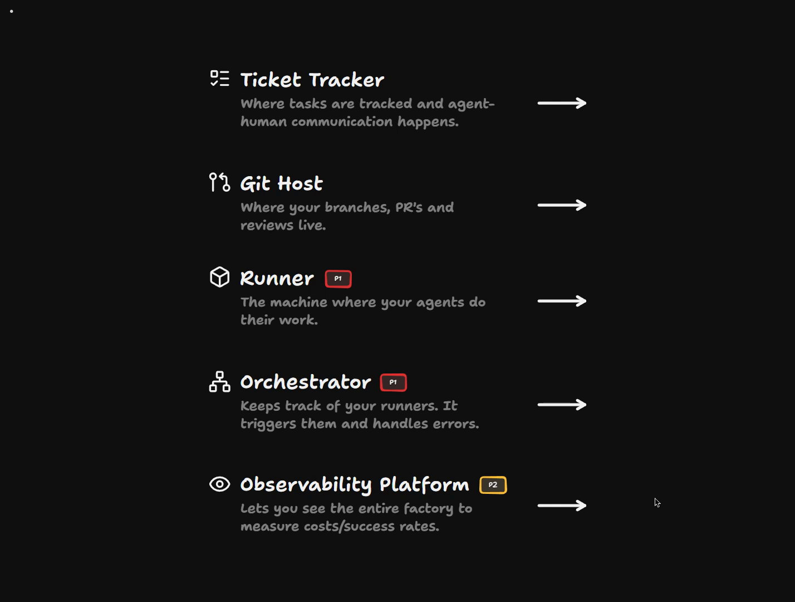
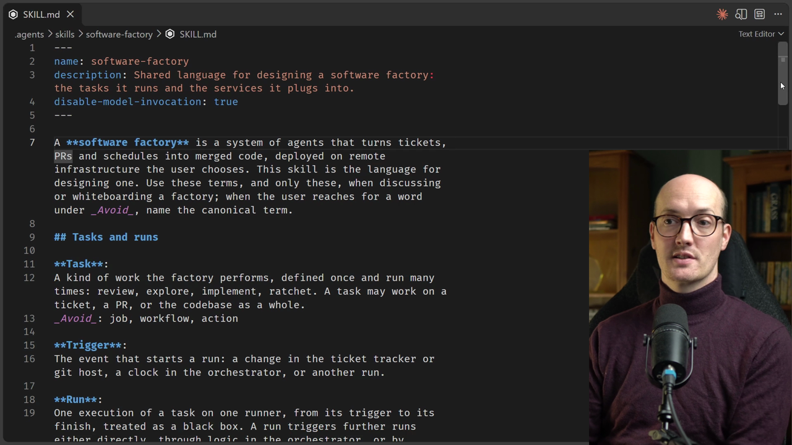
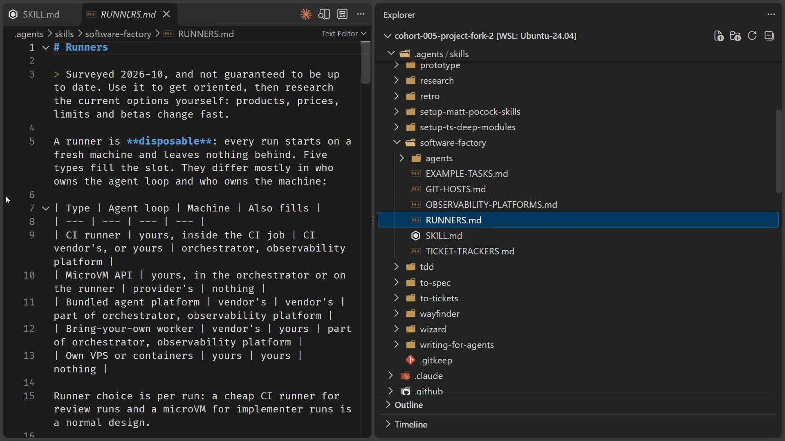

# Choosing Your Infrastructure

<CommitMap packageManager="npm">
<Commit id="chain-factory-end-to-end">Start the lesson: with the factory chained from a filed issue to a reviewed PR</Commit>
<Commit id="add-software-factory-skill">See my solution: with the `software-factory` skill added</Commit>
</CommitMap>

<Prerequisites title="Crash Course Prerequisites">
  <Prerequisite href="https://www.aihero.dev/workshops/ai-coding-crash-course/choosing-your-plan-and-model-24420278">
    Subscription versus pay-per-token API pricing, which decides what a factory costs to run.
  </Prerequisite>
  <Prerequisite href="https://www.aihero.dev/workshops/ai-coding-crash-course/how-much-did-it-cost-abb3ab6e">
    How agent billing works, so you can weigh what each runner and model will cost you.
  </Prerequisite>
  <Prerequisite href="https://www.aihero.dev/workshops/ai-coding-crash-course/hallucination-77d5b4c6">
    Why an agent's knowledge goes stale, so it should research current pricing and products rather than trust what it remembers.
  </Prerequisite>
  <Prerequisite href="https://www.aihero.dev/workshops/ai-coding-crash-course/the-grill-execute-clear-loop-fac85414">
    How to run a grilling session with `/grill-me`, which is how you make every infrastructure decision here.
  </Prerequisite>
  <Prerequisite href="https://www.aihero.dev/workshops/ai-coding-crash-course/what-are-agent-skills-20f91a4e">
    What a skill is, including reference skills like `/software-factory` that hold shared language.
  </Prerequisite>
</Prerequisites>

In the last lesson we mapped out the infrastructure a [software factory](https://www.aihero.dev/ai-coding-dictionary/software-factory) needs. Now you fill those slots yourself: a [ticket](https://www.aihero.dev/ai-coding-dictionary/ticket) tracker, a Git host, a runner, an orchestrator and an observability platform.

You probably already have a favorite ticket tracker and Git host. You probably don't have a runner, orchestrator or observability platform yet, so those are where the real decisions are.

We won't provision anything here. We'll choose tools, with real attention to pricing and usage, so the diagram we draw next is built from tools you'd actually use.



## Steps To Complete

### Get the software factory skill

- [ ] Add the `/software-factory` [skill](https://www.aihero.dev/ai-coding-dictionary/skill) to your repo

```bash
npm run cherry-pick add-software-factory-skill
```

If your repo isn't at `chain-factory-end-to-end`, you can get the same state with `npm run reset add-software-factory-skill`.

- [ ] Open `.agents/skills/software-factory/SKILL.md`

It's a reference skill holding the shared language from the last lesson: runs, runners, ticket trackers, Git hosts, orchestrators and observability platforms.



- [ ] Look through the reference documents next to `SKILL.md`

There's a survey for each slot, with examples of products: `TICKET-TRACKERS.md`, `GIT-HOSTS.md`, `RUNNERS.md` and `OBSERVABILITY-PLATFORMS.md`.

- [ ] Open `RUNNERS.md` and read how it sorts products into types

Notice the types, such as CI runner, MicroVM API, bundled agent platform and bring-your-own worker. The survey says it isn't guaranteed to be up to date, so treat it as orientation. The [agent](https://www.aihero.dev/ai-coding-dictionary/agent) should research current details itself.



### Grill yourself on your infrastructure

- [ ] Open your agent and start a [grilling](https://www.aihero.dev/ai-coding-dictionary/grilling) [session](https://www.aihero.dev/ai-coding-dictionary/session) about a new software factory

Ask it to grill you one question at a time. That keeps an open-ended topic tight, instead of branching in many directions at once.

```text
/grill-me about creating a new /software-factory. I want to move off this GitHub Actions-based setup into new infrastructure. Let's not worry about any new tasks yet, let's just think about the services. Ask one question at a time.
```

- [ ] Tell the agent which ticket tracker and Git host you want to use

These are the slots where you probably already have a favorite. Add a sentence to your prompt naming them, and say that the other services are up for grabs.

- [ ] Work with the agent to choose a runner, an orchestrator and an observability platform

Make real decisions with proper fidelity:

  - Look at the pricing.
  - Consider how often you'll use it.
  - Weigh the things you'd actually weigh in a real choice.

- [ ] Finish with a decision for every slot

You'll use these choices when you diagram your factory in the next lesson.
