# Choosing Your Infrastructure Solution

<CommitMap packageManager="npm">
  <Commit id="chain-factory-end-to-end">Start the lesson: the factory chained from a filed issue to a reviewed PR</Commit>
  <Commit id="add-software-factory-skill">See my solution: the `software-factory` skill added</Commit>
</CommitMap>

## Setting the scene

Before sending the prompt, I give the [agent](https://www.aihero.dev/ai-coding-dictionary/agent) a bit more information about what to keep and what to change.

This is a funny solution for me to demo, because I'm pretty happy with my [software factory](https://www.aihero.dev/ai-coding-dictionary/software-factory) right now. So I'm going to imagine myself in what I think of as your shoes: you have a favorite [ticket](https://www.aihero.dev/ai-coding-dictionary/ticket) tracker and a favorite git host, but you don't know about the other three.

I really like using Linear for my ticket tracker, and GitHub for my git host. The other stuff is up for grabs.

```txt
/grill-me about creating a new /software-factory. I want to move off this GitHub Actions-based setup into new infrastructure. Let's not worry about any new tasks yet, let's just think about the services. Ask one question at a time. I really like using Linear for my ticket tracker, and I really like GitHub for my Git host. But the other stuff is up for grabs.
```

This is a classic use case for Wayfinder, because we don't quite know where we're going. We need to do a lot of research and some [prototyping](https://www.aihero.dev/ai-coding-dictionary/prototyping), and there's tons of stuff that could go into this decision.

For now, we'll treat it as a [grilling](https://www.aihero.dev/ai-coding-dictionary/grilling) [session](https://www.aihero.dev/ai-coding-dictionary/session). I probably won't demo it as a Wayfinder, but you certainly could.

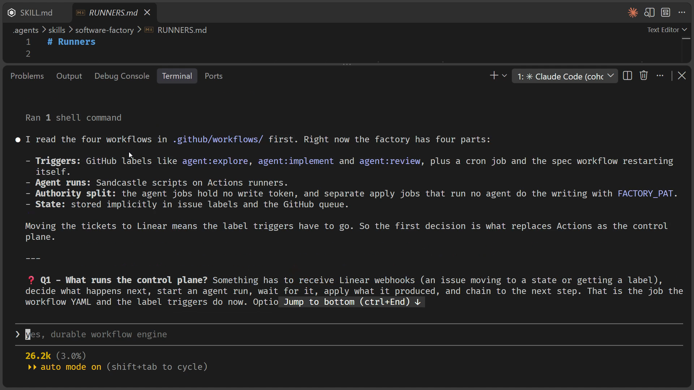

## Fixing the vocabulary

The agent has read the four workflows in `.github/workflows/`, so it understands what our factory is doing right now.

One thing I notice is that it isn't using the language I specified. It's asking "what runs the control plane?" and says something has to:

- receive Linear webhooks
- decide what happens next
- start an agent run
- wait for it
- apply what it produced

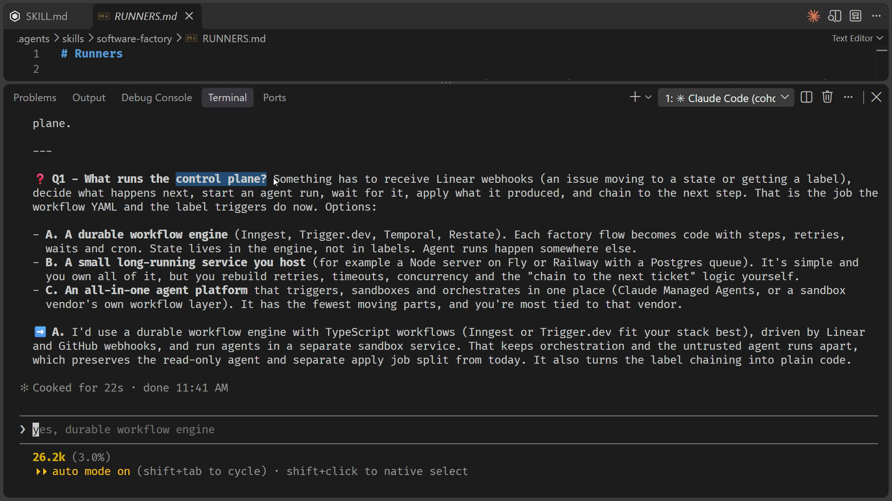

The [skill](https://www.aihero.dev/ai-coding-dictionary/skill) actually names this, and that's what we looked at in the previous section. So I tell it to use the skill's language.

```txt
/software-factory use the language here
```

I think what happened is that the skill is user invoked. When we mentioned it at the top of the prompt, my agent didn't call it and didn't grab it.

Now it's using the language we agreed on: **what fills the orchestrator slot?**

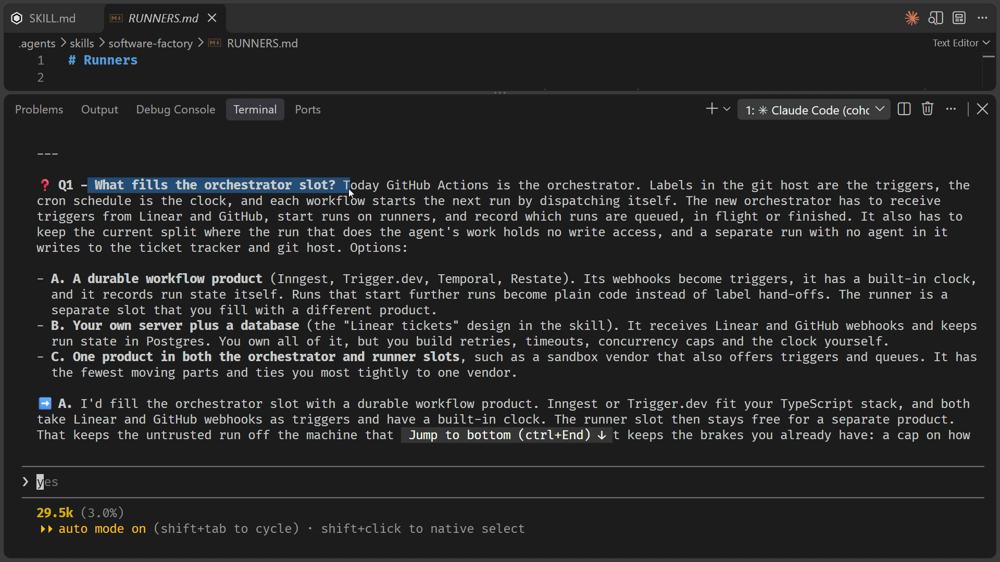

## Choosing the orchestrator

It gives us three options:

| Option | What it is |
| --- | --- |
| A | A durable workflow product |
| B | Your own server |
| C | One product in both the orchestrator and runner slots, such as a [sandbox](https://www.aihero.dev/ai-coding-dictionary/sandbox) vendor that also offers triggers and queues |

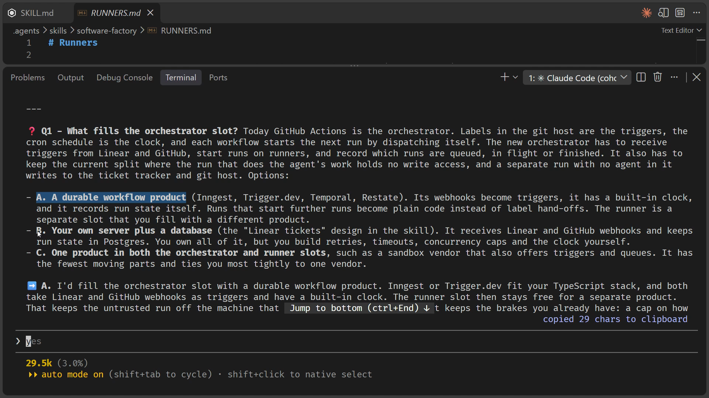

Much of this decision is about how much power you give the vendor and how much you retain yourself.

If we choose C, we're probably locking ourselves in to a sandbox vendor. That might be okay if we want that trade-off. Otherwise we take on the complexity of running our own server plus a database.

I don't feel equipped to figure out the pros and cons, so I ask for more information.

```txt
I need more information on the pros and cons here. I don't really know the trade-offs between A and B, although I'm most suspicious about C.
```

This is another benefit of asking one question at a time. When you're really vague and have no idea where you're going, sometimes you just need to make one key decision that everything else trickles down from.

### What the orchestrator has to get right

It comes back with a lot of detail. Here is what the orchestrator has to get right:

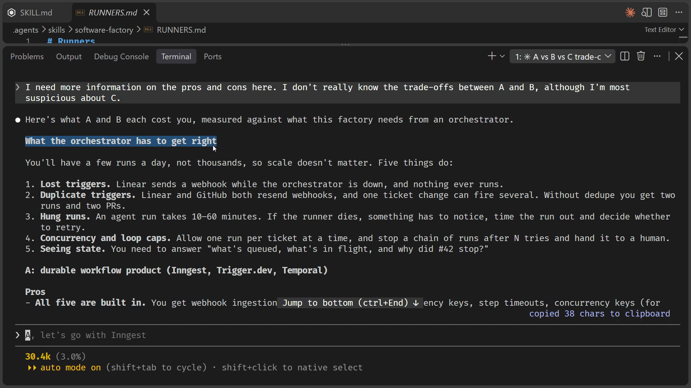

- **Capture every trigger.** When Linear sends a webhook, because a comment or an issue changed, something has to run.
- **Handle duplicate triggers.** Linear and GitHub both resend webhooks, so one ticket change can refire several. We need some kind of deduplication mechanism.
- **Handle hung runs.** If the agent stops or the runner dies, we have to notice, time the run out and decide whether to retry.
- **Handle concurrency.** How many runners can work at the same time, and making sure they don't go crazy in an infinite loop.
- **Show the current state.**

Its recommendation is a durable workflow product, something like Inngest. A lot of the difficulties I have with my own server are described very effectively here, and Inngest could potentially fix them itself.

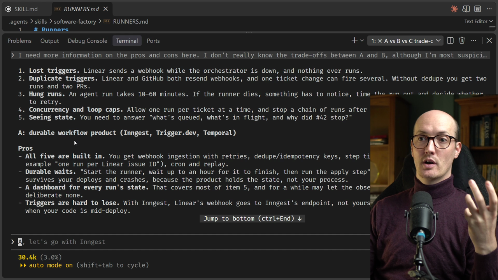

### The cons of B

With B, we have our own server plus Postgres. I've already talked about some of the cons:

- I own the uptime, and I need to make sure runs are handled.
- There is no user interface unless I build one, or I settle for SQL plus an observability platform. That's possible, but not great.
- If I deploy mid-run, it mustn't orphan a run that's still waiting on a runner. That is really nasty, and I run into it all the time.

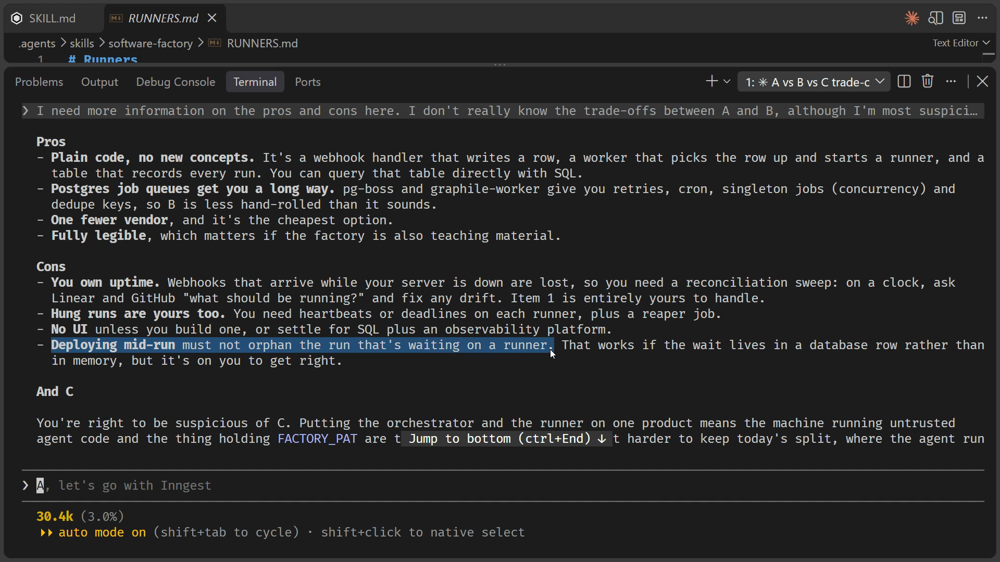

For now, let's discount C as well.

## Pricing and how we talk to Inngest

I agree that a durable workflow product is the way to go. I ask for up-to-date pricing, and whether it fills the whole orchestrator slot or needs an extra piece.

```txt
I agree that a durable workflow product is probably the way to go. Can you do some more pricing information for me so I understand up-to-date pricing? And I kind of need to understand whether this would fill the entire orchestrator slot or whether I need some extra bit along with it. In other words, how do I talk to Inngest, let's say? How do I communicate with it? How do I host the code that Inngest runs for me?
```

I'm choosing Inngest because my business partner, Joel, has some history with them. He used to be the DevRel for them, so there's a little bit of trust there from me at least. We are not sponsored by any of these services. This is just what my agent brought up.

The pricing looks fine. We have a ton of space on the free tier, with 50k executions a month. It keeps traces and logs for 24 hours, but that's okay because we'll probably plug in our own observability system.

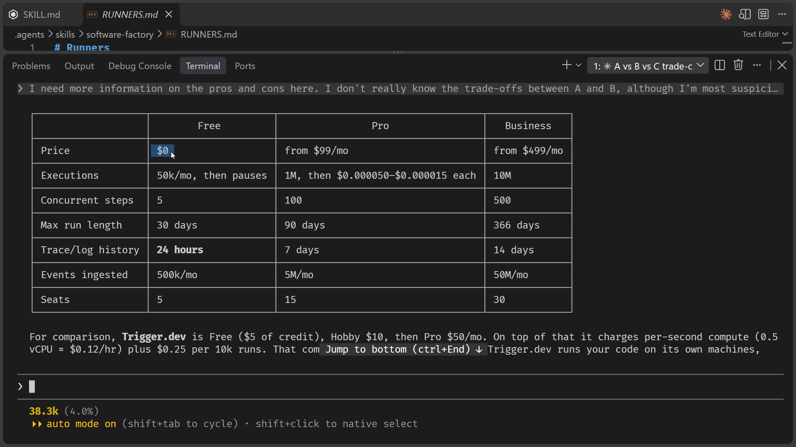

### Inngest doesn't run your code

The key point is that Inngest doesn't run your code. Inngest is the orchestrator's brain and memory, but the function code runs on something you host.

That host is something pretty small. It could use either `serve` or `connect`, depending on how you want to deploy it.

It's also where the tokens live: the GitHub token, the Linear API key and any webhook secrets. So the orchestrator is Inngest plus a little function host.

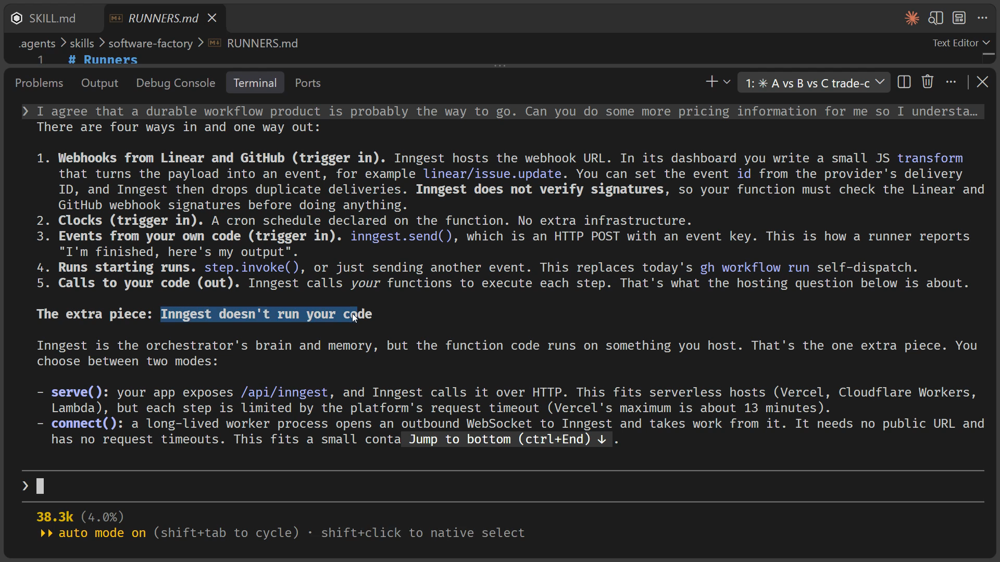

The agent recommends a `connect` worker on Fly.io. The reason is quite complicated: the host needs Git and a [file system](https://www.aihero.dev/ai-coding-dictionary/filesystem). On a serverless container or function on Vercel or Cloudflare, it probably wouldn't have access to those.

I don't want this video to be half an hour long, so I don't query that. I just say yes.

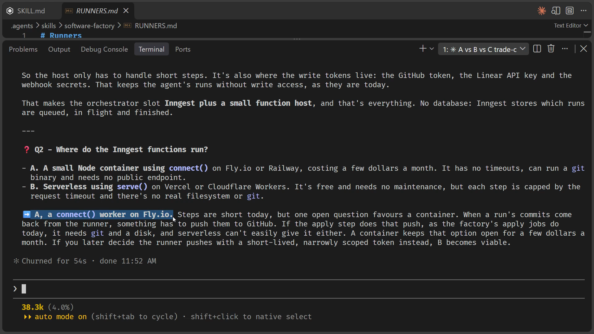

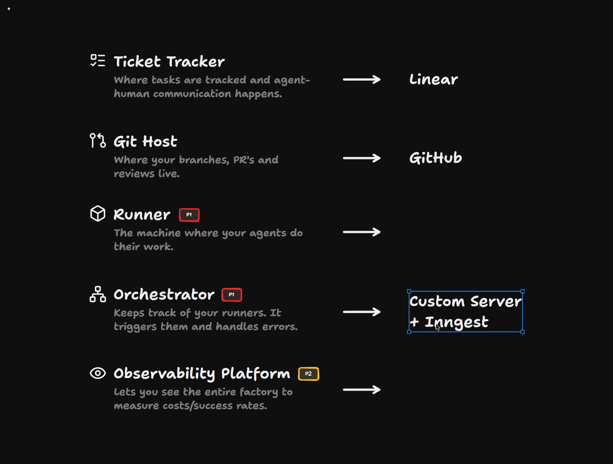

We now have our first option for the orchestrator designed. A custom server plus Inngest fills that slot, and we still need to figure out the runner and the observability platform.

## Choosing the runner

The agent moves on to runners. It picks out Vercel Sandbox, Daytona and Fly.io.

It also looked at Sandcastle and the current prices of most of the setup. Sandcastle 0.12 already supports these providers, so we could run on Daytona or Vercel.

It also says [model](https://www.aihero.dev/ai-coding-dictionary/model) [tokens](https://www.aihero.dev/ai-coding-dictionary/token) will cost far more than the machine. I'm using my Claude subscription token in this setup, so compute is only going to be a few cents per run.

It gives us options for Vercel Sandbox, Daytona or Fly Machines.

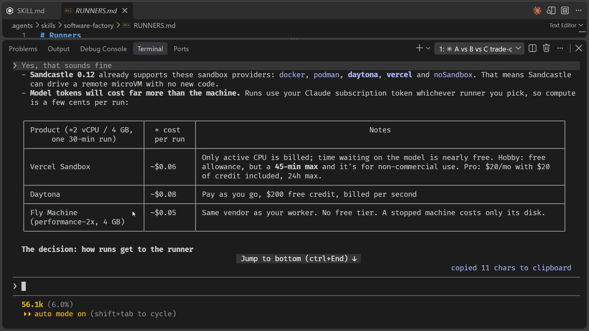

### How does a run get onto a runner?

The question is about implementation. There are three options:

| Option | Approach |
| --- | --- |
| A | Run Sandcastle on the worker, the little server sitting alongside Inngest |
| B | Run the whole script on a throwaway runner |
| C | Use a bundled agent platform, such as Claude Managed Agents or Claude Code cloud |

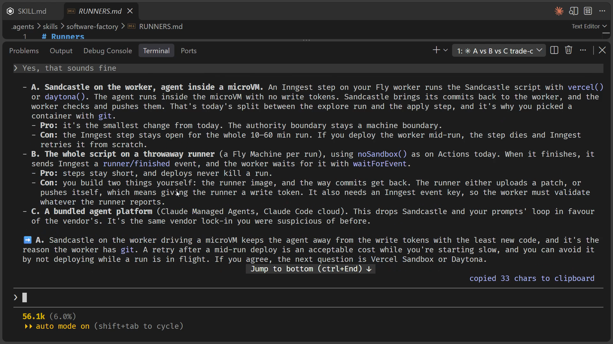

What I don't like about A is that the step stays open for the whole 60-minute run. If you deploy the worker mid-run, the step dies and Inngest retries it from scratch.

From experience, you're going to deploy your software factory very frequently. You don't want deploys screwing over runs that are already underway.

B is good because deploying to your orchestrator won't kill a run. But the runner then needs a write token, because it's going to write back to the Git host.

At this point you really are free to figure this out yourself. If we were doing a whole Wayfinder map, we would try different ways. Having gone down this path before, I'm going to recommend B.

This has been a great exercise for me in improving my software factory. I wasn't expecting that, and I'm genuinely getting quite excited to write the [spec](https://www.aihero.dev/ai-coding-dictionary/spec) and try it out.

### Commits and the runner vendor

It asks another question: how do a run's commits get back to GitHub? I say A.

It recommends something complicated called Tigris that I've never heard of before. I think it wants to allay any fears about security, but I'm not too worried about that.

Now we pick the vendor for the actual runner. I've got no dog in the race. I guess Daytona, because I have some leftover credits. But this is the kind of decision only you can make.

It recommends Fly Machines because I've already provisioned something on Fly.io, but I'm going with Daytona.

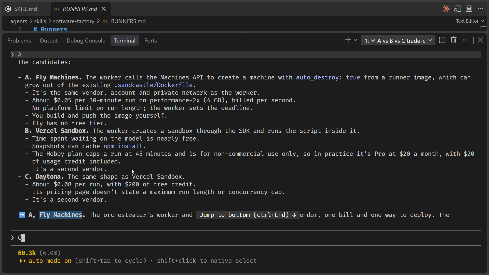

If you're not sure at any point, get the agent to spin up a bunch of research agents to research all the alternatives, so you're not flying blind.

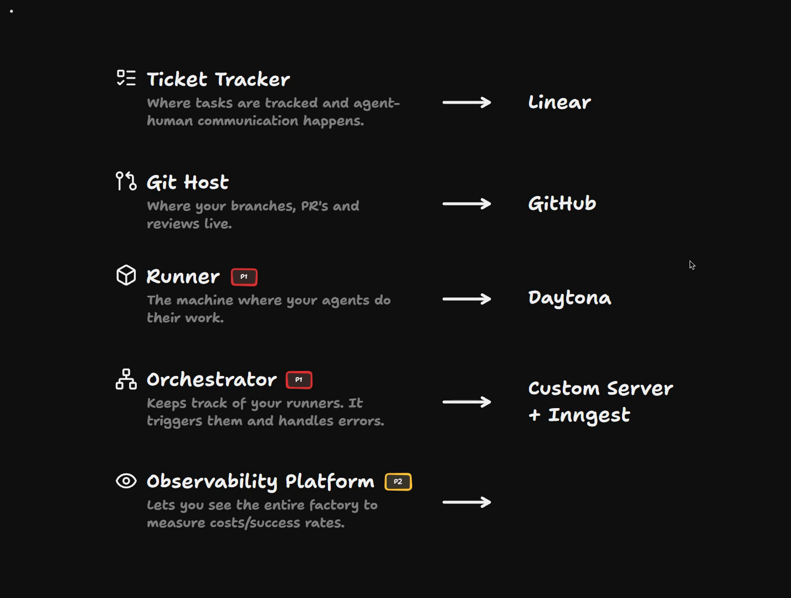

That takes us to Daytona and a custom server plus Inngest, the two main ones we wanted to figure out.

## Implementation questions

Next it asks an implementation question: who ends a run that never reports back? Its recommendation looks good.

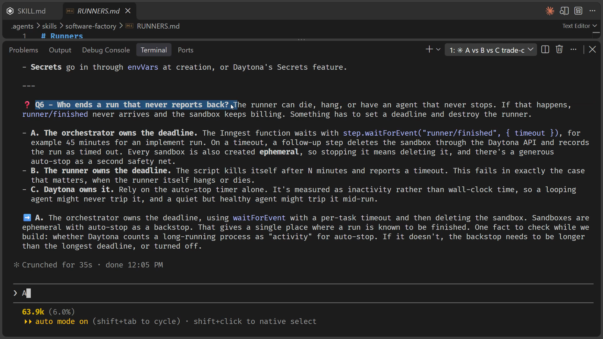

Then another question about keys and credentials. This all looks fine.

It's great doing a grilling session on this stuff. How each service plugs into the others is really hard to visualize at this concrete level. Once you get the agent's feedback that it's okay, you can start planning at a higher level.

Another question: how does the factory appear in Linear? As a Linear agent app. Yep, that sounds great.

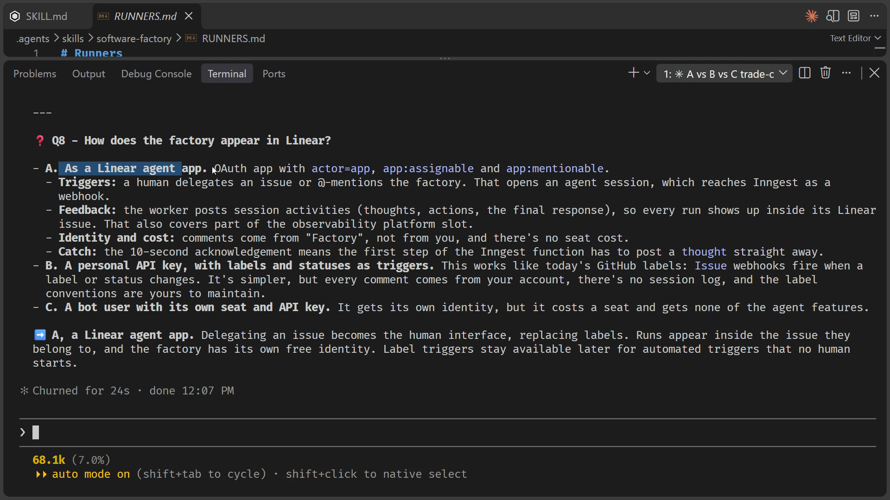

What's cool about Linear is that you can delegate an issue to an agent. The agent is a first-class person inside the setup. That means you can replace the slightly janky label setup we have in GitHub.

## Choosing the observability platform

Now we're figuring out the observability platform. It looks at all the data we get from the other systems: a Linear agent session, the Inngest dashboard and Daytona.

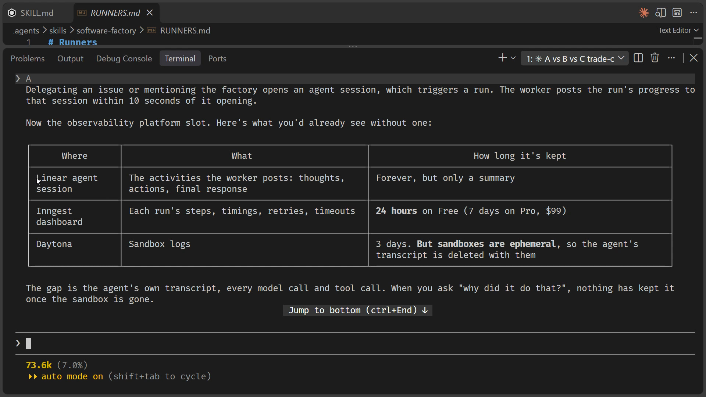

This data is precious to us, because we want to run a retro on the data from these agent sessions so we can improve. That's a problem, particularly in default Daytona, because our sandboxes are ephemeral.

Every time we create a runner and it creates an agent log, we immediately delete it and lose the whole log. That means retro in our current system would be kind of useless.

The agent recommends Langfuse, which has a hobby plan of 50K units per month and 30 days of history.

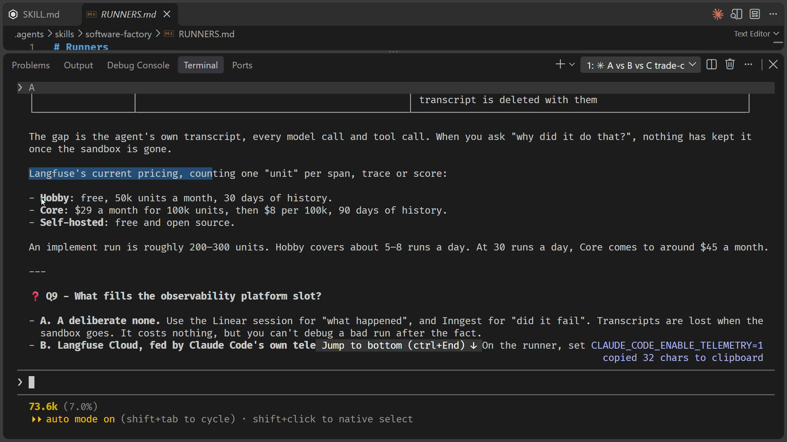

| Option | Notes |
| --- | --- |
| Langfuse Hobby | 50K units per month, 30 days of history |
| Self-hosted Langfuse | Possible if the pricing is too brutal |
| Existing platform | Pull the transcripts into Datadog, Grafana or Honeycomb if you already pay for one |

The Hobby plan doesn't get us very much, because we get around five to eight runs a day. The pricing is fairly brutal, but we can self-host Langfuse if we want to.

Most companies have some kind of observability platform already. If you don't, you need one, and you're probably already paying for it.

For ease, I'm going with Langfuse Cloud. Going without an observability platform is out of the question, because I absolutely need one. I think I'll buy rather than self-host this one.

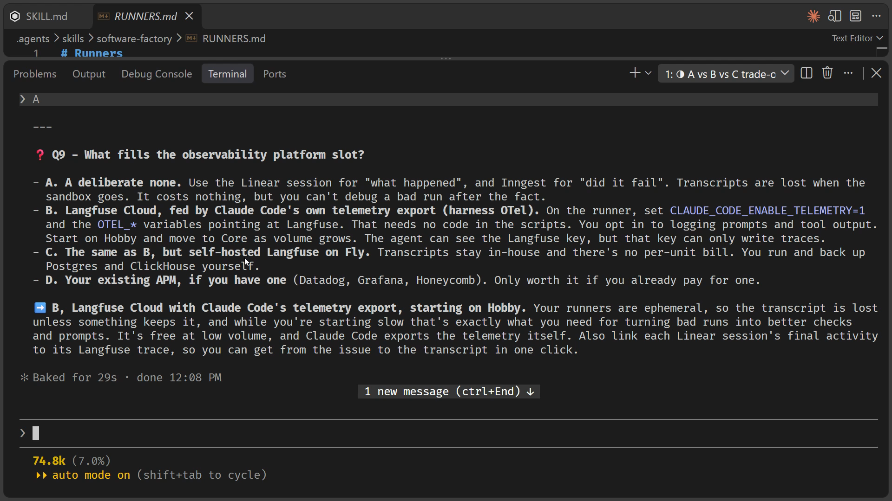

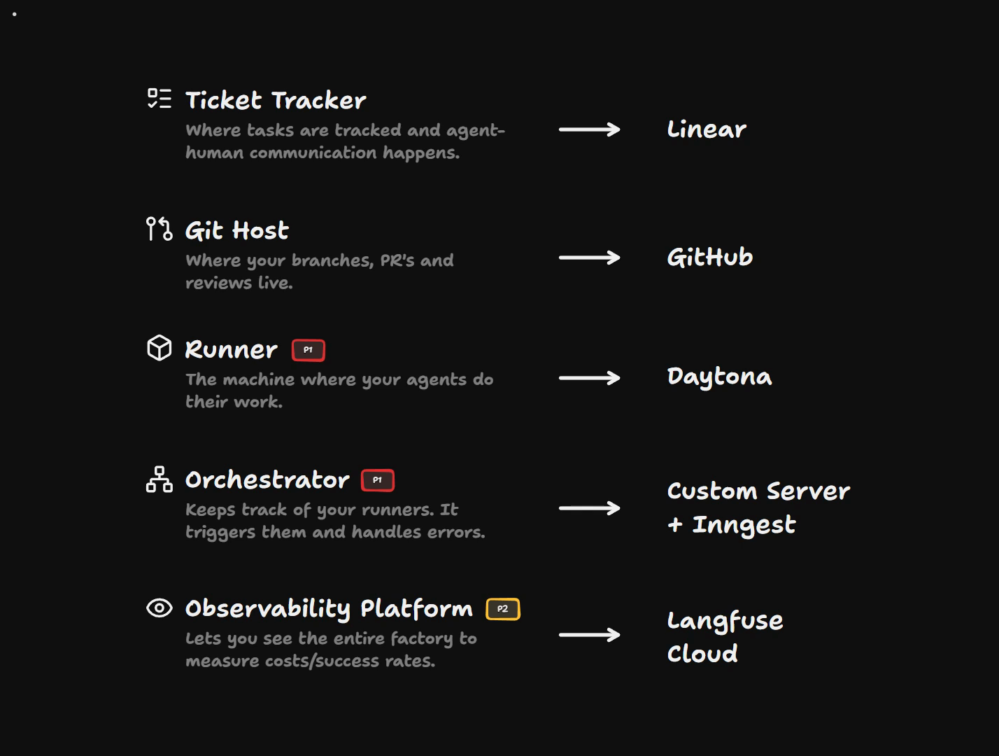

That fills out all of the parts our software factory needs.

## Blitzing through the last questions

I run through what are hopefully the last few questions in the grilling session. We should end up with a nice summary at the end. After that, I'm going to run `/to-spec` on it, and the spec will be available in a gist in the section below.

It asks how the feedback button files into Linear. A seems fine.

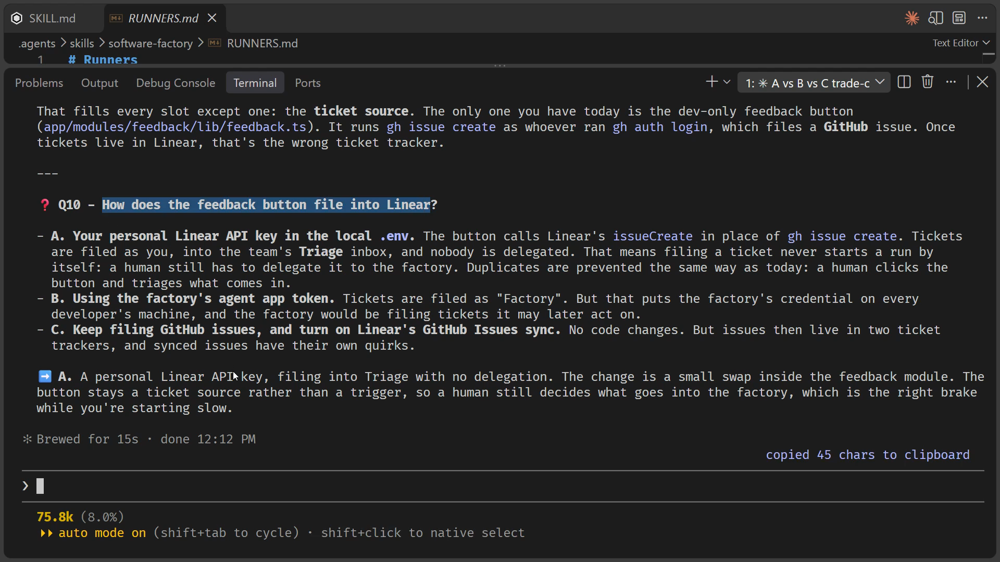

It asks about Claude credentials. I say C, and I also tell it to ask in rounds again.

```txt
C. Ask in rounds again
```

It was going into the `/grill-me` failure mode. If you ask one question at a time, you get a load of quite easy questions to answer in a row.

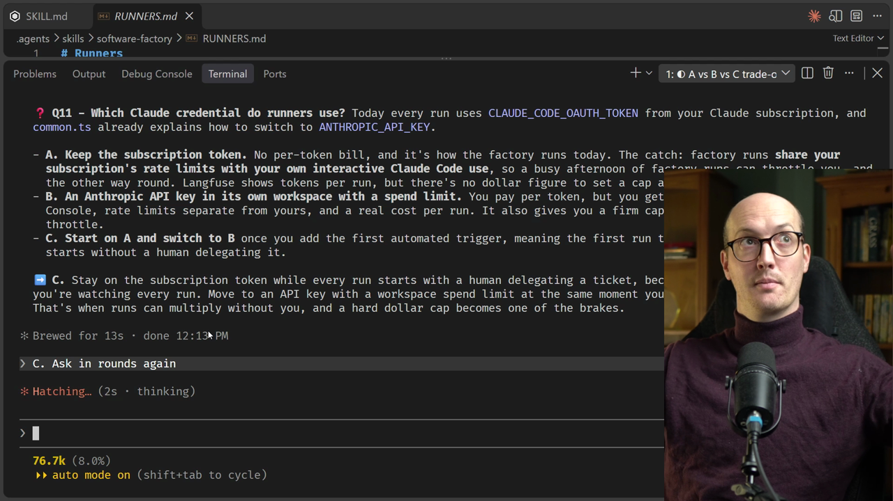

I blitz through the last round. A lot of these were about credentials and where we store tokens:

- Should we use Linear's own GitHub integration?
- Should the worker stay stateless?
- Where do the long-lived secrets live?

It also asked whether the factory's code lives in this repo. I said it probably needs to live outside this repo.

My opinion is that each company probably needs its own software factory. That factory should be capable of pulling lots of repos into a single sandbox, so a single agent can make commits across multiple setups. Not everyone has a single monorepo where they do all their work.

Then finally, a couple of testing questions. How do we test the factory? And should we cut over one task at a time?

That's another grilling round done, mostly on implementation detail. There's another on implementation details, pricing and so on.

Finally, we've made every single service decision and we have the full design.

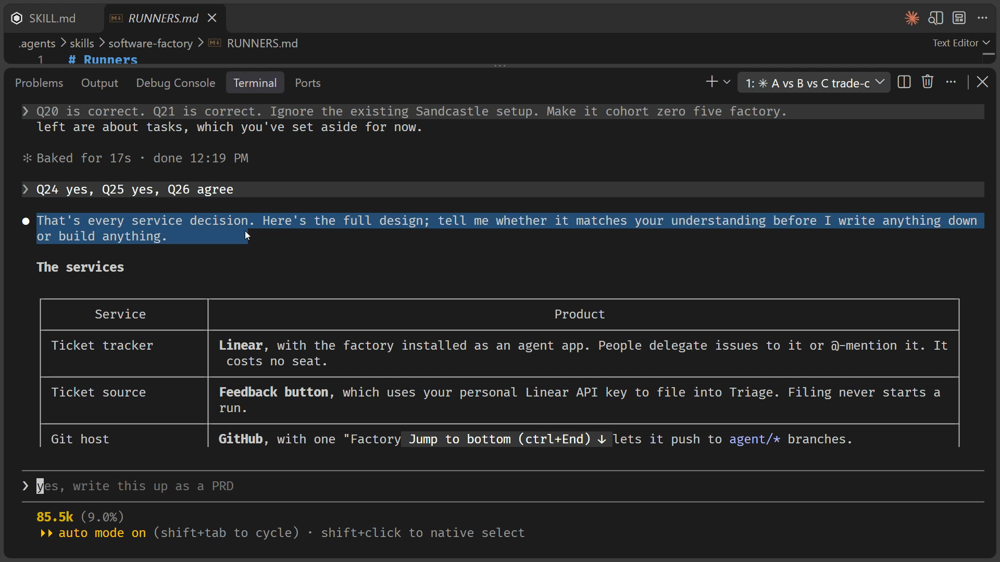

## Turning the design into a spec

I'm not going to review the design now. Instead, I run `/to-spec` and get it to create an issue for me.

```txt
/to-spec
```

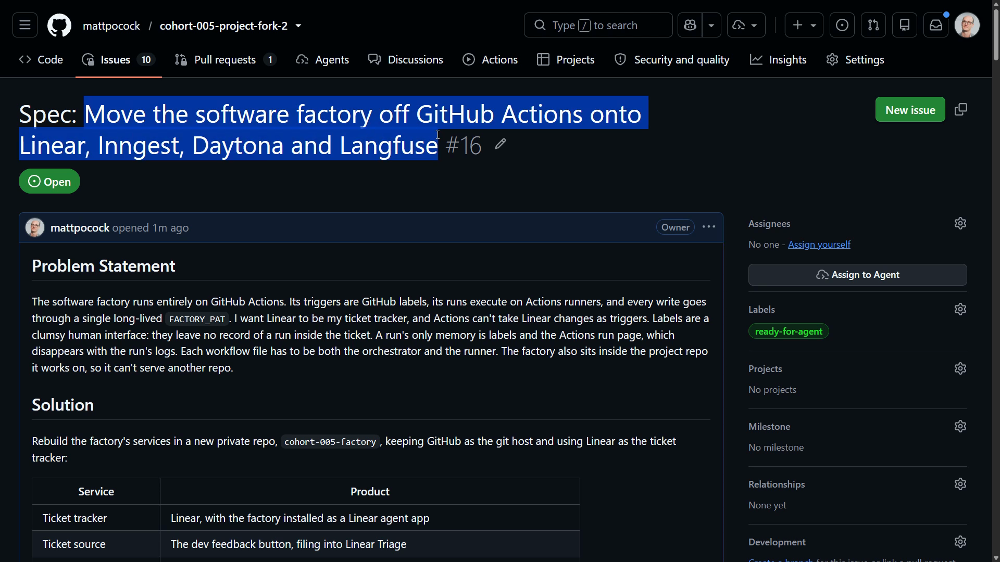

There we have it: **Move the Software Factory off GitHub Actions onto Linear, Inngest, Daytona and Langfuse**.

The solution is to rebuild the software factory services in a new private repo. We use GitHub as the git host and Linear as the ticket tracker.

| Service | Product |
| --- | --- |
| Ticket tracker | Linear, with the factory installed as a Linear agent app |
| Git host | GitHub |
| Orchestrator | Inngest, plus a `connect()` worker on Fly.io |
| Runner | A fresh ephemeral Daytona sandbox per run |
| Observability platform | Langfuse Cloud |

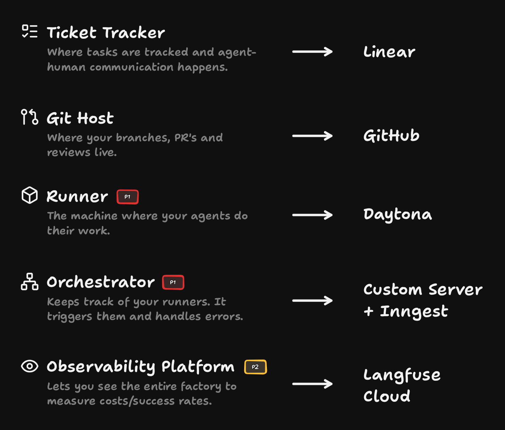

We now have a properly spec'd software factory, with a very detailed spec that we can pass to tickets to set up everything that needs to be set up. You can read the full spec in [the gist](https://gist.github.com/mattpocock/c7996d7d81541dde73f1ed8f60aee58e).

We could create a wizard to provision all of this for us, or to tell us how to provision it. A lot of the hard work of figuring out how this stuff links together is done.

Hopefully you ended up with a spec similar in scope and detail to mine, and you feel confident you could give this a go and try it out.

Well done if you made it this far. This ended up being a super long video, so thank you for watching in all of its detail.

Nice work, and I will see you in the next one.
