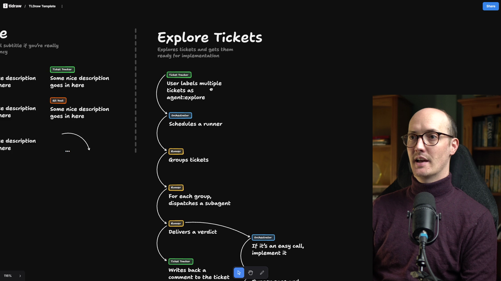
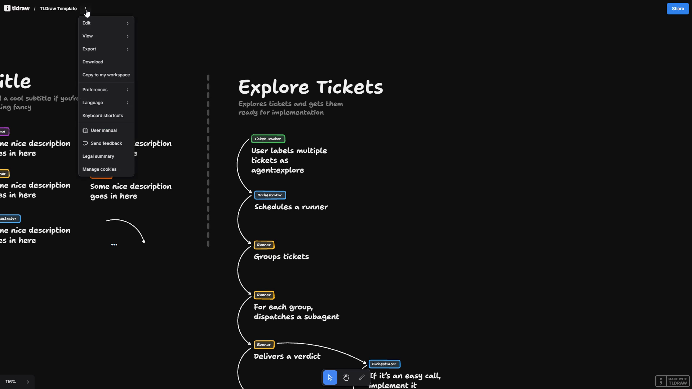
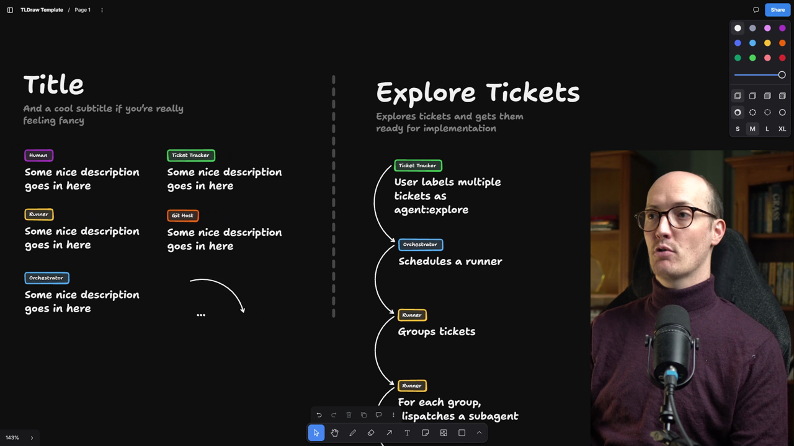

# Whiteboard Your Own Tasks

<Prerequisites title="Crash Course Prerequisites">
  <Prerequisite href="https://www.aihero.dev/workshops/ai-coding-crash-course/models-harnesses-agents-environments-2b9a99a1">
    What a runner is actually running: an agent, made of a model, a harness and an environment.
  </Prerequisite>
  <Prerequisite href="https://www.aihero.dev/workshops/ai-coding-crash-course/subagents-756fafe5">
    What a subagent is: a fresh context you hand work to, which some tasks in your diagrams will spawn.
  </Prerequisite>
  <Prerequisite href="https://www.aihero.dev/workshops/ai-coding-crash-course/how-to-tackle-massive-tasks-6199ee6b">
    Why big work splits into a spec and tickets, the units the factory passes along.
  </Prerequisite>
</Prerequisites>

We now have a good idea of the infrastructure we're looking to provision as part of the [software factory](https://www.aihero.dev/ai-coding-dictionary/software-factory)'s design. But we haven't yet figured out what it's going to do. So let's firm up the language we're going to use.

| Term | Meaning |
| --- | --- |
| Runner | A disposable machine that a run executes on |
| Run | An execution of a task on a runner |
| Task | The thing the runners are going to perform. This is what we're working out |

We can think of explore, implement or review each as an individual task that we put onto runners.

In this section, we're going to brainstorm a bunch of different tasks that we can run on our factory.

## Leaving the agent for the whiteboard

To do that, we're going to leave the world of the [agent](https://www.aihero.dev/ai-coding-dictionary/agent) for a bit and go back to one of my favorite tools for thinking: the whiteboard.

I've built a little whiteboard template for you inside TLDraw. We're going to design diagrams like this one, which mock up what our factory is going to do.

We're not going to practice implementing this stuff. We're going to practice system design, designing lots of different tasks that our factory can potentially implement.

## Setting up the template

Here's how to get set up:

1. Go to the link below, which takes you to the TLDraw template: [https://www.tldraw.com/p/f55y1hDczxC96pSFHiGTF](https://www.tldraw.com/p/f55y1hDczxC96pSFHiGTF)
2. The template is read-only. You can copy things, but you can't move anything around.
3. Click the three little dots in the top left and choose **Copy to my files**. On camera I call this "copy to my workspace".
4. This copies the template in with all of your other TLDraw diagrams.

At some point during that process, you may have to sign up for TLDraw. That's fine. It's free, and I recommend you support them.

If you prefer another drawing app, such as Excalidraw (boo, but some people do like it), feel free to mock up this kind of setup there instead.

If you've never used a diagramming tool for building software before, it is essential, even in the age of AI. Consider this a great opportunity to give it a go.

## Hotkeys

A few little hotkeys will make the whole thing faster:

- **Ctrl/Cmd and scroll** to zoom in.
- **Hold Space and drag** to wander around the canvas.
- **Select, then Alt/Option and drag** to quickly copy something. Select by clicking and dragging, then Alt/Option-click to move the copy.

On the left-hand side there are a few components. Click or Alt/Option-click them and move them into the diagram on the right.

## Reading the diagram

Each step in the diagram corresponds not only to something we do, but also to the place where that step runs.

I've diagrammed the explore [tickets](https://www.aihero.dev/ai-coding-dictionary/ticket) task first:

1. **Ticket tracker:** a user labels a single ticket or multiple tickets `agent:explore`. This is the trigger for everything that follows.
2. **Orchestrator:** this schedules a runner.
3. **Runner:** as in the prompt itself, the runner groups tickets together. For each group, it dispatches a [subagent](https://www.aihero.dev/ai-coding-dictionary/subagent), all on the same runner.
4. **Runner:** it delivers a verdict, working out what we need to do based on the exploration.

## Branching logic

The verdict gives you the opportunity to do branching logic:

- If the runner discovers it needs more input, it writes a comment to the ticket. That happens on the ticket tracker.
- If it's an easy call, it goes back to the orchestrator and tells it to implement. The orchestrator then runs a runner that implements it, and so on. That's a different flow.

You don't have to diagram the entire flow in the exercises. You can use the little ellipsis to say it carries on and we know what's going on there.

## Before you start

Take a moment to make sure your TLDraw setup is present and correct, and get acquainted with the buttons in the top right.

Once that's done, we're going to start doing system design: a bunch of problems and solutions on different ways you can use your factory.

As you work through them, imagine the infrastructure you provisioned in the previous step. For instance:

1. This is Linear, my ticket tracker.
2. It goes to my custom Inngest setup.
3. That runs on Daytona, in the runner.
4. Then it goes back to Linear.

Thinking this way, and reminding yourself of the actual application, will make everything feel a lot more concrete.

Nice work, and I'll see you in the next one.

<Quiz>
  <QuizQuestion data={{
    id: "whiteboard-step-lane-placement",
    question: "You're diagramming a task where an agent can't decide and needs a human's input. The runner has finished exploring. In which lane do you draw the step that writes a comment asking for that input?",
    type: "multiple-choice",
    choices: [
      { answer: "a", label: "The ticket tracker lane, because that is where the comment lives" },
      { answer: "b", label: "The runner lane, because the runner produced the verdict" },
      { answer: "c", label: "The orchestrator lane, because it coordinates every runner" }
    ],
    correct: "a",
    answer: "Each step sits in the lane of the place it runs or happens. Writing a comment to a ticket happens on the ticket tracker, even though the runner decided to do it. The runner lane is for work like grouping tickets, dispatching subagents and delivering the verdict. The orchestrator schedules runners and handles hand-offs such as starting an implement run, but it doesn't hold the ticket."
  }} />
  <QuizQuestion data={{
    id: "task-vs-run-vs-runner",
    question: "Your team says: \"Review is one of the things our factory does, and each time a PR arrives we spin up a fresh machine for it.\" Which pairing of terms is correct?",
    type: "multiple-choice",
    choices: [
      { answer: "a", label: "Review is a run, each execution is a task, each machine is a runner" },
      { answer: "b", label: "Review is a runner, each execution is a run, each machine is a task" },
      { answer: "c", label: "Review is a task, each execution is a run, each machine is a runner" }
    ],
    correct: "c",
    answer: "Review is a kind of work, an execution of it is one occurrence, and the machine is where it happens. The wrong options each swap two of those roles."
  }} />
  <QuizQuestion data={{
    id: "whiteboard-partial-flow",
    question: "You're mocking up a task and the flow after the implement step is long and obvious. What do you do on the whiteboard?",
    type: "multiple-choice",
    choices: [
      { answer: "a", label: "Diagram every remaining step so the design is complete" },
      { answer: "b", label: "Stop the diagram at implement and leave the rest unmarked" },
      { answer: "c", label: "Use the ellipsis component to show the flow carries on" }
    ],
    correct: "c",
    answer: "You don't have to diagram the whole flow. The ellipsis signals that it carries on in a way everyone already understands. Diagramming everything wastes effort in an exercise about system design. Leaving the end unmarked hides the fact that more happens."
  }} />
</Quiz>
