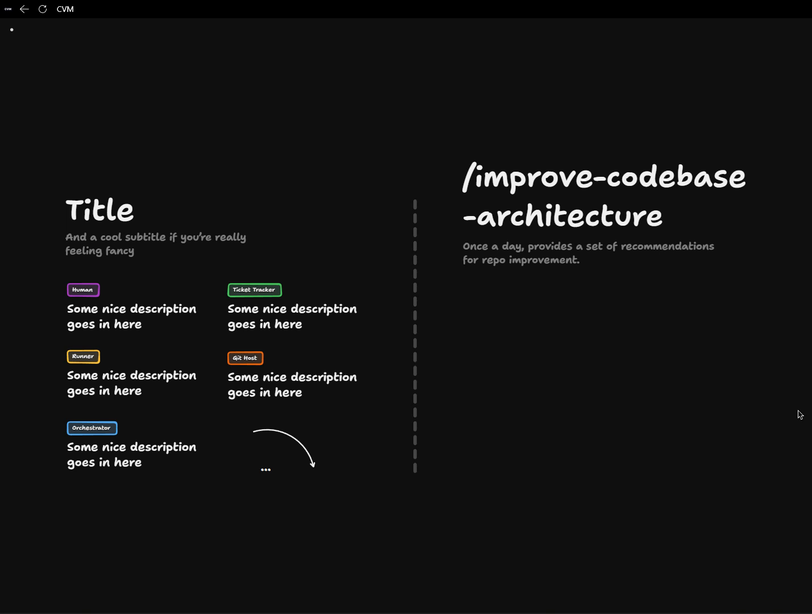

# Improve Codebase Architecture

<Prerequisites title="Crash Course Prerequisites">
  <Prerequisite href="https://www.aihero.dev/workshops/ai-coding-crash-course/models-harnesses-agents-environments-2b9a99a1">
    What a runner is actually running: an agent, made of a model, a harness and an environment.
  </Prerequisite>
  <Prerequisite href="https://www.aihero.dev/workshops/ai-coding-crash-course/smart-zone-dumb-zone-d4b92bd0">
    Why an agent gets worse as its context fills, which shapes how much work you give each runner.
  </Prerequisite>
  <Prerequisite href="https://www.aihero.dev/workshops/ai-coding-crash-course/what-are-agent-skills-20f91a4e">
    What a skill is, since the loop runs `/improve-codebase-architecture` as one.
  </Prerequisite>
  <Prerequisite href="https://www.aihero.dev/workshops/ai-coding-crash-course/set-up-your-issue-tracker-30629075">
    How the ticket tracker works, as one place the loop can send its recommendations.
  </Prerequisite>
  <Prerequisite href="https://www.aihero.dev/workshops/ai-coding-crash-course/enforcing-your-coding-standards-f1656d67">
    Where human review fits, so you can decide when a person picks the work up.
  </Prerequisite>
</Prerequisites>

In the Codebase Design section, I hinted at a process for automatically improving your codebase over time. Now we're going to design that flow as the first one inside our [software factory](https://www.aihero.dev/ai-coding-dictionary/software-factory).

It introduces an important capability of the orchestrator: it can run loops. Once a day, an hour or a minute, it can spawn processes that schedule runners, act on a [ticket](https://www.aihero.dev/ai-coding-dictionary/ticket) tracker or open a PR on a Git host.

Your job is to design a loop that runs once a day and produces a set of recommendations for repo improvement, using the `/improve-codebase-architecture` [skill](https://www.aihero.dev/ai-coding-dictionary/skill).

## Steps To Complete

### Open The Board

- [ ] Open the software factory board and look at the building blocks

[Open the board in TLDraw](https://www.tldraw.com/p/SBHpQXr4cjRO7rc6rM6IN)

The board is read-only, so copy it into your own files first: click the three little dots in the top left and choose **Copy to my files**.

The template holds the orchestrator, a runner, the ticket tracker, the Git host and a small human tag. The flow itself isn't drawn yet.

### Design The Loop

- [ ] Draw the loop that the orchestrator runs once a day

The orchestrator is the one that kicks things off on a schedule. Show how it spawns a runner that runs `/improve-codebase-architecture`, and what that runner talks to.

The goal is that once a day, the loop provides a set of recommendations for repo improvement. How you interpret that is up to you.

- [ ] Decide how the loop finishes

Should it end by creating a PR? Should it end by creating a ticket? Pick whichever fits how you want to receive the recommendations, and draw it.

- [ ] Place the human in the flow

Decide at what point a human should pick the work up. Then decide what they should do with it.

### Think About The Accelerator

- [ ] Decide how you would press on the accelerator

A good software factory starts slow, so you can see it working and check that your brakes are functioning properly. Write down how you would speed yours up.

- [ ] List the variables you could introduce to speed the loop up, or slow it down if it gets too fast

Add these to your board as notes alongside the flow.

### Get Feedback

- [ ] Screenshot your board and post it in the [AI Hero Discord](https://www.aihero.dev/discord)

If you have any questions, share it there and we'll comment on it and suggest what we might change.
