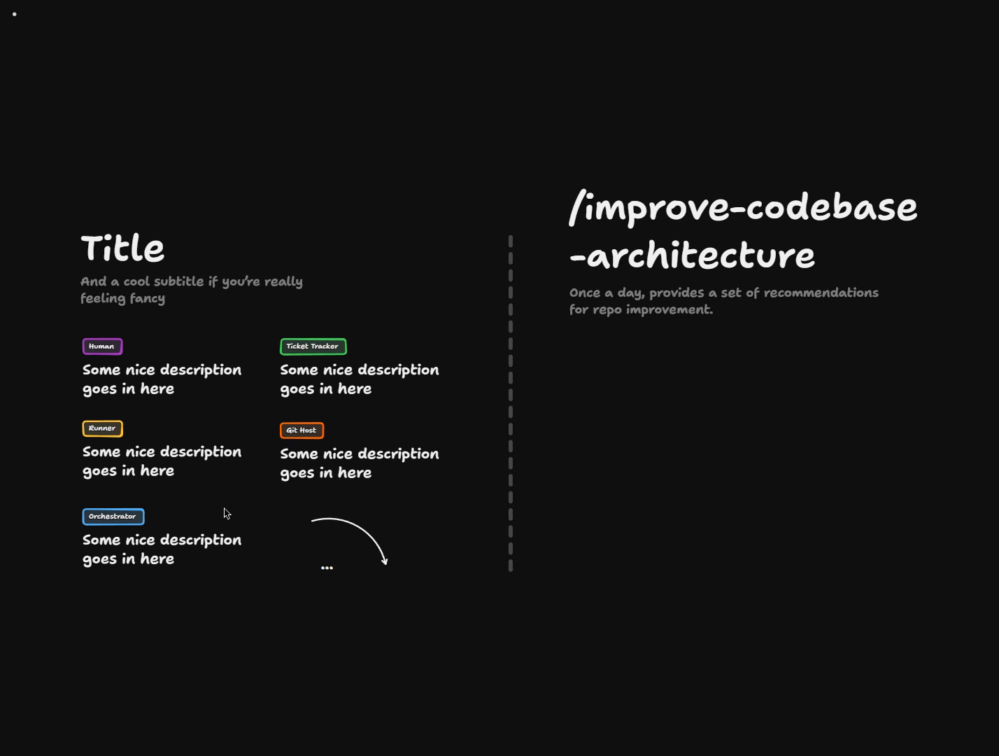
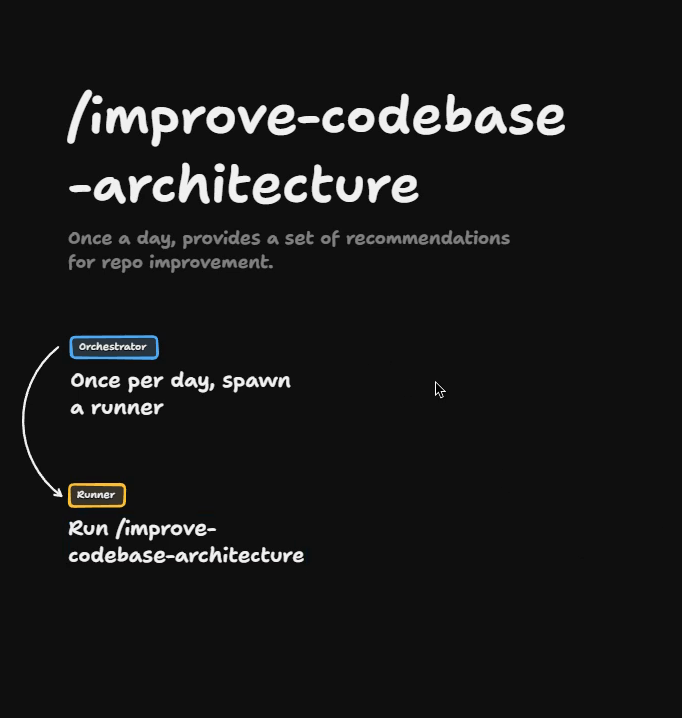
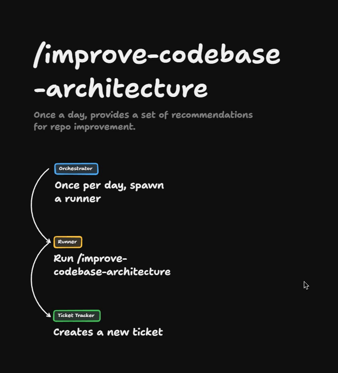
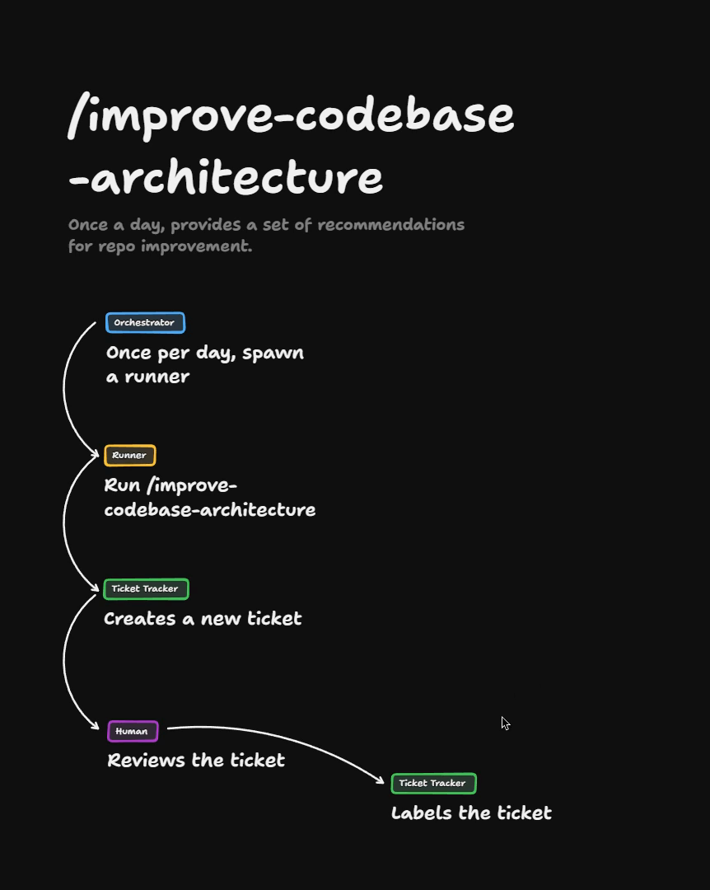
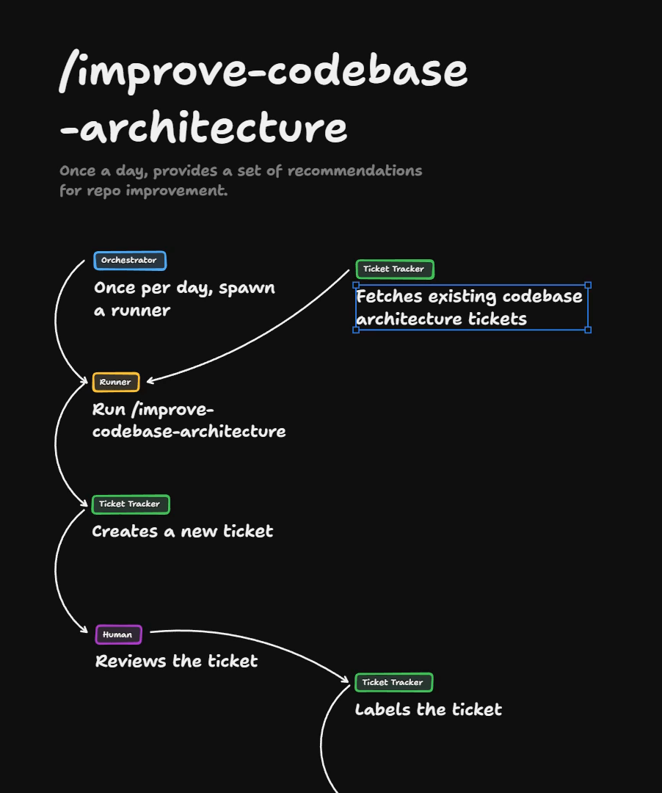
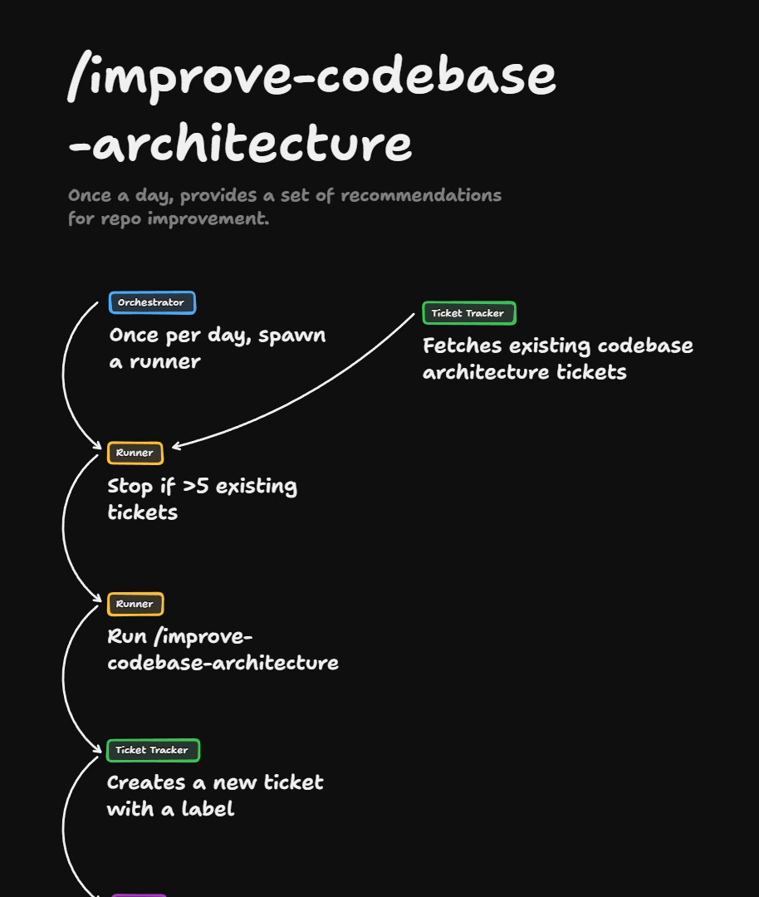
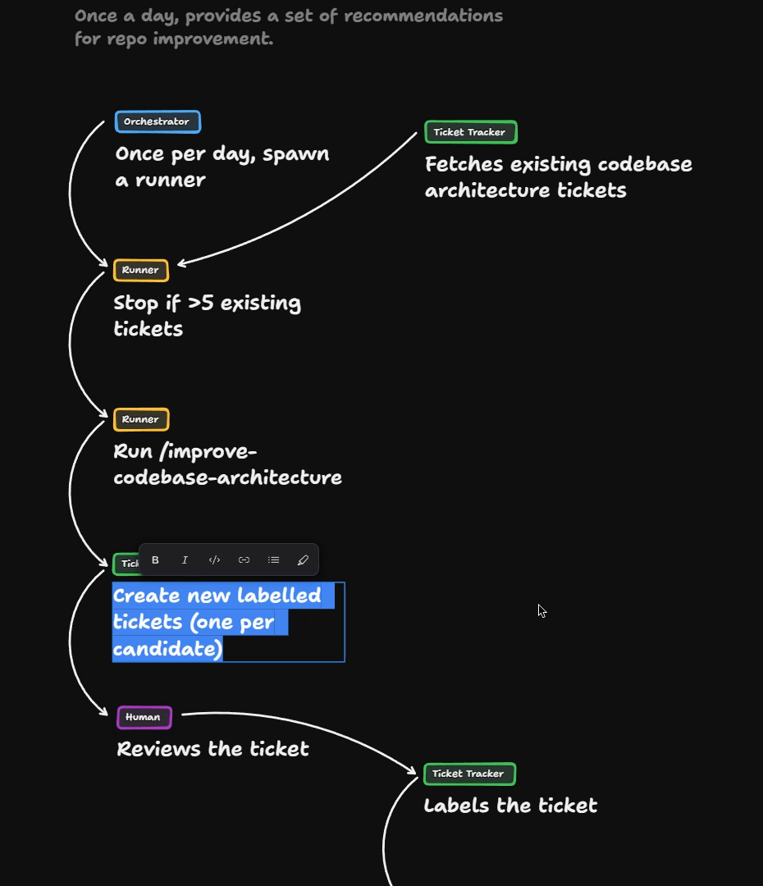
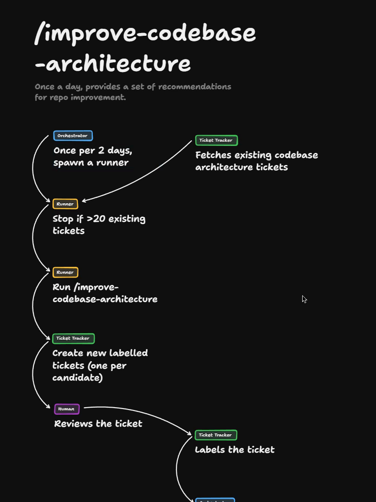
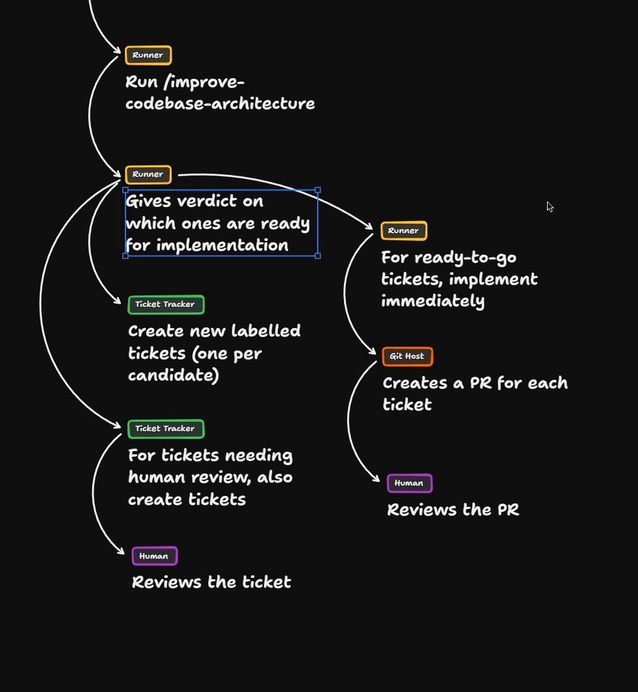
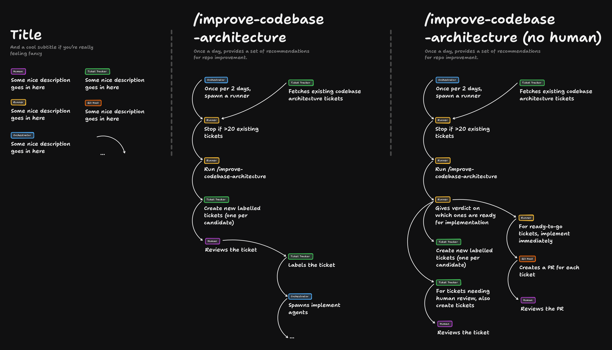

# Improve Codebase Architecture Solution

This lesson walks through a solution for a [software factory](https://www.aihero.dev/ai-coding-dictionary/software-factory) design that runs `/improve-codebase-architecture` on a loop. It starts from the orchestrator and builds out the rest of the flow. You can pan and zoom around the finished board here: [Open the board in TLDraw](https://www.tldraw.com/p/0cjVpMezFWVB5cmLVGuLF).

## Starting With The Orchestrator Loop

I'm going to drop myself in pretty cold here. The thing I want to start with is the orchestrator, where we want a loop.



That loop is essentially going to spawn a runner once per day.

The runner is an [agent](https://www.aihero.dev/ai-coding-dictionary/agent) that runs `/improve-codebase-architecture`.



## Telling People About The Result

`/improve-codebase-architecture` produces some HTML. We could get really fancy and deploy that HTML somewhere, deploying the report.

But what I'm really interested in is what happens once the run is complete. It needs to tell people about it. So it probably needs to create a new [ticket](https://www.aihero.dev/ai-coding-dictionary/ticket) in the ticket tracker.



After that, we pass things back to a human, who reviews the ticket.

The human could then label the ticket and do something with it.



For instance, once the human labels the ticket, that contacts the orchestrator agent, which spawns a bunch of implement agents. That is getting out of scope for this flow. We could go all the way down there, but there is still work to do on this initial setup.

## Two Things That Scare Me

A couple of things scare me about this setup.

The first is that the runner needs the right [context](https://www.aihero.dev/ai-coding-dictionary/context). Otherwise `/improve-codebase-architecture` just gives you endless versions of the same ticket, again and again.

So we need a way of filtering the tickets down to just the ones that are codebase-architecture related.



That means when we create the ticket, we should create it with a label, saying this one came from the `/improve-codebase-architecture` flow.

We should also add a step to stop if there are more than five existing tickets.



In other words, if humans stop paying attention to this, or it stops being a priority, we pause it. If there are five existing tickets, we stop. A human can then come in, maybe close some, and we can figure it out.

## Candidates: One Or Many?

It's also worth looking at the `/improve-codebase-architecture` [skill](https://www.aihero.dev/ai-coding-dictionary/skill) itself. It says to present candidates as an HTML report.

```markdown
### 2. Present candidates as an HTML report

Write a self-contained HTML file to the OS temp directory so nothing lands in the repo. Resolve the temp dir from `$TMPDIR`, falling back to `/tmp` (or `%TEMP%` on Windows), and write to `<tmpdir>/architecture-review-<timestamp>.html` so each run gets a fresh file. Open it for the user (`xdg-open <path>` on Linux, `open <path>` on macOS, `start <path>` on Windows) and tell them the absolute path.
```

That means not one candidate, but multiple candidates. So we have two options:

- Inside the runner, filter down to a single candidate.
- Inside the ticket tracker section, create a bunch of new tickets.



If we go with the second option, we create new labelled tickets, one per candidate. We get a ton of new tickets from each run.

Then we might want to raise the stop level a bit. We'll stop if there are more than 20 existing tickets.

## Tuning The Numbers

You can imagine the human going through this flow getting maybe three or four tickets a day, five or six at most.

Maybe that is too fast. Maybe it is too slow. You may want to run it once every two days instead of once a day.



Overall, I think this design is pretty much complete. We have numbers that we can turn up and down:

- The frequency of the loop is one variable.
- The stop condition is another.
- Inside the runner, we could say only give us really strong candidates.

It's also bounded. It's not going to go too fast or splurge 100 tickets, because of the stop condition and because a human needs to manually review the tickets.

## A Version Without Human Review

Now I'm going to go a bit rogue. I'm going to try a version of this without [human review](https://www.aihero.dev/ai-coding-dictionary/human-review), or where humans come a little later in the process.

The initial setup stays the same. The change is in the step where the human reviews the ticket.



Here is my attempt. In the same runner that ran `/improve-codebase-architecture`, you could give a verdict on which candidates are ready for implementation. That's a little bit iffy, but let's look at the whole shape first and then decide.

Based on that verdict, you go down a couple of paths:

- **Every candidate:** create new labelled tickets. That way you always retain the information for later, even once it has been implemented.
- **Needing human review:** some candidates may not be ready for implementation but need checking with a human. You still put those in the ticket tracker, and the human reviews the ticket.
- **Ready to go:** implement immediately in the same runner, maybe inside [subagents](https://www.aihero.dev/ai-coding-dictionary/subagent) in the existing [context window](https://www.aihero.dev/ai-coding-dictionary/context-window).

Inside the Git host, that creates a PR for each ticket, and the human then reviews the PR.

## The Problem With Implementing In The Runner

The thing I'm not a huge fan of is that `/improve-codebase-architecture` often provides really big, detailed changes.

Refactors can be incredibly context hungry. So the step where ready-to-go tickets just keep getting implemented feels like it could hit context window limits. Or we would end up doing a lot of work in the [dumb zone](https://www.aihero.dev/ai-coding-dictionary/smart-zone).

## Comparing The Two Designs

Here are two potential designs for how you could get this working:

| Design | Where the human comes in | Trade-off |
| --- | --- | --- |
| Left, conservative | The human reviews the ticket | Slower, but safer |
| Right, less conservative | The human reviews the PR | Pumps out more code and does more work before a human gets involved |

Here is the finished board, with both designs on it. You can also [open the board in TLDraw](https://www.tldraw.com/p/0cjVpMezFWVB5cmLVGuLF) to pan and zoom around it.



## What To Take Away

Whatever your design looked like, hopefully you now have a sense that the orchestrator can schedule jobs and run things on a loop.

We also want to build in safeguards, so the software factory doesn't go too fast and create too many tickets for us to review.

We did that via the labelling system, where we create labelled tickets and then fetch all of the tickets. This also has the side effect of making sure it doesn't duplicate work or suggest something that has already been suggested.

If you have any questions about your diagram or your design, do share them in the [Discord](https://www.aihero.dev/discord). Hopefully this is making it a bit more concrete how you can plan out these tasks and put them into your software factory.

Nice work, and I will see you in the next one.

[Open the finished board in TLDraw](https://www.tldraw.com/p/0cjVpMezFWVB5cmLVGuLF)
