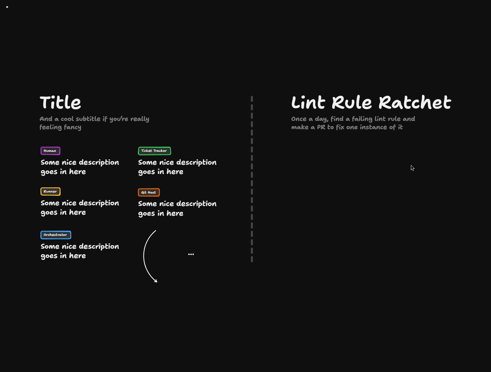

# The Ratchet

<Prerequisites title="Crash Course Prerequisites">
  <Prerequisite href="https://www.aihero.dev/workshops/ai-coding-crash-course/smart-zone-dumb-zone-d4b92bd0">
    Why a file too big for the agent to read in one go hurts it, which is what the file size check guards against.
  </Prerequisite>
  <Prerequisite href="https://www.aihero.dev/workshops/ai-coding-crash-course/executing-your-tickets-8389d87c">
    How automated checks give an agent a feedback loop, which the lint rule is part of.
  </Prerequisite>
  <Prerequisite href="https://www.aihero.dev/workshops/ai-coding-crash-course/enforcing-your-coding-standards-f1656d67">
    The layers of review, and why every ratchet PR ends with a human.
  </Prerequisite>
</Prerequisites>

A lot of people ask how to roll out a new lint rule over an existing repo. Our file size checker only runs on staged files, so the [agent](https://www.aihero.dev/ai-coding-dictionary/agent) only stumbles on oversized files when it happens to touch them.

Fixing everything in one go would free the implementer agent from resizing files as it works. But a repo-wide change is a big, risky PR. Instead, we're going to design a workflow called the **lint rule ratchet**.



You can pan and zoom around the board here: [Open the board in TLDraw](https://www.tldraw.com/p/YvwVDtTIcLevy-44NnXpb)

The board is read-only, so copy it into your own files first: click the three little dots in the top left and choose **Copy to my files**.

## Why A Ratchet?

A ratchet only turns in one direction. Each time the workflow runs, the lint rule gets a little safer, until it is fully established across the repo.

## The Gap We're Closing

The file size checker runs through `lint-staged`, so it only sees the files in a commit:

```json
"lint-staged": {
  "*": [
    "biome format --no-errors-on-unmatched --files-ignore-unknown=true",
    "node scripts/check-file-tokens.js"
  ],
  "*.{js,jsx,ts,tsx,mjs,cjs,mts,cts}": "oxlint -c .oxlintrc.json --no-error-on-unmatched-pattern",
  "*.md": "prettier --check"
}
```

The script it runs, `scripts/check-file-tokens.js`, fails when a file is too big for an agent to read and edit in one go:

```js
// Fails when a file is too big for an agent to read and edit in one go.
// Tokens are estimated as bytes / 4, which is close enough for code.
// Usage: node scripts/check-file-tokens.js <file>...
```

## Steps To Complete

This is a design exercise. There is no code to write and no commands to run. Work on your own TLDraw board, in the same style as the previous [Software Factory](https://www.aihero.dev/ai-coding-dictionary/software-factory) design.

### Sketch The Workflow

- [ ] Add the actors from the previous design to your board

Use the same building blocks as before: an orchestrator, a human, a [ticket](https://www.aihero.dev/ai-coding-dictionary/ticket) tracker, a git host, and a runner.

- [ ] Add a lint rule ratchet node to your design

Its job: **once a day, find a failing lint rule and make a PR to fix one instance of it.**

- [ ] End the workflow with [human review](https://www.aihero.dev/ai-coding-dictionary/human-review)

The PR should be reviewed by a human. Keep the workflow itself relatively simple, and similar to your previous exercise.

### Think Through The Constraints

- [ ] Identify the accelerators

These are the numbers you can turn up and down to speed the ratchet up or slow it down. Label them on your board.

- [ ] Make sure no work is duplicated

Two PRs should never fix the same failure. Decide how your design prevents that.

- [ ] Account for a human who doesn't review the PRs

Decide what happens when PRs pile up unreviewed. Show that behavior on your board.

### Check Your Design

- [ ] Walk through a few days on your board

Trace a run from the daily trigger to a merged PR. Then trace what happens on a day where the previous PR is still open.

When you're happy with it, move on to the solution and compare.
