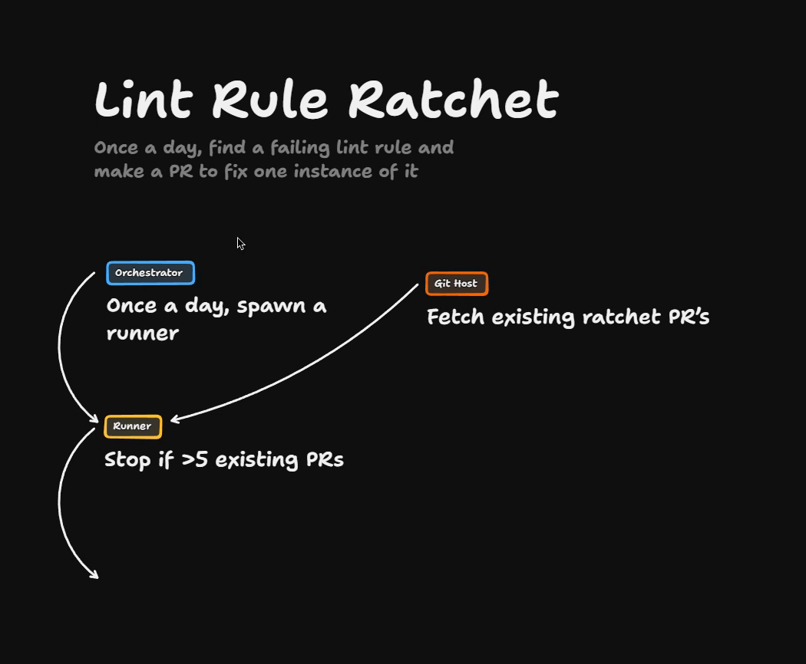
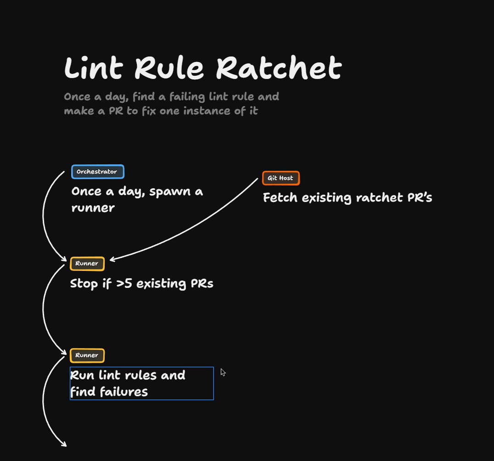
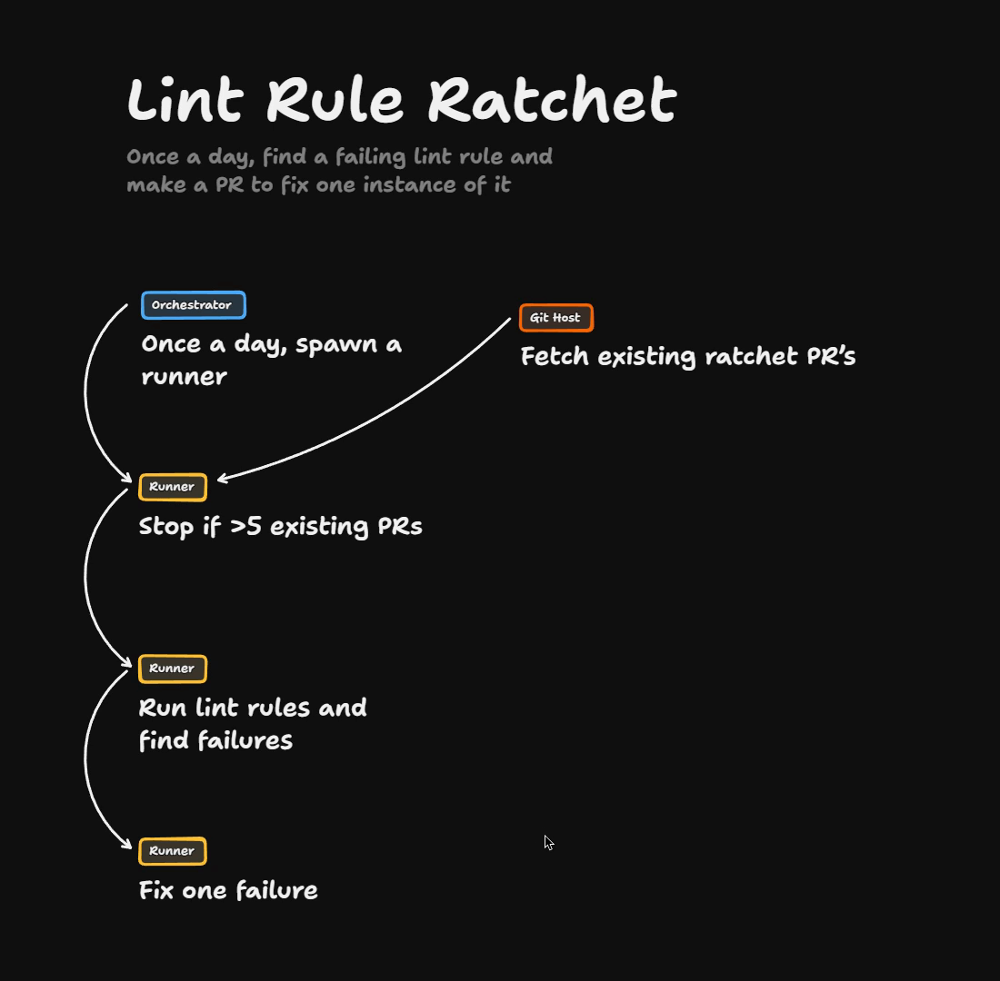
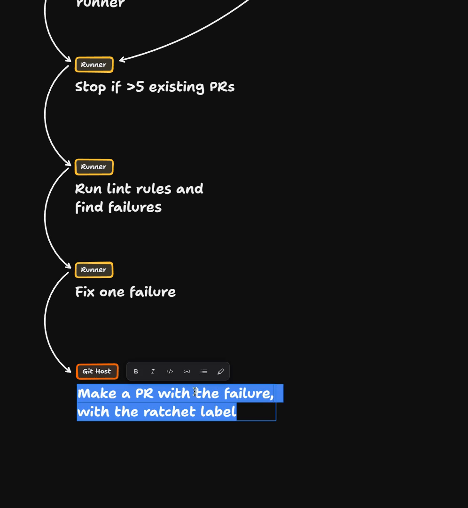
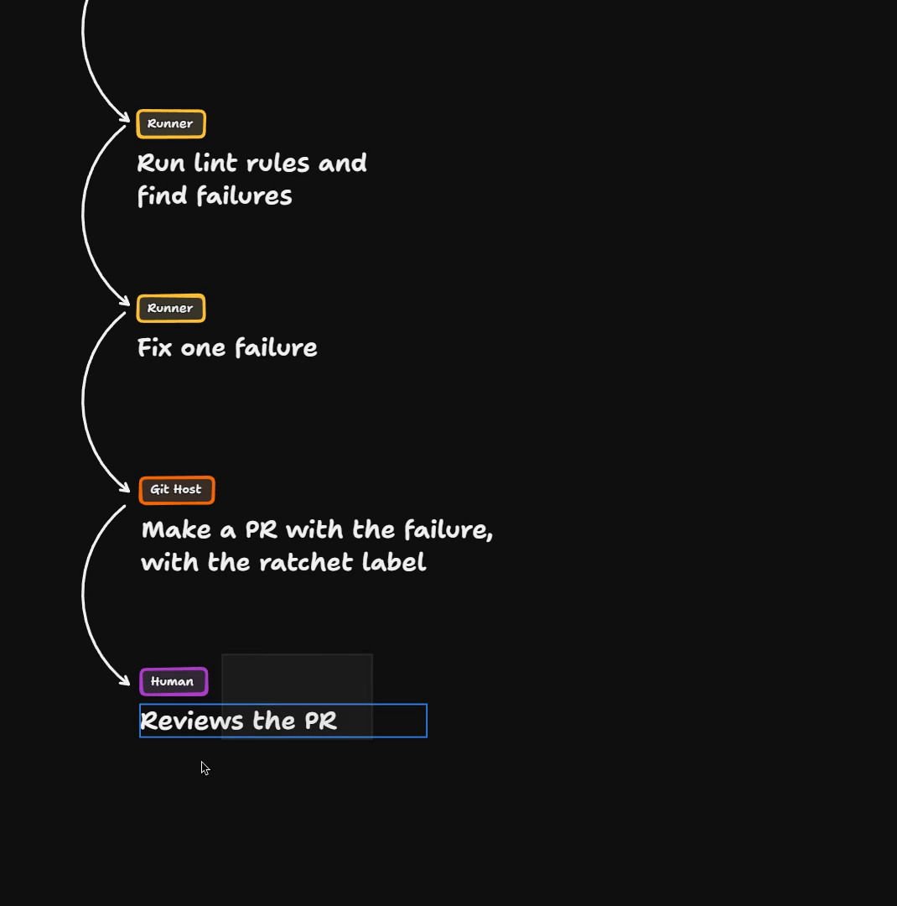
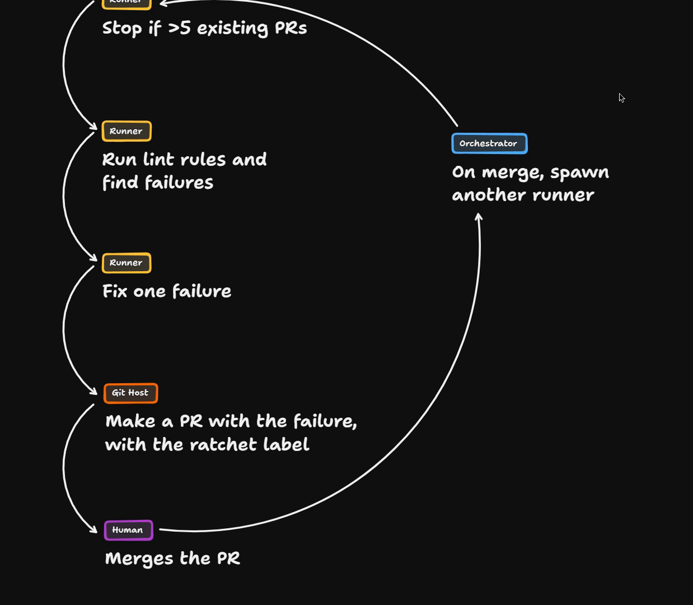
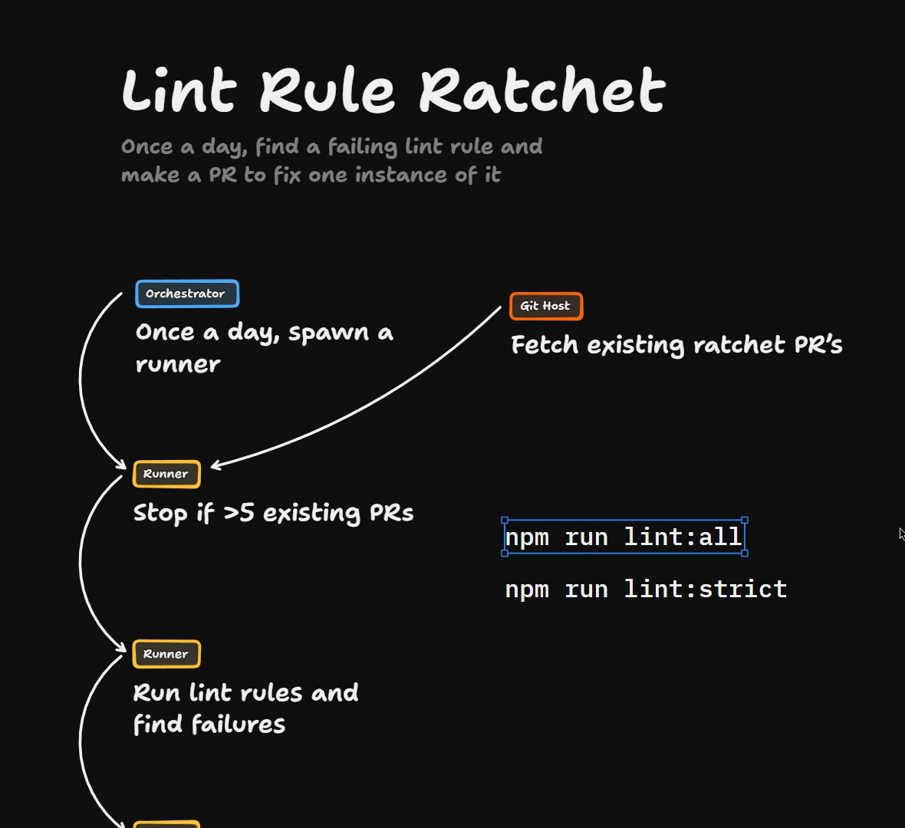
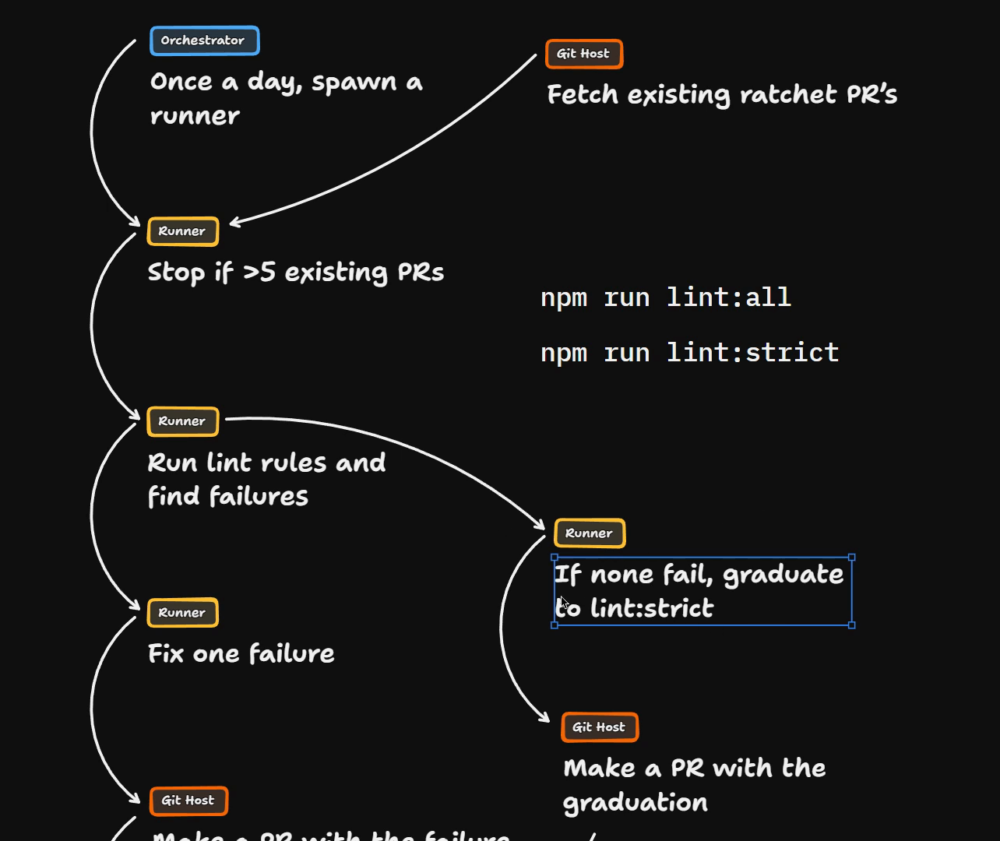
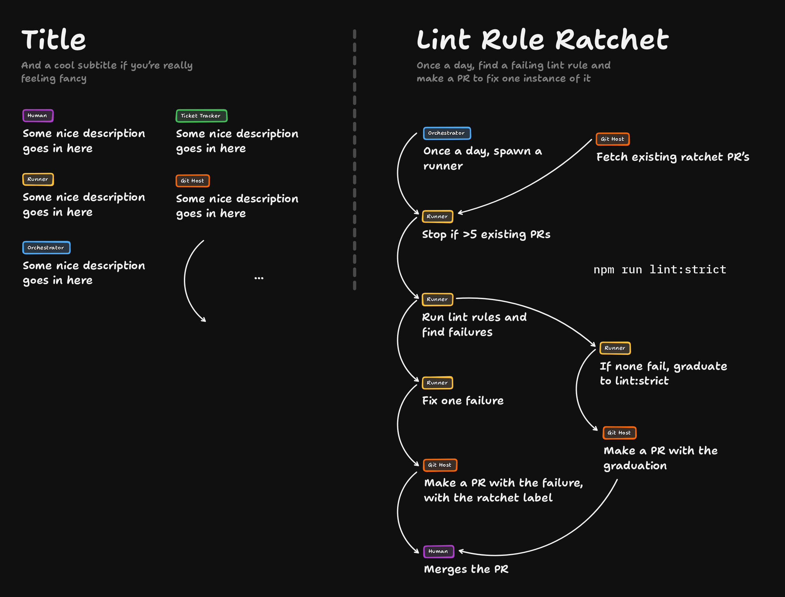

# The Ratchet Solution

This is the solution to the Lint Rule Ratchet exercise. The whole thing is a diagram on a whiteboard: there is no code and no terminal in this lesson. You can [open the board in TLDraw](https://www.tldraw.com/p/dk0ngZhKYDJTA9veX7BwC) to pan and zoom around it.

## Starting from the loop

I'm going to start by stealing the setup from the `/improve-codebase-architecture` lesson. In our orchestrator, we want to run a loop again.



- Once a day, the orchestrator spawns a runner.
- We fetch all of the PRs to do with ratcheting this lint rule from the Git host.
- We pass all of those into the runner, and the runner stops if there are more than five existing PRs.

## Finding and fixing a failure

From there, the runner needs to run the strict lint rules and find all the failures.



Then it fixes one failure.



Next we make a PR in the Git host with the failure. It gets the ratchet label, so that it appears in the fetch step at the top of the runner.



Then the [human reviews](https://www.aihero.dev/ai-coding-dictionary/human-review) the PR.



## Turning up the numbers

Overall, this looks good, and there are lots of numbers here that we can turn up if we want to:

| Setting | Current | Could become |
| --- | --- | --- |
| Orchestrator frequency | Once a day | Four times a day |
| Stop threshold | More than 5 existing PRs | More than 10 existing PRs, letting them pile up a bit |
| Failures fixed per run | One | Five, each fixed in a [subagent](https://www.aihero.dev/ai-coding-dictionary/subagent) |

Each of those five failures could be its own PR, and the human would review each one individually.

## A second trigger

Another way to model this is to have two triggers. When we merge the PR, that merge could trigger an event that the orchestrator picks up on.



The orchestrator could then immediately spawn another runner.

If the dev wants to move faster and particularly likes what they see, they can merge the PR. That immediately spawns another runner, and they keep churning through it as they go.

That's a really nice accelerator, because it adapts to the speed the dev wants to move that day.

## Two grades of lint rules

I'm going to remove the merge trigger to simplify the diagram, because there's something I want to talk about at the stage where we run the lint rules and find the failures.

There are two grades of lint rules here. Imagine them as npm scripts:

```bash
npm run lint:all
npm run lint:strict
```

These scripts are hypothetical. They illustrate the two buckets and aren't scripts in the course repo.

- `lint:all` runs all of the linting rules, including the ones we know fail.
- `lint:strict` runs only the ones we expect to be passing.



The whole point of the ratchet is moving lint rules from one bucket to the other. We're trying to make these equivalent.

## The graduation step

That means we need a graduation step. When we run the lint rules and find the failures, if none fail, we can graduate that rule into the strict set.



So at this stage, when you run the lint rules, if none fail, graduate that rule into the stricter set. Then you make a PR with the graduation, and the human can merge the PR.

Over time the ratchet tightens. Eventually you don't have a discrepancy between all and strict, and you can just delete `lint:all`.

To me this feels like a solid, reproducible ratchet that you can use to adopt any lint rule.

Here is the finished board:



You can also [open the board in TLDraw](https://www.tldraw.com/p/dk0ngZhKYDJTA9veX7BwC).

## What we've learned

- We can use the orchestrator for loops.
- We can use the orchestrator to listen to virtually any event from the Git host or the [ticket](https://www.aihero.dev/ai-coding-dictionary/ticket) tracker. As we looked at before, you could listen for merges and use that to trigger an event, such as running the thing again.
- Inside the runner itself, if it finds that all the failures are the same, it can decide to do different things.

[Agents](https://www.aihero.dev/ai-coding-dictionary/agent) are very clever. You can give them instructions like "if this, do this", and you will find that it goes and does it. So we can build flexibility into our [factory](https://www.aihero.dev/ai-coding-dictionary/software-factory) to make sure we're getting the results we want.

I can imagine a codebase running this turning itself into a stricter codebase over time, which is the dream. Especially if you attach some kind of auto review to the PR merging at the bottom here.

## Share your diagram

Let me know how your diagram looked. I'm imagining that everyone is producing different styles of diagrams and different techniques. Dive into the [Discord](https://www.aihero.dev/discord) and share what you found, along with any questions you have.

Nice work, and I will see you in the next one.
