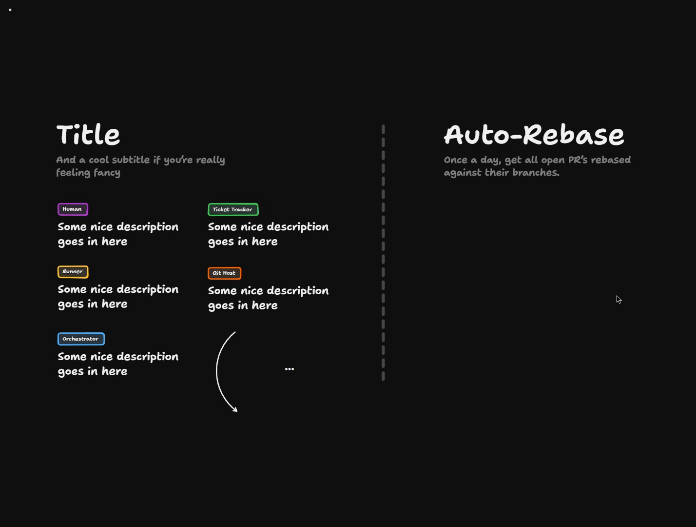

# The Morning Rebase

<Prerequisites title="Crash Course Prerequisites">
  <Prerequisite href="https://www.aihero.dev/workshops/ai-coding-crash-course/models-harnesses-agents-environments-2b9a99a1">
    What a runner spins up when it calls an agent: a model, a harness and an environment.
  </Prerequisite>
  <Prerequisite href="https://www.aihero.dev/workshops/ai-coding-crash-course/non-determinism-c31d9cdd">
    Why agents are unpredictable, so you try the deterministic rebase first and only call one in on failure.
  </Prerequisite>
  <Prerequisite href="https://www.aihero.dev/workshops/ai-coding-crash-course/how-much-did-it-cost-abb3ab6e">
    What an agent run costs, which is why you don't blast one at every PR.
  </Prerequisite>
  <Prerequisite href="https://www.aihero.dev/workshops/ai-coding-crash-course/set-up-your-issue-tracker-30629075">
    How the ticket tracker and Git host fit together on GitHub.
  </Prerequisite>
</Prerequisites>

Sometimes PRs get left out to dry on the PR list. A PR that's two weeks old sits while the codebase churns underneath it, and nobody is sure what it takes to get it ready to go.

Your task is to design a [software factory](https://www.aihero.dev/ai-coding-dictionary/software-factory) task called Auto-Rebase. Once a day, maybe at midnight, all open PRs get rebased against their branches. By morning, the merge conflicts should hopefully be solved.

This is a whiteboard exercise. There's no code to write, and you'll draw the design yourself.

## Steps To Complete

### Set Up Your Board

- [ ] Open the [board in TLDraw](https://www.tldraw.com/p/H1qN_Q3Tov1uSuWLRg3Nq) and find the Auto-Rebase heading

The board is read-only, so copy it into your own files first: click the three little dots in the top left and choose **Copy to my files**.

The heading reads "Once a day, get all open PR's rebased against their branches."

- [ ] Use the template on the left of the board as a style key

It shows the five role tags you should draw with:

- Human
- [Ticket](https://www.aihero.dev/ai-coding-dictionary/ticket) Tracker
- Runner
- Git Host
- Orchestrator

### Design The Flow

- [ ] Draw the Auto-Rebase task using those role tags

Show what happens from the once-a-day trigger through to a PR that is ready in the morning. Label each box with what that role does.

- [ ] Think carefully about determinism

Don't blast [agents](https://www.aihero.dev/ai-coding-dictionary/agent) at everything. A rebase can be tried once deterministically before an agent has to turn up. There's a version of this where no agent is needed at all.

- [ ] Decide where the agent only gets involved when it has to

Work out which step happens first, which happens only on failure, and what that means for your diagram.

### Handle What Can Go Wrong

- [ ] Account for merge conflicts

A rebase can produce merge conflicts. Decide what happens to the PR when it does.

- [ ] Account for PRs that are totally out of date or have been superseded

Decide what the factory should do with a PR that probably shouldn't be rebased at all.

### Think About Runners

- [ ] Decide how work is split across runners

There could be 100 PRs that all need sorting out at once. Does one runner handle all 100? Probably not. Decide what each individual runner does and show it on the board.

### Check Your Work

- [ ] Review your diagram against the questions

Check that your design answers these:

- Is a deterministic rebase attempted before any agent runs?
- What happens on a merge conflict?
- What happens to an out-of-date or superseded PR?
- What does each runner handle?

When you're happy with it, move on to the solution video and compare.
