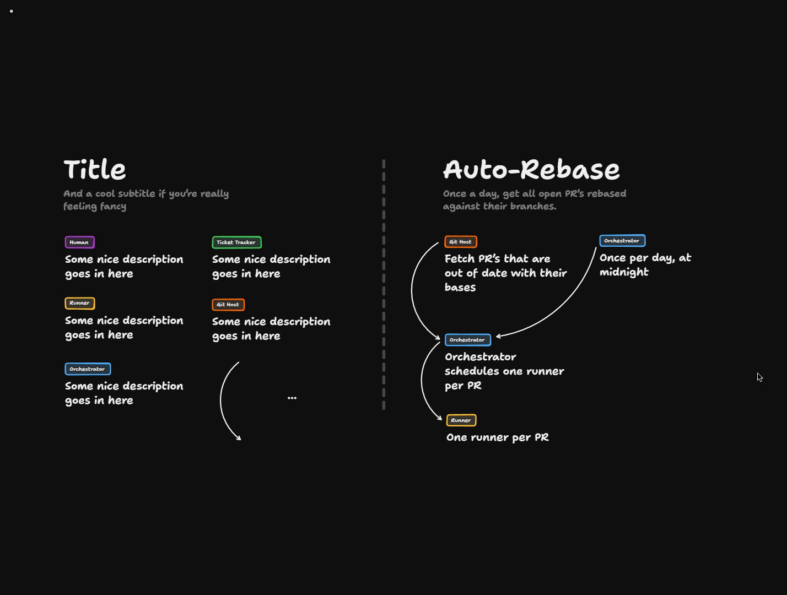
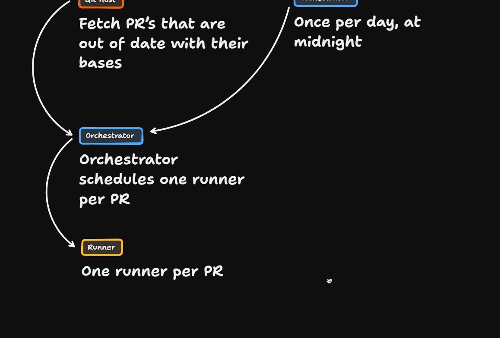
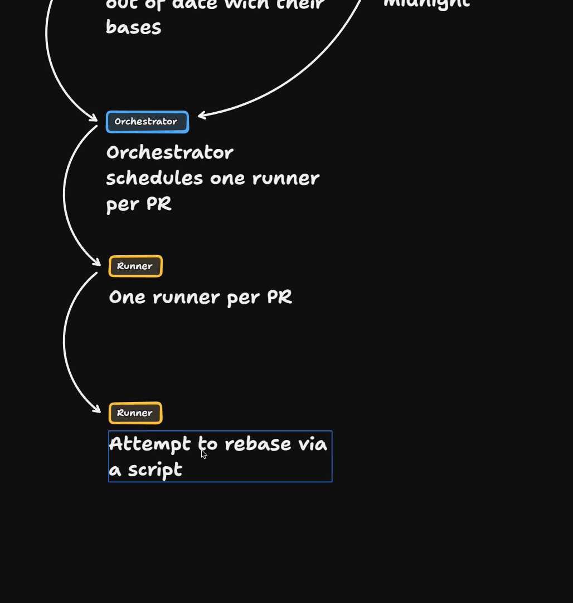
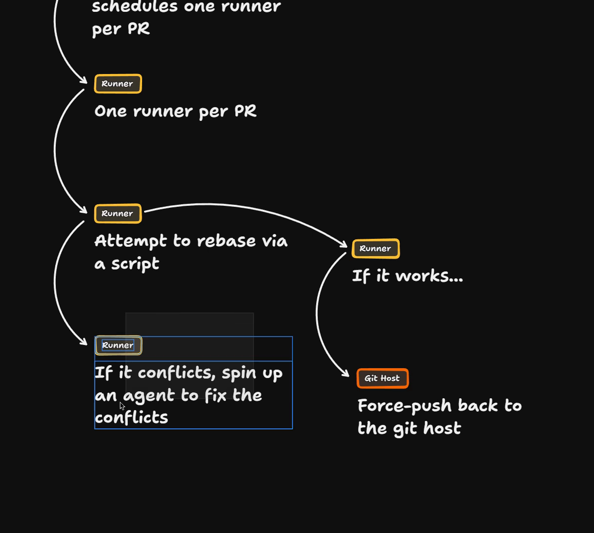
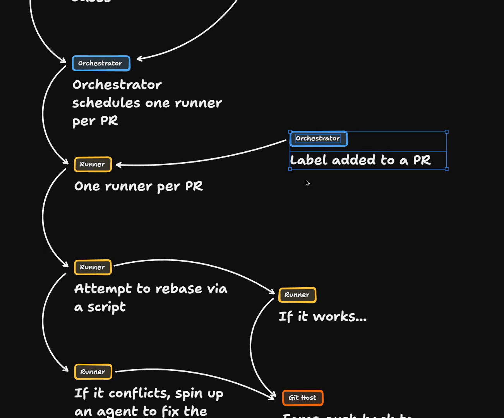
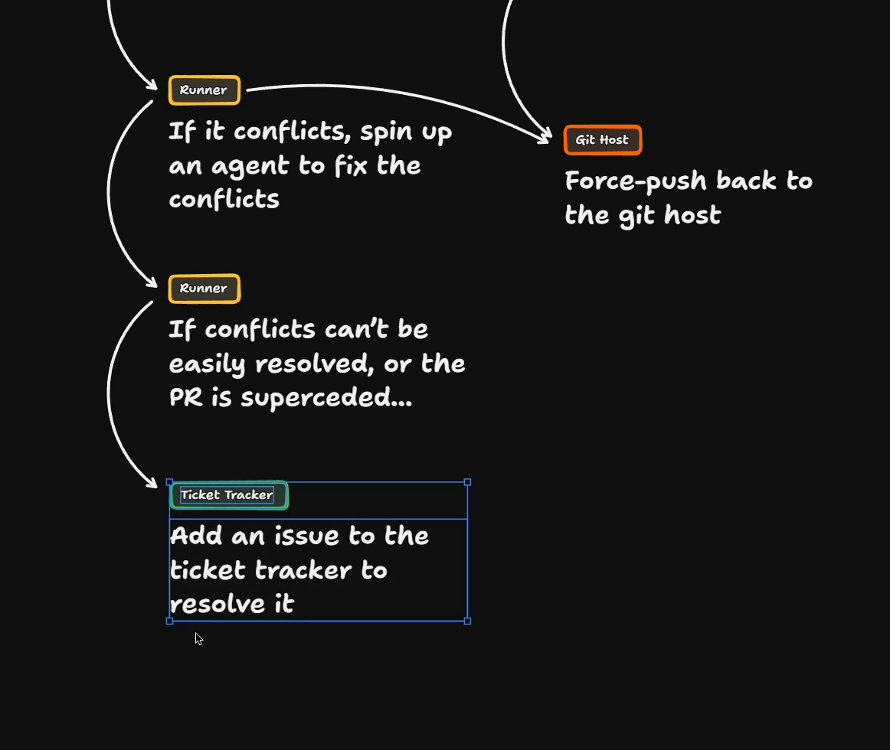
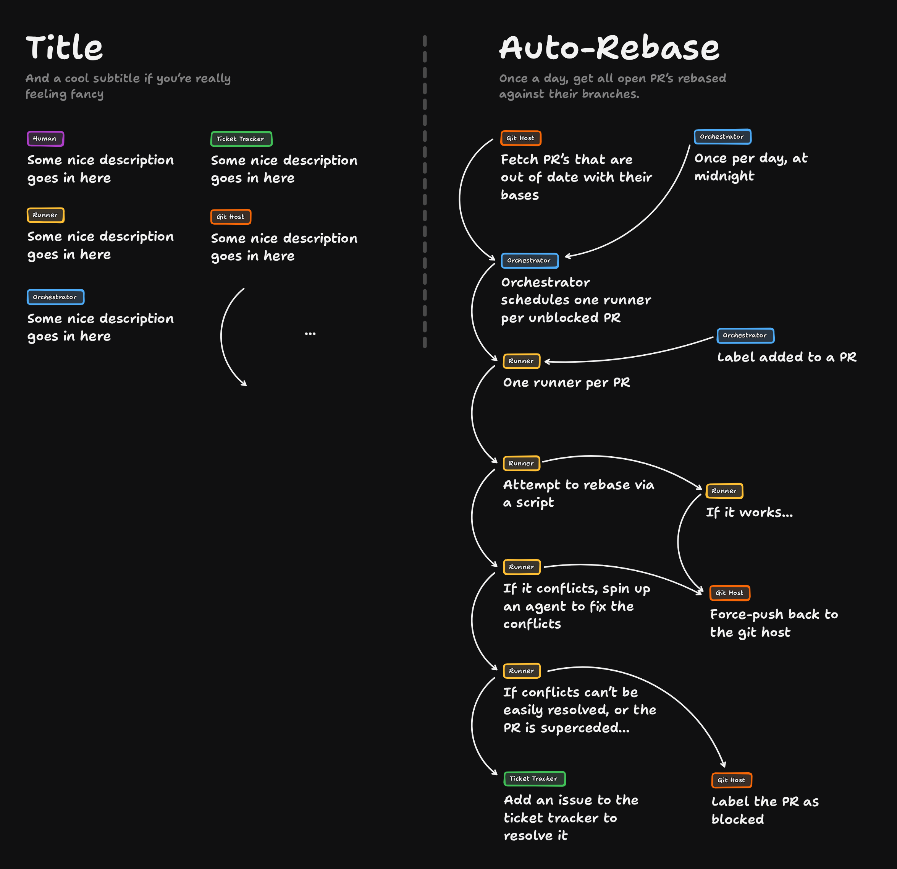

# The Morning Rebase Solution

This is the solution to The Morning Rebase. The whole screen is a whiteboard, so there is no code here, only a diagram of the Auto-Rebase [factory](https://www.aihero.dev/ai-coding-dictionary/software-factory) growing one box at a time. You can [open the board in TLDraw](https://www.tldraw.com/p/Y_-kF2v3VMVvujXYZwKmj) to pan and zoom around it.

## Fetching out-of-date PRs

We start with the idea that we fetch PRs that are out of date with their bases from the Git host.

We're going to do that once a day at midnight. We're assuming midnight is a safe moment to do this. If all of our devs are on the same time zone, we don't need to worry about finding a slot.

Depending on how we design it, this might be safe enough to run during the day. But midnight CI is probably going to be a bit quieter. Makes sense to me.

## One runner per PR

This is the first thing we could potentially tweak. The orchestrator counts all of those PRs and then schedules one runner per PR.

The idea is that we'd only have PRs where the Git host, maybe GitHub, has flagged that there are merge conflicts. So we end up with one runner per PR.

So what are we actually going to do inside that runner?

## Try a deterministic rebase first

The first thing we'll try is to attempt to rebase via a script.

At this point there's no [agent](https://www.aihero.dev/ai-coding-dictionary/agent) involved yet. We just attempt the rebase deterministically.

For many pull requests, this will be absolutely fine. Sometimes GitHub can just get out of sync with the branch it's targeting. All you need is to manually run a rebase, accept everything, and it all just works.

If it does work, we can force push back to the Git host and our work is done. We don't even need to spend any [tokens](https://www.aihero.dev/ai-coding-dictionary/token) on this flow.

## Spin up an agent on conflicts

If there are conflicts, we need to spin up an agent at that moment to fix them.

If it manages to fix the conflicts, it force pushes back to the Git host. So whatever happens, we end up with this force push.

By the way, this force push is always `--force-with-lease`. This means it only lands if nobody has pushed to that PR since the run read it.

This is basically our happy path. For every single PR, once a day at midnight, we've managed to solve it. We've updated all of the branches at once.

## A second trigger: labels

We may want to add a second trigger. If we add a label to a PR, we probably want to schedule a runner too.

Once a day at midnight is not going to be often enough for some workflows. Say you merge one PR, but another PR conflicts with it. You might add a label to those PRs to make sure they are up to date.

## The non-happy path

We should think about the non-happy path as well.

At the step where the agent is trying to fix the conflicts, what if it can't? We might also need to check whether this PR has been superseded by work that's currently on main.

If the conflicts can't be easily resolved, or the PR is superseded, we probably need to assign it to a human. So we go back to the [ticket](https://www.aihero.dev/ai-coding-dictionary/ticket) tracker, our place for things humans need to look at. We add an issue to the ticket tracker to resolve it.

We also want a bit of visibility in the Git host, so we label the PR as blocked.

That blocked label should feed back into the orchestrator, so the orchestrator picks up only the unblocked stuff.

There you go. The orchestrator schedules one runner per unblocked PR.

I'm imagining those blocked labels would be really helpful for people scanning the PRs to see which are current and which aren't.

Here's the finished board. You can also [open it in TLDraw](https://www.tldraw.com/p/Y_-kF2v3VMVvujXYZwKmj).

## Accelerating or decelerating

Just as we've done before, let's see how we might accelerate or decelerate this.

I think the only way to do that is the loop. You could run it once every couple of days, once a week, or only when there's a certain number of PRs. There are lots of start conditions.

We're also only fetching a certain number of relevant PRs, which is a bit of a brake on this too.

I'm not terribly sure about one runner per PR. We always need a runner, even to run the rebase via a script, because we need the code in order to test that the rebase works.

Since it's pretty cheap to spin up runners, I've taken the lazy route and gone with one runner per PR. Nice and simple.

## What we've learned

- **Multiple triggers.** Either a label being added to a PR, or the orchestrator calling it once a day.
- **Filtering in the orchestrator.** It only fetches relevant stuff.
- **Branching logic.** Lots of different things could happen out of the run.
- **Determinism first.** We're not passing it to an agent straight away. We try to resolve it with a script if we can. If there are conflicts, we pass that immediately to an agent.
- **The error path.** If the conflict can't easily be resolved, what do we do in those messy situations? Only then do we involve a human.

If you have the option for determinism, take it, or at least give it a go.

## Keep the ticket tracker and Git host in sync

We're thinking about the state in the ticket tracker as well as the Git host. Whatever the user is looking at, they want to see all the data in one place.

It can be really frustrating if tickets are not in sync with the Git host, say if you're looking in Linear and GitLab.

So when we think about these scripts, we often need to think about synchronizing that state and making sure everything matches up.

## Wrapping up

Overall, I would love to use this. Imagine waking up in the morning and knowing that every single PR was ready to go, with no messing about.

It's the kind of basic factory stuff that just makes sense and makes your whole work life easier.

Nice work, and I will see you in the next one.
