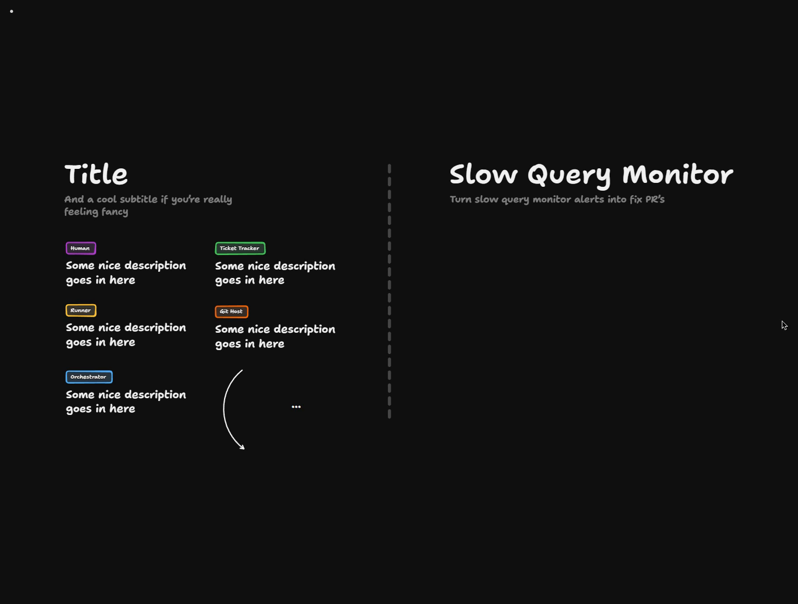
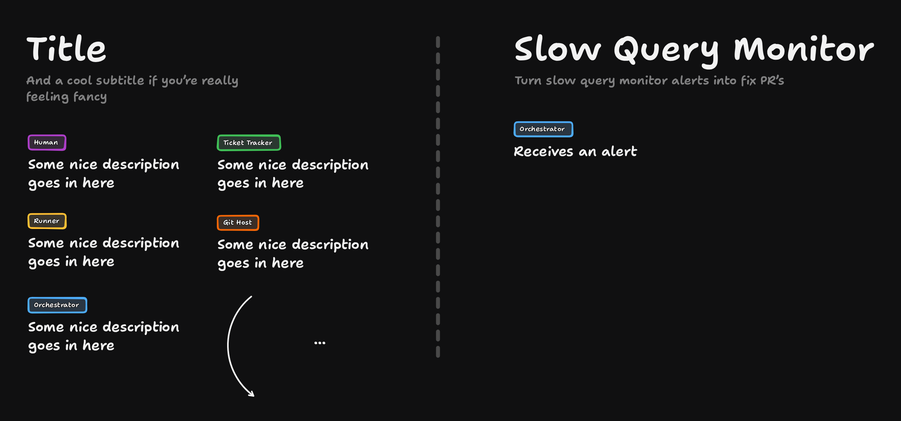

# The Slow-Query Monitor

<Prerequisites title="Crash Course Prerequisites">
  <Prerequisite href="https://www.aihero.dev/workshops/ai-coding-crash-course/models-harnesses-agents-environments-2b9a99a1">
    What a runner is running when it picks up an alert: an agent, made of a model, a harness and an environment.
  </Prerequisite>
  <Prerequisite href="https://www.aihero.dev/workshops/ai-coding-crash-course/how-much-did-it-cost-abb3ab6e">
    How tokens turn into cost, so you can see why one runner per alert burns your budget.
  </Prerequisite>
  <Prerequisite href="https://www.aihero.dev/workshops/ai-coding-crash-course/set-up-your-issue-tracker-30629075">
    How tickets live in a tracker, which is where your alerts can queue up and get deduplicated.
  </Prerequisite>
</Prerequisites>

Most applications have external sources doing some kind of monitoring. Bug reports fire when errors happen, and [ticket](https://www.aihero.dev/ai-coding-dictionary/ticket) trackers get integrations that create tickets when certain things occur.

The one I find most useful is a slow query monitor on my database. I'm not a database expert, so I often need help working out which indexes to add and how to design the database for speed.

This is a design exercise. You'll sketch a [software factory](https://www.aihero.dev/ai-coding-dictionary/software-factory) that turns slow query alerts into fix PRs, and make sure it can't burn through your [tokens](https://www.aihero.dev/ai-coding-dictionary/token).

## Steps To Complete

### Set Up The Board

- [ ] Open the board in TLDraw: [Open the board in TLDraw](https://www.tldraw.com/p/Y7RbVZ9OhDWeMuC522vcl)

The board is read-only, so copy it into your own files first: click the three little dots in the top left and choose **Copy to my files**.

The design side of the board has a heading, "Slow Query Monitor", and a subtitle, "Turn slow query monitor alerts into fix PR's". The template on the left is a style key with one example box per role: Human, Ticket Tracker, Runner, Git Host and Orchestrator.

- [ ] Add an **Orchestrator** box under the heading that reads "Receives an alert"

Imagine the slow query monitor has been hooked up to your orchestrator. Whenever there's a slow query in the database, the orchestrator receives an alert.

### Face The Challenge

- [ ] Consider that you don't know how often the slow query monitor will ping

The alert source is outside your control. It might fire once a day, or it might fire constantly.

- [ ] Work out why spawning one runner per alert is a problem

If the monitor pings frequently and each ping spawns a runner, you burn tokens uselessly.

- [ ] Decide what should sit between the alert and the runners, and add it to the board

Use the roles from the style key (Human, Ticket Tracker, Runner, Git Host, Orchestrator) and draw arrows between them. The orchestrator currently has no arrows leading out of it.

- [ ] Check your design against the challenge

Your design needs to be robust. An input source with an unknown trigger rate shouldn't be able to slam your system or destroy your token budget, however often it fires.

When you're done, compare your design with the solution in the next lesson.
