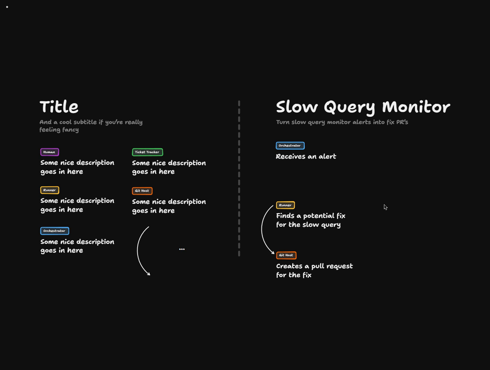
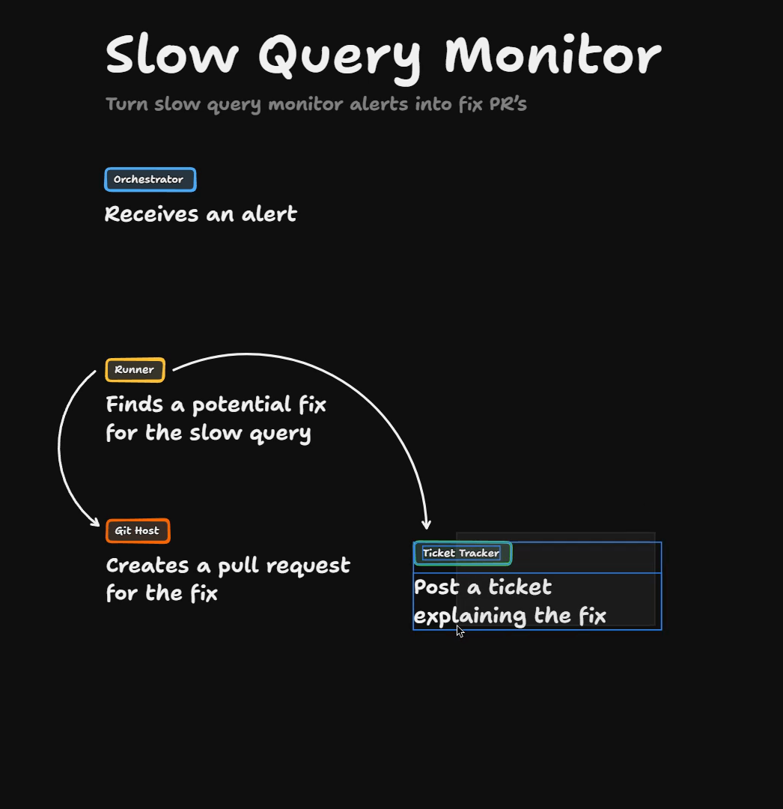
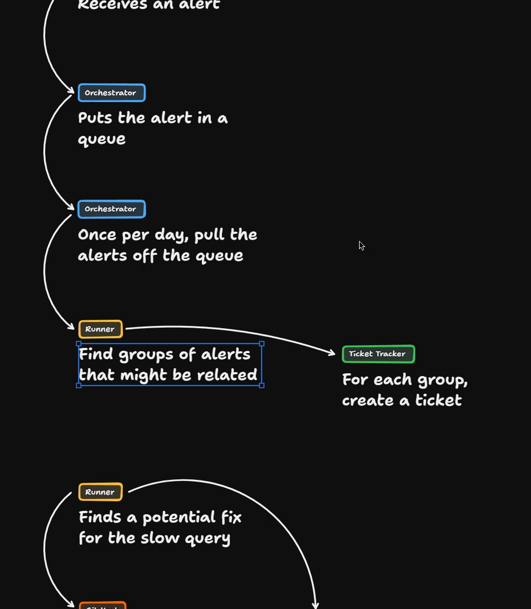
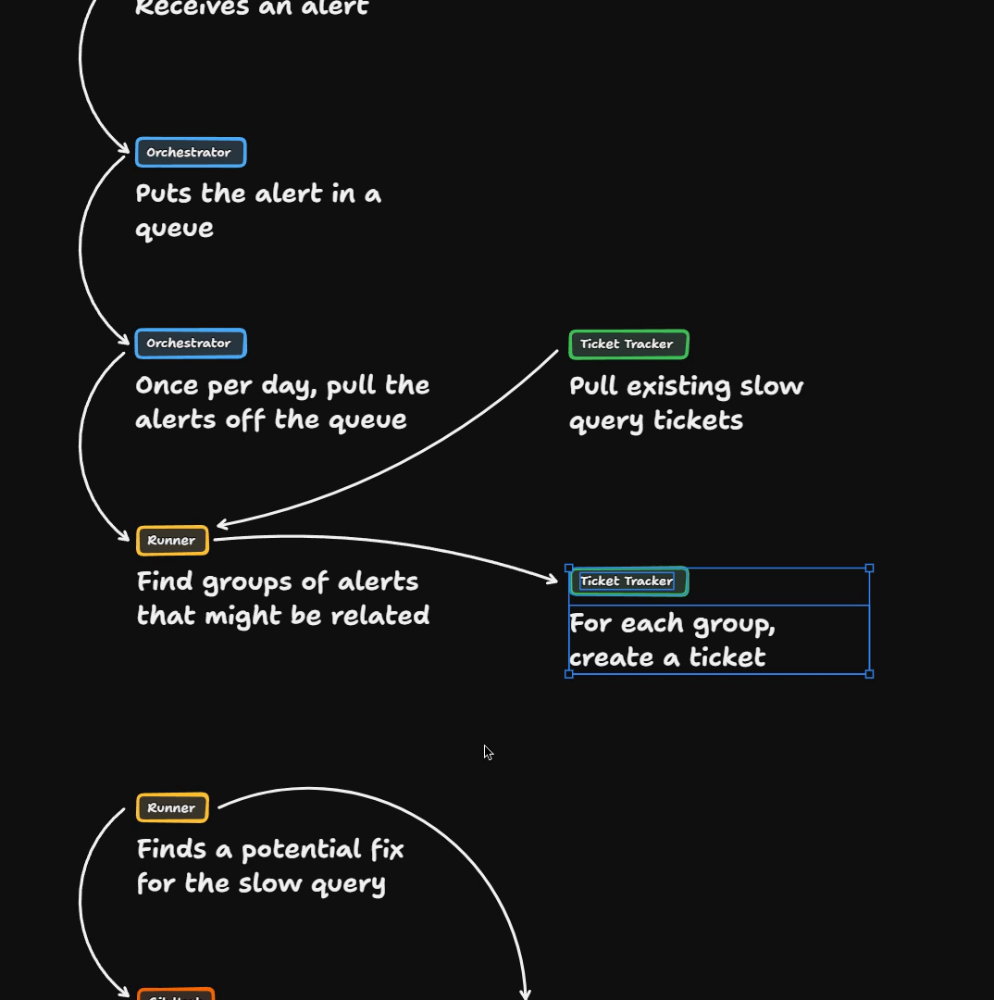
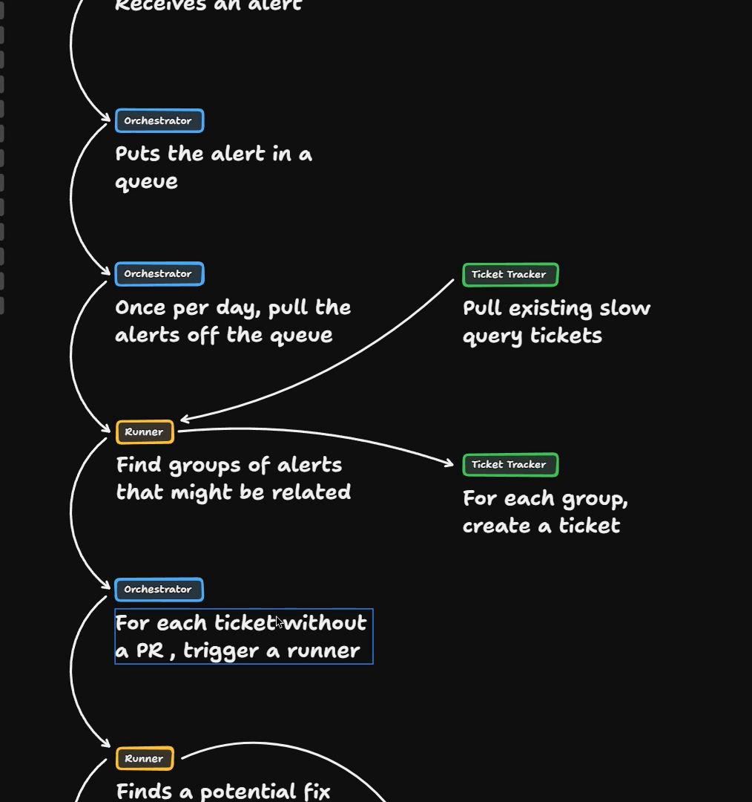
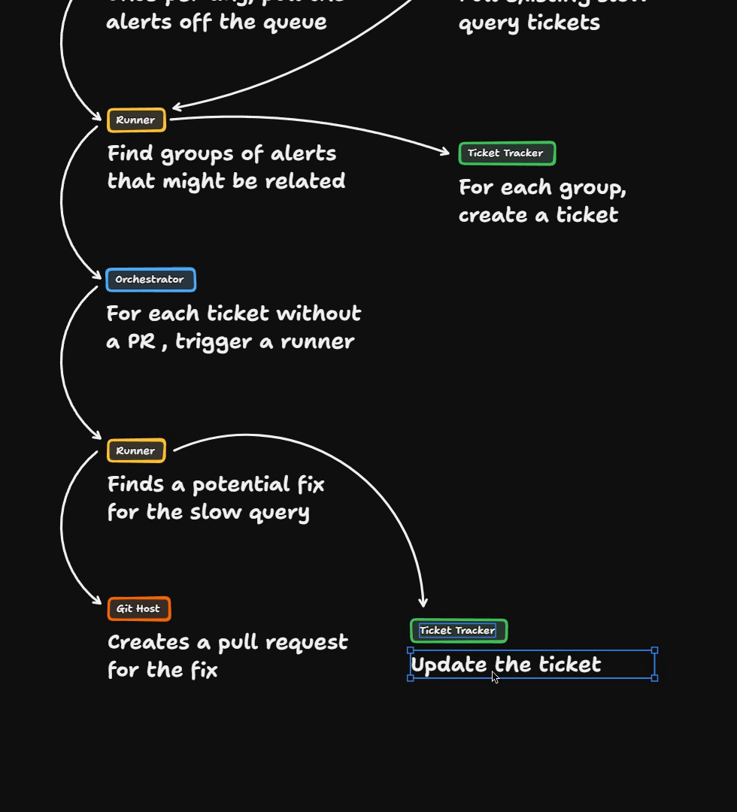
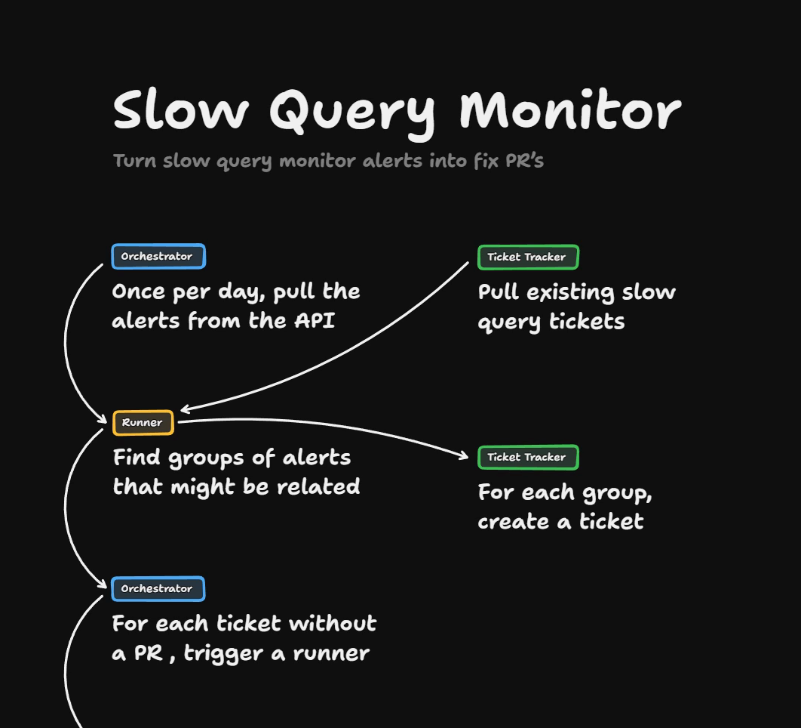
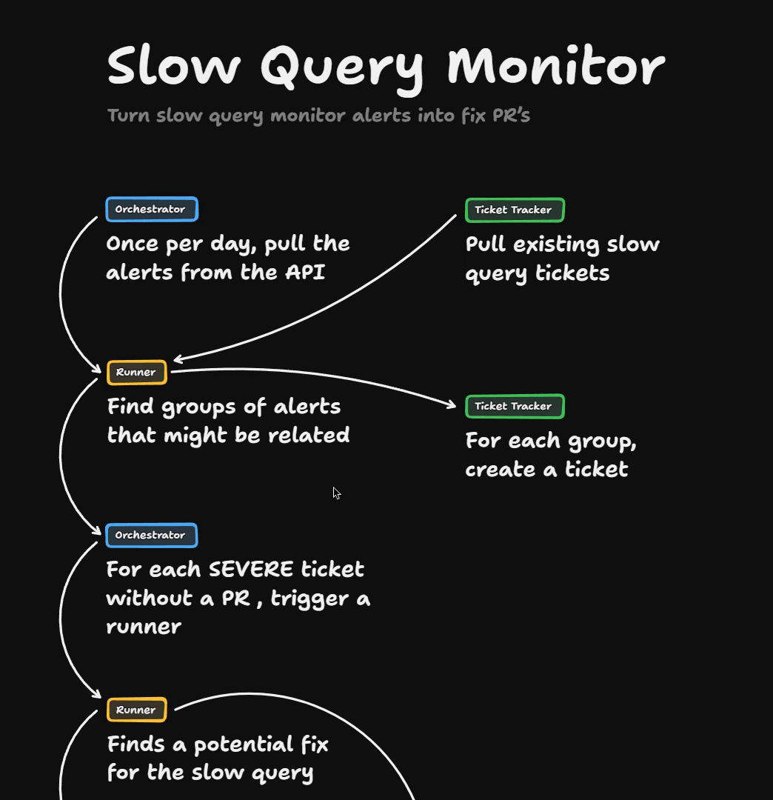
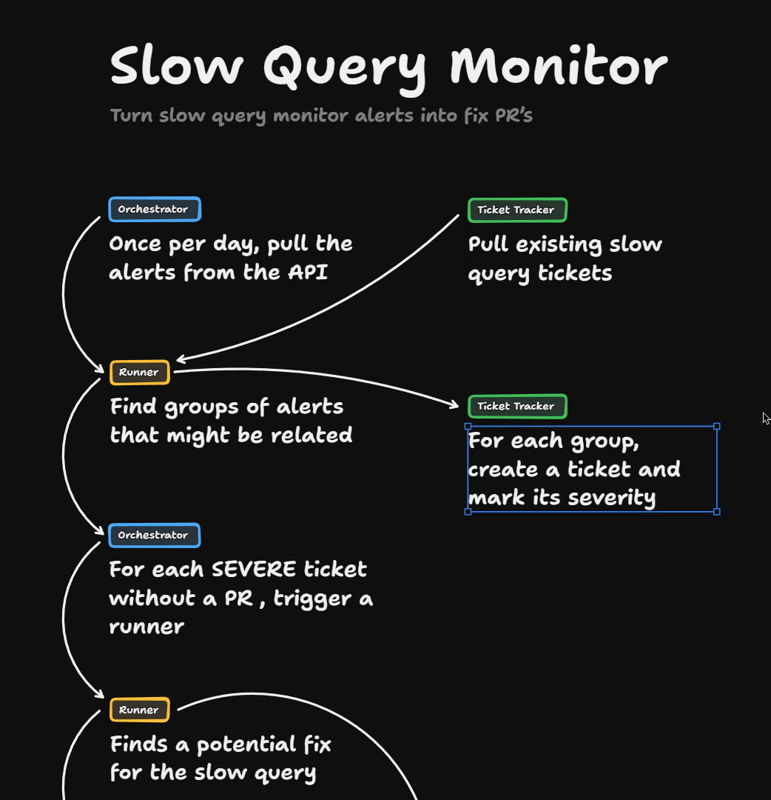
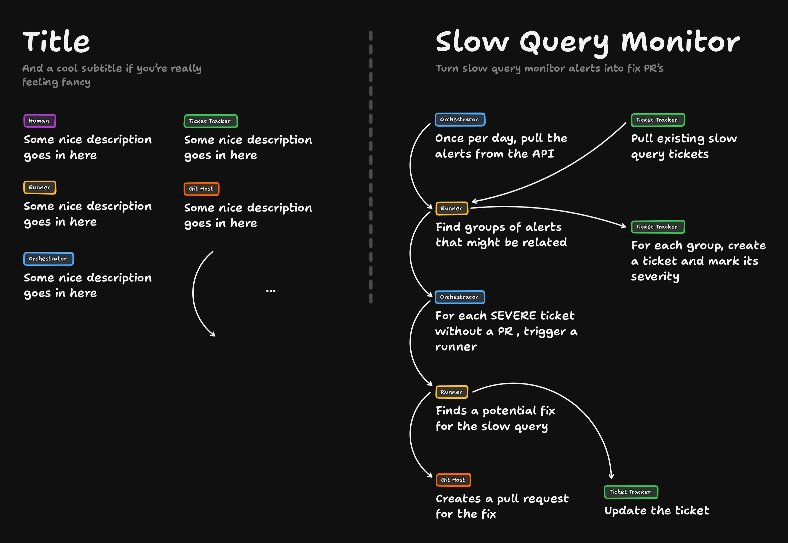

# The Slow-Query Monitor Solution

We start from the board the Problem left us with. It has a single box, an orchestrator that "Receives an alert". The interactive version is here: [Open the board in TLDraw](https://www.tldraw.com/p/NbErBozFoijRiQprLbUBv).

I'm going to start with the really easy part. At some point the end goal is for the runner to find a potential fix for the slow query, then create a pull request.

I think we also want it to post a [ticket](https://www.aihero.dev/ai-coding-dictionary/ticket) explaining the fix. That depends on how linked up your Git host and your ticket tracker are.

The question then becomes: how do we get this runner to figure all this out?

## Why pushing alerts is a problem

As covered in the problem, the naive way is for the orchestrator to receive an alert and spawn a runner directly.

But that is acceleration beyond our control. If we receive 100 alerts, we get 100 runners. That's no good.

The actual problem is that our orchestrator is being pushed these alerts. Because they are pushed, it has no control over their pace.

## Putting the alerts in a queue

What makes sense to me is putting the alert in some kind of queue. Then once a day, our orchestrator can pull the alerts off the queue.

Once it has them, a lot of those alerts are probably the same underlying problem. So we spawn a runner to find groups of alerts that might be related. Then, for each group, we create a ticket.

## Avoiding duplicate tickets

We probably want to prevent creating a bunch of duplicate tickets. So we may need to pull in any existing slow query tickets. That lets us say: these alerts don't matter, because we've already got them tracked.

## Triggering the fix runner

Once that first runner has created the tickets, it reports back to the orchestrator. For every ticket without a PR, we trigger the runner we talked about earlier.

Now, instead of creating a new ticket to explain the fix, we just update the existing ticket.

This feels like a much better design. Instead of all the alerts battering our system, we put them in a queue.

We can then fiddle with the schedule:

- Maybe twice a day, or three times a day.
- Or maybe when there are more than 40 alerts.

## What the queue could be

The queue could be represented by anything. We might hook up our orchestrator to a database to capture the alerts.

Or the slow queries might be saved in the third-party service we're using. Say I'm using PlanetScale. We might be able to ping PlanetScale's API and ask which slow queries we've had recently.

## From push to pull

In other words, we might not need the alerts or the queue at all. We just have the orchestrator say, once a day, pull the alerts off the queue.

Or, phrased better: once a day, pull the alerts directly from the API. That replaces the whole queue.

| | Push system | Pull system |
| --- | --- | --- |
| Who starts the work | The third-party source | Our [factory](https://www.aihero.dev/ai-coding-dictionary/software-factory) |
| Control over pace | None | A lot |

What we had before was a push system, pushing to our [agent](https://www.aihero.dev/ai-coding-dictionary/agent). We have much more control when we use a pull system, where our factory pulls from the third-party source.

## Filtering by severity

One danger I can see is the ticket tracker filling up with loads of slow query tickets.

So inside the step that finds groups of alerts that might be related, you might also do a severity check.

Similar to the agent explore step we saw before, this little runner would deliver a verdict on each of the groups.

That verdict might be severe or mild. If the problem gets worse as you add more data to the system, a ticket might go from mild to severe.

The orchestrator then only implements the severe problems. That is another filter, so you're not pushing too fast or crowding your ticket tracker with irrelevant guff.

## The whole loop

That gives us the whole loop:

1. We have a pull system, and pull the alerts in.
2. We group and rate them.
3. We only fix the severe ones.

The ticket tracker holds a lot of state here. We're putting in a bunch of slow query tickets and slowly fixing them over time. The ability to filter them is really important, so labels are going to be crucial too.

Here is the finished board. You can also [open it in TLDraw](https://www.tldraw.com/p/NbErBozFoijRiQprLbUBv).

## Other uses for this pattern

This pattern is going to be useful for any outside data that tracks the health of your application:

- Performance monitoring.
- Logs.
- Errors coming up in your application.

You end up with a system that reads the metrics about your application and finds improvements for them over time. That sounds pretty sweet.

Nice work, and I'll see you in the next one.
