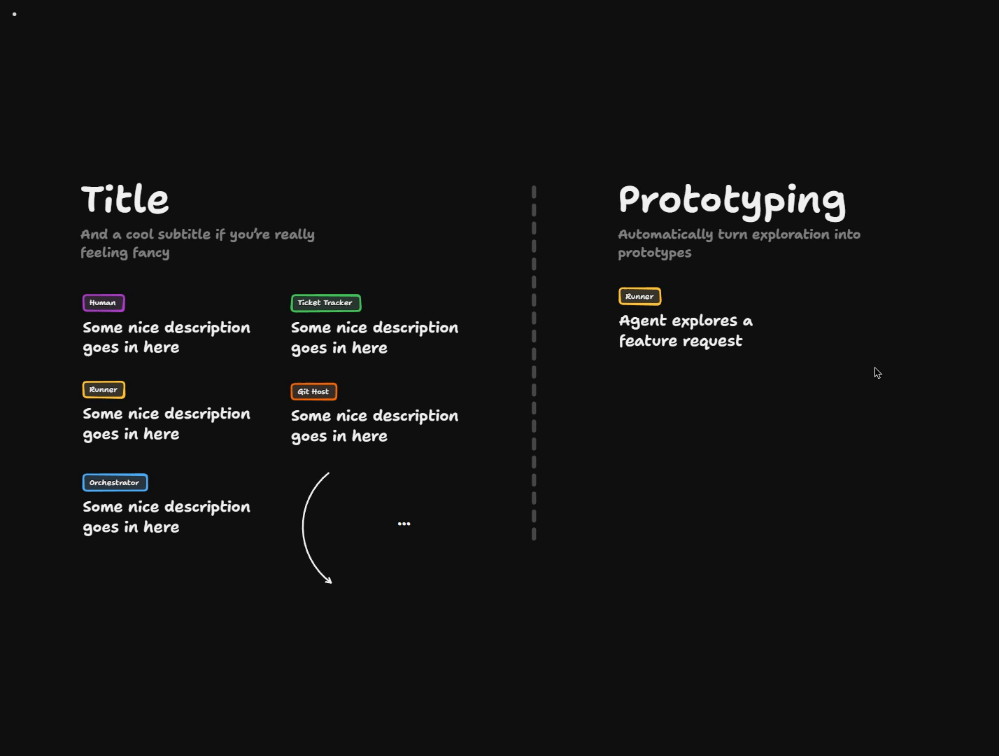
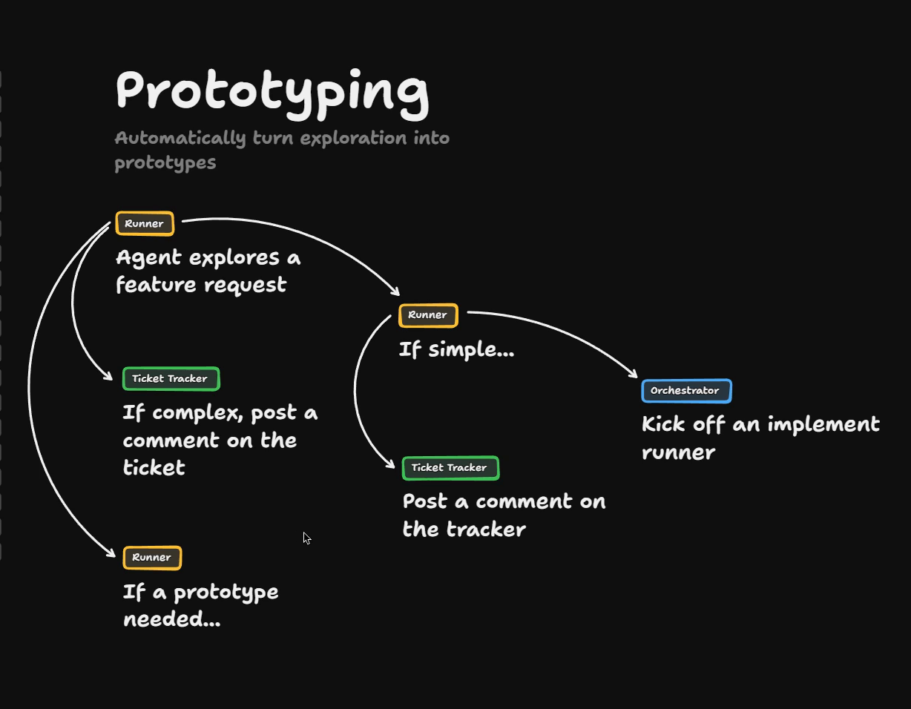

# Prototyping

<Prerequisites title="Crash Course Prerequisites">
  <Prerequisite href="https://www.aihero.dev/workshops/ai-coding-crash-course/why-plan-mode-sucks-2d6ef1a6">
    Why you align on a shared design concept before building, which is what a prototype gives you.
  </Prerequisite>
  <Prerequisite href="https://www.aihero.dev/workshops/ai-coding-crash-course/the-grill-execute-clear-loop-fac85414">
    How grilling gets you to that shared understanding, the step a prototype speeds up.
  </Prerequisite>
  <Prerequisite href="https://www.aihero.dev/workshops/ai-coding-crash-course/set-up-your-issue-tracker-30629075">
    How GitHub issues work as the ticket tracker where people comment on the prototype.
  </Prerequisite>
  <Prerequisite href="https://www.aihero.dev/workshops/ai-coding-crash-course/where-you-go-from-here-4c6bb9b1">
    Where prototyping fits among the next steps beyond the five-step system.
  </Prerequisite>
</Prerequisites>

So far, our [software factory](https://www.aihero.dev/ai-coding-dictionary/software-factory) has been about bug reports and codebase improvements. We haven't looked at how a factory can help you build features.

Let's add [prototyping](https://www.aihero.dev/ai-coding-dictionary/prototyping). Getting a prototype in early is hugely valuable, and [agents](https://www.aihero.dev/ai-coding-dictionary/agent) are good at building them, especially when they kick one off themselves from an exploration.

The hard part isn't producing the first prototype. It's that a prototype needs iteration, and that loop has to run through the factory.

## Steps To Complete

### Review the starting board

- [ ] Open the board and find the **Runner** box reading "Agent explores a feature request"

[Open the board in TLDraw](https://www.tldraw.com/p/XtkLvS2agaKH3wK_UgdOq)

The board is read-only, so copy it into your own files first: click the three little dots in the top left and choose **Copy to my files**.

The legend on the left defines the five roles you'll use for every box: **Human**, **[Ticket](https://www.aihero.dev/ai-coding-dictionary/ticket) Tracker**, **Runner**, **Git Host** and **Orchestrator**.

- [ ] Look at the two existing verdicts coming out of the exploration

- **If complex:** a comment is posted on the ticket.
- **If simple:** an implement runner is kicked off, a comment is posted on the tracker, and the work goes through the implement and review flow.

### Add the third verdict

- [ ] Find the **Runner** box "If a prototype needed…"

This is the new verdict. It isn't simple and it isn't complex. It's visual, and it needs a prototype to move the discussion forward.

Nothing comes after it yet. Your job is to finish this branch.

- [ ] Draw what happens when a prototype is needed

Instead of only leaving a comment to review, the factory should produce a rich asset that people can look at. Decide which roles take part, and what each one does to get the first prototype out.

### Design the iteration loop

- [ ] Draw how comments about the prototype turn into updates to it

This is the tricky part. The Orchestrator needs to pick up comments made about the prototype and turn them into updates.

Think about where the comments are made, who makes them, and which role reacts to them.

- [ ] Make sure the flow is a loop, not a straight line

Just like when you mess about with a prototype locally, you should be able to keep changing it. Through the Ticket Tracker, non-technical people can do this too.

- [ ] Check that a non-technical person could drive the loop

Their throwaway prototypes are rich input for the rest of your factory. Your diagram should make clear where they take part, without them needing to touch code.

### Compare your design

- [ ] Check your board against the roles in the legend

Every box should use one of the five role tags, with a line of text under it. Once you're happy, move on to the solution to compare.
