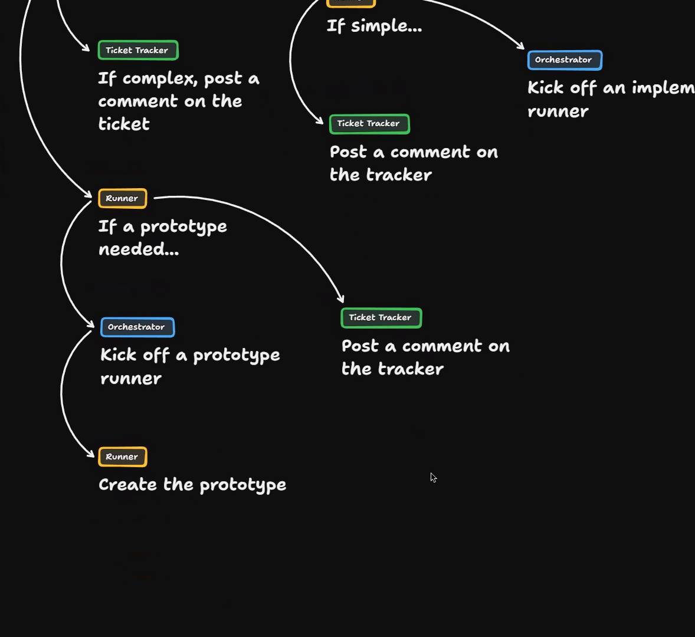
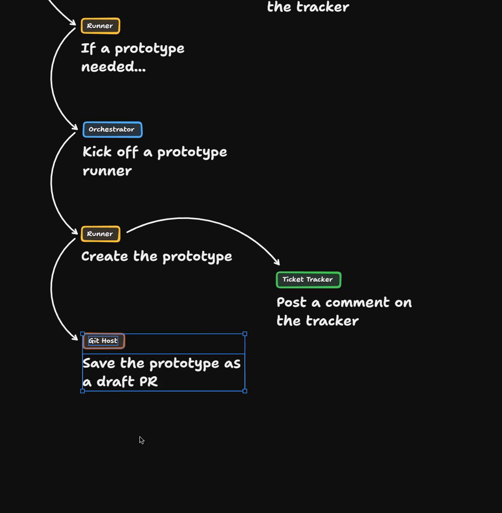
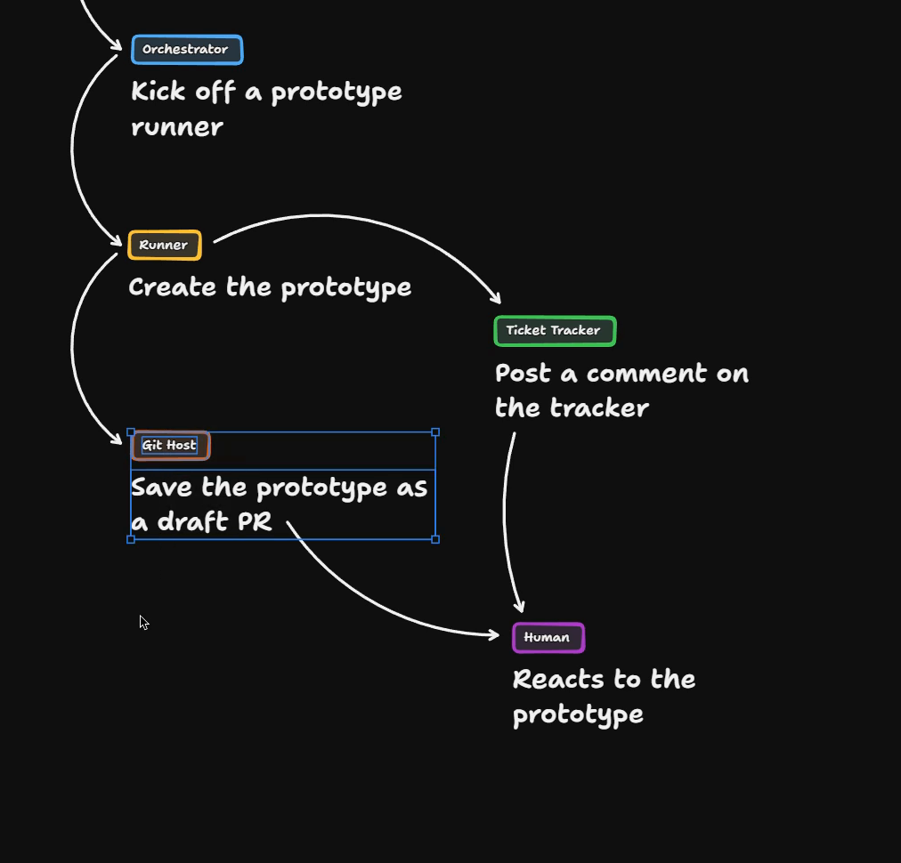
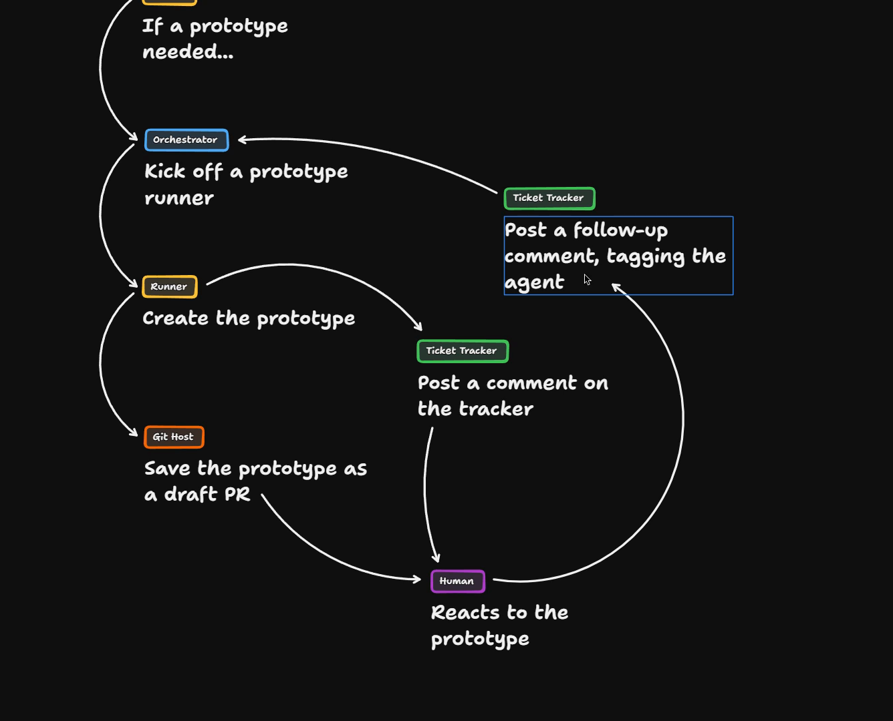
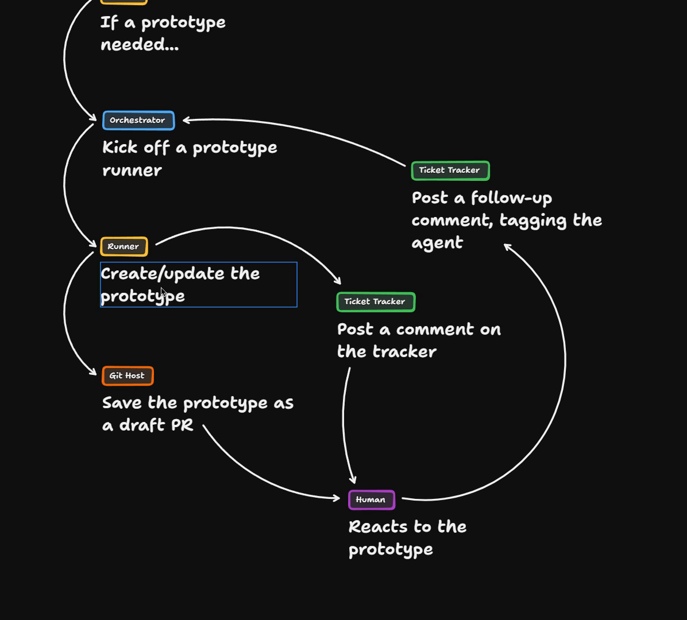
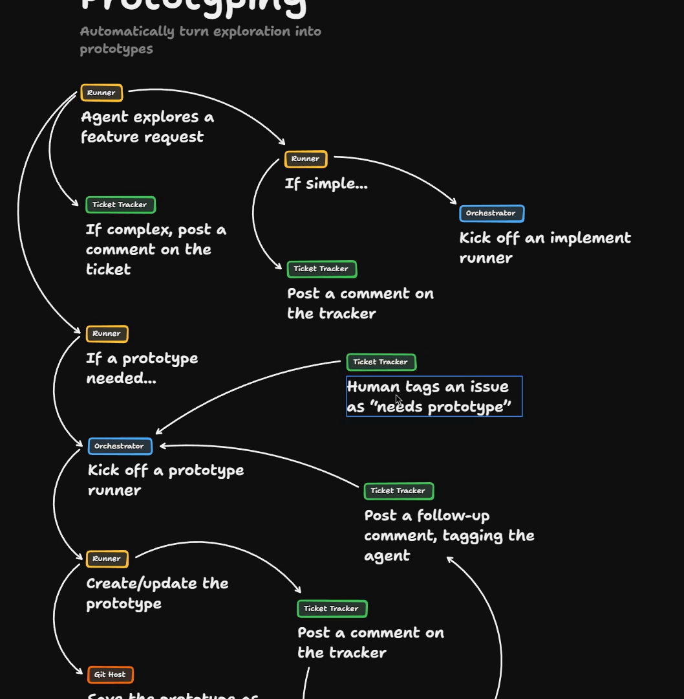
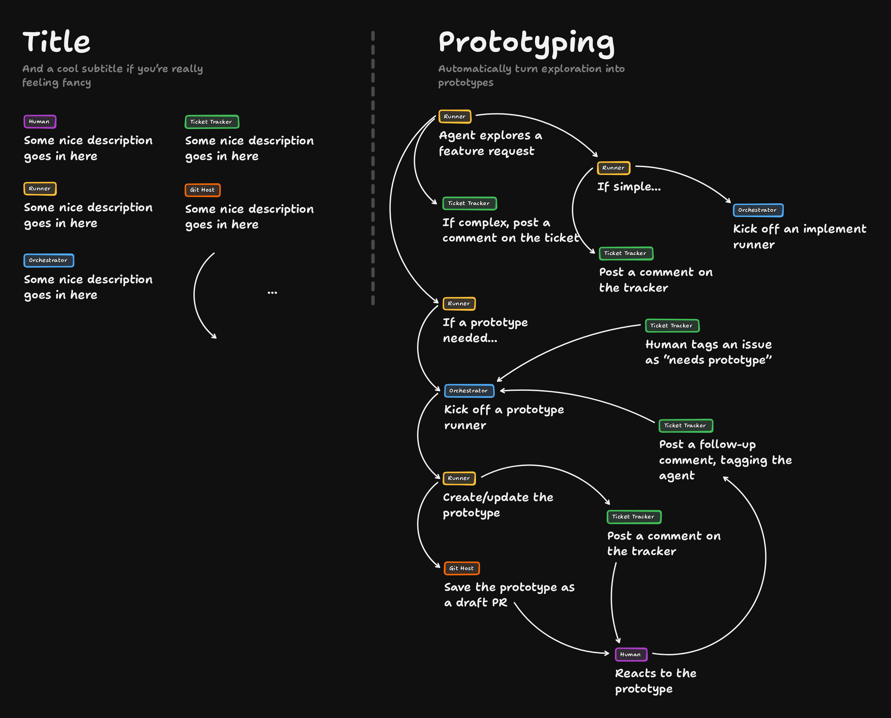

# Prototyping Solution

We pick up on the Prototyping board with one branch still open. The hook is the runner step "If a prototype needed…".

[Open the board in TLDraw](https://www.tldraw.com/p/OEaxgxXKKzWWN8klUXQ3r)

If a [prototype](https://www.aihero.dev/ai-coding-dictionary/prototyping) is needed, we need to kick off a prototype runner. That runner then creates the prototype, and ideally it deploys it somewhere.

Deploying it means that even a non-technical person can view the prototype and click through everything the prototype [skill](https://www.aihero.dev/ai-coding-dictionary/skill) gives you. Then they can give feedback.

## Ship the comment after the prototype exists

It only makes sense to post the comment on the tracker once the prototype has actually been created.

The code for the prototype also needs to live somewhere. A draft PR is a sensible home for it.

It should be labeled specifically, so people know not to try to merge it.

At this point the issue has been explored. A comment has been posted back to the tracker with a link to the prototype.

## The human reacts

Next, the human reacts to the prototype. They probably don't look at the code, but they certainly look at the deployed asset.

They are also contacted through the [ticket](https://www.aihero.dev/ai-coding-dictionary/ticket) tracker. The message is roughly: you were interested in this feature request, come back, there's something here you might want to look at.

## Closing the loop

We want to go back through the loop. In other words, we want to get from the human's reaction all the way back up to the prototype runner.

The human reacts to the prototype and transmits some information. We then kick off another prototype runner, which looks at the existing prototype and goes through the loop again.

One reasonable way to do this:

1. The human reacts to the prototype.
2. They post a follow-up comment on the ticket tracker.
3. They tag the [agent](https://www.aihero.dev/ai-coding-dictionary/agent) explicitly.

That kicks off another prototype runner. It has the existing prototype and all the comments made so far. The tracker comments form the conversation history the runner needs to recreate the prototype.

I've modified the runner box to say **Create/update the prototype**, since it might be modifying an existing one.

This means the orchestrator needs to be clever enough to receive two different types of signals:

- There is already an existing prototype.
- There is no prototype at all.

## A human route in

There's one more addition. Currently the only way to kick this off is for an agent to explore a feature request and decide that a prototype is needed.

I'm adding a ticket tracker watcher. A human tags an issue as "needs prototype".

In other words, there's a shortcut: this needs a prototype, so go away and fix it up.

## The finished prototyping loop

There we have our prototyping loop.

[Open the board in TLDraw](https://www.tldraw.com/p/OEaxgxXKKzWWN8klUXQ3r)

What it enables is not quite obvious. Someone can build a working prototype entirely by interacting with the ticket tracker.

- They don't need a local development environment.
- They don't need any real expertise.
- They can just keep reacting: I like this, I don't like this.

Once they're done, the result is inside the Git host as a draft PR. There is code for the actual developer to go and look at.

Crucially, the developer also has the entire history of the person's opinions and wants, just from the ticket tracker.

## Non-technical people and code

A lot of people ask me whether you should allow non-technical people to write code. In my opinion, yes. This is a really great way to get them into it.

The understanding is that what they're shipping is more like a very detailed [spec](https://www.aihero.dev/ai-coding-dictionary/spec) than working code.

If someone produced a prototype this way, I wouldn't expect it to go directly into production. It should be run through the proper system and get proper code review. It might also feed a [grilling](https://www.aihero.dev/ai-coding-dictionary/grilling) [session](https://www.aihero.dev/ai-coding-dictionary/session), or be part of a wayfinding session.

Either way, I think most organizations with people interested in creating prototypes should have a flow like this.

## What we've learned about designing workflows

What have we learned about designing workflows and [software factories](https://www.aihero.dev/ai-coding-dictionary/software-factory)?

- **The iterative loop.** A runner either creates or updates something. The orchestrator is then responsible for following up on the conversation and seeing how things are going. This demands a little complexity in your orchestrator. I've built it a couple of times in different orchestrators, and it's really not that hard.
- **A human route as well as an agent route.** If an agent can trigger a workflow, you probably also need a way for a human to trigger it.
- **The ticket tracker as a communication tool.** This workflow shows how useful the tracker is for human-to-agent communication.

Nice work, and I will see you in the next one.
