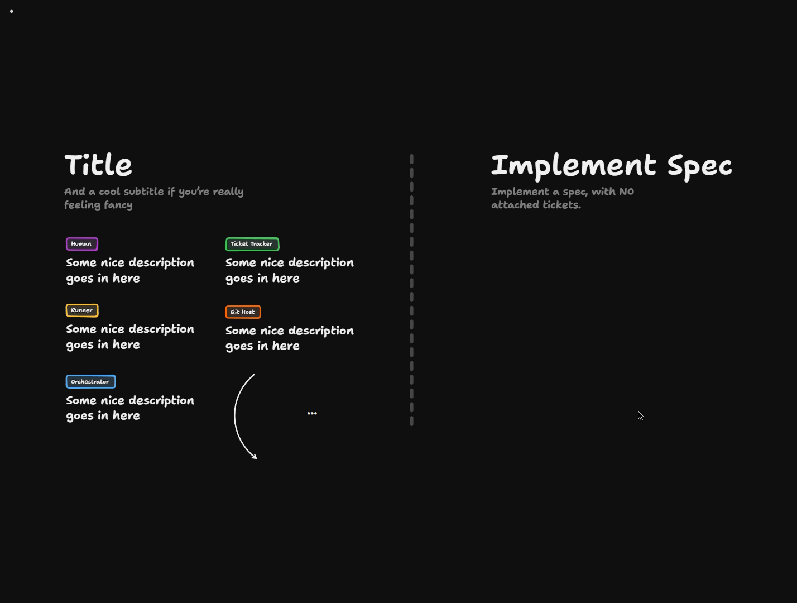

# Implement Spec

<Prerequisites title="Crash Course Prerequisites">
  <Prerequisite href="https://www.aihero.dev/workshops/ai-coding-crash-course/subagents-756fafe5">
    What a subagent is: a fresh context you hand work to, which is what each explorer, implementer and merger is.
  </Prerequisite>
  <Prerequisite href="https://www.aihero.dev/workshops/ai-coding-crash-course/how-to-tackle-massive-tasks-6199ee6b">
    Why big work splits into a spec and tickets that each fit in one context window.
  </Prerequisite>
  <Prerequisite href="https://www.aihero.dev/workshops/ai-coding-crash-course/write-great-specs-with-this-skill-362ad013">
    What a spec contains and how `/to-spec` writes one, the only input this design takes.
  </Prerequisite>
  <Prerequisite href="https://www.aihero.dev/workshops/ai-coding-crash-course/split-features-across-context-windows-with-tickets-d9aa8395">
    How `/to-tickets` splits a spec into vertical slices with blocking relationships, which is where the frontier comes from.
  </Prerequisite>
  <Prerequisite href="https://www.aihero.dev/workshops/ai-coding-crash-course/the-implement-spec-skill-47372df2">
    The `/implement-spec` skill you're turning into an orchestrator and runners.
  </Prerequisite>
</Prerequisites>

This is the most ambitious [Software Factory](https://www.aihero.dev/ai-coding-dictionary/software-factory) design so far: `/implement-spec`. We've covered bug fixes and [prototyping](https://www.aihero.dev/ai-coding-dictionary/prototyping), but not how to schedule a long [AFK](https://www.aihero.dev/ai-coding-dictionary/afk) run that produces a load of code.

Your job is to take the logic written as text inside the `/implement-spec` [skill](https://www.aihero.dev/ai-coding-dictionary/skill) and turn it into a deterministic set of runners driven by an orchestrator. It's going to be gnarly, but it becomes the beating heart of how features ship.

[Open the board in TLDraw](https://www.tldraw.com/p/j7EKdvEBztO8xiqwjAPuR)

The board is read-only, so copy it into your own files first: click the three little dots in the top left and choose **Copy to my files**.

## Steps To Complete

### Study the skill

- [ ] Read through every step of `.agents/skills/implement-spec/SKILL.md`

Work out how each step maps onto an orchestrator and its runners. Note which steps are [agent](https://www.aihero.dev/ai-coding-dictionary/agent) work and which are plain orchestration.

- [ ] Understand the task graph

The [tickets](https://www.aihero.dev/ai-coding-dictionary/ticket) are not a linear list of steps. They are a **task graph**, so there is always a **frontier** of tickets that are ready to be grabbed.

### Change the input

- [ ] Take only a [spec](https://www.aihero.dev/ai-coding-dictionary/spec) as input, with no attached tickets

The skill currently expects the result of `/to-spec` and `/to-tickets`. Instead, the agent should create its own tickets in the ticket tracker, then follow them.

### Design the runners

- [ ] Add an exploration step at the start

An exploration [subagent](https://www.aihero.dev/ai-coding-dictionary/subagent) saves markdown notes in a directory. Decide where that directory lives, and make sure all future subagents can access it.

- [ ] Implement everything on the frontier at the same time

Run implementer subagents concurrently, one per ready ticket.

- [ ] Merge finished work into the integration branch

Use merger subagents to merge each completed ticket. Think about what happens to the frontier after each merge.

- [ ] Kick off new implementers when the frontier changes

Keep going until every ticket is complete.

- [ ] (Optional) Add a review pass

Finish with a review on the integration branch. You can leave this out for simplicity, since you've already seen it in action.

### Check your design

- [ ] Walk through a spec end to end

Trace a spec from input to integration branch and confirm each step in the skill has a home in your orchestrator or runners. This is the "night shift" that piles up the code you wayfound on the day shift.
