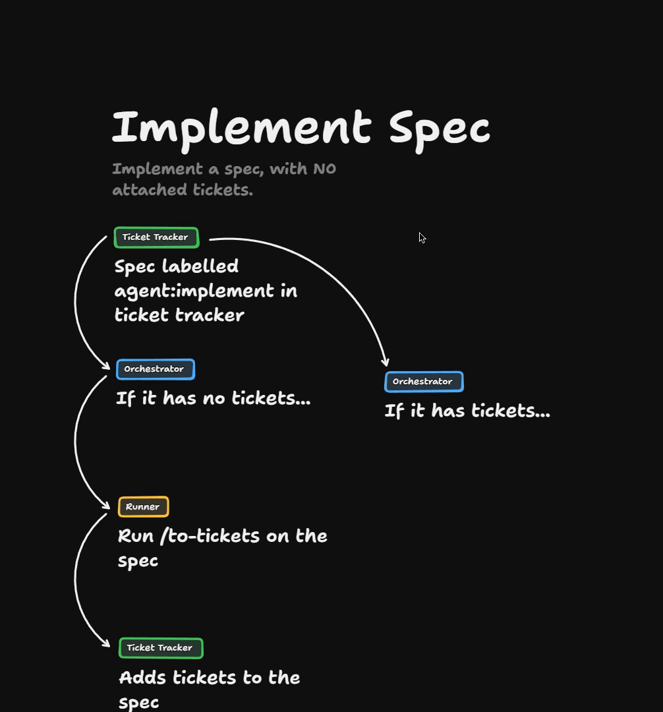
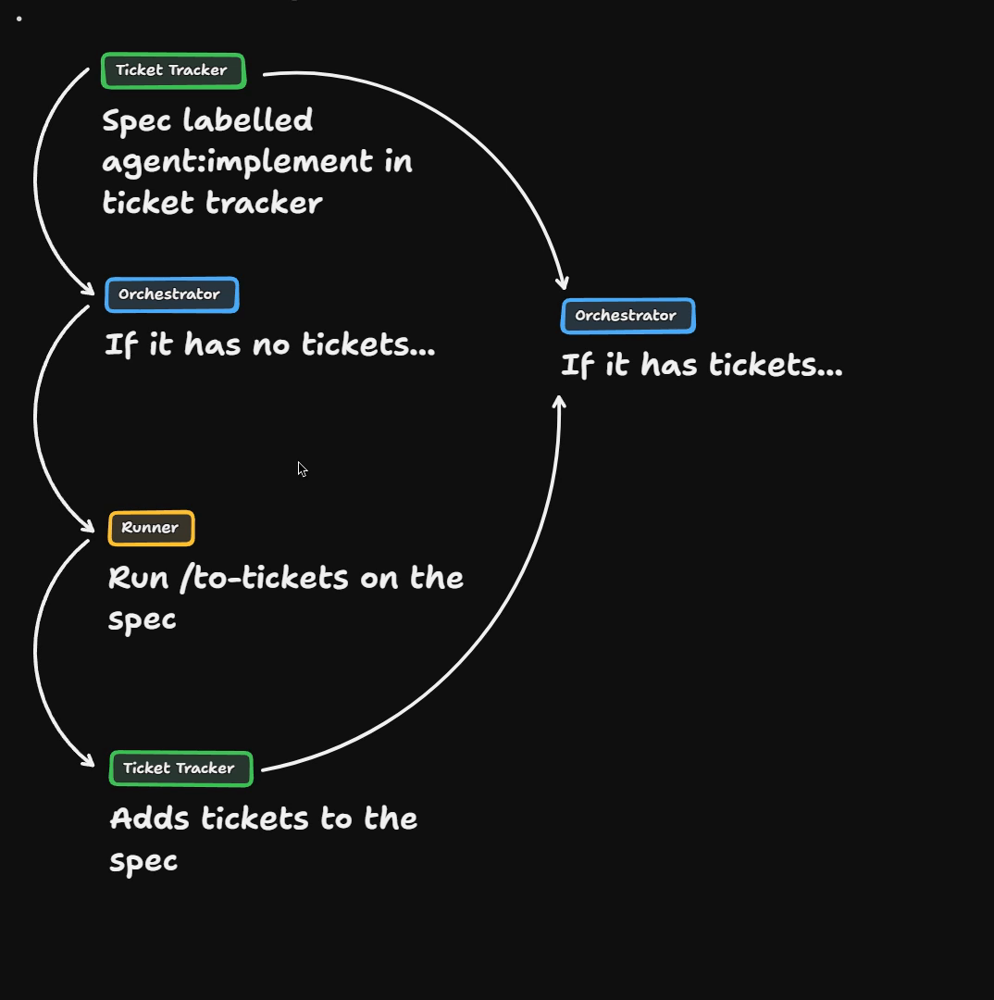
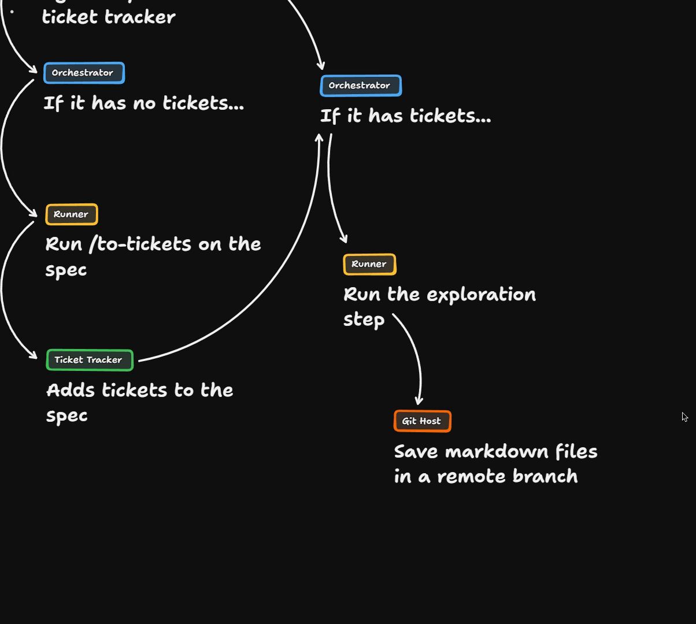
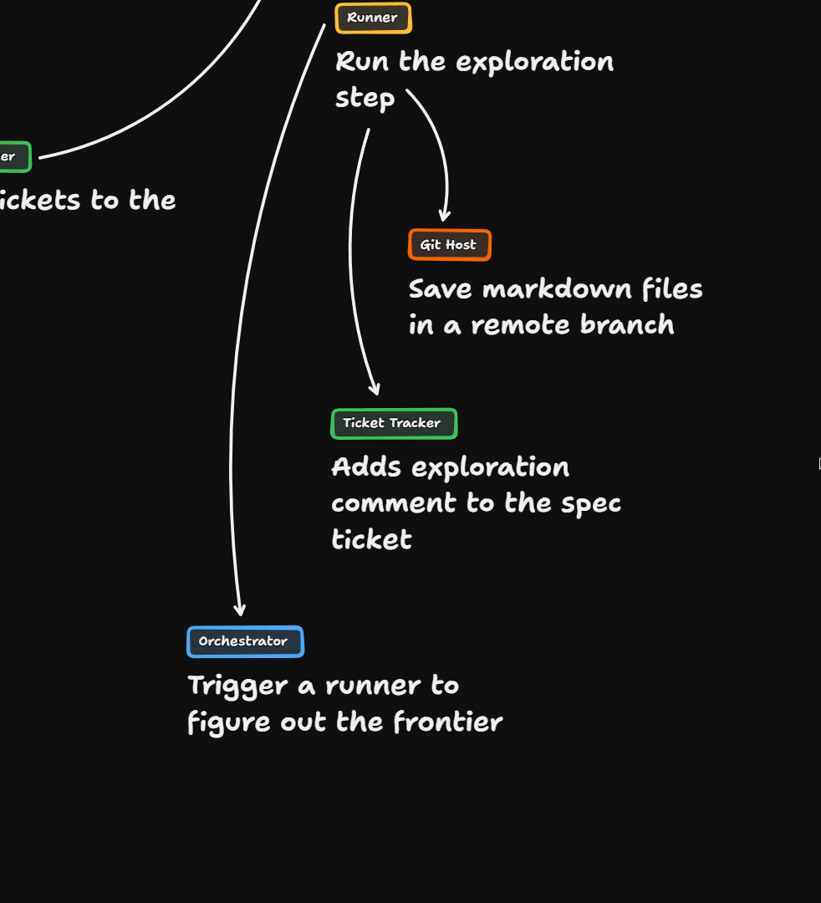
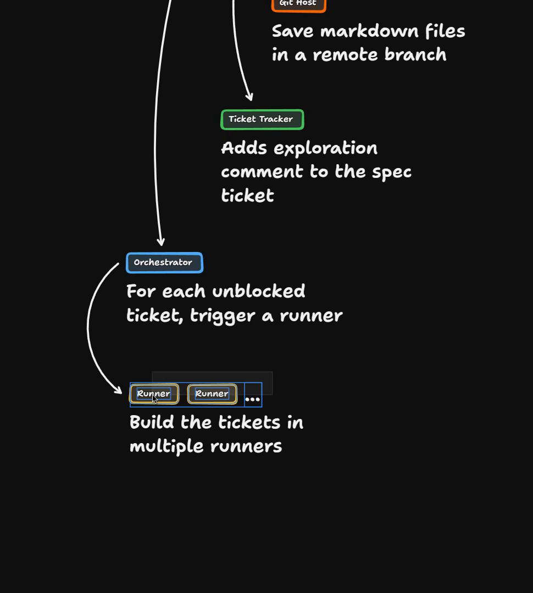
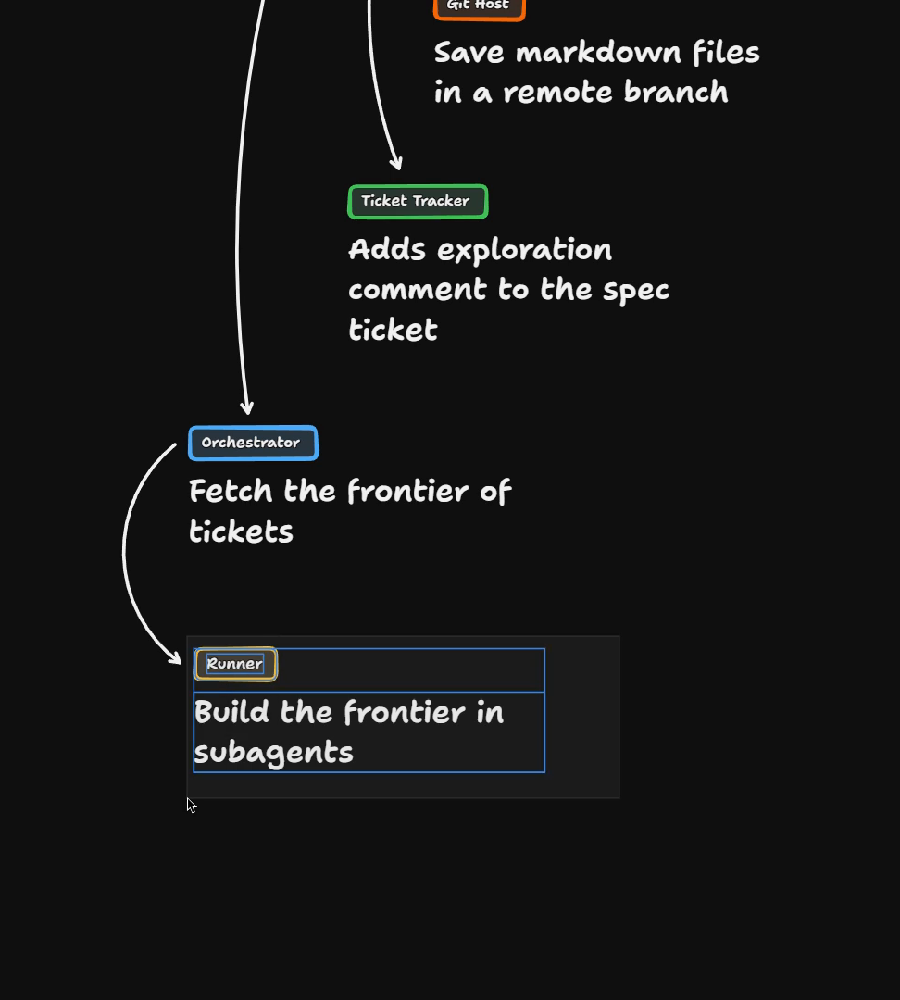
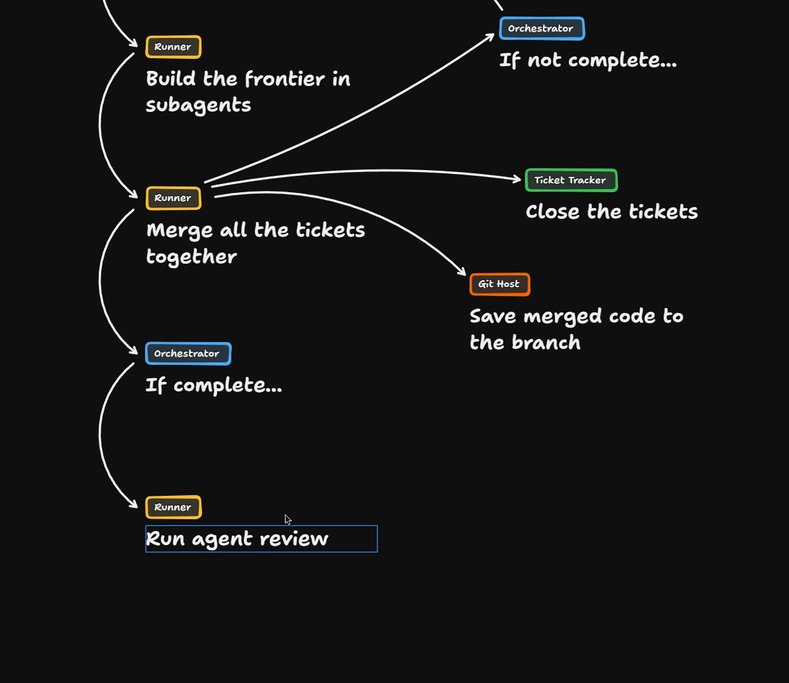
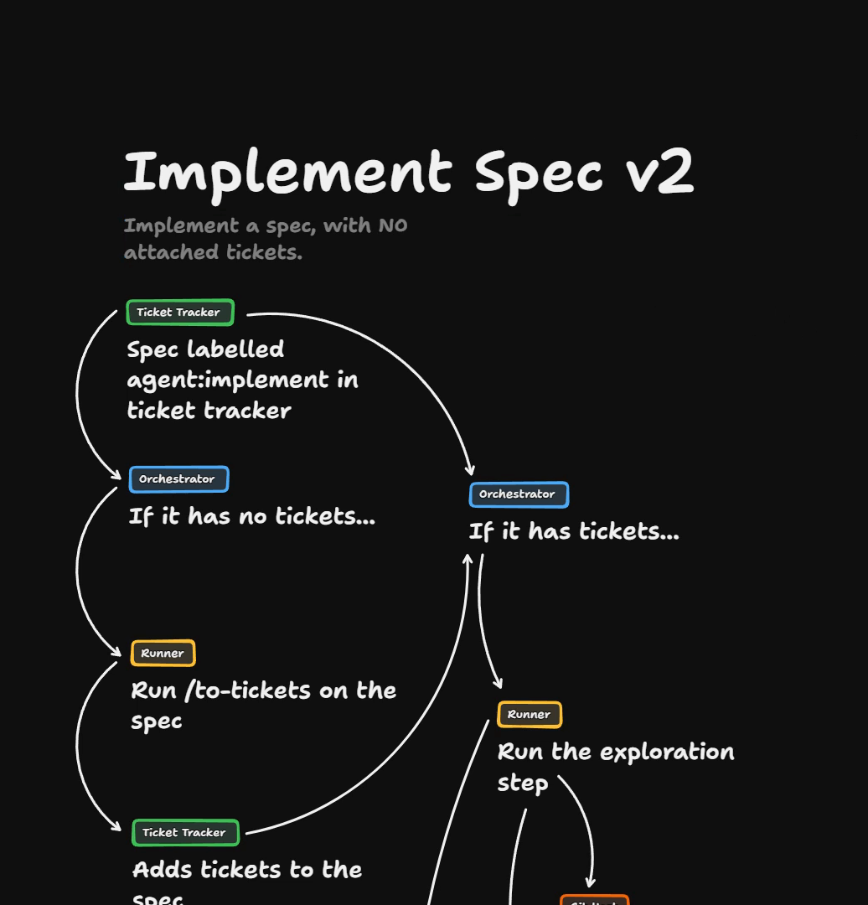
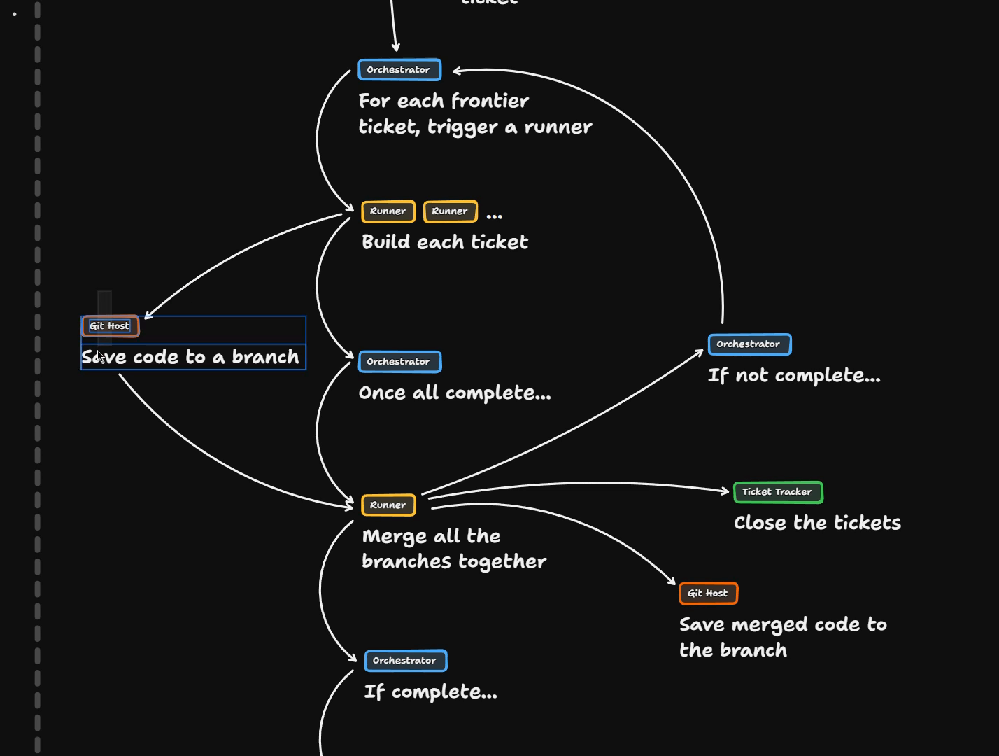
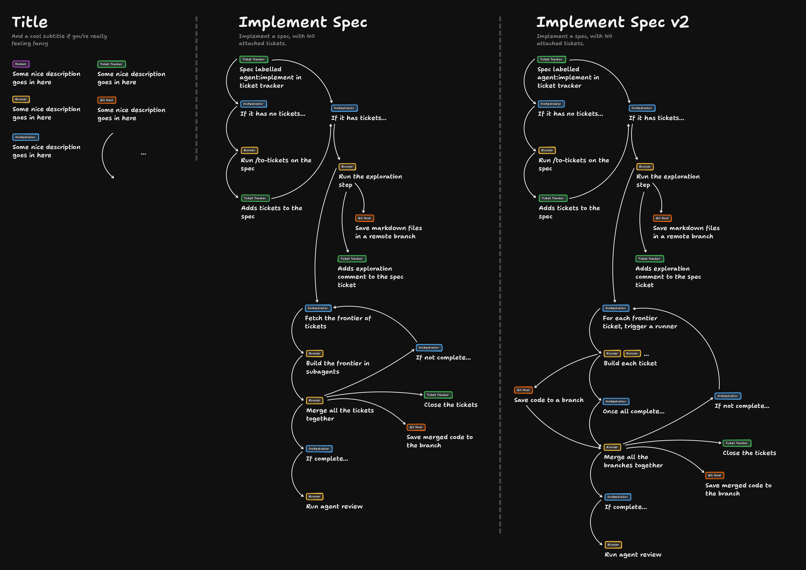

# Implement Spec Solution

This is the solution to the Implement Spec exercise. Everything here happens on a whiteboard, so there is no code to run. You can [open the board in TLDraw](https://www.tldraw.com/p/t7xPJ8TPCnFgghI8MhGir) to pan and zoom around it.

We draw two designs for `/implement-spec`. The first uses one runner per frontier. The second uses one runner per [ticket](https://www.aihero.dev/ai-coding-dictionary/ticket).

## Starting from a labelled spec

We store our [specs](https://www.aihero.dev/ai-coding-dictionary/spec) in the ticket tracker, as we have been doing. Imagine someone has labelled the spec with `agent:implement` or similar. Or maybe they have assigned it to their [agent](https://www.aihero.dev/ai-coding-dictionary/agent). Either way, the orchestrator has been alerted.

## The to-tickets loop

One thing I like is not having to worry about the tickets anymore.

When I figure out my destination, the spec, that's when I want to step away. I can't be bothered to think about the tickets. Sometimes it's useful to go through them and check there aren't too many or too few, especially if your runs are resource intensive.

But sometimes I just want to say: if the spec has no tickets, schedule a runner to go and add the tickets to it.

This is really useful when specs come in from `/improve-codebase-architecture` loops. You don't want to clone the spec down, run `/to-tickets` on it, and so on. Just label it and have the [factory](https://www.aihero.dev/ai-coding-dictionary/software-factory) create the tickets itself.

By the end of this process, we have run `/to-tickets` on the spec and we're back at the start of our loop.

## The exploration step

The spec now has tickets, so we need to kick off an exploration runner.

The exploration step explores the spec and the repo, and saves some information in markdown files.

How do we store those markdown files? We could put them in a draft PR that we later have to close. I prefer to put them in a remote branch. We clean that branch up at some future stage, long after the spec is gone.

Along with that, we add an exploration comment to the spec ticket. The comment points to the markdown files.

Every future runner gets access to three things:

- The entire spec
- Their individual ticket
- The exploration markdown file set

Commenting on the spec in the ticket tracker is how they find out about the exploration files.

## Figuring out the frontier

Once the exploration is done, we need to figure out the frontier of tickets.

We might not need an agent for this. The tickets have blocking relationships between them, and those can be worked out deterministically.

We saw this in Wayfinder, where tickets block other tickets. This is just that.

So it's simple: for each unblocked ticket, trigger a runner.

## Design one: a single runner per frontier

One option is a whole bunch of runners, n of them, that build the tickets.

Or you could have a single runner per frontier. Here, the orchestrator fetches the frontier of tickets. Inside that runner, you build the entire frontier, and you tell it to do this in [subagents](https://www.aihero.dev/ai-coding-dictionary/subagent) inside the [sandbox](https://www.aihero.dev/ai-coding-dictionary/sandbox).

The benefit is that the runner has all of the branches set up locally. You then just merge all the tickets together.

From there:

1. Close the tickets in the ticket tracker.
2. Push all of the merged code to the branch itself.
3. If there are still uncompleted tickets, go back into the loop. Keep going until all the tickets are closed.

If you are complete, you run the agent review and go through that chain.

That completes this version of implement spec. It's a pretty tasty one.

## The problem with one runner per frontier

I do want to diagram what it looks like if we run each ticket in a separate runner, because it's slightly more complex.

The version we have now works if you have a really powerful runner. It would need to run five versions of your app and five of your test suite at once.

But these runners are usually not that powerful. You probably want to spec your runner so it can run just one of your apps.

## Design two: one runner per ticket

I took a couple of minutes to spec it out. It's not that much different.

Everything at the top is exactly the same. We run the exploration step in exactly the same way. The difference is further down.

For each frontier ticket, the orchestrator keeps track of a different runner.

The diagram says "in a subagent", but that's not quite right. Each ticket is just built inside its own sandbox.

The complexity is that the orchestrator needs to keep track of when they're all complete.

This makes the diagram quite a lot uglier. Each ticket needs to save its code to a branch, certainly a remote branch on the git host.

Then another runner comes in. It receives all of the branches and merges them together.

At that point we follow the same logic as before:

- If we're not complete, we go back to the frontier and trigger another runner.
- If we're complete, we run the agent review.

This one is more complex, but certainly less taxing on the individual runner. It's what I would choose if I had to pick between the two.

## Wrapping up

That is implement spec: a really tasty one, with a lot of complexity and a lot of loops. For the first time, we're also spawning parallel runners.

With this one, we have to be careful where we store state. That includes branches, and code information that doesn't belong on tickets, such as the exploration step.

The first thing we added, the to-tickets loop, is totally unnecessary. We could delete it. We would just have the logic of "if it has tickets, then go and implement it".

But it's nice to have this extra button, a shortcut that means the human doesn't have to do any pointless busy work. This kind of thought and engineering in your software factory adds up over time.

Here is the finished board. You can [open it in TLDraw](https://www.tldraw.com/p/t7xPJ8TPCnFgghI8MhGir) to explore it.

We now have a machine that can take in any spec and fan out as many runners as you need. It builds with maximum parallelism, and what you end up with is an automatically reviewed PR, ready to go.

I'm interested in what your version looks like, so share it in the [Discord](https://www.aihero.dev/discord). If it's anything like mine, it's equally convoluted.

Nice work, and I'll see you in the next one.
