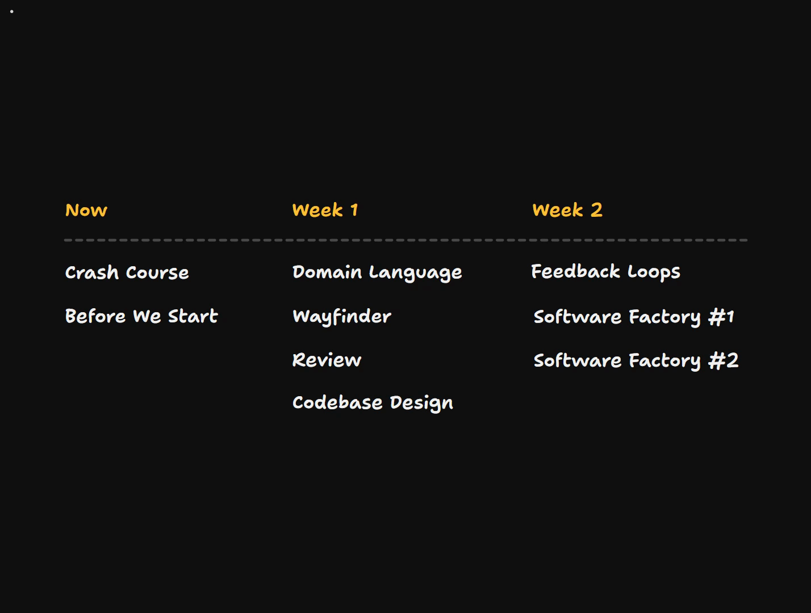

# Wrapping Up

<Prerequisites title="Crash Course Prerequisites">
  <Prerequisite href="https://www.aihero.dev/workshops/ai-coding-crash-course/where-we-re-going-6167bf7e">
    The five-step system the whole cohort builds on.
  </Prerequisite>
  <Prerequisite href="https://www.aihero.dev/workshops/ai-coding-crash-course/models-harnesses-agents-environments-2b9a99a1">
    What an agent actually is: a model, a harness and an environment working together.
  </Prerequisite>
  <Prerequisite href="https://www.aihero.dev/workshops/ai-coding-crash-course/smart-zone-dumb-zone-d4b92bd0">
    Why an agent gets worse as its context fills, the reason behind nearly every workflow decision.
  </Prerequisite>
  <Prerequisite href="https://www.aihero.dev/workshops/ai-coding-crash-course/enforcing-your-coding-standards-f1656d67">
    The layers of review, and why the chain still ends with a human deciding whether to merge.
  </Prerequisite>
  <Prerequisite href="https://www.aihero.dev/workshops/ai-coding-crash-course/where-you-go-from-here-4c6bb9b1">
    Where AFK agents, prototyping and sandboxes fit beyond the five-step system.
  </Prerequisite>
</Prerequisites>

We have arrived at the end of the course. These cohorts are glorious fun for me. I absolutely love interacting with engineers, figuring out what people want to learn and trying to phrase things so that it fits in people's heads.

You have lifetime access to all the material we've covered, so you can keep dipping in and out of it as you continue with your journey.

The community we've established in this cohort is not going away. You can continue to ask questions and continue to work together on the [AI Hero Discord](https://www.aihero.dev/discord).

## How Each Section Feeds the Software Factory

Here is how every section of the course contributes to making our [software factory](https://www.aihero.dev/ai-coding-dictionary/software-factory) what it is.

### Crash course

The fundamental concepts from the crash course are probably still paying off, the further we get into the more advanced material.

Understanding and working with the [agent](https://www.aihero.dev/ai-coding-dictionary/agent), with a [human in the loop](https://www.aihero.dev/ai-coding-dictionary/human-in-the-loop) and you actually in touch with the agent, is essential. It's how you get the most out of the agent and build trust.

### Domain language

The work we did on domain language, making sure we're aligned with the agent, follows all the way through everything we do.

The investment in a glossary and a shared language pays off in every other phase:

- **Review**
- **Codebase design**, building codebases that match the domain language
- **Wayfinder**, with better planning
- **The software factory**, with clearer communication between humans and agents

### Wayfinder

I've put Wayfinder in the brakes section, but it's really more of an accelerator. It's a way of pushing more work through your software factory.

In other words, it's the efficient planning solution I spent about half a year looking for before I finally landed on it.

### Review

The review section might be the most consequential in the course. Everyone I talk to at conferences and meetups is talking about [human review](https://www.aihero.dev/ai-coding-dictionary/human-review): what are we going to do about it? I think the review section has an answer for that.

### Codebase design and feedback loops

Codebase design links so cleanly into feedback loops that I struggled to pull them apart and decide which order to teach them in. The better designed your codebase, the more possible it becomes to develop good [automated checks](https://www.aihero.dev/ai-coding-dictionary/automated-check).

Feedback loops are also about verification, which is another level of raising the trust in your agent.

### Software factory

In the software factory sections, I wanted to give you a concrete sense of what it feels like to have your own software factory. You can ignore it, let it go off and do its own thing, and it calls you when it needs to.

I didn't want to stop there, though. I wanted you to develop ideas about your own infrastructure.

Hopefully by now you have a strong idea of how you're going to integrate this into your company. If you don't, that is what the [Discord](https://www.aihero.dev/discord) is for.

## Goodbye

It's hard to say goodbye. You've seen an awful lot of my face over the last couple of weeks, and I'm grateful to you for tuning in, for coming to the cohort, and for spending your hard-earned money, or your company's, to attend.

I don't take that for granted. If there's anything I can do in future to help you out, please ping me on the [Discord](https://www.aihero.dev/discord) and I will do my best.

Thank you so much for coming. Good luck navigating this complex, weird AI age we're living in. Hopefully, like me, you can find the fun.

Good luck, and I'll see you in the next one.
